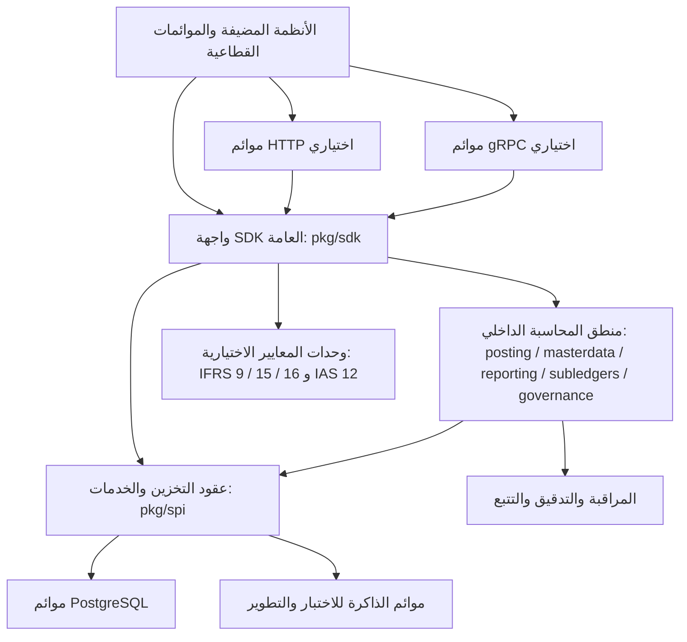

# وثيقة بدء مشروع Accounting Engine (PID)

> **حالة الوثيقة:** مسودة أولية مبنية على مراجعة النسخة البرمجية `engine9_1.zip` ووثيقة هوية ونطاق ومعمارية المشروع `project_specification_and_architecture.md` الإصدار 1.0.0 بتاريخ 18 نوفمبر 2026، وبالاسترشاد بدليل إدارة المشاريع البريطاني BIS الصادر في نوفمبر 2010. لا تصبح هذه الوثيقة خط أساس معتمداً إلا بعد مراجعتها واعتمادها من المالك المسؤول الأول (SRO) ومجلس المشروع.

## ضبط الوثيقة

| العنصر | القيمة |
| --- | --- |
| اسم المشروع | Accounting Engine |
| رمز المشروع | AE-PID-001 |
| مالك المشروع / SRO | لم يحدد بعد — يتطلب تعييناً رسمياً |
| الراعي والجهة الممولة | لم يحددا بعد |
| مدير المشروع | لم يعين بعد |
| مالك المنتج / المستخدم الرئيسي | لم يحدد بعد |
| قائد الهندسة | لم يعين رسمياً |
| الإصدار البرمجي محل المراجعة | الأرشيف `engine9_1.zip`؛ تذكر ملاحظات الإصدار `v0.2.0` |
| خط الأساس الوظيفي والمعماري | `project_specification_and_architecture.md` v1.0.0 |
| منهجية إدارة المشروع | دورة حياة BIS ذات المراحل الخمس، مع تكييف حوكمة PRINCE2 بحسب حجم المشروع |
| تاريخ الوثيقة | 18 نوفمبر 2026 |
| حالة الاعتماد | غير معتمدة — مسودة |

### سجل التعديلات

| الإصدار | التاريخ | التغيير | الحالة |
|---|---|---|---|
| 0.1.0 | 2026-11-18 | إعداد أول PID بالاستناد إلى وثيقة المشروع ومراجعة الأرشيف البرمجي | للمراجعة |

---

# 1. الملخص التنفيذي (Executive Summary)

Accounting Engine هو محرك محاسبي مالي عام ومحايد تجاه القطاعات، مكتوب بلغة Go، صُمم ليعمل بوصفه مكتبة قابلة للتضمين (Embedded Go Library / SDK)، أو نواة خلفية يمكن تغليفها بخدمة مستقلة عبر HTTP وgRPC عند الحاجة. ليس النظام ERP، ولا يدير دورة البيع أو الشراء أو المخزون أو العمليات التشغيلية للقطاعات، ولا يقدم واجهات رسومية.

تتمثل مهمة المشروع في توفير نواة محاسبية موثوقة تستقبل قيداً محاسبياً أو حدثاً اقتصادياً مجرداً من النظام المضيف، وتتحقق من سلامته، وتنفذ أثره المالي وفق القيد المزدوج، وتضمن ذرية الترحيل وعدم تكراره، وتحافظ على أثر تدقيق قابل للتحقق، ثم تتيح قراءة الأرصدة والتقارير وإجراءات الإقفال والمطابقة.

تتضمن النسخة البرمجية التي تمت مراجعتها مكونات مهمة من النواة، وواجهات SDK/API/SPI عامة، وموائمات تخزين للذاكرة وPostgreSQL، ووحدات معيارية IFRS/IAS، واختبارات كثيرة، وخدمة HTTP/gRPC. إلا أن وجود الشيفرة أو الاختبارات لا يثبت وحده نجاح التنفيذ في بيئة تشغيل فعلية. كما كشفت المراجعة عن فجوات توثيقية ومعمارية واختبارات قبول لم تحسم بعد؛ لذلك يصنف هذا PID حالة المشروع على أنها **تنفيذ متقدم في الشيفرة مع وجود بنود تحتاج إلى استكمال أو تحقق مستقل قبل اعتماد الجاهزية الإنتاجية**.

**القرار المطلوب من مجلس المشروع:** اعتماد تعريف المحرك ونطاقه وحدوده، تعيين المالكين والمسؤولين، حسم حدود المصادقة والتفويض، اعتماد خطة معالجة الفجوات، وتحديد ميزانية وجدول زمني واقعيين بعد تقدير الموارد.

# 2. المبررات ودراسة الجدوى (Business Case)

## 2.1 المشكلة أو الحاجة

تحتاج الأنظمة التجارية والقطاعية المختلفة إلى إثبات آثارها المالية وفق قواعد موحدة، من دون نقل منطق الحسابات والقيود والتقارير إلى كل نظام على حدة. كما أن اختلاف التطبيقات المضيفة لا ينبغي أن يؤدي إلى اختلاف قواعد القيد المزدوج أو سلامة الأرصدة أو دورة حياة الفترات أو سجل التدقيق.

يستهدف المشروع معالجة هذه الحاجة عبر نواة مشتركة، مع ترك تفاصيل المعاملة التجارية للنظام المضيف، وتوحيد الواجهة المالية التي يتواصل بها المضيف مع المحرك.

## 2.2 القيمة المتوقعة

1. إعادة استخدام نواة محاسبية واحدة عبر تطبيقات وقطاعات متعددة.
2. تقليل تكرار منطق المحاسبة في الأنظمة المضيفة، وتوحيد قواعد الترحيل والعكس والإقفال.
3. رفع موثوقية القيود من خلال التوازن الدقيق، والتخزين الذري، ومنع التكرار، والعزل بين الشركات.
4. تسهيل استبدال قاعدة البيانات أو نمط النشر عبر عقود SDK وSPI.
5. توفير دفتر أستاذ وتقارير وأدلة تدقيق قابلة للتتبع، مع وحدات معيارية اختيارية.

## 2.3 الخيارات التي ينبغي أن يعتمدها مجلس المشروع

| الخيار | الوصف | التقييم الأولي |
| --- | --- | --- |
| عدم تنفيذ المشروع | إبقاء منطق المحاسبة موزعاً داخل الأنظمة المضيفة | لا يحقق هدف إعادة الاستخدام وتوحيد الضوابط |
| بناء محرك محاسبي مشترك | تطوير نواة محايدة مع SDK وSPI وموائمات اختيارية | الخيار المتوافق مع وثيقة هوية المشروع |
| شراء/استخدام نظام ERP شامل | اعتماد نظام تجاري شامل بدلاً من محرك مجرد | لا يطابق حدود المشروع؛ لأنه يضم عمليات وواجهات خارج النطاق |

لا تتوفر في المدخلات الحالية أرقام موثقة للتكلفة الرأسمالية والتشغيلية، أو الإيرادات، أو الوفر المالي، أو حجم السوق، أو تكلفة البدائل. لذلك فإن الجدوى الاقتصادية وقرار التمويل النهائي **غير مكتملين**، ويجب استكمالهما قبل اعتماد ميزانية التنفيذ.

# 3. هوية المشروع وأهدافه (Project Identity & Objectives)

## 3.1 الهوية المعتمدة

- **المنتج:** نواة محاسبية مالية مجردة (Pure Financial Accounting Engine).
- **لغة التنفيذ:** Go؛ يحدد `go.mod` الإصدار `go 1.26.0` و`toolchain go1.26.3`.
- **النمط المعماري:** Hexagonal / Ports & Adapters، مع فصل العقود العامة عن التنفيذ الداخلي.
- **نمط الاستخدام الأساسي:** مكتبة مضمّنة عبر `pkg/sdk`.
- **نمط النشر الاختياري:** خدمة مستقلة HTTP/gRPC عبر محولات النقل.
- **التخزين المرجعي:** PostgreSQL؛ وموائم الذاكرة للتطوير والاختبارات فقط.
- **الحياد القطاعي:** لا توجد قواعد تشغيلية خاصة بالتجزئة أو الزراعة أو الصناعة أو الصحة داخل النواة.

## 3.2 الأهداف القابلة للقياس (SMART Objectives)

| المعرف | الهدف | معيار القبول |
| --- | --- | --- |
| OBJ-01 | توفير واجهة عامة مستقرة لاستخدام المحرك | نجاح بناء واختبار مستهلك خارجي لا يستورد أي حزمة `internal/*`، واستخدام `pkg/sdk` و`pkg/api` و`pkg/spi` فقط |
| OBJ-02 | ضمان القيد المزدوج | رفض أي قيد غير متوازن قبل الترحيل، وتغطية ذلك باختبارات حدودية واختبارات تكامل |
| OBJ-03 | ضمان ذرية الترحيل | إثبات أن فشل أي خطوة داخل وحدة العمل يلغي القيد والأرصدة والآثار المرتبطة به بالكامل |
| OBJ-04 | حماية القيود المرحلة | منع تعديل أو حذف القيد المرحل، وإجراء التصحيح بقيد عكسي مرتبط بالأصل |
| OBJ-05 | منع تكرار المعاملات | إثبات أن إعادة إرسال الطلب بالمفتاح والحمولة نفسيهما لا ينتج عنها أثر مالي مكرر، وأن تعارض الحمولة يعاد كخطأ صريح |
| OBJ-06 | ضمان العزل بين الشركات | اجتياز اختبارات RLS والعزل على PostgreSQL باستخدام دور غير متجاوز للسياسات |
| OBJ-07 | إدارة البيانات والفترات | إدارة شجرة الحسابات والعملات والسنوات والفترات، ومنع الترحيل على الحسابات التجميعية أو الفترات المغلقة |
| OBJ-08 | دعم الدفاتر الفرعية | توفير AR/AP والأصول الثابتة والخزينة، مع تقارير مطابقة لحسابات المراقبة |
| OBJ-09 | توفير التقارير الأساسية | توليد ميزان المراجعة وقائمة المركز المالي وقائمة الدخل، مع قدرات التدفق النقدي والتقارير الإضافية حسب نطاق الاعتماد |
| OBJ-10 | تحقيق متطلبات الجودة | تغطية آلية لا تقل عن 80% وفق وثيقة المشروع، مع اجتياز اختبارات الوحدة والتكامل والعقود والتزامن والأمان |
| OBJ-11 | تحقيق هدف الأداء | ألا يتجاوز زمن ترحيل القيد العادي 50ms عند P95 تحت ملف حمل تشغيلي يتم تعريفه واعتماده مسبقاً |
| OBJ-12 | دعم الاستقلالية التشغيلية | نجاح البناء والتشغيل في نمط المكتبة، ونجاح اختبار الخدمة المستقلة كخيار منفصل، دون فرض طبقة النقل على مستخدم المكتبة |

> **ملاحظة قياس:** القيم 80% و50ms هي أهداف واردة في وثيقة هوية المشروع، وليست نتائج قياس حالية. يجب إعداد بروتوكول قياس يحدد مواصفات الأجهزة، وحجم البيانات، والتزامن، وعدد العينات، والبيئة قبل إعلان تحققها.

# 4. نطاق المشروع وحدوده (Project Scope)

## 4.1 النطاق الحتمي — مطلوب في النواة (Core Required)

1. إدارة شجرة الحسابات وتصنيف الحسابات وطبيعتها، والتحقق من صلاحية الحساب للترحيل.
2. التحقق من بنية القيد وصحته الرياضية، مع استخدام الحسابات العشرية الدقيقة وعدم الاعتماد على الأرقام العائمة للمبالغ.
3. دورة حياة القيد من المسودة والتحقق والاعتماد إلى الترحيل، مع الترقيم والأثر المالي.
4. الترحيل الذري وتحديث دفتر الأستاذ العام والأرصدة والآثار الفرعية وسجل التدقيق وفق وحدة عمل واحدة.
5. عدم قابلية القيود المرحلة للتعديل أو الحذف، واستخدام القيود العكسية للتصحيح.
6. إدارة العملات وأسعار الصرف والتواريخ المالية والفترات المفتوحة والمغلقة.
7. إدارة دفاتر المدينين والدائنين والخزينة والأصول الثابتة، مع حسابات المراقبة والمطابقة.
8. استقبال الأحداث المحاسبية المجردة من النظام المضيف مع مفاتيح منع التكرار.
9. توفير عقود تخزين عامة مستقلة عن تفاصيل قاعدة البيانات، بما في ذلك وحدة العمل والمعاملات.
10. سجل تدقيق قابل للتحقق مع هوية الفاعل الموثوقة والوقت والسبب والمصدر والمراجع الخارجية المتاحة.

## 4.2 القدرات الاختيارية أو المعيارية (Optional / Modular)

- ميزان المراجعة، قائمة المركز المالي، قائمة الدخل، التدفقات النقدية، الأستاذ العام، قائمة التغيرات في حقوق الملكية، النسب والإيضاحات.
- المطابقة والتسويات بين مصادر مالية محددة، مع تعريف مصادر المقارنة ومفاتيح المطابقة والمهلة المسموح بها ومعالجة الاستثناءات.
- وحدات IFRS 15 وIFRS 16 وIFRS 9 وIAS 12، على أن تبقى كل وحدة محددة النطاق، ومعلنة المتطلبات غير المدعومة، ولا تدعي الامتثال الكامل دون مراجعة مهنية مستقلة.
- واجهات النقل HTTP REST وgRPC كموائمات اختيارية لا كشرط لاستخدام النواة.
- تشغيل المهام الدورية والأتمتة المالية عندما تكون مدخلاتها واعتماداتها ومخرجاتها محددة.

## 4.3 خارج النطاق (Strictly Out of Scope)

1. إدارة أوامر البيع والشراء والفواتير التجارية والتسعير والخصومات والشحن والمخزون الفعلي وخطوط الإنتاج والعمليات القطاعية.
2. واجهات المستخدم الرسومية، وتطبيقات الويب والموبايل، ولوحات التحكم.
3. إدارة المستخدمين وكلمات المرور والجلسات ومزود الهوية المركزي وإصدار رموز الدخول.
4. الاتصال المباشر بالبنوك أو شبكات SWIFT أو أجهزة نقاط البيع أو بوابات الدفع؛ يستقبل المحرك الأثر المالي بعد نجاح العملية في النظام الخارجي.
5. تخزين صور المستندات أو ملفات PDF أو المرفقات الثنائية؛ يحتفظ المحرك بمعرف أو مرجع خارجي عند الحاجة.
6. تعديل الأرصدة مباشرة أو توفير `SetBalance` أو بديل يخالف القيد المزدوج.
7. إقفال الفترات أو السنوات تلقائياً من دون طلب صريح واعتماد من المسؤول المخول.
8. فرض PostgreSQL أو HTTP أو gRPC على من يدمج المحرك كمكتبة.

## 4.4 حدود المسؤولية بين النظام المضيف والمحرك

| المجال | مسؤولية النظام المضيف | مسؤولية المحرك |
| --- | --- | --- |
| دورة المعاملة التجارية | إدارة البيع والشراء والشحن والمخزون والخدمة | لا يدير دورة المعاملة؛ يستقبل أثرها المالي المعياري |
| تحويل القطاع إلى حدث مالي | تطوير Industry Adapter وتحديد الحسابات والمراجع التجارية | توفير نموذج الحدث وقواعد التحقق والتوجيه المحاسبي المتفق عليها |
| الهوية وتسجيل الدخول | إدارة المستخدمين وكلمات المرور وMFA وإصدار الرموز | عدم إنشاء هوية أو إصدار رموز؛ قبول سياق موثوق يمرره الحد الخارجي عند الحاجة، والتحقق من اتساق نطاق الشركة وتسجيل الفاعل |
| السياسة التشغيلية | تحديد من يحق له بدء العملية في النظام المضيف | فرض ضوابط المحاسبة والاعتماد وسلامة العملية ضمن الحدود المعتمدة |
| البيانات المالية | تمرير الحدث والمراجع والبيانات المصدرية | امتلاك منطق الترحيل والأرصدة وسجل التدقيق والتقارير |
| البنك والدفع | الاتصال بالبنوك ومزودي الدفع والتحقق من النتيجة | تسجيل الأثر المحاسبي بعد تحقق النظام المضيف |

**حد أمني ملزم:** لا يعني إخراج IAM من المحرك إلغاء العزل بين الشركات أو إلغاء سجل التدقيق أو ضوابط الموافقة المحاسبية. هذه ضوابط مالية داخل النطاق. أما التحقق من كلمات المرور/الرموز أو إدارة الأدوار المركزية فيبقى خارج المحرك. يجب اعتماد التصميم النهائي لسياق `principal/tenant/company` قبل حذف أي مكون أمني.

# 5. الوضع الحالي وخط الأساس البرمجي (Current Baseline)

## 5.1 ملخص الأرشيف محل المراجعة

| المؤشر | نتيجة فحص الأرشيف |
| --- | ---: |
| ملفات المشروع الفعلية | 615 |
| ملفات Go | 518 |
| ملفات الاختبار `*_test.go` | 213 |
| ملفات ترحيل SQL | 64 ملفاً: 32 ترحيلاً صاعداً و32 عكسياً |
| أدوات التشغيل والنشر | Dockerfile وdocker-compose وCI وMakefile وسكربتات فحص |
| المستودع المعلن | `github.com/osmai4603-collab/accounting_engine` |

الأرقام أعلاه وصفية للأرشيف فقط، ولا تدل على نجاح البناء أو الاختبار.

## 5.2 المعمارية الموجودة في الشيفرة

### المكونات الموجودة

| المسار | المسؤولية كما تظهر في الشيفرة |
| --- | --- |
| `pkg/sdk` | بناء المحرك، تجميع الخدمات العامة، استقبال الأحداث، وتكوين القدرات الاختيارية |
| `pkg/api/v1` | عقود بيانات ledger/events/reporting/subledger/types |
| `pkg/spi` | عقود التطبيق والأحداث والبيانات الأساسية والمعايير والتخزين والدفاتر الفرعية |
| `internal/posting` | التحقق من القيود، دورة الترحيل، العكس، القيود الدورية/التعديلية، الأبعاد والضوابط |
| `internal/masterdata` | الشركات والحسابات والدفاتر والتقاويم والسنوات والفترات والأبعاد |
| `internal/subledgers` | AR/AP والأصول الثابتة والخزينة والمطابقة وحركات البنك والربط بالأحداث |
| `internal/reporting` | ميزان المراجعة والقوائم المالية والتدفقات النقدية والإيضاحات والإقفال والتتبع |
| `internal/governance` | الموافقات وفصل المهام وسجل التدقيق وسلسلة التجزئة والتصدير وWORM |
| `internal/valuation` و`internal/types` | الأموال والعملات وأسعار الصرف والتحويل وإعادة التقييم |
| `internal/consolidation` | توحيد القوائم ومعلومات الملكية والإلغاءات وفروق ترجمة العملات |
| `modules/*` | موائمات وحدات IFRS/IAS التي تكشف قدراتها ومتطلباتها المحدودة |
| `internal/adapters/postgres` | تنفيذ تخزين PostgreSQL والترحيلات وسياسات العزل والتكامل |
| `storage/postgres` و`storage/memory` | واجهات الموائمات العامة التي تعرض `Ports()` للمستهلك |
| `cmd/accounting-service` | خدمة مستقلة تتضمن HTTP وgRPC وhealth endpoints وmetrics وrate limiting |
| `cmd/agy` | أداة تشغيل/ترحيل/أتمتة تستعمل `internal/legacyengine` مباشرة |

## 5.3 تقييم المتطلبات الوظيفية FR

الحالات التالية تقيس **وجود التنفيذ في الشيفرة ومستوى الدليل المتاح**. لا تعني عبارة «موجود في الشيفرة» أن الاختبارات نجحت في بيئة المراجعة أو أن الوظيفة معتمدة محاسبياً.

| المتطلب | دليل الشيفرة والاختبار الموجود | التقييم الأولي | الإجراء المطلوب قبل الاعتماد |
| --- | --- | --- | --- |
| FR-01 إدارة شجرة الحسابات | `internal/masterdata/`، `pkg/spi/masterdata/`، اختبارات masterdata وPostgreSQL | موجود في الشيفرة؛ تحقق تشغيله معلق | إعادة اختبار التسجيل والتعديل والتدرج ومنع دورات الحسابات والحسابات غير القابلة للترحيل |
| FR-02 التحقق من صحة القيد | `internal/posting/entry_validation.go` و`entry_invariants_test.go` و`engine_test.go` | موجود في الشيفرة؛ تحقق التنفيذ معلق | اختبار حدود المبالغ والعملات والسطور والحسابات والرفض قبل بدء المعاملة |
| FR-03 الترحيل الذري | `pkg/spi/storage/transaction.go`، `internal/adapters/postgres/transactions.go`، `test/atomic/`، اختبارات الذرية في PostgreSQL | موجود مع أدلة اختبار مصدرية؛ غير معاد التنفيذ هنا | تشغيل fault-injection واختبارات فشل كل خطوة، وإثبات all-or-nothing للقيد والأرصدة والتدقيق |
| FR-04 حرمة القيود المرحلة | ترحيلات SQL، `immutability_test.go`، `audit_immutability_test.go` | موجود في الشيفرة؛ يلزم مراجعة شمول الجداول والأدوار | فحص triggers وقيود الصلاحيات ومحاولات UPDATE/DELETE لكل جداول الأثر المالي |
| FR-05 القيود العكسية | `internal/posting/reversal.go` و`reversal_lifecycle_test.go` و`p4_04_reversal_test.go` | موجود في الشيفرة؛ التحقق التشغيلي معلق | اختبار الربط بالقيد الأصلي، العكس الجزئي/الكلي، منع تكرار العكس وسلامة الأرصدة |
| FR-06 الفترات المالية | `internal/masterdata/fiscal_calendar.go`، حالات الفترات، اختبارات إقفال وإعادة فتح الفترات | موجود في الشيفرة؛ التحقق التشغيلي معلق | التحقق من كل أنواع الفترات والتواريخ الحدية ومسارات إعادة الفتح ذات الاعتماد والتدقيق |
| FR-07 إقفال نهاية السنة | `internal/sdkapplication/year_end_closing.go`، `pkg/sdk/p9_workflows_test.go`، اختبارات PostgreSQL للسنة المالية | موجود في الشيفرة؛ يتطلب قبولاً محاسبياً | مطابقة قيود الإقفال والأرصدة الافتتاحية وحساب الأرباح المبقاة وإعادة التشغيل بعد الفشل |
| FR-08 الدفاتر الفرعية | `internal/subledgers/` و`pkg/spi/subledger/stores.go` واختبارات AR/AP والأصول والخزينة | موجود جزئياً/واسع؛ تغطية التكامل تحتاج تحققاً | اختبار مطابقة AR/AP والأصول والخزينة مع حسابات المراقبة، وفحص تكامل كشوف البنك من parser حتى التسوية |
| FR-09 استيعاب الأحداث ومنع التكرار | `pkg/sdk/event_ingestion.go`، migrations الخاصة بـ public event idempotency، اختبارات idempotency/recovery | موجود في الشيفرة مع اختبارات مصدرية؛ تحقق تشغيله معلق | تشغيل إعادة الإرسال والتعارض والتزامن والانقطاع بين commit وحفظ نتيجة الحدث |
| FR-10 التقارير المالية | `internal/reporting/` وواجهة `ReportingService` في `pkg/sdk/engine.go` | موجود في الشيفرة؛ اعتماد البيانات والمحاسبة معلق | تشغيل golden scenarios ومطابقة ميزان المراجعة مع القوائم وتواريخ القطع والعملات والتصنيف |
| FR-11 مسار التدقيق | `internal/governance/audit_chain.go` و`audit_export.go` و`worm_local.go` و`worm_s3.go` | موجود جزئياً/متقدم؛ اكتمال حقول المصدر والفاعل يحتاج تحققاً | اختبار سلسلة التجزئة بعد العبث، وصلاحيات WORM، وتغطية actor/reason/reference/timestamp لكل مسار ترحيل |
| FR-12 العملات المتعددة | `internal/types/currency.go` و`money.go` و`internal/valuation/` واختبارات IAS 21 | موجود في الشيفرة؛ التكامل الشامل مع التقارير والدفاتر يحتاج تحققاً | اختبار عملة المعاملة والوظيفية وأسعار الصرف المؤرخة والتقريب وفروق الصرف وإعادة التقييم |

## 5.4 تقييم المتطلبات غير الوظيفية NFR

| المتطلب | المطلوب في وثيقة المشروع | الموجود حالياً | الفجوة/الإجراء |
| --- | --- | --- | --- |
| NFR-01 ACID | لا حفظ جزئي؛ معاملة all-or-nothing | وحدة عمل ومعاملات PostgreSQL واختبارات ذرية | إعادة تشغيل اختبارات الفشل والتكامل على PostgreSQL 18.x وتوثيق نتيجة CI |
| NFR-02 الأداء | ترحيل عادي لا يتجاوز 50ms عند P95 | مجلد `test/benchmark/` واختبارات أداء داخلية | لا يوجد في الأرشيف تقرير نتائج قابل للاعتماد يثبت P95 تحت حمل محدد؛ يجب إعداد benchmark protocol وتقرير baseline |
| NFR-03 التزامن | لا سباقات أو تعارض أرصدة | اختبارات concurrency/race/locking وCI race job | لم تنفذ في بيئة المراجعة؛ مطلوب تشغيل race suite واختبارات الضغط المتزامن |
| NFR-04 عزل الشركات | عدم قراءة/تعديل بيانات شركة أخرى | سياسات RLS وترحيلات و`rls_test.go` و`phase6_rls_penetration_test.go` | يلزم تشغيلها بدور DB غير مالك وغير متجاوز RLS، والتحقق من سياق tenant في كل طلب |
| NFR-05 المعمارية | فصل Domain عن SQL/Transport/Infrastructure | عقود عامة وفحوص purity وapplication layer | مسار الخدمة يستخدم `WithCoreStorage` القديم، و`cmd/agy` يستخدم legacyengine، وبعض وحدات المعايير تستورد داخليات؛ يلزم قرار معماري ومعالجة |
| NFR-06 جودة الاختبارات | تغطية لا تقل عن 80% | CI يفرض حالياً `COVERAGE_MIN=54.1`؛ `coverage.out` المرفق أقدم من عدة ملفات حالية | فجوة مؤكدة بين معيار المشروع والبوابة الآلية؛ رفع الحد تدريجياً بخطة، ثم بلوغ 80% وإرفاق تقرير حديث |
| NFR-07 الاستقلالية | استبدال موائم التخزين دون تعديل النواة | `pkg/spi/storage` وموائما memory/postgres واختبارات external consumer | دليل جيد في المصدر؛ إعادة تنفيذ اختبارات المستهلك الخارجي مطلوبة |
| NFR-08 سجل التدقيق | سجلات append-only قابلة للإثبات | سلسلة hash وتصدير WORM محلي/S3 واختبارات | يلزم اختبار صلاحيات التخزين الفعلية وإجراءات المفاتيح والاحتفاظ والاسترداد |

## 5.5 فجوات التوثيق والتوافق التي ظهرت في الأرشيف

1. لا يحتوي الأرشيف على مجلد `docs/`، بينما تحيل إليه `CHANGELOG.md` و`RELEASE_NOTES.md` في موضوع دليل SDK وسياسة التوافق وسياسة الترحيل وتقرير الجاهزية ودليل التعافي من الكوارث.
2. السكربت `scripts/check_api_compat.sh` يتوقع وجود `docs/api/v1.snapshot`، وهذا الملف غير موجود في الأرشيف. وبناءً على منطق السكربت، ستفشل بوابة توافق API عند تشغيلها ما لم ينشأ خط الأساس ويعتمد.
3. `CHANGELOG.md` يسجل `v0.1.0` ويذكر 11 ترحيلاً، بينما `RELEASE_NOTES.md` يذكر `v0.2.0`، وتحتوي النسخة الحالية على 32 migration صاعداً و32 ملف rollback.
4. `RELEASE_NOTES.md` يعلن جاهزية 100% لـ Embedded SDK وStandalone Service، لكن تقارير الجاهزية والـ runbooks التي يستند إليها غير موجودة في الأرشيف المرسل؛ لذلك لا يمكن اعتماد النسبة أو ادعاء GO من هذه النسخة وحدها.
5. يذكر `internal/adapters/postgres/driver.go` مسار `storage/postgres/migrations` في تعليق الترحيل، بينما ملفات الترحيل الموجودة فعلياً داخل `internal/adapters/postgres/migrations`؛ يجب توحيد الإشارة التوثيقية.
6. يذكر `internal/reconciliation/doc.go` أن الحزمة تمثل عقد بيانات لا محرك مقارنة؛ بينما `capability.go` يحتوي فعلياً على `CompareSources`. توجد قدرة مقارنة عامة، لكن لم يظهر في البحث ربط إنتاجي واضح بين محلل كشوف البنك ومصادر الأستاذ العام وواجهة SDK؛ يلزم اختبار سلسلة التكامل قبل ادعاء اكتمال التسوية البنكية.
7. وثيقة المشروع تستهدف 80% تغطية، لكن بوابة CI الحالية تقبل 54.1%. هذه ليست مجرد ملاحظة توثيقية، بل اختلاف بين معيار القبول وخط الإنتاج.
8. يوجد تقرير `test/contract_parity/parity_report.md` يذكر 22 نتيجة ناجحة و0 فاشلة و0 متخطاة؛ ولكنه تقرير محفوظ داخل الأرشيف، وليس إعادة تنفيذ مستقلة لهذه المراجعة.

## 5.6 وحدات المعايير — الحدود المعلنة

تصف ملفات `modules/*/module.go` قدرات معيارية محدودة وتحتوي على قائمة متطلبات غير منفذة. لا يجوز تسويقها أو اعتمادها على أنها امتثال كامل للمعيار.

| الوحدة | ما يظهر في الوصف البرمجي | أمثلة للحدود المعلنة |
| --- | --- | --- |
| IFRS 15 | مدخلات الخطوات الخمس، تخصيص السعر، جداول الاعتراف، المقابل المتغير، التمويل، تعديلات العقد والإفصاحات | تقييم principal-vs-agent والتراخيص المعقدة غير منفذين بحسب descriptor |
| IFRS 16 | قياس المستأجر والمؤجر، جداول الإهلاك والفائدة، بعض الإعفاءات والإفصاحات | sale-and-leaseback وsubleases وDisclosureProvider الدائم غير منفذة بحسب descriptor |
| IFRS 9 | قياس لاحق لفئات الأصول المالية، ECL مبسط وعام مرجح بالسيناريوهات، وقيود الترحيل | derecognition والتعديل والشطب الكامل، hedge accounting، والتحقق المهني المستقل غير منفذة بحسب descriptor |
| IAS 12 | فروق مؤقتة وقياس ضريبة حالية تقديرية وIFRIC 23 وتسوية معدل الضريبة | تحديد الضريبة الكاملة حسب التشريع، الإقرارات والملفات الضريبية، والعرض والإفصاح الكامل غير منفذة بحسب descriptor |

**شرط القبول:** يجب أن يحدد كل معيار إصدار المعيار والتعديلات وتاريخ السريان والولاية القضائية والافتراضات ومصادر البيانات. لا تظهر هذه القيم محددة في descriptors الحالية؛ بل يطلب من النظام المضيف ضبطها.

# 6. المخرجات الرئيسية (Project Deliverables)

| الرمز | المخرج | الوصف | شرط القبول |
| --- | --- | --- | --- |
| D-01 | خط أساس المتطلبات والمعمارية | وثيقة الهوية والنطاق والمعمارية وقواعد العمل ومصفوفة التتبع | اعتماد نسخة متوافقة مع الشيفرة والقرارات الحالية |
| D-02 | SDK والعقود العامة | `pkg/sdk` و`pkg/api/v1` و`pkg/spi` | مستهلك خارجي يبني ويستخدم الوظائف العامة دون استيراد internal |
| D-03 | نواة دفتر الأستاذ | القيود، التحقق، الترحيل، العكس، التسلسل والأرصدة | اجتياز اختبارات التوازن والذرية والحرمة والعكس والتزامن |
| D-04 | البيانات المالية الرئيسية | الحسابات والعملات والشركات والسنوات والفترات والأبعاد | اجتياز اختبارات التدرج والصلاحيات والفترات والقيود على الحسابات |
| D-05 | الدفاتر الفرعية | AR/AP والأصول الثابتة والخزينة والمطابقة | تطابق الأرصدة مع حسابات المراقبة واجتياز حالات التسوية والاستثناءات |
| D-06 | التقارير والقوائم | TB وBS وP&L وCash Flow وGL والإيضاحات حسب النطاق | مطابقة سيناريوهات ذهبية مع سجلات الأستاذ وتوثيق فروق العملات |
| D-07 | الحوكمة والتدقيق | الموافقات وفصل المهام والتدقيق وسلسلة التجزئة وWORM | إثبات عدم العبث وصحة دورة الاعتماد والتصدير |
| D-08 | وحدات المعايير الاختيارية | IFRS 15/16/9 وIAS 12 | descriptor دقيق وحدود واضحة واختبارات معتمدة ومراجعة محاسبية مستقلة |
| D-09 | موائمات التخزين والترحيلات | PostgreSQL وMemory وعقود Unit of Work | parity tests وترقية/rollback/backup/restore واختبار RLS |
| D-10 | موائمات النقل والتشغيل | HTTP/gRPC والخدمة المستقلة والتهيئة والمقاييس | API contracts موثقة، readiness/liveness، graceful shutdown، وحدود تشغيل واضحة |
| D-11 | حزمة الجودة والإصدار | CI، API baseline، التغطية، الأمن، SBOM، اختبارات race والتكامل | كل بوابات الإصدار ناجحة على إصدار Go المعلن وبيئة PostgreSQL مدعومة |
| D-12 | حزمة التشغيل والاستمرارية | runbooks، النسخ الاحتياطي والاستعادة، الرصد، إدارة الأعطال | تمرين DR موثق وموقع، مع RPO/RTO متفق عليهما |

# 7. خطة التنفيذ وتقسيم العمل (Work Breakdown & Stages)

تقسم الخطة إلى مراحل قابلة للرقابة. لا تضع هذه المسودة تواريخ أو مدد تنفيذ غير مدعومة بتقدير موارد معتمد.

| المرحلة | الهدف | حزم العمل الأساسية | بوابة الانتقال |
| --- | --- | --- | --- |
| S0 — بدء المشروع (Start-up) | تثبيت التكليف والنتائج والنطاق | اعتماد موجز المشروع، تعيين SRO ومدير المشروع، حصر أصحاب المصلحة والاعتمادات | موافقة مبدئية على الانتقال إلى التأسيس |
| S1 — التأسيس (Initiation) | اعتماد PID وخط الأساس | مراجعة المتطلبات، تحليل الفجوات، دراسة الجدوى، المخاطر، خطة الجودة، تقدير الموارد، وخطة الإصدار | اعتماد PID والميزانية والجدول وخطة المخاطر |
| S2 — تسليم النواة (Core Delivery) | ضمان الأساس المالي الحتمي | COA، القيود، التوازن، atomic posting، العكس، الفترات، idempotency، UoW، RLS | قبول سيناريوهات القيد المزدوج والذرية والحرمة والعزل |
| S3 — التسليم المالي الموسع (Financial Capabilities) | إكمال القدرات التشغيلية المالية | AR/AP، الأصول، الخزينة، المطابقة، العملات، التقارير، الإقفال السنوي | قبول مطابقة الدفاتر والتقارير والإقفال |
| S4 — الوحدات والواجهات (Modules & Adapters) | اعتماد الاختيارات الاختيارية | IFRS modules، event contracts، HTTP/gRPC، external consumers، توحيد مسار SDK/SPI | قبول كل وحدة ضمن نطاقها المعلن دون ادعاء امتثال غير مثبت |
| S5 — التحصين والإصدار (Hardening & Release) | إثبات الجاهزية للإنتاج | الأداء، التزامن، الأمن، API compatibility، الترحيلات، DR، التشغيل والمراقبة | جميع بوابات Go/No-Go ناجحة وتوقيع قبول مستقل |
| S6 — تحقيق المنافع (Benefits Realisation) | قياس القيمة الفعلية | قياس زمن الترحيل والتكلفة لكل معاملة، إعادة الاستخدام، الحوادث، والوفورات | مراجعات PIR وقرارات تحسين أو توسيع النطاق |

## 7.1 أولويات المعالجة من مراجعة النسخة الحالية

**الأولوية P0 — قبل إعلان خط أساس الإصدار:**

1. استعادة وإضافة الوثائق التي يحيل إليها المشروع، وبالأخص `docs/api/v1.snapshot` وسياسات التوافق والترحيلات والتشغيل والتعافي.
2. توحيد سجل الإصدارات: Changelog وRelease Notes ورقم الإصدار وأعداد migrations ونتائج الاختبارات.
3. حسم حدود المصادقة والتفويض: إزالة التحقق الداخلي من JWT/HMAC وإدارة الهوية من المحرك، ونقلها إلى النظام المضيف/البوابة؛ مع تحديد أقل سياق موثوق يحتاجه المحرك للعزل وتسجيل الفاعل.
4. وضع خطة للانتقال من `WithCoreStorage` إلى `WithStoragePorts` في `cmd/accounting-service`، وتحديد مصير `cmd/agy` و`internal/legacyengine` لتجنب وجود مساري تركيب متباعدين.
5. توفير بيئة Go 1.26.3 وPostgreSQL المدعومة وتنفيذ CI الكامل وتوثيق السجل الناتج.
6. مواءمة حد التغطية في CI مع هدف 80% عبر مراحل معلنة، وعدم اعتبار 54.1% هو معيار القبول النهائي.

**الأولوية P1 — قبل قبول القدرات المالية الموسعة:**

1. إثبات مطابقة AR/AP والأصول والخزينة مع حسابات المراقبة.
2. إثبات مسار كشوف البنك من parsing (CAMT.053/MT940) إلى المطابقة والاستثناء والتسوية المحاسبية.
3. إثبات التقارير الذهبية والتقارير متعددة العملات والإقفال السنوي على PostgreSQL.
4. قياس أداء P95 ومعدلات throughput مع سيناريوهات وحجم بيانات معلنين.
5. مراجعة استقلالية وحدات المعايير من حيث الاعتماد على SPI وعدم كشف internal types في العقود العامة.

**الأولوية P2 — قبل التوسع التجاري:**

1. إكمال التوثيق المهني ودليل SDK وعقود API وrunbooks.
2. توثيق توافق الإصدارات وسياسة deprecation والترحيلات.
3. مراجعة محاسبية/قانونية مستقلة لكل وحدة معيارية يراد تسويقها.
4. بناء أمثلة مرجعية لمستهلكين خارجيين وموائم قطاعية خارج المحرك؛ من دون إدخال منطق القطاع داخل النواة.

# 8. الحوكمة والأدوار والمسؤوليات (Project Governance)

## 8.1 هيكل الحوكمة المقترح

- **المالك المسؤول الأول (SRO):** يملك مبررات المشروع ومنافعه، ويرأس مجلس المشروع، ويقرر الاستمرار أو الإيقاف عند تغير الجدوى.
- **مجلس المشروع (Project Board):** يضم SRO، وممثل المستخدم/المالية، وممثل المورد/الهندسة. يعتمد PID وخطط المراحل والتغييرات الجوهرية.
- **مدير المشروع (Project Manager):** يدير الخطة والموارد والمخاطر والقضايا والتقارير اليومية ويرفع الاستثناءات.
- **ضمان المشروع (Project Assurance):** يراجع بصورة مستقلة الجودة والمحاسبة والأمن والمعمارية والجدوى.
- **قائد الهندسة:** مسؤول عن المعمارية وجودة الشيفرة والعقود العامة والبوابات التقنية.
- **المراجع المحاسبي:** مسؤول عن مطابقة القواعد المحاسبية والسيناريوهات الذهبية وحدود وحدات المعايير.
- **مسؤول التشغيل وقاعدة البيانات:** مسؤول عن PostgreSQL والترحيلات والنسخ الاحتياطي والاستعادة والرصد.

الأسماء والتكليفات الفعلية لكل دور **غير محددة في المدخلات الحالية** ويجب تسجيلها في محضر اعتماد PID.

## 8.2 مصفوفة المسؤولية الأولية

| النشاط | SRO / المجلس | مدير المشروع | الهندسة | المالية/المحاسبة | التشغيل | ضمان مستقل |
| --- | --- | --- | --- | --- | --- | --- |
| اعتماد الأهداف والنطاق والميزانية | A | R | C | C | C | C |
| خط الأساس المعماري والعقود | I | C | A/R | C | C | C |
| قواعد المحاسبة والقبول | I | C | C | A/R | I | C |
| خطة التنفيذ والتقارير | I | A/R | R | C | C | C |
| اختبارات الإصدار | I | C | R | R | R | A/C |
| قبول المرحلة والإصدار | A | R | C | C | C | C |
| تحقيق المنافع بعد التشغيل | A | R | C | R | R | C |

`R` منفذ، `A` مسؤول نهائي، `C` مستشار، `I` مطلع. يجب اعتماد المصفوفة وتعديلها وفق الهيكل الفعلي.

# 9. أصحاب المصلحة وخطة الاتصال (Stakeholders & Communication)

| صاحب المصلحة | المصلحة/التأثير | طريقة الإشراك | التكرار المقترح |
| --- | --- | --- | --- |
| مالك المشروع/الراعي | مرتفع/مرتفع | قرارات المرحلة وتقارير الاستثناء | عند كل بوابة وعند الاستثناء |
| الإدارة المالية والمحاسبون | مرتفع/مرتفع | مراجعة قواعد العمل والسيناريوهات الذهبية | أسبوعياً أثناء تسليم القدرات المالية |
| مهندسو الأنظمة والأنظمة المضيفة | مرتفع/مرتفع | مراجعة API/SPI وعقود الأحداث والتكامل | أسبوعياً |
| التشغيل وقاعدة البيانات والأمن | مرتفع/متوسط إلى مرتفع | مراجعة الترحيلات وRLS والتعافي والتشغيل | كل أسبوعين وعند الإصدار |
| المستخدمون/الجهات المستهلكة | مرتفع/متوسط | تجارب external consumer وUAT | في نهاية كل مرحلة |
| ضمان المشروع/المراجع المستقل | مرتفع/مرتفع | مراجعة الأدلة وسجلات الجودة والاعتماد | في كل بوابة قبول |

**تقارير التحكم:** تقرير تقدم دوري (Highlight Report) كل أسبوعين، ونقاط فحص أسبوعية للفرق. يرفع مدير المشروع تقرير استثناء فور توقع تجاوز أي تفاوت يعتمد لاحقاً من مجلس المشروع.

# 10. خطة الموارد والتقدير الزمني والمالي

لا تحتوي الملفات المتاحة على أسماء الفريق أو نسب التفرغ أو الميزانية أو العقود أو مواعيد التسليم. لذلك لا يجوز اختلاق تقدير مالي أو مدة نهائية.

## 10.1 الأدوار والقدرات المطلوبة

- مهندس Go/SDK ومعمارية تطبيق.
- مهندس محاسبة/دفتر أستاذ وقواعد مالية.
- مهندس PostgreSQL وترحيلات وRLS ومعاملات.
- مهندس جودة واختبارات تكامل وتزامن وأداء.
- مهندس تشغيل/DevOps وأمن تطبيقات.
- مراجع مالي متخصص بالمعايير عند اعتماد وحدات IFRS/IAS.
- ممثلو أنظمة مضيفة لتصميم عقود التكامل والموائمات القطاعية.

## 10.2 عناصر تقدير الميزانية

1. تكلفة التطوير والاختبار والمراجعة المحاسبية.
2. البنية التحتية وبيئات التطوير والاختبار والتشغيل.
3. خدمات النسخ الاحتياطي والتعافي والرصد والأمن.
4. التراخيص أو خدمات الأطراف الثالثة وأدوات التحليل.
5. التدريب والتوثيق والدعم والصيانة.
6. احتياطي المخاطر والتغييرات.

**قرار مطلوب:** إعداد تقدير bottom-up مبني على حزم العمل والموارد الفعلية، واعتماده قبل تحديد تاريخ إطلاق ملزم.

# 11. إدارة المخاطر (Risk Management)

التقييم التالي أولي مبني على فحص الأرشيف، ويعاد تقديره من مدير المشروع والضمان المستقل.

| المعرف | الخطر | الاحتمال | الأثر | الاستجابة/الإجراء | المالك المقترح |
| --- | --- | --- | --- | --- | --- |
| R-01 | إعلان جاهزية إنتاجية قبل إعادة تشغيل أدلة الاختبار والإصدار | مرتفع | مرتفع | منع GO قبل تشغيل CI الكامل وتوقيع تقرير قبول مستقل | مدير المشروع/ضمان الجودة |
| R-02 | غياب API snapshot والوثائق التي يعتمد عليها CI والإصدار | مرتفع | مرتفع | إعادة بناء docs baseline وتفعيل التحقق من وجود الملفات في CI | قائد الهندسة |
| R-03 | اختلاف هدف التغطية 80% عن بوابة CI البالغة 54.1% | مرتفع | مرتفع | خطة رفع متدرجة ومؤرخة حتى 80%، مع مؤشرات لكل حزمة | قائد الجودة |
| R-04 | بقاء JWT/HMAC والتحقق الأمني داخل الخدمة رغم أن IAM خارج نطاق المحرك | مرتفع | مرتفع | اعتماد عقد principal context من النظام المضيف ثم إزالة طبقة التحقق الداخلية وفق خطة تغيير | قائد المعمارية/الأمن |
| R-05 | استمرار مسار Legacy عبر `WithCoreStorage` و`internal/legacyengine` | متوسط | مرتفع | خطة توحيد حول `WithStoragePorts`، وتحديد إيقاف أو عزل الأوامر القديمة | قائد الهندسة |
| R-06 | استخدام وحدات IFRS المحدودة على أنها امتثال كامل | متوسط | مرتفع | إظهار حدود كل Module، وتحديد الإصدار والولاية القضائية، ومراجعة مهنية مستقلة | المراجع المحاسبي |
| R-07 | اختلافات أو فشل في الترحيلات/استعادة قاعدة البيانات | متوسط | مرتفع | تشغيل migration lifecycle وupgrade/rollback وDR على بيئة مماثلة للإنتاج | مسؤول قاعدة البيانات |
| R-08 | عدم اكتمال ربط كشوف البنك بمطابقة الأستاذ والتسوية | متوسط | متوسط/مرتفع | بناء مصدر مصرفي ومصدر GL متوافقين واختبار حالات unmatched/variance/FX | قائد الدفاتر الفرعية |
| R-09 | عدم إثبات هدف P95=50ms | متوسط | مرتفع | تعريف حمل مرجعي وقياس متكرر على أجهزة وبيانات معلنة | قائد الأداء |
| R-10 | الاعتماد على موائم الذاكرة في تشغيل دائم أو إنتاجي | متوسط | مرتفع | منع استخدامه للإنتاج؛ جعل PostgreSQL أو موائم durable معتمد شرطاً للتشغيل الإنتاجي | مسؤول التشغيل |
| R-11 | تغييرات غير متوافقة في API أو ترحيلات DB | متوسط | مرتفع | API snapshot، Semantic Versioning، ترحيلات مرقمة ومراجعة migration policy | قائد الهندسة/DBA |
| R-12 | اختلاف إعدادات tenant/company بين التحقق في الخدمة وRLS | متوسط | مرتفع | اختبار end-to-end على دور DB غير مميز وبسياقات شركات متعددة | قائد الأمن/DBA |

# 12. الافتراضات والقيود والتبعيات (Assumptions, Constraints & Dependencies)

## 12.1 الافتراضات

1. النظام المضيف مسؤول عن العملية التجارية الأصلية وتحويلها إلى أثر مالي أو حدث محاسبي واضح.
2. النظام المضيف مسؤول عن تسجيل الدخول وإدارة المستخدمين ومزود الهوية.
3. يوفر المستهلك مراجع الشركة والفاعل والمستندات المصدرية ومفتاح عدم التكرار وفق العقد المعتمد.
4. قواعد العمل المحاسبية والخرائط الحسابية والاختيارات المعيارية تُعتمد من مختصين قبل التشغيل.
5. PostgreSQL هو موائم الإنتاج المرجعي الحالي، بينما موائم الذاكرة ليس مخزناً دائماً.

## 12.2 القيود

- يتطلب المشروع Go 1.26.3 وفق `go.mod`، ولا يمكن اعتماد نتائج اختبار نُفذت بإصدار Go غير مطابق.
- يتطلب اختبار التكامل قاعدة PostgreSQL متوافقة مع إعداد CI؛ يستخدم سير العمل PostgreSQL 18.6.
- يتطلب اختبار DR وجود `pg_dump` و`pg_restore` وصلاحيات إنشاء قواعد بيانات وأدوار اختبار مناسبة.
- وحدات المعايير تتطلب تحديد النسخة والتعديلات وتاريخ السريان والولاية القضائية من النظام المضيف.
- لا تتوفر حالياً ميزانية أو جدول موارد معتمد.

## 12.3 التبعيات الخارجية

- نظام هوية/بوابة موثوقة من النظام المضيف لتوفير سياق الطلب.
- قاعدة بيانات PostgreSQL عند اعتماد التشغيل الدائم.
- مصادر أسعار الصرف والبيانات المالية التي يحددها المستهلك.
- مراجعة محاسبية/ضريبية قانونية عند تفعيل وحدات IFRS/IAS.
- خدمات تخزين WORM/S3 عند اعتماد أرشفة أدلة التدقيق خارج قاعدة البيانات.
- أنظمة تشغيلية مضيفة وIndustry Adapters عند إدخال أحداث مالية من القطاعات.

# 13. خطة الجودة والاختبار ومعايير القبول (Quality & Acceptance)

## 13.1 طبقات الاختبار المطلوبة

1. اختبارات الوحدة: القواعد الحسابية، العملات، التحقق، الحسابات، الفترات، والقيود.
2. اختبارات العقود: مطابقة دلالات الموائمات المختلفة (Memory/PostgreSQL/External Adapter).
3. اختبارات التكامل: PostgreSQL والترحيلات وRLS ووحدة العمل والدفاتر الفرعية.
4. اختبارات السيناريوهات الذهبية: القيد المزدوج، العكس، التقارير، العملات، الإقفال، والتسوية.
5. اختبارات التزامن وRace: سباق الترحيل والتكرار والتسلسل وتحديث الأرصدة.
6. اختبارات التعافي: انقطاع الاتصال وإعادة المحاولة وإعادة تشغيل معالجة الحدث واستعادة النسخة الاحتياطية.
7. اختبارات الأمن: RLS، صلاحيات DB، عدم تسرب بيانات شركة، وسلامة سجل التدقيق.
8. اختبارات الأداء: P50/P95/P99 وthroughput واستهلاك الذاكرة على بيانات وأجهزة موثقة.
9. اختبارات المستهلك الخارجي: بناء واستخدام SDK من وحدة مستقلة لا تستورد `internal/*`.

## 13.2 شروط القبول غير القابلة للتفاوض

- كل قيد مرحل متوازن وفق قواعد العمل المعتمدة.
- كل عملية ترحيل كاملة أو متراجعة بالكامل؛ لا حفظ جزئي.
- لا تعديل أو حذف على قيد مرحل؛ التصحيح بقيد عكسي.
- كل عملية قابلة لإعادة الإرسال لا تنتج أثراً مالياً مكرراً.
- لا يستطيع مستأجر/شركة الوصول إلى بيانات مستأجر/شركة أخرى.
- لا ترحيل على حساب تجميعي أو فترة مغلقة.
- مطابقة الدفاتر الفرعية لحسابات المراقبة ضمن حدود العملة والتاريخ المعتمدة.
- لا استخدام لـ Floating Point في حساب قيمة مالية.
- يمكن بناء واستخدام SDK دون إلزام تشغيل HTTP/gRPC.
- كل قدرة اختيارية تعلن بوضوح ما تدعمه وما لا تدعمه.
- جميع اختبارات الإصدار وبوابات CI المطلوبة ناجحة على البيئة والإصدارات المعتمدة.

## 13.3 بوابات Go/No-Go المقترحة

| البوابة | شرط GO | شرط NO-GO |
| --- | --- | --- |
| G1 — Architecture & API | وجود API baseline وفحوص الفصل المعماري ناجحة | غياب snapshot أو كشف internal types أو اعتماد غير واضح على legacy |
| G2 — Accounting Integrity | جميع سيناريوهات التوازن والذرية والحرمة والعكس ناجحة | حفظ جزئي أو تكرار أثر مالي أو خلل توازن |
| G3 — Tenant Isolation | نجاح اختبارات RLS والعزل end-to-end | أي تسرب أو اعتماد على company_id من payload وحده |
| G4 — Functional Coverage | تحقق المتطلبات الأساسية FR-01 إلى FR-12 وفق حدود النطاق | وظيفة أساسية غير متحققة أو غير قابلة للتشغيل |
| G5 — Quality & Performance | تغطية 80% وP95 لا يتجاوز 50ms وفق القياس المعتمد | عدم بلوغ معايير الجودة أو غياب تقرير الأداء |
| G6 — Operational Readiness | اختبار ترحيل/استعادة/رصد/إيقاف سليم وrunbooks معتمدة | غياب دليل استعادة أو readiness أو إجراءات معالجة حادث |
| G7 — Standards Scope | قبول مهني لكل وحدة معيارية مع بيان الحدود | تسويق وحدة محدودة كامتثال كامل أو عدم ضبط الولاية والإصدار |

# 14. الرقابة وإدارة التغيير والتكوين (Project Control & Change Control)

1. تثبيت خط أساس النطاق والمتطلبات والمعمارية والجدول والميزانية بعد اعتماد PID.
2. تسجيل كل طلب تغيير مع سبب التغيير، والمتطلبات المتأثرة، والأثر على التكلفة والوقت والجودة والمخاطر.
3. لا يغير المطور نطاق المحرك أو حدوده المعمارية منفرداً؛ التغييرات التي تؤثر على non-goals أو العقود العامة أو سلامة القيود ترفع لمجلس المشروع.
4. يستخدم الإصدار الدلالي (Semantic Versioning) وسياسة توافق API؛ لا يكسر عقداً عاماً دون إصدار رئيسي وقرار موثق.
5. تخضع ترحيلات قاعدة البيانات لمراجعة وتحقق checksum واختبارات upgrade/rollback؛ لا يجرى DDL يدوي غير مسجل.
6. تحفظ الوثائق والعقود والقرارات ونتائج الاختبار وتقارير الأداء كعناصر تكوين ذات إصدارات.
7. تحدد حدود تفاوت الوقت والميزانية والجودة من مجلس المشروع بعد تقدير الموارد؛ لا توجد حدود رقمية معتمدة في هذه المسودة.
8. إذا توقع مدير المشروع تجاوز أي حد تفاوت، يصدر Exception Report ويقدم خطة استثنائية لاعتمادها.

# 15. الإغلاق وتسليم التشغيل (Project Closure)

لا يعتمد إغلاق المشروع بمجرد اكتمال البرمجة. يجب قبل الإغلاق:

- اعتماد جميع المخرجات مقابل PID والتغييرات المعتمدة.
- قبول اختبارات المحاسبة والتكامل والأمن والأداء والتعافي.
- تسليم الوثائق ودليل SDK وAPI والعقود وrunbooks وسياسات الترحيل.
- تسليم سجل العيوب المعروفة والمخاطر المتبقية إلى مالك تشغيلي.
- قبول مسؤول التشغيل لمسؤولية PostgreSQL والنسخ الاحتياطي والرصد والتحديثات.
- توثيق الدروس المستفادة وإصدار تقرير الإغلاق.
- تعيين مالك تشغيلي لكل منفعة وخطة قياس بعد التشغيل.

# 16. خطة تحقيق المنافع (Benefits Realisation Plan)

| المنفعة | مؤشر القياس | خط الأساس الحالي | الهدف | المالك | موعد القياس |
| --- | --- | --- | --- | --- | --- |
| توحيد منطق المحاسبة | عدد التطبيقات المضيفة التي تستخدم SDK/SPI نفسه | غير موثق | يحدد بعد اختيار أول مستهلكين | SRO/مالك المنتج | بعد كل تكامل |
| كفاءة الترحيل | P95 لزمن ترحيل القيد | لا يوجد تقرير حديث معتمد | ≤ 50ms وفق NFR-02 وملف الحمل المعتمد | قائد الأداء | قبل الإصدار وبعده |
| جودة الاختبار | نسبة تغطية الكود | CI حالياً يفرض 54.1%؛ النسبة الفعلية الحديثة غير مثبتة | ≥ 80% | قائد الجودة | كل إصدار |
| سلامة البيانات | حالات حفظ جزئي أو تكرار مالي أو تسرب بين الشركات | لا توجد نتيجة تشغيل حديثة معتمدة في هذه المراجعة | صفر حالات | قائد الهندسة/DBA | مستمر |
| قابلية إعادة الاستخدام | زمن دمج مستهلك خارجي جديد وعدد تغييرات النواة المطلوبة | غير مقاس | يحدد بعد أول تكاملين | مالك SDK | بعد كل تكامل |
| جاهزية التشغيل | RPO/RTO واكتمال تمرين الاستعادة | توجد اختبارات DR في المصدر، لكن تقرير تشغيل موثق غير موجود في الأرشيف | يعتمد SRO القيم المستهدفة ثم يثبتها تمرين حي | مسؤول التشغيل | قبل الإنتاج وكل مراجعة دورية |
| جودة الوحدات المعيارية | عدد المتطلبات المحدودة/غير المنفذة المفتوحة لكل معيار | descriptors تعلن حدوداً صريحة | لا متطلب غير معلن؛ اعتماد مستقل قبل التسويق | المراجع المحاسبي | عند كل إصدار معياري |

يجب تحديد خط أساس فعلي بعد أول فترة تشغيل، وتعيين مالك محدد لكل منفعة. لا تعد نسبة الجاهزية المعلنة في Release Notes بديلاً عن قياس المنافع الفعلية.

# 17. قرارات مطلوبة قبل اعتماد PID (Decision Log)

| الرمز | القرار المطلوب | سبب الحاجة | الجهة المخولة | الحالة |
| --- | --- | --- | --- | --- |
| DEC-01 | اعتماد أن Accounting Engine محرك محاسبي مجرد وليس ERP | تثبيت الحدود مع الأنظمة المضيفة | SRO/المجلس | معروض للاعتماد |
| DEC-02 | اعتماد نقل IAM والتحقق من JWT/HMAC إلى النظام المضيف/بوابة موثوقة | إزالة تضارب `internal/serviceauth` مع non-goals | SRO/المعمارية/الأمن | مفتوح |
| DEC-03 | تحديد الحد الأدنى لسياق `principal/tenant/company` الذي يستهلكه المحرك | الحفاظ على العزل والتدقيق دون امتلاك IAM | المعمارية/الأمن/المالية | مفتوح |
| DEC-04 | اعتماد `WithStoragePorts` كمسار تركيب وحيد مستهدف | إزالة اعتماد الخدمة على `WithCoreStorage` القديم | قائد الهندسة | مفتوح |
| DEC-05 | تحديد مصير `cmd/agy` و`internal/legacyengine` | منع استمرار مسار تشغيل موازٍ غير متوافق | SRO/قائد الهندسة | مفتوح |
| DEC-06 | إعادة إنشاء وتثبيت `docs/api/v1.snapshot` | بوابة API الحالية تشير إلى ملف غير موجود | قائد الهندسة | مفتوح |
| DEC-07 | اعتماد هدف 80% ورفع CI من 54.1% | توحيد معيار الوثيقة وبوابة الإصدار | مجلس المشروع/الجودة | مفتوح |
| DEC-08 | تحديد أولويات IFRS modules ومعايير الاعتماد المهني | منع الادعاء بالامتثال الكامل | المالية/المجلس | مفتوح |
| DEC-09 | تحديد ما إذا كانت UFIS/قاموس الأحداث المالية ضمن إصدار المشروع | لا يظهر UFIS أو قاموس أحداث موحد بالاسم في الأرشيف أو وثيقة الهوية محل المراجعة | SRO/المعمارية | خارج خط الأساس الحالي حتى قرار مستقل |
| DEC-10 | اعتماد الميزانية والجدول الزمني والفريق | لا تتوفر تقديرات موثقة حالياً | الراعي/SRO | مفتوح |

# 18. سجل الأدلة وحدود المراجعة (Evidence & Review Limitations)

اعتمدت المراجعة الأولية على:

- فحص أرشيف `engine9_1.zip` واستخراج شجرة الملفات والواجهات والمكونات والاختبارات والترحيلات.
- قراءة `go.mod` و`Makefile` و`.github/workflows/ci.yml` و`CHANGELOG.md` و`RELEASE_NOTES.md` وملفات SDK/SPI والخدمة والموائمات.
- مراجعة descriptors لوحدات `modules/ifrs15` و`modules/ifrs16` و`modules/ifrs9` و`modules/ias12`.
- مقارنة التنفيذ بوثيقة `project_specification_and_architecture.md` v1.0.0.
- استخدام دليل BIS لإدارة المشاريع (نوفمبر 2010) كمرجع لهيكل PID ودورة الحياة والحوكمة والرقابة والإغلاق وتحقيق المنافع.

**ما لم يتم التحقق منه:**

1. لم يتم تنفيذ `go test ./...`؛ لأن البيئة المتاحة لا تحتوي إلا على Go 1.23.2، بينما يتطلب المشروع Go 1.26.3، وتعذر تنزيل toolchain بسبب عدم توفر الاتصال بمصدر Go.
2. لم يتم تنفيذ بناء Docker أو تشغيل HTTP/gRPC فعلياً.
3. لم يتم تشغيل PostgreSQL 18.6 أو migrations أو اختبارات RLS/DR في هذه المراجعة.
4. لم يتم إعادة تشغيل race detector أو coverage أو benchmark أو security scanners.
5. لم تتم مراجعة محاسبية مستقلة أو تصديق قانوني على وحدات IFRS/IAS.
6. لا تتوفر بيانات ميزانية أو موارد أو جدول زمني أو أصحاب مصلحة مسمين.

وعليه، فإن تصنيفات «موجود في الشيفرة» تعني أن التنفيذ أو الاختبارات المقابلة ظاهرة في المصدر، لا أنها اختبارات ناجحة في بيئة مستقلة. يجب إرفاق نتائج CI حديثة قبل رفع الحالة إلى «مكتمل ومتحقق منه».

# 19. المراجع الحاكمة

1. `project_specification_and_architecture.md` — وثيقة هوية ونطاق ومعمارية مشروع Accounting Engine، الإصدار 1.0.0، 18 نوفمبر 2026. المرجع الحاكم لهوية المنتج ونطاقه وحدوده ومتطلباته وقواعده ومعماريته.
2. `PID_GUIDE_COMPLETE.md` — الدليل الشامل لإدارة المشاريع: التنظيم والتخطيط والرقابة، BIS، نوفمبر 2010، URN 10/1257. مرجع إرشادي لهيكل بدء المشروع والتأسيس والتنفيذ والرقابة والإغلاق وتحقيق المنافع.
3. `engine9_1.zip` — النسخة البرمجية التي أجريت عليها المراجعة الأولية.
4. `go.mod`, `Makefile`, `.github/workflows/ci.yml`, `CHANGELOG.md`, `RELEASE_NOTES.md` — ملفات تعريف toolchain والبوابات والإصدارات.

---

## قرار الاعتماد

| الدور | الاسم | القرار | التاريخ | التوقيع |
| --- | --- | --- | --- | --- |
| المالك المسؤول الأول (SRO) | يحدد لاحقاً | اعتماد / رفض / إعادة للمراجعة | — | — |
| ممثل المستخدم/المالية | يحدد لاحقاً | اعتماد / رفض / إعادة للمراجعة | — | — |
| ممثل المورد/الهندسة | يحدد لاحقاً | اعتماد / رفض / إعادة للمراجعة | — | — |
| ضمان المشروع المستقل | يحدد لاحقاً | اعتماد / رفض / إعادة للمراجعة | — | — |

> **تنبيه اعتماد:** لا تستخدم هذه المسودة كإقرار بأن النظام جاهز للإنتاج أو ممتثل بالكامل للمعايير المحاسبية. اعتماد PID يثبت نطاق المشروع وخطة تنفيذه؛ أما الجاهزية النهائية فتتطلب اجتياز بوابات القبول وإثبات نتائج الاختبار والتشغيل والمراجعة المهنية.
