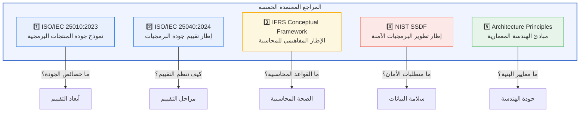
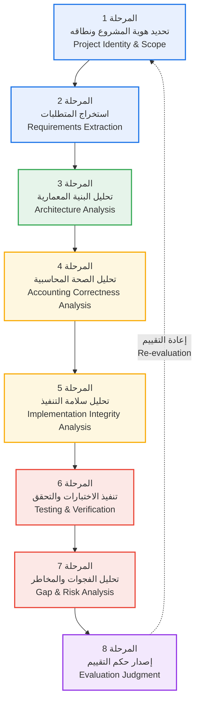
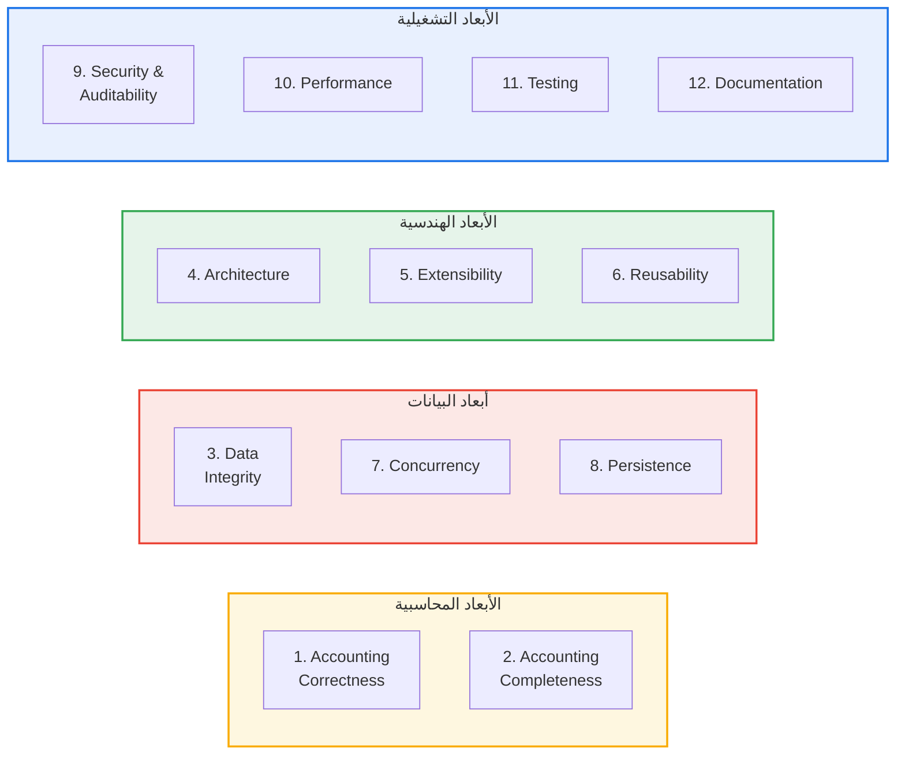
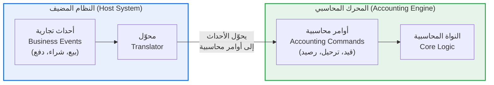

<!-- markdownlint-disable MD033 MD041 -->

# معيار تقييم المحركات المحاسبية

## المرجع الرسمي لمنهجية التقييم الهندسي والمحاسبي

---

> **بيان الإلزام**: هذه الوثيقة هي المرجع الرسمي والوحيد لمنهجية تقييم المحركات المحاسبية.
> أيّ وكيل ذكاء اصطناعي (AI Agent)، أو مهندس برمجيات، أو مراجع خارجي (External Auditor)
> يقوم بتقييم أي محرك محاسبي **يجب** أن يلتزم بهذه الوثيقة التزاماً كاملاً دون استثناء.
> أيّ تقييم لا يتبع هذه المنهجية يُعتبر غير رسمي وغير قابل للاعتماد.

---

# جدول المحتويات

- [المقدمة والغرض](#المقدمة-والغرض)
- [أولاً: المراجع المعتمدة](#أولاً-المراجع-المعتمدة-الخمسة)
  - [1. معايير جودة البرمجيات والهندسة](#1-معايير-جودة-البرمجيات-والهندسة)
  - [2. المعايير والمبادئ المحاسبية](#2-المعايير-والمبادئ-المحاسبية)
  - [3. معايير سلامة البيانات وأمن البرمجيات](#3-معايير-سلامة-البيانات-وأمن-البرمجيات)
  - [4. مبادئ الهندسة المعمارية](#4-مبادئ-الهندسة-المعمارية)
  - [5. معايير الاختبار والتحقق](#5-معايير-الاختبار-والتحقق)
- [ثانياً: مراحل التقييم الثمانية](#ثانياً-مراحل-التقييم-الثمانية)
- [ثالثاً: أبعاد التقييم الاثنا عشر](#ثالثاً-أبعاد-التقييم-الاثنا-عشر)
- [رابعاً: منهجية الحكم — الربط الثلاثي](#رابعاً-منهجية-الحكم--الربط-الثلاثي)
- [خامساً: مقياس النضج](#خامساً-مقياس-النضج)
- [سادساً: معيار استقلالية المجال وقابلية إعادة الاستخدام](#سادساً-معيار-استقلالية-المجال-وقابلية-إعادة-الاستخدام)
- [سابعاً: قواعد نزاهة التقييم](#سابعاً-قواعد-نزاهة-التقييم)
- [ثامناً: هيكل تقرير التقييم](#ثامناً-هيكل-تقرير-التقييم)
- [تاسعاً: الملحقات](#تاسعاً-الملحقات)

---

# المقدمة والغرض

## 1.1 ماهية هذه الوثيقة

هذه الوثيقة هي **المرجع الرسمي والمعتمد** لمنهجية تقييم المحركات المحاسبية (Accounting Engines). وهي ليست مجرد إرشادات أو توصيات، بل هي **معيار إلزامي** يحكم كيفية تقييم أي محرك محاسبي من الناحيتين الهندسية والمحاسبية.

المحرك المحاسبي (Accounting Engine) — كما تعرّفه هذه الوثيقة — هو مكوّن برمجي (Software Component) مسؤول عن:

- **تسجيل** القيود المحاسبية (Journal Entries) وفق نظام القيد المزدوج (Double-Entry Bookkeeping)
- **ترحيل** القيود إلى الحسابات (Posting to Ledger Accounts)
- **حساب** الأرصدة (Balance Computation)
- **ضمان** سلامة البيانات المحاسبية (Accounting Data Integrity)
- **تطبيق** القواعد المحاسبية المعتمدة (Accounting Rules Enforcement)

## 1.2 لماذا هذه الوثيقة ضرورية

تقييم المحركات المحاسبية يختلف جوهرياً عن تقييم البرمجيات العامة، وذلك لعدة أسباب:

1. **الازدواجية التخصصية**: المحرك المحاسبي يقع عند تقاطع علمين — هندسة البرمجيات والمحاسبة المالية. تقييمه يتطلب معرفة عميقة بكليهما.

2. **خطورة الأخطاء**: خطأ في محرك محاسبي ليس مجرد bug عادي — بل قد يؤدي إلى:
   - أرصدة مالية غير صحيحة
   - تقارير مالية مضللة
   - مخالفات قانونية وتنظيمية
   - خسائر مالية مباشرة

3. **تعقيد التحقق**: لا يكفي أن يعمل الكود — يجب أن يعمل بشكل صحيح محاسبياً. وهذا يتطلب فهماً للمبادئ المحاسبية، وليس فقط قراءة الكود.

4. **الحاجة للموضوعية**: دون معيار واضح ومتفق عليه، يمكن أن يصدر كل مقيّم حكماً مختلفاً بناءً على خبرته الشخصية، مما يجعل التقييمات غير قابلة للمقارنة.

## 1.3 من يستخدم هذه الوثيقة

| الفئة | طريقة الاستخدام |
| --- | --- |
| **وكيل الذكاء الاصطناعي (AI Agent)** | يتبع هذه المنهجية حرفياً عند تقييم أي محرك محاسبي. لا يستخدم معايير أخرى ولا يرتجل منهجية خاصة. |
| **مهندس البرمجيات (Software Engineer)** | يستخدمها كمرجع لفهم معايير القبول قبل البدء في التنفيذ، وكقائمة فحص (Checklist) للمراجعة الذاتية. |
| **المراجع الخارجي (External Auditor)** | يستخدمها كإطار عمل موحد لضمان تغطية شاملة ومتسقة. |
| **مدير المنتج (Product Manager)** | يفهم من خلالها أبعاد الجودة المطلوبة والمخاطر المحتملة. |
| **فريق ضمان الجودة (QA Team)** | يستخدمها لبناء خطط اختبار شاملة تغطي الأبعاد الاثنتي عشرة. |

## 1.4 أهداف هذه الوثيقة

1. **الموضوعية (Objectivity)**: ضمان أن التقييم يستند إلى معايير واضحة وقابلة للقياس، لا إلى انطباعات شخصية.

2. **قابلية التكرار (Reproducibility)**: أيّ مقيّم يتبع هذه المنهجية يجب أن يصل إلى نتائج متقاربة (وإن لم تكن متطابقة) عند تقييم نفس المحرك.

3. **قابلية المقارنة (Comparability)**: إمكانية مقارنة نتائج تقييم إصدارات مختلفة من نفس المحرك، أو مقارنة محركات مختلفة.

4. **الشمولية (Comprehensiveness)**: تغطية جميع الأبعاد ذات الصلة — من الصحة المحاسبية إلى جودة الكود إلى الأداء والأمان.

5. **المرجعية (Authoritativeness)**: ربط كل بُعد تقييم بمعيار دولي أو مبدأ هندسي أو محاسبي معترف به.

## 1.5 نطاق التطبيق

هذه الوثيقة تنطبق على:

- ✅ أيّ محرك محاسبي (Accounting Engine) بصرف النظر عن لغة البرمجة أو المنصة
- ✅ المحركات الموجودة (للتقييم) والمحركات المصمَّمة حديثاً (للتحقق من المتطلبات)
- ✅ التقييمات الداخلية والخارجية على حد سواء

هذه الوثيقة **لا تنطبق** على:

- ❌ تطبيقات المحاسبة الكاملة (Full Accounting Applications) — مثل واجهات المستخدم، إدارة المستخدمين، إعداد التقارير المتقدمة. هذه الوثيقة تُقيّم **النواة المحاسبية** فقط.
- ❌ أنظمة ERP الشاملة — إلا إذا كان التقييم مقتصراً على المحرك المحاسبي داخلها.
- ❌ أدوات المحاسبة الإحصائية أو التحليلية التي لا تتعامل مع القيد المزدوج.

## 1.6 مبدأ الالتزام

> **قاعدة أساسية**: أيّ تقييم يُصدَر دون الالتزام بهذه المنهجية يُعتبر **غير رسمي** (Informal Assessment)
> ويجب تمييزه بوضوح عن التقييمات الرسمية. لا يُعتمد في اتخاذ قرارات المنتج أو الإصدار.

> **قاعدة التعديل**: أيّ تعديل على هذه الوثيقة يجب أن يمر بعملية مراجعة رسمية،
> ويُوثّق في سجل التغييرات (Change Log)، ويُحدَّث رقم الإصدار.

---

# أولاً: المراجع المعتمدة الخمسة

هذا المعيار لا يرتجل قواعده — بل يستند إلى خمسة مراجع رئيسية معترف بها دولياً. كل مرجع يجيب عن سؤال محدد في عملية التقييم.

> **مبدأ المرجعية**: كل حكم يُصدره المقيّم يجب أن يرتبط بمرجع واحد على الأقل من هذه المراجع الخمسة.
> أيّ حكم لا يستند إلى مرجع يُعتبر **رأياً شخصياً** ويجب تمييزه بوضوح في التقرير.



---

## 1. معايير جودة البرمجيات والهندسة

### 1.1 ISO/IEC 25010:2023 — نموذج جودة المنتجات البرمجية (Product Quality Model)

- **المرجع الرسمي**: [https://www.iso.org/standard/78176.html](https://www.iso.org/standard/78176.html)
- **السؤال الذي يجيب عنه**: ما خصائص الجودة التي ينبغي تقييمها في أيّ منتج برمجي؟

هذا المعيار الدولي يُحدد **تسع خصائص رئيسية** (Quality Characteristics) لجودة المنتجات البرمجية. وهو الأساس الذي تُبنى عليه أبعاد التقييم في هذه الوثيقة.

| الخاصية (Characteristic) | التعريف | تطبيقها على المحرك المحاسبي |
| --- | --- | --- |
| **Functional Suitability** | مدى تلبية الوظائف للاحتياجات المحددة والضمنية | هل ينفذ القيد المزدوج بشكل صحيح؟ هل يرحّل القيود؟ هل يحسب الأرصدة؟ |
| **Performance Efficiency** | الأداء مقارنة بالموارد المستخدمة | ما زمن ترحيل 10,000 قيد؟ كم ذاكرة يستهلك حساب الأرصدة؟ |
| **Compatibility** | قدرة التعايش مع أنظمة أخرى وتبادل المعلومات | هل يمكن دمج المحرك مع أنظمة ERP مختلفة؟ |
| **Usability** | سهولة الفهم والتعلم والاستخدام | هل واجهات المحرك (APIs) واضحة ومتسقة وموثقة؟ |
| **Reliability** | قدرة النظام على أداء وظائفه في ظروف محددة لفترة محددة | هل يتعامل مع فشل قاعدة البيانات بشكل آمن؟ هل يمنع فقد البيانات؟ |
| **Security** | حماية المعلومات والبيانات | هل يمنع الوصول غير المصرح به؟ هل يوفر سجل تدقيق؟ |
| **Maintainability** | سهولة التعديل والتحسين | هل يمكن إصلاح خطأ دون التأثير على أجزاء أخرى؟ |
| **Portability** | قابلية النقل بين بيئات مختلفة | هل يمكن تشغيل المحرك مع قواعد بيانات مختلفة؟ |
| **Safety** | ضمان عدم إلحاق ضرر بالمستخدمين أو البيئة | هل يمنع إصدار أرصدة خاطئة قد تؤدي لقرارات مالية ضارة؟ |

> **ملاحظة هامة**: إصدار 2023 من ISO/IEC 25010 أضاف خاصية **Safety** كخاصية تاسعة،
> وهي ذات أهمية خاصة للمحركات المحاسبية حيث أن الأخطاء المحاسبية يمكن أن تُلحق ضرراً مالياً وقانونياً حقيقياً.

#### كيفية استخدام ISO/IEC 25010 في التقييم

لا نطلب من المقيّم تطبيق كل خاصية فرعية (Sub-characteristic) حرفياً. بل نستخدم المعيار كـ**إطار فكري** يضمن عدم إغفال أي بُعد مهم. الخصائص التسع تُترجَم إلى الأبعاد الاثنتي عشرة المفصّلة في [القسم الثالث](#ثالثاً-أبعاد-التقييم-الاثنا-عشر).

#### جدول الربط: خصائص ISO/IEC 25010 ← أبعاد التقييم

| خاصية ISO/IEC 25010 | بُعد/أبعاد التقييم المقابلة |
| --- | --- |
| Functional Suitability | Accounting Correctness, Accounting Completeness |
| Performance Efficiency | Performance |
| Compatibility | Extensibility, Reusability, Interoperability |
| Usability | Documentation, API Design |
| Reliability | Data Integrity, Persistence, Concurrency |
| Security | Security & Auditability |
| Maintainability | Architecture, Extensibility |
| Portability | Reusability, Architecture |
| Safety | Accounting Correctness, Data Integrity |

---

### 1.2 ISO/IEC 25040:2024 — إطار عمل تقييم جودة البرمجيات (Evaluation Process)

- **المرجع الرسمي**: [https://www.iso.org/standard/83467.html](https://www.iso.org/standard/83467.html)
- **السؤال الذي يجيب عنه**: كيف ننظّم عملية التقييم نفسها؟

هذا المعيار يُحدد **كيف** يجب أن تتم عملية التقييم — ليس ماذا نقيّم، بل كيف ننظّم ونوثّق ونُصدر أحكام التقييم.

#### المراحل الخمس لعملية التقييم حسب ISO/IEC 25040

| المرحلة | الوصف | تطبيقها في هذه المنهجية |
| --- | --- | --- |
| **تحديد متطلبات التقييم** | تعريف الغرض والنطاق ومعايير القبول | المرحلة 1 و 2 من دورة التقييم |
| **تحديد التقييم** | اختيار القياسات والمعايير المحددة | الأبعاد الاثنا عشر ومقياس النضج |
| **تصميم التقييم** | تخطيط أنشطة التقييم | ترتيب المراحل الثمانية |
| **تنفيذ التقييم** | إجراء القياسات وجمع النتائج | المراحل 3–7 من دورة التقييم |
| **إصدار حكم التقييم** | تحليل النتائج وإصدار الحكم النهائي | المرحلة 8 من دورة التقييم |

#### المبادئ الجوهرية من ISO/IEC 25040 المطبّقة

1. **التكرارية (Repeatability)**: نفس المقيّم يصل لنفس النتائج عند تقييم نفس المحرك.
2. **إمكانية إعادة الإنتاج (Reproducibility)**: مقيّمون مختلفون يصلون لنتائج متقاربة.
3. **الحيادية (Impartiality)**: عدم التحيز للتنفيذ الحالي أو ضده.
4. **الموضوعية (Objectivity)**: الاستناد إلى أدلة وليس انطباعات.

---

## 2. المعايير والمبادئ المحاسبية

### 2.1 IFRS Conceptual Framework — الإطار المفاهيمي للمعايير الدولية لإعداد التقارير المالية

- **المرجع الرسمي**: [https://www.ifrs.org/issued-standards/list-of-standards/conceptual-framework/](https://www.ifrs.org/issued-standards/list-of-standards/conceptual-framework/)
- **السؤال الذي يجيب عنه**: ما المبادئ والمفاهيم المحاسبية الأساسية التي يجب أن يلتزم بها المحرك؟

الإطار المفاهيمي يُحدد الأساسيات التي تُبنى عليها جميع المعايير المحاسبية:

#### العناصر الأساسية للقوائم المالية

| العنصر | التعريف حسب الإطار المفاهيمي | ما يعنيه للمحرك المحاسبي |
| --- | --- | --- |
| **الأصول (Assets)** | مورد اقتصادي حالي تسيطر عليه المنشأة نتيجة أحداث سابقة | يجب أن يدعم المحرك تسجيل الأصول بأنواعها وتتبع أرصدتها |
| **الالتزامات (Liabilities)** | واجب حالي على المنشأة لنقل مورد اقتصادي نتيجة أحداث سابقة | يجب أن يدعم المحرك تسجيل الالتزامات وتتبعها |
| **حقوق الملكية (Equity)** | الحصة المتبقية في أصول المنشأة بعد خصم جميع التزاماتها | يجب أن يحسب المحرك حقوق الملكية بشكل صحيح |
| **الإيرادات (Income)** | زيادات في الأصول أو نقص في الالتزامات تؤدي لزيادة حقوق الملكية (عدا مساهمات الملاك) | يجب أن يسجل المحرك الإيرادات وأثرها على الأرصدة |
| **المصروفات (Expenses)** | نقص في الأصول أو زيادة في الالتزامات تؤدي لنقص حقوق الملكية (عدا التوزيعات على الملاك) | يجب أن يسجل المحرك المصروفات وأثرها على الأرصدة |

#### المفاهيم الأساسية التي يجب أن يدعمها المحرك

| المفهوم | الشرح | متطلب المحرك |
| --- | --- | --- |
| **الاعتراف (Recognition)** | عملية إدراج عنصر في القوائم المالية | يجب أن يحدد المحرك متى يُسجَّل العنصر |
| **القياس (Measurement)** | تحديد القيم النقدية للعناصر | يجب أن يدعم المحرك أسس القياس المختلفة (التكلفة التاريخية، القيمة العادلة، إلخ) |
| **العرض (Presentation)** | كيفية عرض المعلومات في القوائم المالية | يجب أن يوفر المحرك بيانات قابلة للعرض بالشكل المطلوب |
| **الإفصاح (Disclosure)** | المعلومات الإضافية التي تُقدَّم مع القوائم المالية | يجب أن يحفظ المحرك بيانات كافية لدعم الإفصاحات |

#### الخصائص النوعية للمعلومات المفيدة

| الخاصية | التعريف | أثرها على المحرك |
| --- | --- | --- |
| **الملاءمة (Relevance)** | المعلومات قادرة على إحداث فرق في قرارات المستخدمين | المحرك يجب أن يوفر معلومات ذات صلة بالقرارات المالية |
| **التمثيل الصادق (Faithful Representation)** | المعلومات كاملة ومحايدة وخالية من الأخطاء | المحرك يجب أن يضمن دقة البيانات وعدم وجود تحيز |
| **قابلية المقارنة (Comparability)** | إمكانية مقارنة المعلومات عبر الفترات والمنشآت | المحرك يجب أن يطبق سياسات متسقة |
| **قابلية التحقق (Verifiability)** | مراقبون مختلفون يمكنهم التوصل لتوافق | المحرك يجب أن يوفر مسار تدقيق (Audit Trail) |
| **التوقيت المناسب (Timeliness)** | توفر المعلومات في الوقت المناسب لاتخاذ القرارات | المحرك يجب أن يعالج القيود في وقت معقول |
| **قابلية الفهم (Understandability)** | المعلومات واضحة ومصنفة بشكل مناسب | واجهات المحرك يجب أن تكون واضحة |

### 2.2 تحذيرات جوهرية بشأن الامتثال المحاسبي

> **تحذير 1 — الإطار المفاهيمي وحده لا يكفي**:
> الإطار المفاهيمي (Conceptual Framework) يضع الأساسيات والمبادئ العامة فقط.
> لتقييم الامتثال الكامل، يجب الرجوع إلى **المعايير التفصيلية** (Specific Standards) مثل:
>
> | المعيار | الموضوع | أهميته للمحرك |
> | --- | --- | --- |
> | **IAS 1** | عرض القوائم المالية | هيكل الحسابات والتقارير |
> | **IAS 8** | السياسات المحاسبية والتغييرات والأخطاء | التعامل مع تغيير السياسات وتصحيح الأخطاء |
> | **IAS 21** | آثار التغيرات في أسعار الصرف | معالجة العملات المتعددة |
> | **IFRS 15** | الإيراد من العقود مع العملاء | الاعتراف بالإيراد |
> | **IAS 16** | الممتلكات والآلات والمعدات | معالجة الأصول الثابتة والإهلاك |
> | **IAS 36** | الانخفاض في قيمة الأصول | اختبارات الانخفاض |

> **تحذير 2 — لا يجوز الادعاء بالتوافق مع IFRS لمجرد تطبيق القيد المزدوج**:
>
> القيد المزدوج (Double-Entry Bookkeeping) هو **آلية تسجيل** وليس معياراً محاسبياً.
> تطبيق القيد المزدوج هو **شرط ضروري** لكنه **ليس كافياً** للتوافق مع IFRS.
>
> مثال: محرك يطبق القيد المزدوج بشكل مثالي، لكنه لا يدعم:
>
> - الفترات المحاسبية (Accounting Periods)
> - التسويات (Adjusting Entries)
> - العملات المتعددة (Multi-Currency)
> - تصنيف الحسابات حسب IAS 1
>
> هذا المحرك **لا يمكن وصفه بأنه متوافق مع IFRS**.

> **تحذير 3 — يجب تحديد الإطار المحاسبي المستهدف**:
>
> قبل بدء التقييم، يجب تحديد الإطار المحاسبي الذي يستهدفه المحرك بوضوح:
>
> | الإطار | الوصف | مستوى التعقيد |
> | --- | --- | --- |
> | **IFRS الكاملة** | المعايير الدولية الكاملة | عالي جداً |
> | **IFRS for SMEs** | المعايير الدولية للمنشآت الصغيرة والمتوسطة | متوسط |
> | **معيار محلي** | معايير محاسبية خاصة بدولة معينة | يعتمد على الدولة |
> | **نواة محاسبية عامة** | لا يستهدف إطاراً بعينه، بل يوفر الأساسيات | أساسي |
>
> التقييم يجب أن يكون **نسبة إلى الإطار المستهدف**. لا يُعاقب محرك يستهدف النواة
> المحاسبية العامة على عدم دعمه لتعقيدات IFRS الكاملة، **لكن يجب توثيق ذلك بوضوح**.

---

## 3. معايير سلامة البيانات وأمن البرمجيات

### 3.1 NIST Secure Software Development Framework (SSDF)

- **المرجع الرسمي**: NIST Special Publication 800-218
- **السؤال الذي يجيب عنه**: ما متطلبات الأمان وسلامة البيانات التي يجب توفرها في البرنامج؟

إطار NIST SSDF يُوفر مجموعة ممارسات لتطوير البرمجيات الآمنة. في سياق المحرك المحاسبي، نركّز على الممارسات التالية:

#### متطلبات سلامة البيانات المحاسبية

| المتطلب | الشرح | المخاطر عند عدم التطبيق |
| --- | --- | --- |
| **عدم ضياع القيود أو الأرصدة** | يجب ألا تضيع أي بيانات محاسبية بعد تأكيد حفظها | فقد قيود يعني قوائم مالية ناقصة وغير صحيحة |
| **عدم الحفظ الجزئي عند فشل المعاملة** | عند فشل أي جزء من عملية محاسبية، يجب التراجع عن كل الأجزاء | حفظ جزئي يعني خلل في التوازن المحاسبي |
| **الذرية (Atomicity)** | المعاملة المحاسبية تكتمل بالكامل أو تفشل بالكامل | عدم الذرية يؤدي لبيانات غير متسقة |
| **عزل الشركات (Tenant Isolation)** | في الأنظمة متعددة المستأجرين، لا يجب أن تتداخل بيانات الشركات | تسرب بيانات بين الشركات كارثة أمنية ومحاسبية |
| **منع التكرار غير المقصود (Idempotency)** | نفس العملية لا يجب أن تُسجَّل مرتين | تكرار القيود يعني أرصدة مضاعفة وغير صحيحة |
| **سجل التدقيق (Audit Trail)** | كل تغيير يجب أن يُسجَّل — من قام به، ومتى، وماذا تغيّر | عدم وجود سجل تدقيق يمنع التحقق والمراجعة |
| **حماية البيانات (Data Protection)** | البيانات المحاسبية يجب أن تكون محمية من الوصول والتعديل غير المصرح بهما | تعديل القيود المحاسبية دون تتبع يُعتبر تلاعباً |
| **الصلاحيات (Access Control)** | يجب تحديد من يمكنه إنشاء/تعديل/حذف القيود | عدم التحكم في الصلاحيات يفتح باب التلاعب |

#### عناصر الأمان المرتبطة بـ NIST SSDF

| ممارسة SSDF | تطبيقها على المحرك المحاسبي |
| --- | --- |
| **PW.1** — تصميم آمن | تصميم المحرك يمنع إنشاء قيود غير متوازنة بناءً على التصميم (By Design) |
| **PW.5** — تكوين آمن | الإعدادات الافتراضية يجب أن تكون آمنة (مثلاً: Audit Trail مفعّل افتراضياً) |
| **PW.6** — إدارة الحوادث | المحرك يجب أن يتعامل مع الأخطاء بشكل آمن دون تسريب بيانات |
| **PW.9** — اختبار الأمان | يجب اختبار سيناريوهات الأمان (محاولة إنشاء قيد غير متوازن، الوصول لبيانات شركة أخرى، إلخ) |
| **PS.1** — حماية الكود | الكود المصدري للمحرك يجب أن يكون محمياً من التعديل غير المصرح |
| **RV.1** — التحقق المستمر | يجب إجراء مراجعات أمنية دورية |

---

## 4. مبادئ الهندسة المعمارية

### 4.1 المبدأ الأساسي: القياس الفعلي لا مجرد التسمية

> **قاعدة حاسمة**: لا يكفي أن يذكر التوثيق أو المقيّم أن المحرك يتبع Clean Architecture
> أو Hexagonal Architecture أو أي نمط معماري آخر. **يجب قياس المبادئ فعلياً في الكود**.
>
> مثال على تقييم **خاطئ**: "المحرك يتبع Clean Architecture لأن المجلدات مسمّاة
> `domain/`, `usecase/`, `infrastructure/`."
>
> مثال على تقييم **صحيح**: "طبقة `domain/` لا تعتمد (import) على أي حزمة
> من طبقة `infrastructure/`. تم التحقق من ذلك بتحليل الاعتماديات (Dependency Analysis)."

### 4.2 المبادئ المعمارية المطلوب قياسها

| المبدأ | التعريف | ما يتحقق منه المقيّم | أدلة القياس |
| --- | --- | --- | --- |
| **Separation of Concerns** | فصل المسؤوليات — كل وحدة لها مسؤولية واحدة واضحة | هل لكل طبقة (Layer) أو وحدة (Module) مسؤولية واضحة ومحددة؟ هل هناك طبقة تقوم بأكثر من مسؤولية؟ | تحليل محتوى كل حزمة (Package) — هل تحتوي على كود ينتمي لطبقة أخرى؟ |
| **Dependency Inversion** | انعكاس الاعتماديات — الطبقات العليا تعتمد على عقود (Interfaces) لا على تفاصيل تنفيذ | هل يعتمد منطق المحاسبة (Domain/Business Logic) على عقود مجرّدة (Interfaces/Abstractions) بدلاً من تفاصيل التخزين أو البنية التحتية؟ | تحليل عبارات الاستيراد (Import Statements) — هل `domain` يستورد من `infrastructure`؟ |
| **Modularity** | الوحداتية — النظام مقسّم إلى وحدات مستقلة ومتماسكة | هل يمكن تعديل وحدة واحدة (مثلاً: طبقة التخزين) دون التأثير على وحدات أخرى (مثلاً: منطق المحاسبة)؟ | محاكاة تغيير — هل استبدال مستودع البيانات (Repository) يتطلب تعديل كود المحاسبة؟ |
| **Encapsulation** | التغليف — الوحدات تحمي بياناتها الداخلية وتكشف فقط ما هو ضروري | هل تحمي الوحدات حالتها الداخلية (Internal State)؟ هل الحقول المصدّرة (Exported Fields) هي فقط ما يحتاجه المستخدم الخارجي؟ | فحص الحقول والدوال المصدّرة — هل هناك تسريب لتفاصيل داخلية؟ |
| **Extensibility** | قابلية التوسيع — إمكانية إضافة وظائف جديدة دون تعديل واسع للكود الموجود | هل يمكن إضافة نوع قيد جديد أو تقرير جديد دون تعديل واسع في النواة؟ | تقدير حجم التغيير المطلوب لإضافة ميزة جديدة |
| **Interoperability** | قابلية التشغيل البيني — إمكانية الدمج مع أنظمة أخرى | هل يوفر المحرك واجهات (APIs/Interfaces) واضحة تسمح لأنظمة خارجية بالتفاعل معه؟ | فحص الواجهات العامة (Public API) — هل هي كافية ومتسقة؟ |
| **Testability** | قابلية الاختبار — إمكانية اختبار كل جزء بشكل مستقل | هل يمكن اختبار منطق المحاسبة دون الحاجة لقاعدة بيانات حقيقية أو بنية تحتية خارجية؟ | هل توجد واجهات (Interfaces) تسمح بالاستبدال بمحاكيات (Mocks)؟ |

### 4.3 كيفية التقييم المعماري العملي

المقيّم يتبع هذه الخطوات:

1. **رسم خريطة المكونات (Component Map)**: تحديد جميع الحزم والوحدات والملفات وعلاقاتها.

2. **تحليل الاعتماديات (Dependency Analysis)**: تتبع كل عبارة استيراد (Import) وتحديد اتجاه الاعتماديات.

3. **تقييم كل مبدأ**: لكل مبدأ من المبادئ السبعة، جمع أدلة ملموسة من الكود.

4. **توثيق النتائج**: تسجيل الأدلة الإيجابية (المبادئ المطبقة) والسلبية (المبادئ المخالفة) مع ذكر الملفات والأسطر المحددة.

> **قاعدة**: لا يُقبل تقييم معماري يقول "الهندسة المعمارية جيدة" أو "سيئة" دون أدلة
> ملموسة من الكود لكل مبدأ من المبادئ السبعة.

---

## 5. معايير الاختبار والتحقق

### 5.1 الأساس: تشغيل الاختبارات وليس مجرد قراءتها

> **قاعدة أساسية**: قراءة كود الاختبارات وحدها **لا تكفي** ولا تُعتبر "تحققاً".
> يجب **تشغيل الاختبارات فعلياً** (Run Tests) ومراجعة نتائج التشغيل.

### 5.2 مرجع الاختبار

المرجع الأساسي لمعايير الاختبار يعتمد على لغة البرمجة المستخدمة. للمحركات المكتوبة بلغة Go:

- **حزمة `testing` الرسمية**: [https://pkg.go.dev/testing](https://pkg.go.dev/testing)
- **أدوات التغطية**: `go test -cover`, `go test -coverprofile`
- **أدوات الأداء**: `go test -bench`, Benchmarks

### 5.3 متطلبات الاختبار للمحركات المحاسبية

| المتطلب | الشرح | مستوى الإلزام |
| --- | --- | --- |
| **اختبارات وحدة (Unit Tests)** | اختبار كل دالة ومنطق محاسبي بشكل مستقل | إلزامي |
| **اختبارات تكامل (Integration Tests)** | اختبار تفاعل المكونات مع بعضها (مثلاً: قيد → ترحيل → رصيد) | إلزامي |
| **اختبارات الحالات الحدية (Edge Cases)** | اختبار الحالات غير العادية (أرقام سالبة، قيم صفرية، إلخ) | إلزامي |
| **اختبارات التزامن (Concurrency Tests)** | اختبار السلوك عند تنفيذ عمليات متزامنة | إلزامي للمحركات متعددة المستأجرين |
| **اختبارات الفشل (Failure Tests)** | اختبار سلوك المحرك عند فشل قاعدة البيانات أو مكون خارجي | إلزامي |
| **اختبارات الأداء (Performance Tests)** | قياس زمن التنفيذ واستهلاك الموارد | مستحسن |
| **اختبارات الانحدار (Regression Tests)** | ضمان عدم ظهور أخطاء سابقة بعد التعديلات | إلزامي |

### 5.4 معايير جودة الاختبارات

لا يكفي أن توجد اختبارات — يجب أن تكون **ذات جودة**. معايير الجودة:

| المعيار | الشرح | كيفية القياس |
| --- | --- | --- |
| **تغطية الكود (Code Coverage)** | نسبة أسطر الكود المغطاة بالاختبارات | `go test -cover` أو ما يعادله |
| **تغطية المتطلبات (Requirement Coverage)** | نسبة المتطلبات الوظيفية المغطاة باختبارات | مقارنة قائمة المتطلبات مع الاختبارات الموجودة |
| **جودة التأكيدات (Assertion Quality)** | هل الاختبارات تتحقق من النتائج الصحيحة فعلاً؟ | مراجعة عبارات التأكيد (Assertions) — هل هي محددة وكافية؟ |
| **استقلالية الاختبارات (Test Independence)** | كل اختبار يعمل بشكل مستقل عن الآخرين | هل يفشل اختبار بسبب ترتيب التشغيل؟ |
| **وضوح الاختبارات (Test Clarity)** | الاختبار يوضح ما يختبره وما المتوقع | هل اسم الاختبار ووصفه واضحان؟ |

---

# ثانياً: مراحل التقييم الثمانية

## دورة التقييم الهندسي والمحاسبي

عملية التقييم تمر بثماني مراحل متتابعة ومتكاملة. كل مرحلة تبني على نتائج المرحلة السابقة. لا يجوز تخطي أي مرحلة إلا بتوثيق سبب التخطي.



---

## المرحلة 1: تحديد هوية المشروع ونطاقه (Project Identity & Scope)

### الغرض

فهم ماهية المشروع وحدوده قبل بدء التقييم الفعلي. بدون هذه المرحلة، لا يمكن تحديد ما يُقيَّم وما لا يُقيَّم.

### الأنشطة المطلوبة

| النشاط | الوصف | المخرج |
| --- | --- | --- |
| **1.1** تحديد نوع المحرك | هل هو نواة محاسبية عامة؟ محرك متخصص لصناعة معينة؟ جزء من نظام أكبر؟ | تصنيف نوع المحرك |
| **1.2** تحديد الإطار المحاسبي المستهدف | IFRS؟ IFRS for SMEs؟ معيار محلي؟ لا يستهدف إطاراً محدداً؟ | الإطار المحاسبي المرجعي |
| **1.3** تحديد لغة البرمجة والمنصة | Go? Java? Python? ما المنصة المستهدفة؟ | البيئة التقنية |
| **1.4** تحديد نطاق التقييم | ما الوحدات المشمولة في التقييم؟ ما المستبعد؟ | وثيقة النطاق |
| **1.5** جمع الوثائق المتاحة | README, design docs, API docs, أي توثيق متاح | قائمة المراجع |
| **1.6** تحديد الإصدار والتاريخ | أيّ إصدار (Version/Commit) يتم تقييمه؟ | معرّف الإصدار |

### مخرجات المرحلة

- **بطاقة هوية المشروع**: ملخص يحتوي على اسم المشروع، نوعه، الإطار المحاسبي، لغة البرمجة، الإصدار، النطاق.
- **قائمة المراجع والوثائق المتاحة**.

### معايير الانتقال للمرحلة التالية

- ✅ تم تحديد نوع المحرك والإطار المحاسبي المستهدف
- ✅ تم تحديد نطاق التقييم بوضوح
- ✅ تم توثيق الإصدار المقيَّم

---

## المرحلة 2: استخراج المتطلبات (Requirements Extraction)

### الغرض

تحديد ما يجب أن يفعله المحرك (المتطلبات الوظيفية)، وكيف يجب أن يفعله (المتطلبات غير الوظيفية)، وما القواعد المحاسبية التي يجب أن يلتزم بها، وما العقود المعمارية التي يجب أن يحترمها.

### أنواع المتطلبات المستخرجة

#### 2.1 المتطلبات الوظيفية (Functional Requirements)

| الفئة | أمثلة | المصدر |
| --- | --- | --- |
| **تسجيل القيود** | إنشاء قيد محاسبي، التحقق من التوازن، تعيين الحسابات | الإطار المحاسبي + توثيق المحرك |
| **الترحيل** | ترحيل القيود إلى الحسابات، تحديث الأرصدة | الإطار المحاسبي |
| **حساب الأرصدة** | حساب رصيد حساب في تاريخ معين، أرصدة ميزان المراجعة | الإطار المحاسبي |
| **الفترات المحاسبية** | فتح/إغلاق الفترات، منع التسجيل في فترات مغلقة | الإطار المحاسبي + IAS 1 |
| **العملات** | دعم العملات المتعددة، أسعار الصرف، فروقات العملة | IAS 21 |
| **التقارير** | ميزان المراجعة، كشف حساب، تقارير مالية أساسية | الإطار المحاسبي + IAS 1 |

#### 2.2 المتطلبات غير الوظيفية (Non-Functional Requirements)

| الفئة | أمثلة | المرجع |
| --- | --- | --- |
| **الأداء** | زمن استجابة، معدل المعالجة، استهلاك الموارد | ISO/IEC 25010 — Performance Efficiency |
| **الموثوقية** | التعامل مع الأخطاء، التعافي من الفشل | ISO/IEC 25010 — Reliability |
| **الأمان** | التحكم في الصلاحيات، سجل التدقيق | NIST SSDF + ISO/IEC 25010 — Security |
| **قابلية الصيانة** | سهولة التعديل، وضوح الكود | ISO/IEC 25010 — Maintainability |
| **قابلية النقل** | العمل مع قواعد بيانات مختلفة | ISO/IEC 25010 — Portability |

#### 2.3 القواعد المحاسبية (Accounting Rules)

| القاعدة | الشرح | المرجع |
| --- | --- | --- |
| **المعادلة المحاسبية** | الأصول = الالتزامات + حقوق الملكية (دائماً) | الإطار المفاهيمي |
| **القيد المزدوج** | كل معاملة تؤثر على حسابين على الأقل | مبدأ أساسي |
| **التوازن** | مجموع المدين = مجموع الدائن (دائماً) | مبدأ أساسي |
| **عدم حذف القيود** | القيود المرحّلة لا تُحذف — تُعكس بقيد عكسي | مبدأ محاسبي |
| **الاستمرارية** | الأرصدة الافتتاحية = الأرصدة الختامية للفترة السابقة | مبدأ محاسبي |
| **الأهمية النسبية** | التعامل مع الأرقام بدقة كافية | الإطار المفاهيمي |

#### 2.4 العقود المعمارية (Architectural Contracts)

| العقد | الشرح | كيفية التحقق |
| --- | --- | --- |
| **حدود الحزم** | ما الحزم (Packages) الموجودة وما مسؤولية كل منها | تحليل هيكل المشروع |
| **اتجاه الاعتماديات** | ما الحزم التي يُسمح لها بالاعتماد على أخرى | تحليل Import Statements |
| **الواجهات العامة** | ما الواجهات (Interfaces) والأنواع المصدّرة | تحليل الرموز المصدّرة (Exported Symbols) |
| **قواعد التسمية** | هل هناك قواعد تسمية متسقة | مراجعة أسماء الحزم والأنواع والدوال |

### مخرجات المرحلة

- **قائمة المتطلبات الموحّدة**: جدول يربط كل متطلب بمصدره ونوعه وأولويته.
- **المتطلبات الصريحة (Explicit)**: المذكورة في التوثيق أو الكود.
- **المتطلبات الضمنية (Implicit)**: المفروضة بطبيعة المحرك المحاسبي حتى لو لم تُذكر.

> **قاعدة المتطلبات الضمنية**: المحرك المحاسبي يُلزَم بمتطلبات محاسبية أساسية (مثل القيد المزدوج والتوازن)
> حتى لو لم تُذكر صراحة في التوثيق. غياب ذكرها لا يعني أنها اختيارية.

---

## المرحلة 3: تحليل البنية المعمارية (Architecture Analysis)

### الغرض

فهم كيف يُنظَّم الكود وكيف تتفاعل المكونات، وتقييم مدى التزام البنية بالمبادئ المعمارية السليمة.

### الأنشطة المطلوبة

| النشاط | الوصف | الأدوات |
| --- | --- | --- |
| **3.1** رسم خريطة الحزم | تحديد جميع الحزم (Packages/Modules) ومسؤولية كل منها | تحليل هيكل الملفات |
| **3.2** تحليل الاعتماديات | رسم مخطط الاعتماديات بين الحزم | Import Analysis |
| **3.3** تحديد الطبقات | تحديد الطبقات المعمارية (Domain, Use Case, Infrastructure, إلخ) | تحليل المحتوى |
| **3.4** فحص الواجهات | تحديد الواجهات العامة (Public Interfaces) وتقييم تصميمها | API Review |
| **3.5** فحص تدفق البيانات | تتبع مسار البيانات من المدخل إلى المخرج | Code Tracing |
| **3.6** تقييم المبادئ المعمارية | تقييم كل مبدأ من المبادئ السبعة بأدلة | مراجعة ضد جدول المبادئ |

### مخرجات المرحلة

- **خريطة المكونات (Component Map)**: مخطط يوضح جميع المكونات وعلاقاتها.
- **مخطط الاعتماديات (Dependency Graph)**: رسم يوضح اتجاهات الاعتماديات.
- **تقييم المبادئ المعمارية**: جدول بنتيجة كل مبدأ مع الأدلة.
- **قائمة الانتهاكات المعمارية**: أيّ انتهاكات للعقود المعمارية مع تحديد الموقع.

---

## المرحلة 4: تحليل الصحة المحاسبية (Accounting Correctness Analysis)

### الغرض

التحقق من أن المحرك ينفذ القواعد والمبادئ المحاسبية بشكل صحيح. هذه هي المرحلة الأكثر أهمية وتخصصاً.

### الأنشطة المطلوبة

| النشاط | الوصف | ما يتحقق منه |
| --- | --- | --- |
| **4.1** تحليل العمليات المحاسبية | تتبع كل عملية محاسبية (تسجيل، ترحيل، حساب أرصدة) في الكود | هل العمليات مكتملة وصحيحة؟ |
| **4.2** التحقق من القواعد المحاسبية | فحص تطبيق كل قاعدة محاسبية (القيد المزدوج، التوازن، إلخ) | هل القواعد مطبقة بشكل صحيح ولا يمكن تجاوزها؟ |
| **4.3** تحليل الأرصدة | فحص كيفية حساب الأرصدة وتحديثها | هل الأرصدة تُحسب بشكل صحيح في جميع الحالات؟ |
| **4.4** تحليل القيود | فحص هيكل القيود وعمليات التحقق عليها | هل يمنع المحرك القيود غير الصالحة؟ |
| **4.5** تحليل التسويات | فحص دعم القيود التسوية (Adjusting Entries) | هل يدعم المحرك التسويات الدورية؟ |
| **4.6** تحليل التقارير | فحص البيانات التي يوفرها المحرك للتقارير المالية | هل البيانات كافية ودقيقة لإنتاج التقارير المطلوبة؟ |

### أسئلة التحقق الثمانية للقيد المحاسبي

هذه الأسئلة الثمانية يجب أن يسألها المقيّم عند فحص أيّ عملية قيد:

| # | السؤال | ما يكشفه | المرجع |
| --- | --- | --- | --- |
| **1** | هل المحرك يمنع إنشاء قيد مدينه لا يساوي دائنه (Debit ≠ Credit)؟ | صحة التوازن | مبدأ القيد المزدوج |
| **2** | هل المحرك يتعامل مع العملات بشكل صحيح في القيد المزدوج (مثلاً: قيد بعملة أجنبية)؟ | سلامة المعالجة متعددة العملات | IAS 21 |
| **3** | هل المحرك يمنع التسجيل في فترة محاسبية مغلقة (Closed Period)؟ | سلامة الفترات المحاسبية | IAS 1 |
| **4** | هل المحرك يمنع التسجيل في حساب غير مفعّل أو غير موجود؟ | سلامة شجرة الحسابات | مبدأ محاسبي |
| **5** | هل المحرك يتعامل مع الأرقام العشرية بدقة كافية (مثلاً: Decimal ≥ 4 منازل)؟ | دقة الحسابات المالية | مبدأ الدقة |
| **6** | هل الترحيل (Posting) يُحدّث الأرصدة بشكل ذري (Atomic)؟ | سلامة البيانات | NIST SSDF |
| **7** | هل يمكن عكس (Reverse) قيد مرحّل بقيد عكسي بدلاً من حذفه؟ | عدم العبث بالسجل المحاسبي | مبدأ محاسبي |
| **8** | هل يُسجَّل كل قيد مع البيانات الوصفية المطلوبة (التاريخ، المصدر، الوصف، المُسجِّل)؟ | مسار التدقيق (Audit Trail) | NIST SSDF + مبدأ محاسبي |

### مخرجات المرحلة

- **تقييم كل عملية محاسبية**: جدول بالعمليات المدعومة ونتيجة تقييم كل منها.
- **قائمة الانتهاكات المحاسبية**: أيّ انتهاكات للقواعد المحاسبية مع تحديد الموقع في الكود.
- **تقييم الأسئلة الثمانية**: نتيجة كل سؤال مع الدليل.

---

## المرحلة 5: تحليل سلامة التنفيذ (Implementation Integrity Analysis)

### الغرض

التحقق من أن التنفيذ الفعلي (Implementation) يضمن سلامة البيانات في جميع الظروف، بما في ذلك الظروف الاستثنائية (فشل، تزامن، أحمال عالية).

### الأنشطة المطلوبة

| النشاط | الوصف | ما يتحقق منه |
| --- | --- | --- |
| **5.1** تحليل المعاملات (Transactions) | فحص كيفية استخدام المعاملات في قواعد البيانات | هل كل عملية محاسبية مغلّفة في معاملة ذرية؟ |
| **5.2** تحليل التزامن (Concurrency) | فحص كيفية التعامل مع العمليات المتزامنة | هل هناك حماية من Race Conditions و Deadlocks؟ |
| **5.3** تحليل العزل (Isolation) | فحص عزل البيانات في الأنظمة متعددة المستأجرين | هل بيانات كل شركة/مستأجر معزولة تماماً؟ |
| **5.4** تحليل التراجع عند الفشل (Rollback) | فحص سلوك المحرك عند فشل جزء من العملية | هل يتراجع عن كل التغييرات عند الفشل؟ |
| **5.5** تحليل منع التكرار (Idempotency) | فحص الحماية من تنفيذ نفس العملية مرتين | هل هناك آليات لمنع التكرار غير المقصود؟ |
| **5.6** تحليل إدارة الأخطاء (Error Handling) | فحص كيفية التعامل مع الأخطاء وإبلاغ المستخدم | هل الأخطاء تُعالج بشكل آمن ومفيد؟ |

### سيناريوهات الاختبار المطلوبة

| السيناريو | الوصف | النتيجة المتوقعة |
| --- | --- | --- |
| **فشل في منتصف الترحيل** | تُرحَّل بعض أسطر القيد ثم يفشل النظام | يتراجع عن كل الترحيل — لا ترحيل جزئي |
| **قيدان متزامنان لنفس الحساب** | مستخدمان يرحّلان قيداً لنفس الحساب في نفس اللحظة | كلاهما يُسجَّل بشكل صحيح دون فقد أو تداخل |
| **انقطاع قاعدة البيانات** | المحرك يحاول الكتابة وتنقطع قاعدة البيانات | لا تُفقد بيانات ولا تُحفظ جزئياً |
| **نفس الطلب يُرسل مرتين** | بسبب خطأ شبكي، يُرسل نفس القيد مرتين | يُسجَّل مرة واحدة فقط أو يُرفض الثاني |
| **وصول بيانات شركة أخرى** | مستخدم في شركة أ يحاول قراءة بيانات شركة ب | يُرفض الطلب — لا تسريب |

### مخرجات المرحلة

- **تقييم سلامة المعاملات**: نتيجة فحص كل آلية حماية.
- **قائمة المخاطر**: أيّ ثغرات في سلامة التنفيذ مع درجة خطورتها.
- **نتائج سيناريوهات الاختبار**: ما تم اختباره وما كانت النتيجة.

---

## المرحلة 6: تنفيذ الاختبارات والتحقق (Testing & Verification)

### الغرض

تشغيل الاختبارات الموجودة، تحليل نتائجها، وتحديد الحالات غير المغطاة. ثم إضافة اختبارات للحالات الحرجة المفقودة.

### الأنشطة المطلوبة

| النشاط | الوصف | المخرج |
| --- | --- | --- |
| **6.1** تشغيل جميع الاختبارات | `go test ./...` أو ما يعادله | نتائج التشغيل (Pass/Fail) |
| **6.2** قياس التغطية | `go test -cover ./...` أو ما يعادله | نسبة التغطية لكل حزمة |
| **6.3** تحليل الاختبارات الفاشلة | لكل اختبار فاشل: هل الخلل في الكود أم في الاختبار؟ | قائمة الأخطاء المكتشفة |
| **6.4** تحليل جودة الاختبارات | مراجعة عبارات التأكيد وتغطية الحالات | تقييم جودة الاختبارات |
| **6.5** تحديد الفجوات | ما الحالات الحرجة غير المغطاة بالاختبارات؟ | قائمة الاختبارات المفقودة |
| **6.6** كتابة اختبارات إضافية | كتابة اختبارات للحالات الحرجة المفقودة (اختياري) | اختبارات جديدة |

### قائمة الحالات الحرجة الواجب تغطيتها

| الحالة | لماذا هي حرجة |
| --- | --- |
| **قيد بمدين ≠ دائن** | يجب أن يُرفض — اختبار أمان محاسبي أساسي |
| **قيد بقيمة صفرية** | هل يُقبل أم يُرفض؟ يجب أن يكون السلوك واضحاً |
| **قيد بقيمة سالبة** | هل يُقبل أم يُرفض؟ يجب أن يكون السلوك واضحاً |
| **قيد بحساب غير موجود** | يجب أن يُرفض |
| **قيد في فترة مغلقة** | يجب أن يُرفض |
| **ترحيل مزدوج لنفس القيد** | يجب أن يُمنع |
| **رصيد بعد عمليات متعددة** | يجب أن يكون صحيحاً حسابياً |
| **ميزان مراجعة بعد عمليات مختلطة** | مجموع المدين يجب أن يساوي مجموع الدائن |

> **قاعدة التشغيل الفعلي**: المقيّم يجب أن **يشغّل** الاختبارات فعلياً ويراجع مخرجات التشغيل.
> لا يُقبل أن يقول المقيّم "الاختبارات تبدو صحيحة" دون تشغيلها. هذا ينتهك قواعد نزاهة التقييم.

### مخرجات المرحلة

- **نتائج تشغيل الاختبارات**: عدد الناجح والفاشل لكل حزمة.
- **تقرير التغطية**: نسبة التغطية مع تحديد المناطق غير المغطاة.
- **قائمة الأخطاء المكتشفة**: أيّ أخطاء كشفتها الاختبارات.
- **تقييم جودة الاختبارات**: هل الاختبارات كافية وذات جودة؟

---

## المرحلة 7: تحليل الفجوات والمخاطر (Gap & Risk Analysis)

### الغرض

مقارنة ما يجب أن يفعله المحرك (المتطلبات) بما يفعله فعلاً (التنفيذ)، وتحديد الفجوات والمخاطر المترتبة عليها.

### الأنشطة المطلوبة

| النشاط | الوصف | المخرج |
| --- | --- | --- |
| **7.1** مقارنة المتطلبات بالتنفيذ | لكل متطلب: هل هو منفذ؟ هل هو صحيح؟ هل هو مختبر؟ | مصفوفة الامتثال (Compliance Matrix) |
| **7.2** تحديد الفجوات | ما المتطلبات غير المنفذة أو المنفذة جزئياً؟ | قائمة الفجوات |
| **7.3** تقييم المخاطر | لكل فجوة: ما تأثيرها؟ ما احتمال حدوث مشكلة؟ | مصفوفة المخاطر |
| **7.4** ترتيب الأولويات | ترتيب الفجوات والمخاطر حسب الخطورة | قائمة أولويات |

### مصفوفة الامتثال — المثال

| المتطلب | الحالة | الدليل | الملاحظات |
| --- | --- | --- | --- |
| القيد المزدوج | ✅ Verified | ملف `entry.go` سطر 45 + اختبار `TestDoubleEntry` | - |
| التوازن المحاسبي | ✅ Verified | ملف `validation.go` سطر 23 + اختبار `TestBalanceValidation` | - |
| الفترات المحاسبية | ⚠️ Partially Verified | الكود موجود لكن لا يوجد اختبار لمنع التسجيل في فترة مغلقة | مخاطر متوسطة |
| العملات المتعددة | ❌ Not Implemented | لا يوجد دعم للعملات في الكود | مخاطر عالية إذا كان مطلوباً |

### مخرجات المرحلة

- **مصفوفة الامتثال الكاملة**: كل متطلب وحالته ودليله.
- **سجل الفجوات والمخاطر (Findings Register)**: قائمة مفصّلة بكل فجوة ومخاطرها.
- **قائمة الأولويات**: الفجوات مرتبة حسب الخطورة والتأثير.

---

## المرحلة 8: إصدار حكم التقييم (Evaluation Judgment)

### الغرض

تجميع كل نتائج المراحل السابقة في حكم نهائي شامل، مدعوم بأدلة وتوصيات قابلة للتنفيذ.

### الأنشطة المطلوبة

| النشاط | الوصف | المخرج |
| --- | --- | --- |
| **8.1** تجميع النتائج | دمج نتائج المراحل 3–7 في صورة موحدة | ملخص النتائج |
| **8.2** تطبيق مقياس النضج | تقييم كل بُعد حسب مقياس النضج (0–4) | جدول درجات النضج |
| **8.3** تطبيق تصنيف المخاطر | تصنيف كل اكتشاف حسب مستوى الخطورة | جدول تصنيف المخاطر |
| **8.4** تقييم جاهزية الإنتاج | هل المحرك جاهز للاستخدام في بيئة إنتاج؟ | حكم جاهزية الإنتاج |
| **8.5** صياغة التوصيات | توصيات محددة وقابلة للتنفيذ لكل اكتشاف | قائمة التوصيات |
| **8.6** كتابة التقرير النهائي | صياغة تقرير التقييم حسب الهيكل المحدد | تقرير التقييم النهائي |

### قواعد إصدار الحكم

1. **كل حكم يجب أن يكون مدعوماً بدليل**: لا أحكام بدون أدلة (ملف + سطر + نتيجة اختبار).
2. **الفصل بين الحقائق والآراء**: الحقائق تُوثَّق كحقائق، والآراء تُوثَّق كآراء.
3. **التفريق بين الخلل والتحسين**: الخلل (Defect) يعني عدم استيفاء متطلب. التحسين (Improvement) يعني اقتراح لم يكن مطلوباً.
4. **عدم دمج الأبعاد**: لا يُصدر درجة واحدة شاملة — كل بُعد يُقيَّم منفصلاً.

### مخرجات المرحلة

- **تقرير التقييم النهائي**: حسب الهيكل المحدد في [القسم الثامن](#ثامناً-هيكل-تقرير-التقييم).
- **ملخص تنفيذي**: صفحة واحدة تلخص النتائج الرئيسية.

---

# ثالثاً: أبعاد التقييم الاثنا عشر

## نظرة عامة

التقييم يغطي اثني عشر بُعداً (Evaluation Dimension). كل بُعد يمثل جانباً مهماً من جوانب المحرك المحاسبي. الأبعاد مستقلة عن بعضها — كل بُعد يُقيَّم منفصلاً بدرجة نضج مستقلة.

> **قاعدة عدم الدمج**: لا يجوز دمج أبعاد متعددة في درجة واحدة أو حكم واحد.
> محرك قد يكون ممتازاً في الصحة المحاسبية وضعيفاً في الأداء — ودمج الدرجتين يُخفي المشكلة.



---

## الجدول الشامل لأبعاد التقييم

| # | مجال التقييم (Dimension) | الوصف | أمثلة على ما يُفحص | المرجع الرئيسي |
| --- | --- | --- | --- | --- |
| **1** | **Accounting Correctness** | صحة تنفيذ القواعد المحاسبية الأساسية | القيد المزدوج (Double-Entry)، المدين/الدائن (Debit/Credit)، الترحيل (Posting)، حساب الأرصدة (Balance Computation)، التحقق من التوازن (Balance Validation)، عكس القيود (Reversal)، المعادلة المحاسبية | IFRS Conceptual Framework |
| **2** | **Accounting Completeness** | مدى اكتمال الوظائف المحاسبية المدعومة | شجرة الحسابات (Chart of Accounts)، الفترات المحاسبية (Accounting Periods)، العملات المتعددة (Multi-Currency)، الأبعاد المحاسبية (Dimensions)، دفتر اليومية (Journal)، دفتر الأستاذ (Ledger)، ميزان المراجعة (Trial Balance)، التقارير المالية الأساسية | IFRS + IAS 1 |
| **3** | **Data Integrity** | سلامة البيانات المحاسبية في جميع الظروف | الذرية (Atomicity)، الاتساق (Consistency)، العزل (Isolation)، المتانة (Durability) — خصائص ACID، سلامة البيانات المرجعية (Referential Integrity)، منع البيانات اليتيمة (Orphan Prevention) | NIST SSDF |
| **4** | **Architecture** | جودة البنية المعمارية والتصميم | فصل المسؤوليات (Separation of Concerns)، اتجاه الاعتماديات (Dependency Direction)، مسؤوليات المكونات (Component Responsibilities)، العقود بين الطبقات (Inter-layer Contracts)، تماسك الوحدات (Cohesion)، اقتران منخفض (Low Coupling) | ISO/IEC 25010 — Maintainability + مبادئ معمارية |
| **5** | **Extensibility** | قابلية إضافة وظائف جديدة | إضافة نوع قيد جديد (New Entry Type)، إضافة تقرير جديد (New Report)، إضافة عملة جديدة (New Currency)، إضافة بُعد محاسبي جديد (New Dimension) — كل ذلك دون إفساد النواة (Without Breaking the Core) | ISO/IEC 25010 — Maintainability |
| **6** | **Reusability** | قابلية استخدام المحرك في سياقات مختلفة | استخدام المحرك في نظام تجارة إلكترونية (E-Commerce)، نظام بنكي (Banking)، نظام إدارة عقارات (Property Management) — دون تعديل النواة | ISO/IEC 25010 — Portability |
| **7** | **Concurrency** | التعامل مع العمليات المتزامنة | التزامن على نفس الحساب (Same Account Concurrency)، تضارب العمليات (Conflict Resolution)، منع التكرار (Idempotency)، أقفال قواعد البيانات (Database Locks)، منع Deadlocks | NIST SSDF |
| **8** | **Persistence** | سلامة التخزين والاسترجاع | سلامة الكتابة (Write Integrity)، التعامل مع فشل قواعد البيانات (Database Failure Handling)، التعافي من الأعطال (Crash Recovery)، النسخ الاحتياطي (Backup Support)، عدم فقد البيانات (Zero Data Loss) | NIST SSDF |
| **9** | **Security & Auditability** | الأمان والقدرة على التدقيق | الصلاحيات (Access Control)، سجل التدقيق (Audit Trail)، عدم حذف القيود (No Entry Deletion)، تتبع التغييرات (Change Tracking)، عدم العبث (Tamper Prevention)، تشفير البيانات الحساسة | NIST SSDF + ISO/IEC 25010 — Security |
| **10** | **Performance** | الأداء واستهلاك الموارد وقابلية التوسع | زمن تنفيذ القيود (Entry Processing Time)، زمن حساب الأرصدة (Balance Computation Time)، استهلاك الذاكرة (Memory Usage)، قابلية التوسع (Scalability)، أداء الاستعلامات (Query Performance) | ISO/IEC 25010 — Performance Efficiency |
| **11** | **Testing** | جودة الاختبارات وتغطيتها | نسبة تغطية الكود (Code Coverage)، تغطية المتطلبات (Requirement Coverage)، جودة التأكيدات (Assertion Quality)، اختبارات الحالات الحدية (Edge Case Tests)، اختبارات الفشل (Failure Tests) | معايير الاختبار + ISO/IEC 25010 — Reliability |
| **12** | **Documentation** | جودة التوثيق ووضوحه | توثيق العقود (Contract Documentation)، توثيق السلوك (Behavior Documentation)، توثيق المتطلبات (Requirement Documentation)، توثيق الواجهات (API Documentation)، أمثلة الاستخدام (Usage Examples) | ISO/IEC 25010 — Usability |

---

## مثال تفصيلي: كيفية التحقق من صحة القيد المحاسبي (Accounting Correctness)

هذا المثال يوضح كيف يقوم المقيّم بتقييم بُعد واحد (Accounting Correctness) بشكل عملي. نفس المنهجية تُطبّق على كل بُعد.

### الأسئلة الثمانية التي يجب أن يسألها المقيّم

#### السؤال 1: هل يفرض المحرك التوازن بين المدين والدائن؟

| العنصر | التفصيل |
| --- | --- |
| **ما يبحث عنه المقيّم** | دالة أو منطق يتحقق من أن `Sum(Debit) == Sum(Credit)` قبل حفظ القيد |
| **أين يبحث** | دالة إنشاء القيد (Create Entry)، دالة التحقق (Validate)، أو Middleware |
| **الدليل الإيجابي** | كود يرفض القيد عندما لا يتحقق التوازن + اختبار يثبت الرفض |
| **الدليل السلبي** | لا توجد دالة تحقق، أو التحقق يحدث في طبقة واحدة فقط ويمكن تجاوزه |
| **درجة الخطورة عند الغياب** | **Critical** — غياب التوازن يعني بيانات محاسبية فاسدة |

#### السؤال 2: هل يتعامل المحرك بشكل صحيح مع أنواع الحسابات؟

| العنصر | التفصيل |
| --- | --- |
| **ما يبحث عنه المقيّم** | تصنيف الحسابات (أصول، التزامات، حقوق ملكية، إيرادات، مصروفات) ومعرفة الطبيعة الطبيعية (Normal Balance) لكل نوع |
| **أين يبحث** | نموذج الحساب (Account Model)، شجرة الحسابات (Chart of Accounts) |
| **الدليل الإيجابي** | نوع الحساب مُخزَّن ومستخدم في حساب الأرصدة |
| **الدليل السلبي** | لا تصنيف للحسابات، أو التصنيف موجود لكن غير مستخدم |
| **درجة الخطورة عند الغياب** | **High** — بدون تصنيف لا يمكن إنتاج تقارير مالية صحيحة |

#### السؤال 3: هل يحسب المحرك الأرصدة بشكل صحيح؟

| العنصر | التفصيل |
| --- | --- |
| **ما يبحث عنه المقيّم** | منطق حساب الرصيد يأخذ في الاعتبار طبيعة الحساب (مدين الطبيعة أم دائن الطبيعة) |
| **أين يبحث** | دالة حساب الرصيد (GetBalance / CalculateBalance) |
| **الدليل الإيجابي** | رصيد الأصول = مجموع المدين − مجموع الدائن، رصيد الالتزامات = مجموع الدائن − مجموع المدين |
| **الدليل السلبي** | الرصيد يُحسب بنفس الطريقة لكل أنواع الحسابات |
| **درجة الخطورة عند الغياب** | **Critical** — أرصدة خاطئة تعني قوائم مالية خاطئة |

#### السؤال 4: هل يمنع المحرك التسجيل في فترات مغلقة؟

| العنصر | التفصيل |
| --- | --- |
| **ما يبحث عنه المقيّم** | آلية فتح/إغلاق الفترات ومنطق يرفض القيود في الفترات المغلقة |
| **أين يبحث** | دالة إنشاء القيد + نموذج الفترة المحاسبية |
| **الدليل الإيجابي** | رفض القيد عند محاولة التسجيل في فترة مغلقة + اختبار يثبت الرفض |
| **الدليل السلبي** | لا مفهوم للفترات المحاسبية، أو الفترات موجودة لكن لا يتم التحقق منها |
| **درجة الخطورة عند الغياب** | **High** — عدم منع التسجيل في فترات مغلقة يخالف الممارسات المحاسبية |

#### السؤال 5: هل يدعم المحرك الترحيل بشكل صحيح؟

| العنصر | التفصيل |
| --- | --- |
| **ما يبحث عنه المقيّم** | عملية ترحيل القيد من دفتر اليومية (Journal) إلى دفتر الأستاذ (Ledger)، وتأثيرها على الأرصدة |
| **أين يبحث** | دالة الترحيل (Post)، تحديث الأرصدة |
| **الدليل الإيجابي** | الترحيل ذري (Atomic)، يُحدّث جميع الأرصدة المتأثرة، ويُغيّر حالة القيد |
| **الدليل السلبي** | الترحيل غير ذري، أو لا يُحدّث الأرصدة، أو لا يُغيّر حالة القيد |
| **درجة الخطورة عند الغياب** | **Critical** — ترحيل غير ذري يمكن أن يؤدي لأرصدة غير صحيحة |

#### السؤال 6: هل يمنع المحرك حذف القيود المرحّلة؟

| العنصر | التفصيل |
| --- | --- |
| **ما يبحث عنه المقيّم** | عدم وجود دالة حذف للقيود المرحّلة، أو وجود حماية تمنع الحذف |
| **أين يبحث** | الواجهات العامة (API)، دوال المستودع (Repository) |
| **الدليل الإيجابي** | لا توجد دالة Delete لقيد مرحّل، أو تُرفض محاولة الحذف + دعم قيود عكسية (Reversal) |
| **الدليل السلبي** | يمكن حذف قيد مرحّل فعلياً |
| **درجة الخطورة عند الغياب** | **Critical** — حذف قيد مرحّل يُعتبر تلاعباً محاسبياً |

#### السؤال 7: هل يدعم المحرك القيود العكسية؟

| العنصر | التفصيل |
| --- | --- |
| **ما يبحث عنه المقيّم** | دالة أو عملية لإنشاء قيد عكسي (Reversal Entry) يعكس أثر قيد سابق |
| **أين يبحث** | دالة العكس (Reverse)، أو منطق إنشاء قيد معاكس |
| **الدليل الإيجابي** | دالة عكس تُنشئ قيداً جديداً بأطراف معكوسة وتربطه بالقيد الأصلي |
| **الدليل السلبي** | لا آلية عكس — الخيار الوحيد هو الحذف |
| **درجة الخطورة عند الغياب** | **High** — بدون قيود عكسية لا يمكن تصحيح الأخطاء بشكل سليم محاسبياً |

#### السؤال 8: هل يوفر المحرك مسار تدقيق كافٍ؟

| العنصر | التفصيل |
| --- | --- |
| **ما يبحث عنه المقيّم** | تسجيل من أنشأ القيد، ومتى، ومن عدّله، وما التغييرات |
| **أين يبحث** | نموذج القيد (Entry Model)، سجل التدقيق (Audit Log)، Timestamps |
| **الدليل الإيجابي** | كل قيد يحتوي على: `CreatedBy`, `CreatedAt`, `UpdatedBy`, `UpdatedAt` + سجل تغييرات |
| **الدليل السلبي** | لا timestamps، لا تتبع للمستخدم، لا سجل تغييرات |
| **درجة الخطورة عند الغياب** | **High** — بدون مسار تدقيق لا يمكن مراجعة أو تتبع الأنشطة |

---

# رابعاً: منهجية الحكم — الربط الثلاثي

## 4.1 المبدأ الأساسي: الربط الثلاثي (Traceability Triangle)

كل حكم يُصدره المقيّم يجب أن يربط بين ثلاثة عناصر:

```
المتطلب (Requirement) ← التنفيذ (Implementation) ← الدليل (Evidence)
```

| العنصر | الشرح | مثال |
| --- | --- | --- |
| **المتطلب** | ما يجب أن يفعله المحرك (من المراجع أو التوثيق) | "يجب أن يمنع المحرك إنشاء قيد غير متوازن" |
| **التنفيذ** | كيف تم تنفيذ هذا المتطلب في الكود | `validate.go:45` — دالة `ValidateBalance()` |
| **الدليل** | ما يُثبت أن التنفيذ صحيح | نتيجة تشغيل `TestValidateBalance_RejectsUnbalanced` ← PASS |

> **قاعدة الربط الثلاثي**: أيّ حكم بدون أحد العناصر الثلاثة يُعتبر **غير مكتمل**:
>
> - **متطلب بلا تنفيذ ولا دليل** = Not Implemented (غير منفذ)
> - **متطلب + تنفيذ بلا دليل** = Not Verified (غير متحقق)
> - **تنفيذ بلا متطلب واضح** = يحتاج توضيح — هل هو متطلب ضمني أم كود زائد؟

## 4.2 مثال عملي مفصّل

### المتطلب
>
> "يجب أن يمنع المحرك تسجيل قيد في فترة محاسبية مغلقة" (من المرحلة 2 — استخراج المتطلبات)

### التنفيذ

```
الملف: internal/domain/entry/validation.go
السطر: 78-92
الدالة: ValidateEntryPeriod()

المنطق:
1. يقرأ حالة الفترة المحاسبية المرتبطة بتاريخ القيد
2. إذا كانت الحالة "مغلقة" (Closed)، يُرجع خطأ ErrPeriodClosed
3. إذا كانت الحالة "مفتوحة" (Open)، يسمح بالمتابعة
```

### الدليل

```
الاختبار: internal/domain/entry/validation_test.go
الدالة: TestValidateEntryPeriod_RejectsClosedPeriod()
النتيجة: PASS ✅

الاختبار يُنشئ فترة مغلقة، ثم يحاول تسجيل قيد فيها، ويتحقق من:
1. أن الدالة تُرجع خطأ
2. أن الخطأ هو ErrPeriodClosed تحديداً
3. أن القيد لم يُحفظ
```

### الحكم

```
التصنيف: Verified ✅
درجة النضج: 3 (منفذ ومختبر بنجاح)
ملاحظات: لا يوجد اختبار تكامل (Integration Test) يتحقق من السيناريو مع قاعدة بيانات حقيقية
```

---

## 4.3 تصنيفات الامتثال (Compliance Classifications)

| التصنيف | الرمز | معناه | متى يُستخدم |
| --- | --- | --- | --- |
| **Verified** | ✅ | منفذ ومتحقق بالأدلة | المتطلب منفذ في الكود + يوجد اختبار ناجح يثبت الصحة |
| **Partially Verified** | ⚠️ | تحقق جزئي | المتطلب منفذ جزئياً، أو منفذ لكن الاختبارات لا تغطي كل الحالات |
| **Failed** | ❌ | فشل في الاستيفاء | المتطلب منفذ لكن الاختبارات تُظهر خللاً، أو التنفيذ خاطئ |
| **Not Implemented** | ⛔ | غير منفذ | لا يوجد كود ينفذ هذا المتطلب |
| **Not Verified** | ❓ | لا توجد أدلة كافية | الكود موجود لكن لا توجد اختبارات، أو الاختبارات لا يمكن تشغيلها |
| **Out of Scope** | ➖ | خارج نطاق التقييم | المتطلب خارج نطاق المحرك أو خارج نطاق هذا التقييم |

### التفريق الحاسم بين Not Implemented و Not Verified

> **Not Implemented (غير منفذ)**: لا يوجد كود على الإطلاق ينفذ هذا المتطلب.
> المحرك لا يدعم هذه الوظيفة.
>
> **Not Verified (غير متحقق)**: الكود موجود ويبدو أنه ينفذ المتطلب،
> لكن **لا توجد أدلة كافية** لتأكيد صحته. هذا قد يعني:
>
> - لا توجد اختبارات
> - الاختبارات موجودة لكن لا يمكن تشغيلها
> - الاختبارات لا تغطي الحالة المطلوبة
> - المقيّم لم يتمكن من التحقق لسبب فني
>
> **الفرق الجوهري**: Not Implemented يعني "الوظيفة غير موجودة".
> Not Verified يعني "الوظيفة قد تكون موجودة لكن لا يمكن تأكيد صحتها".
> هذا التفريق **مهم جداً** لأن التوصيات تختلف:
>
> - Not Implemented → يحتاج **تنفيذ**
> - Not Verified → يحتاج **اختبارات وتحقق**

---

# خامساً: مقياس النضج

## 5.1 مقياس درجات النضج (Maturity Scale)

كل بُعد من أبعاد التقييم الاثني عشر يُقيَّم بدرجة نضج من 0 إلى 4:

| الدرجة | المستوى | الوصف التفصيلي | مثال |
| --- | --- | --- | --- |
| **0** | **غير موجود (Absent)** | لا يوجد أي تنفيذ أو تصميم لهذا البُعد. المحرك لا يتعامل مع هذا الجانب على الإطلاق. | لا يوجد مفهوم للفترات المحاسبية في أيّ مكان — لا كود، لا تصميم، لا توثيق |
| **1** | **موثق في التصميم فقط (Designed)** | البُعد مذكور في وثائق التصميم أو التوثيق، لكن لا يوجد كود ينفذه. قد يكون مخططاً للتنفيذ المستقبلي. | الفترات المحاسبية مذكورة في وثيقة التصميم كميزة مطلوبة، لكن لا يوجد كود |
| **2** | **منفذ برمجياً (Implemented)** | يوجد كود ينفذ هذا البُعد، لكن لا توجد اختبارات تتحقق من صحته. التنفيذ قد يكون صحيحاً أو خاطئاً — لا يمكن الجزم. | دالة `ClosePeriod()` موجودة في الكود لكن لا يوجد اختبار لها |
| **3** | **منفذ ومختبر بنجاح (Tested)** | يوجد كود + اختبارات وحدة (Unit Tests) ناجحة تتحقق من صحة التنفيذ. التنفيذ مُثبت الصحة على مستوى الوحدة. | `TestClosePeriod_RejectsNewEntries` ← PASS + `TestClosePeriod_UpdatesStatus` ← PASS |
| **4** | **متحقق باختبارات التكامل والسيناريوهات التشغيلية (Verified)** | يوجد كود + اختبارات وحدة + اختبارات تكامل (Integration Tests) + اختبارات سيناريوهات تشغيلية (End-to-End Scenarios). التنفيذ مُثبت في ظروف واقعية. | اختبار تكامل يُنشئ فترة، يسجل قيوداً، يغلق الفترة، ثم يتحقق من رفض قيد جديد — كل ذلك مع قاعدة بيانات حقيقية |

### التطبيق العملي لمقياس النضج

| البُعد | الدرجة | التبرير |
| --- | --- | --- |
| Accounting Correctness | 3 | القيد المزدوج والتوازن منفذان ومختبران بنجاح في اختبارات وحدة |
| Accounting Completeness | 2 | الفترات المحاسبية منفذة لكن لا توجد اختبارات |
| Data Integrity | 4 | الذرية والاتساق مختبران في اختبارات وحدة وتكامل |
| Architecture | 3 | المبادئ المعمارية مطبقة ومتحقق منها بتحليل الاعتماديات |
| Testing | 2 | اختبارات موجودة لكن التغطية أقل من 60% |

---

## 5.2 تصنيف المخاطر (Risk Classification)

كل اكتشاف (Finding) يُصنَّف حسب مستوى خطورته:

| المستوى | الرمز | الوصف التفصيلي | أمثلة |
| --- | --- | --- | --- |
| **Critical** | 🔴 | خلل يؤدي لفساد بيانات محاسبية أو أرصدة غير صحيحة. يتطلب إصلاحاً فورياً قبل أي استخدام إنتاجي. | قيد غير متوازن يُحفظ بنجاح؛ ترحيل جزئي يُفسد الأرصدة؛ أرصدة محسوبة بشكل خاطئ |
| **High** | 🟠 | يؤثر جوهرياً على الوظائف الأساسية أو سلامة النظام. يتطلب إصلاحاً قبل الإنتاج. | لا حماية من التزامن على نفس الحساب؛ لا مسار تدقيق؛ لا دعم للفترات المحاسبية |
| **Medium** | 🟡 | مشكلة محدودة الأثر أو فجوة مهمة ليست حرجة. يجب إصلاحها ولكن لا تمنع الاستخدام المحدود. | تغطية اختبارات منخفضة لحزمة معينة؛ توثيق ناقص لبعض الواجهات؛ عدم دعم العملات المتعددة (إذا لم يكن مطلوباً) |
| **Low** | 🟢 | تحسين اختياري أو مشكلة محدودة الأثر. لا يؤثر على الوظائف الأساسية. | قواعد تسمية غير متسقة؛ كود مكرر يمكن توحيده؛ تحسين أداء غير ضروري حالياً |

### قواعد تصنيف المخاطر

1. **الأثر المحاسبي أولاً**: أيّ خلل يؤثر على صحة البيانات المحاسبية يُصنَّف **Critical** بصرف النظر عن احتمال حدوثه.

2. **لا تخفيض بسبب الاحتمالية**: خلل Critical لا ينخفض إلى High لأن "احتمال حدوثه ضعيف". في المحاسبة، حتى الخلل النادر غير مقبول.

3. **السياق مهم**: نفس الفجوة قد تكون Medium في محرك نواة عامة و Critical في محرك يستهدف IFRS الكاملة.

> **تنبيه مهم**: لا ينبغي دمج درجة النضج ومستوى الخطورة في رقم واحد مركّب.
>
> **السبب**: درجة النضج تصف **حالة التنفيذ** (أين نحن الآن)، بينما مستوى الخطورة
> يصف **أثر الفجوة** (ماذا يحدث إذا لم نُصلح). هما بُعدان مختلفان.
>
> **مثال**: بُعد بدرجة نضج 2 (منفذ بلا اختبارات) قد يكون:
>
> - **Critical** إذا كان يتعلق بالتوازن المحاسبي
> - **Low** إذا كان يتعلق بتنسيق رسائل الخطأ
>
> دمجهما في رقم واحد يُخفي هذا الفرق الجوهري.

---

## 5.3 مصفوفة النضج والمخاطر (Maturity × Risk Matrix)

هذه المصفوفة تُستخدم لترتيب أولويات الإصلاح:

| | نضج 0 (غير موجود) | نضج 1 (مصمَّم فقط) | نضج 2 (منفذ) | نضج 3 (مختبر) | نضج 4 (متحقق) |
| --- | --- | --- | --- | --- | --- |
| **Critical** | 🚨 أولوية قصوى | 🚨 أولوية قصوى | 🔴 أولوية عالية | ⚠️ مراجعة | ✅ مقبول |
| **High** | 🔴 أولوية عالية | 🔴 أولوية عالية | 🟠 أولوية متوسطة | ⚠️ مراجعة | ✅ مقبول |
| **Medium** | 🟠 أولوية متوسطة | 🟡 تخطيط | 🟡 تخطيط | ✅ مقبول | ✅ مقبول |
| **Low** | 🟡 تخطيط | 🟢 اختياري | 🟢 اختياري | ✅ مقبول | ✅ مقبول |

---

# سادساً: معيار استقلالية المجال وقابلية إعادة الاستخدام

## 6.1 لماذا هذا معيار مستقل؟

استقلالية المجال (Domain Independence) وقابلية إعادة الاستخدام (Reusability) ليست مجرد خاصية هندسية — بل هي **قرار تصميمي جوهري** يؤثر على قيمة المحرك المحاسبي بأكمله.

محرك محاسبي يمكن استخدامه في أي نظام (تجارة إلكترونية، بنوك، عقارات، تعليم) أعلى قيمة بكثير من محرك مقيّد بصناعة واحدة. لكن هذا لا يعني أن المحرك يجب أن **ينفذ** كل وظائف كل صناعة.

## 6.2 المفهوم الصحيح

> **المبدأ الأساسي**: المحرك القابل لإعادة الاستخدام ≠ محرك ينفذ كل وظائف كل صناعة
>
> **الأصح**: نواة محاسبية عامة (Generic Accounting Core) + النظام المضيف (Host System)
> يحوّل أحداثه التجارية (Business Events) إلى أوامر محاسبية (Accounting Commands)
> يفهمها المحرك.



**مثال توضيحي**:

| النظام المضيف | الحدث التجاري | ما يفعله المحوّل | الأمر المحاسبي |
| --- | --- | --- | --- |
| تجارة إلكترونية | "بيع منتج بـ 100 ريال" | يحوّل الحدث إلى قيد | مدين: النقد 100 / دائن: الإيرادات 100 |
| بنك | "إيداع 5000 ريال" | يحوّل الحدث إلى قيد | مدين: خزينة الفرع 5000 / دائن: حساب العميل 5000 |
| عقارات | "تحصيل إيجار 2000 ريال" | يحوّل الحدث إلى قيد | مدين: النقد 2000 / دائن: إيرادات الإيجار 2000 |

في كل الحالات، **المحرك المحاسبي يفعل نفس الشيء**: يستقبل قيداً، يتحقق من توازنه، يرحّله، ويحدّث الأرصدة. الفرق فقط في **من يُنشئ القيد** (المحوّل في النظام المضيف).

## 6.3 أسئلة اختبار استقلالية المجال (7 أسئلة)

| # | السؤال | ما يكشفه | الإجابة المطلوبة |
| --- | --- | --- | --- |
| **1** | هل يحتوي المحرك على منطق خاص بصناعة معينة (مثلاً: حسابات بنكية، أو منتجات تجارة إلكترونية) في نواته؟ | مدى تلوث النواة بمنطق تجاري محدد | **لا** — النواة يجب أن تكون عامة. أيّ منطق خاص بصناعة يجب أن يكون في النظام المضيف |
| **2** | هل يمكن تعريف شجرة حسابات مخصصة (Custom Chart of Accounts) دون تعديل كود المحرك؟ | مرونة شجرة الحسابات | **نعم** — شجرة الحسابات يجب أن تكون قابلة للتخصيص |
| **3** | هل يفرض المحرك أسماء حسابات أو أرقام حسابات محددة؟ | مدى تقييد المحرك | **لا** — المحرك يجب ألا يفرض أسماء أو أرقام محددة |
| **4** | هل يمكن استخدام المحرك مع أنظمة مختلفة (ERP، CRM، POS) دون تعديل نواته؟ | قابلية الدمج | **نعم** — من خلال واجهات (APIs/Interfaces) واضحة |
| **5** | هل واجهات المحرك (APIs) تتحدث بلغة المحاسبة (قيد، حساب، رصيد) لا بلغة صناعة معينة (فاتورة، منتج، عميل)؟ | لغة الواجهات | **نعم** — الواجهات يجب أن تستخدم مصطلحات محاسبية عامة |
| **6** | هل يمكن تشغيل المحرك مع مخزن بيانات مختلف (PostgreSQL, MySQL, MongoDB) بتغيير طبقة البنية التحتية فقط؟ | استقلالية التخزين | **نعم** (مستحسن لكن ليس إلزامياً — يعتمد على التصميم) |
| **7** | هل يمكن إضافة أنواع تقارير جديدة دون تعديل نواة المحرك؟ | قابلية التوسيع في التقارير | **نعم** — من خلال واجهات استعلام مرنة |

### تقييم الاستقلالية

| النتيجة | التصنيف |
| --- | --- |
| 7/7 أسئلة بالإجابة المطلوبة | **ممتاز** — المحرك مستقل تماماً وقابل لإعادة الاستخدام |
| 5-6/7 | **جيد** — المحرك مستقل إلى حد كبير مع بعض التقييدات |
| 3-4/7 | **مقبول** — المحرك يحتاج تحسينات لزيادة الاستقلالية |
| 0-2/7 | **ضعيف** — المحرك مقيّد بسياق محدد ويحتاج إعادة تصميم للاستقلالية |

---

# سابعاً: قواعد نزاهة التقييم

## 7.1 لماذا نحتاج قواعد نزاهة؟

التقييم الموضوعي للمحركات المحاسبية يتطلب انضباطاً فكرياً صارماً. هذه القواعد تمنع الأخطاء الشائعة في التقييم وتضمن أن يكون كل حكم مبنياً على أدلة.

> **مبدأ عام**: القواعد العشر التالية **إلزامية**. انتهاك أيّ منها يُبطل الحكم المبني على هذا الانتهاك.

---

## القاعدة 1: لا تعتبر وجود الكود دليلاً على صحة الوظيفة

### النص

وجود كود ينفذ وظيفة ما لا يعني بالضرورة أن الوظيفة تعمل بشكل صحيح. الكود قد يحتوي على أخطاء منطقية، أو حالات حدية غير معالجة، أو سلوك غير متوقع.

### الشرح

الكود يمثل **نية** المطور، لا **حقيقة** السلوك. المقيّم يجب أن يتعامل مع الكود بشك بنّاء (Constructive Skepticism) — يقرأه، يفهمه، لكن لا يثق بصحته حتى يرى دليلاً.

### مثال على انتهاك
>
> "دالة `ValidateBalance()` موجودة في الكود، إذاً التوازن المحاسبي مطبّق بشكل صحيح."

### المثال الصحيح
>
> "دالة `ValidateBalance()` موجودة في `entry.go:45`. تم فحص منطقها: تتحقق من `Sum(Debit) == Sum(Credit)`. تم تشغيل اختبار `TestValidateBalance` ← PASS. لكن لا يوجد اختبار لحالة القيد متعدد الأطراف (Multi-line Entry). التصنيف: Partially Verified."

---

## القاعدة 2: لا تعتبر وجود الاختبارات دليلاً على صحة المحرك دون فحصها وتشغيلها

### النص

وجود ملفات اختبار لا يعني أن الاختبارات:

- تعمل (قد تكون معطّلة أو تفشل)
- صحيحة (قد تختبر الشيء الخطأ)
- كافية (قد تغطي جزءاً صغيراً فقط)

### الشرح

المقيّم يجب أن:

1. **يشغّل** الاختبارات فعلياً
2. **يراجع** عبارات التأكيد (Assertions) — هل تتحقق من الشيء الصحيح؟
3. **يقيّم** التغطية — ما الحالات المفقودة؟

### مثال على انتهاك
>
> "يوجد 50 اختباراً في الحزمة، إذاً الحزمة مختبرة بشكل جيد."

### المثال الصحيح
>
> "يوجد 50 اختباراً. تم تشغيلها: 48 ناجح، 2 فاشل. الفاشلان: `TestCurrency_Convert` و `TestPeriod_Close`. نسبة التغطية: 73%. الحالات المفقودة: لا اختبار للقيم السالبة، لا اختبار للتزامن."

---

## القاعدة 3: لا تعتبر نجاح الاختبارات الحالية دليلاً على اكتمال التغطية

### النص

حتى لو نجحت جميع الاختبارات الموجودة، هذا لا يعني أن كل الحالات المهمة مغطاة. قد تكون الاختبارات تختبر الحالات السهلة فقط وتتجاهل الحالات الحرجة.

### الشرح

المقيّم يجب أن يسأل: "ما الحالات التي **لم** تُختبر؟" وليس فقط "هل الاختبارات الموجودة ناجحة؟"

### مثال على انتهاك
>
> "جميع الاختبارات (100%) ناجحة، إذاً المحرك سليم."

### المثال الصحيح
>
> "جميع الاختبارات الموجودة ناجحة (48/48). لكن التحليل يُظهر أن الحالات التالية غير مغطاة: القيم السالبة، القيد متعدد العملات، الترحيل المتزامن، الفشل في منتصف المعاملة. درجة النضج: 3 (وليس 4) بسبب غياب اختبارات التكامل."

---

## القاعدة 4: لا تستنتج أن ميزة مكتملة من اسمها أو توثيقها

### النص

اسم الدالة أو اسم الملف أو التوثيق لا يُثبت اكتمال الميزة. دالة اسمها `SupportMultiCurrency()` قد تكون فارغة، أو تدعم جزءاً فقط من المتطلبات.

### الشرح

المقيّم يجب أن **يقرأ الكود** الفعلي وليس فقط الأسماء والتعليقات. التوثيق قد يكون قديماً أو متفائلاً أو يصف خططاً مستقبلية وليس الحالة الحالية.

### مثال على انتهاك
>
> "الملف `multi_currency.go` موجود، إذاً المحرك يدعم العملات المتعددة."

### المثال الصحيح
>
> "الملف `multi_currency.go` موجود ويحتوي على: `type Currency struct{...}` و `func Convert(...)`. فحص دالة `Convert`: تدعم التحويل بسعر صرف ثابت فقط. لا يوجد دعم لتاريخ سعر الصرف أو فروقات العملة. الميزة **جزئية**."

---

## القاعدة 5: لا تصف مخالفة محاسبية دون تحديد المبدأ أو المعيار المخالف

### النص

عند الإبلاغ عن مخالفة محاسبية، يجب تحديد **أيّ مبدأ أو معيار** تم انتهاكه، وليس مجرد القول "هذا خطأ محاسبياً".

### الشرح

"خطأ محاسبي" عبارة عامة لا تفيد. يجب ربط كل مخالفة بمرجع محدد (مبدأ القيد المزدوج، IAS 1، IAS 21، إلخ) حتى يتمكن المطور من فهم المشكلة وإصلاحها.

### مثال على انتهاك
>
> "المحرك يتعامل مع العملات بشكل خاطئ."

### المثال الصحيح
>
> "المحرك يحوّل العملات الأجنبية باستخدام سعر صرف واحد ثابت، دون اعتبار لتاريخ المعاملة. هذا يخالف **IAS 21 الفقرة 23** التي تنص على استخدام سعر الصرف في تاريخ المعاملة (Spot Rate at Transaction Date). التأثير: فروقات عملة غير محسوبة بشكل صحيح."

---

## القاعدة 6: لا تقترح إعادة التصميم لمجرد اختلاف الأسلوب

### النص

لا يجوز اقتراح إعادة تصميم (Redesign) كاملة لمجرد أن المقيّم يفضل أسلوباً مختلفاً. إعادة التصميم تُقترح فقط عندما يكون التصميم الحالي **يخالف مبدأً** أو **يسبب مشكلة موثقة**.

### الشرح

هناك فرق بين:

- "هذا التصميم يخالف مبدأ Dependency Inversion لأن `domain/` يستورد من `infrastructure/`" ← **مشكلة حقيقية**
- "أنا أفضل استخدام Event Sourcing بدلاً من CRUD" ← **تفضيل شخصي**

### مثال على انتهاك
>
> "يجب إعادة تصميم المحرك ليستخدم Event Sourcing لأنه الأسلوب الأفضل للمحركات المحاسبية."

### المثال الصحيح
>
> "المحرك يستخدم نمط CRUD. هذا لا يخالف أيّ مبدأ. ملاحظة: نمط Event Sourcing قد يوفر مزايا إضافية (مسار تدقيق طبيعي، إعادة بناء الحالة) لكن هذا **تحسين اختياري** وليس خللاً."

---

## القاعدة 7: لا تخلط بين المشكلة الفعلية والتحسين الاختياري

### النص

يجب التفريق بوضوح بين:

- **المشكلة (Defect/Issue)**: عدم استيفاء متطلب واضح أو مخالفة لمبدأ أو معيار
- **التحسين (Improvement/Enhancement)**: اقتراح لتحسين الكود أو إضافة وظيفة ليست مطلوبة حالياً

### الشرح

خلط المشكلات والتحسينات يُضعف مصداقية التقييم ويُربك فريق التطوير. تقرير يحتوي على 50 "مشكلة" منها 40 تحسيناً اختيارياً يفقد تأثيره.

### مثال على انتهاك
>
> سجل الاكتشافات يحتوي على: "FINDING-15: المحرك لا يدعم GraphQL" — مصنّف كـ High.

### المثال الصحيح
>
> "RECOMMENDATION-5: إضافة واجهة GraphQL قد تُسهّل التكامل مع تطبيقات الويب الحديثة. هذا **تحسين اختياري** وليس خللاً، لأن المحرك يوفر واجهات Go Interfaces كافية."

---

## القاعدة 8: لا تصدر حكماً دون دليل قابل للمراجعة

### النص

كل حكم يجب أن يكون مصحوباً بدليل يمكن لمراجع آخر التحقق منه: ملف محدد، سطر محدد، نتيجة اختبار محددة.

### الشرح

"الكود نظيف" ليس حكماً قابلاً للمراجعة. "الدالة `CreateEntry()` في `entry.go:23-45` تتبع مبدأ Single Responsibility — مسؤوليتها الوحيدة هي إنشاء القيد والتحقق من صحته" هو حكم قابل للمراجعة.

### مثال على انتهاك
>
> "البنية المعمارية سليمة وتتبع أفضل الممارسات."

### المثال الصحيح
>
> "تحليل الاعتماديات يُظهر:
>
> - `domain/` لا يستورد أي حزمة خارج `domain/` ← Dependency Inversion: ✅
> - `usecase/` يستورد فقط من `domain/` ← طبقة التطبيق نظيفة: ✅
> - `infrastructure/db/` يستورد من `domain/` و `usecase/` ← خلل: يجب ألا تستورد من `usecase/`"

---

## القاعدة 9: لا تدّعِ تنفيذ اختبارات لم تشغّلها فعلياً

### النص

إذا لم يتمكن المقيّم من تشغيل الاختبارات (لأسباب بيئية أو تقنية)، يجب أن يُوثّق ذلك بوضوح ولا يدّعي أنه شغّلها.

### الشرح

هذه القاعدة تحمي نزاهة التقييم. أحياناً لا يمكن تشغيل الاختبارات بسبب اعتماديات خارجية أو بيئة غير مهيأة. في هذه الحالة:

- يُوثّق السبب
- يُصنَّف البُعد كـ "Not Verified" وليس "Verified"
- يُذكر أن التقييم مبني على قراءة الكود فقط

### مثال على انتهاك
>
> "تم تشغيل جميع الاختبارات بنجاح." (بينما لم يتم تشغيلها فعلياً)

### المثال الصحيح
>
> "لم يتمكن المقيّم من تشغيل الاختبارات بسبب عدم توفر قاعدة بيانات PostgreSQL في بيئة التقييم. تم تقييم الاختبارات بناءً على قراءة الكود فقط. جميع النتائج المتعلقة بالاختبارات مصنّفة كـ **Not Verified** حتى يتم تشغيلها فعلياً."

---

## القاعدة 10: وثّق كل افتراض أو نقطة لم تتحقق منها

### النص

أيّ افتراض يقوم به المقيّم (بسبب نقص المعلومات أو عدم الوصول) يجب أن يُوثَّق بوضوح في التقرير.

### الشرح

التقييم المثالي لا يحتوي على افتراضات. لكن في الواقع، قد يحتاج المقيّم لافتراضات. الأهم هو أن تكون هذه الافتراضات **شفافة وموثّقة** حتى يتمكن القارئ من تقييم أثرها.

### مثال على انتهاك
>
> (عدم ذكر أن المقيّم لم يتحقق من سلوك المحرك مع قاعدة بيانات حقيقية)

### المثال الصحيح
>
> "**الافتراضات**:
>
> 1. افتُرض أن سلوك المحرك مع SQLite (المستخدم في الاختبارات) يتطابق مع سلوكه مع PostgreSQL (المستهدف للإنتاج). هذا الافتراض قد لا يصح في حالات التزامن والأقفال.
> 2. لم يتم التحقق من أداء المحرك مع أكثر من 10,000 قيد. نتائج الأداء مبنية على 1,000 قيد فقط.
> 3. لم يتم الوصول إلى وثيقة المتطلبات الأصلية. المتطلبات مستخلصة من الكود والتوثيق المتاح."

---

## 7.2 ملخص قواعد النزاهة

| # | القاعدة (مختصرة) | نوع الانتهاك الذي تمنعه |
| --- | --- | --- |
| 1 | الكود ≠ صحة الوظيفة | تقييم متفائل بناءً على وجود الكود |
| 2 | وجود اختبارات ≠ صحة المحرك | تقييم متفائل بناءً على وجود الاختبارات |
| 3 | نجاح الاختبارات ≠ اكتمال التغطية | تقييم متفائل بناءً على نجاح الموجود |
| 4 | الاسم/التوثيق ≠ اكتمال الميزة | تقييم سطحي بناءً على الأسماء |
| 5 | مخالفة محاسبية بدون مرجع | حكم غير مؤسس |
| 6 | إعادة تصميم لاختلاف الأسلوب | تحيّز شخصي |
| 7 | خلط المشكلة بالتحسين | تضخيم المشكلات |
| 8 | حكم بلا دليل | حكم غير قابل للمراجعة |
| 9 | ادعاء تشغيل اختبارات | كذب في التقرير |
| 10 | افتراض غير موثّق | عدم شفافية |

---

# ثامناً: هيكل تقرير التقييم

## 8.1 نظرة عامة

تقرير التقييم هو المخرج النهائي لعملية التقييم. يجب أن يكون شاملاً ومنظماً وقابلاً للمراجعة. يتكون من **14 قسماً** إلزامياً.

> **قاعدة الهيكل**: كل تقرير تقييم يجب أن يحتوي على هذه الأقسام الأربعة عشر.
> يمكن أن يكون قسم ما قصيراً (إذا لم تكن هناك نتائج مهمة)، لكن لا يجوز حذفه.

---

## القسم 1: Executive Summary — الملخص التنفيذي

### المحتوى المتوقع

- ملخص في صفحة واحدة كحد أقصى
- **الغرض من التقييم**: لماذا تم إجراء هذا التقييم
- **النطاق**: ما تم تقييمه وما لم يتم تقييمه
- **النتائج الرئيسية**: أهم 3-5 نتائج (إيجابية وسلبية)
- **الحكم العام**: هل المحرك جاهز للاستخدام في بيئة الإنتاج؟
- **أهم التوصيات**: أعلى 3 توصيات أولوية

### القاعدة

- لا تفاصيل تقنية في الملخص التنفيذي
- يجب أن يكون مفهوماً لقارئ غير تقني (مدير منتج مثلاً)
- يجب أن يكون صادقاً — لا تجميل ولا تهويل

---

## القسم 2: Project Understanding — فهم المشروع

### المحتوى المتوقع

- اسم المشروع والإصدار المقيَّم
- الغرض من المحرك (كما فُهم من المقيّم)
- الإطار المحاسبي المستهدف
- لغة البرمجة والمنصة
- هيكل المشروع العام (الحزم والمجلدات الرئيسية)
- الوثائق المتاحة التي تم الاعتماد عليها

### القاعدة

- هذا القسم يُظهر أن المقيّم **فهم** المشروع قبل تقييمه
- أيّ سوء فهم هنا يُبطل الأحكام المبنية عليه

---

## القسم 3: Evaluation Methodology — منهجية التقييم

### المحتوى المتوقع

- إشارة إلى هذه الوثيقة كمرجع رسمي
- المراحل التي تم تنفيذها
- أيّ مراحل تم تخطيها (مع السبب)
- الأدوات المستخدمة في التقييم
- الافتراضات والقيود
- تاريخ التقييم ومدته

---

## القسم 4: Accounting Assessment — التقييم المحاسبي

### المحتوى المتوقع

- نتائج المرحلة 4 (تحليل الصحة المحاسبية)
- إجابات الأسئلة الثمانية للقيد المحاسبي
- تقييم كل قاعدة محاسبية
- الامتثال للإطار المحاسبي المستهدف
- أيّ انتهاكات محاسبية مع تحديد المعيار المخالف

### القاعدة

- كل حكم مرتبط بمعيار أو مبدأ محاسبي محدد
- كل انتهاك يحتوي على: الموقع في الكود + المعيار المخالف + الأثر

---

## القسم 5: Architecture Assessment — التقييم المعماري

### المحتوى المتوقع

- خريطة المكونات (Component Map)
- مخطط الاعتماديات (Dependency Graph)
- تقييم المبادئ المعمارية السبعة (جدول بالأدلة)
- أيّ انتهاكات معمارية

### القاعدة

- يجب أن يتضمن مخططاً بصرياً (Diagram) للمكونات والاعتماديات
- كل حكم معماري مدعوم بدليل من الكود (ملف + سطر)

---

## القسم 6: Data Integrity Assessment — تقييم سلامة البيانات

### المحتوى المتوقع

- نتائج المرحلة 5 (تحليل سلامة التنفيذ)
- تقييم خصائص ACID
- تقييم التعامل مع الفشل
- تقييم التزامن والعزل
- نتائج سيناريوهات الاختبار

---

## القسم 7: Engineering Assessment — التقييم الهندسي

### المحتوى المتوقع

- جودة الكود (قراءته، تنظيمه، اتساقه)
- إدارة الأخطاء (Error Handling)
- إدارة الاعتماديات (Dependency Management)
- قابلية التوسيع والصيانة
- أيّ ديون تقنية (Technical Debt)

---

## القسم 8: Testing Assessment — تقييم الاختبارات

### المحتوى المتوقع

- نتائج تشغيل الاختبارات (عدد الناجح/الفاشل لكل حزمة)
- تقرير التغطية (نسبة التغطية لكل حزمة)
- تقييم جودة الاختبارات
- الحالات الحرجة المفقودة
- التوصيات لتحسين الاختبارات

---

## القسم 9: Security Assessment — التقييم الأمني

### المحتوى المتوقع

- تقييم التحكم في الصلاحيات
- تقييم سجل التدقيق
- تقييم حماية البيانات
- أيّ ثغرات أمنية مكتشفة

---

## القسم 10: Reusability Assessment — تقييم قابلية إعادة الاستخدام

### المحتوى المتوقع

- نتائج أسئلة استقلالية المجال السبعة
- تقييم الاستقلالية (ممتاز/جيد/مقبول/ضعيف)
- أيّ تبعيات لصناعة أو سياق محدد في النواة
- توصيات لزيادة الاستقلالية

---

## القسم 11: Findings Register — سجل الاكتشافات

### المحتوى المتوقع

- قائمة شاملة بكل اكتشاف (Finding)
- كل اكتشاف بالهيكل المحدد (انظر أدناه)
- مرتبة حسب الخطورة (Critical أولاً)

---

## القسم 12: Risk Assessment — تقييم المخاطر

### المحتوى المتوقع

- مصفوفة المخاطر الشاملة
- المخاطر المحاسبية
- المخاطر الهندسية
- المخاطر التشغيلية
- استراتيجيات التخفيف المقترحة

---

## القسم 13: Production Readiness — جاهزية الإنتاج

### المحتوى المتوقع

- حكم واضح: **جاهز** / **جاهز بشروط** / **غير جاهز**
- معايير الحكم:
  - لا توجد اكتشافات Critical مفتوحة
  - لا توجد اكتشافات High أكثر من عدد محدد
  - الاختبارات الأساسية تعمل بنجاح
  - المتطلبات المحاسبية الأساسية مستوفاة
- الشروط (إذا كان الحكم "جاهز بشروط")
- الخطوات المطلوبة قبل الإنتاج (إذا كان الحكم "غير جاهز")

---

## القسم 14: Recommendations — التوصيات

### المحتوى المتوقع

- توصيات مرتبة حسب الأولوية
- كل توصية مرتبطة باكتشاف محدد
- كل توصية قابلة للتنفيذ (Actionable) — ليست عامة
- تقدير الجهد المطلوب (عالٍ/متوسط/منخفض)
- التبعيات بين التوصيات (أيها يجب أن يُنفَّذ أولاً)

---

## 8.2 هيكل كل اكتشاف (Finding Structure)

كل اكتشاف (Finding) في سجل الاكتشافات يجب أن يتضمن العناصر التالية:

| العنصر | الوصف | مثال |
| --- | --- | --- |
| **رقم تعريفي (Finding ID)** | معرّف فريد بتنسيق متسق | `FIND-ACC-001` |
| **العنوان** | وصف مختصر وواضح للمشكلة | "الترحيل غير ذري — يمكن أن يتم ترحيل جزئي" |
| **البُعد** | أيّ بُعد من الأبعاد الاثني عشر | Data Integrity |
| **وصف المشكلة** | شرح تفصيلي للمشكلة المكتشفة | "دالة `PostEntry()` في `posting.go:34` تُحدّث الأرصدة بدون معاملة قاعدة بيانات (Database Transaction). إذا فشل التحديث بعد تحديث الحساب الأول، تبقى الأرصدة في حالة غير متسقة." |
| **المعيار أو المتطلب المرتبط** | المرجع الذي يُحدد أن هذا خطأ | "NIST SSDF PW.1 — تصميم آمن: العمليات الحرجة يجب أن تكون ذرية" |
| **الدليل البرمجي** | الملف والسطر المحدد | `internal/infrastructure/db/posting.go:34-56` |
| **التأثير المتوقع** | ماذا يحدث إذا لم يُصلح؟ | "فشل أثناء الترحيل يؤدي لأرصدة غير صحيحة، مما يُفسد ميزان المراجعة والتقارير المالية" |
| **درجة الخطورة** | Critical / High / Medium / Low | 🔴 **Critical** |
| **الاختبار المثبت** | اسم الاختبار الذي يُثبت المشكلة (إن وجد) | `TestPostEntry_PartialFailure` — FAIL (يُثبت المشكلة) أو "لا يوجد اختبار لهذه الحالة" |
| **التوصية المقترحة** | كيف يمكن إصلاح المشكلة | "لفّ كل عملية ترحيل في `db.Transaction()` لضمان الذرية. إضافة اختبار تكامل لسيناريو الفشل الجزئي." |

### مثال كامل لاكتشاف

---

> **FIND-DI-001**: الترحيل غير ذري — يمكن أن يحدث ترحيل جزئي
>
> **البُعد**: Data Integrity
>
> **وصف المشكلة**: دالة `PostEntry()` في `posting.go:34` تُحدّث أرصدة الحسابات المتأثرة
> بقيد محاسبي واحداً تلو الآخر، دون استخدام معاملة قاعدة بيانات (Database Transaction).
> إذا فشل تحديث الحساب الثاني بعد نجاح تحديث الحساب الأول، تبقى الأرصدة في حالة
> غير متسقة: الحساب الأول محدّث والثاني غير محدّث.
>
> **المعيار المرتبط**: NIST SSDF PW.1 (تصميم آمن) + مبدأ الذرية (Atomicity)
>
> **الدليل**: `internal/infrastructure/db/posting.go:34-56` — لا يوجد `db.Begin()` أو
> `db.Transaction()` حول عمليات التحديث.
>
> **التأثير**: فشل أثناء الترحيل يؤدي لأرصدة غير صحيحة ← ميزان مراجعة غير متوازن
> ← تقارير مالية خاطئة. **الأثر: فساد بيانات محاسبية.**
>
> **الخطورة**: 🔴 **Critical**
>
> **الاختبار المثبت**: لا يوجد اختبار لهذه الحالة (فجوة في التغطية).
>
> **التوصية**: لفّ عملية الترحيل في `db.Transaction()`. التحقق من `Commit` عند النجاح
> و `Rollback` عند أيّ فشل. إضافة اختبار تكامل يحاكي فشلاً بعد تحديث الحساب الأول.

---

# تاسعاً: الملحقات

---

## ملحق أ: قائمة الفحص السريعة (Quick Checklist)

هذه القائمة تُستخدم كمرجع سريع لضمان تغطية جميع الأبعاد. لا تحل محل التقييم التفصيلي.

### أ.1 الصحة المحاسبية (Accounting Correctness)

| # | عنصر الفحص | النتيجة | ملاحظات |
| --- | --- | --- | --- |
| A1.1 | هل يُفرض التوازن بين المدين والدائن (Debit = Credit)؟ | ☐ نعم ☐ لا ☐ جزئي | |
| A1.2 | هل تُصنَّف الحسابات حسب النوع (أصول، التزامات، إلخ)؟ | ☐ نعم ☐ لا ☐ جزئي | |
| A1.3 | هل تُحسب الأرصدة بشكل صحيح مع مراعاة طبيعة الحساب؟ | ☐ نعم ☐ لا ☐ جزئي | |
| A1.4 | هل يُمنع التسجيل في فترات محاسبية مغلقة؟ | ☐ نعم ☐ لا ☐ غير مدعوم | |
| A1.5 | هل الترحيل ذري (Atomic)؟ | ☐ نعم ☐ لا ☐ غير واضح | |
| A1.6 | هل يُمنع حذف القيود المرحّلة؟ | ☐ نعم ☐ لا ☐ غير مدعوم | |
| A1.7 | هل تُدعم القيود العكسية (Reversal Entries)؟ | ☐ نعم ☐ لا ☐ غير مدعوم | |
| A1.8 | هل يتوفر مسار تدقيق كافٍ (Audit Trail)؟ | ☐ نعم ☐ لا ☐ جزئي | |

### أ.2 الاكتمال المحاسبي (Accounting Completeness)

| # | عنصر الفحص | النتيجة | ملاحظات |
| --- | --- | --- | --- |
| A2.1 | هل تُدعم شجرة حسابات مرنة (Chart of Accounts)؟ | ☐ نعم ☐ لا | |
| A2.2 | هل تُدعم الفترات المحاسبية (Accounting Periods)؟ | ☐ نعم ☐ لا | |
| A2.3 | هل تُدعم العملات المتعددة (Multi-Currency)؟ | ☐ نعم ☐ لا | |
| A2.4 | هل يُدعم ميزان المراجعة (Trial Balance)؟ | ☐ نعم ☐ لا | |
| A2.5 | هل تُدعم التسويات الدورية (Adjusting Entries)؟ | ☐ نعم ☐ لا | |
| A2.6 | هل تُدعم الأبعاد المحاسبية (Dimensions)؟ | ☐ نعم ☐ لا | |

### أ.3 سلامة البيانات (Data Integrity)

| # | عنصر الفحص | النتيجة | ملاحظات |
| --- | --- | --- | --- |
| A3.1 | هل المعاملات ذرية (Atomic Transactions)؟ | ☐ نعم ☐ لا | |
| A3.2 | هل يتم التراجع عند الفشل (Rollback on Failure)؟ | ☐ نعم ☐ لا | |
| A3.3 | هل هناك حماية من التزامن (Concurrency Protection)؟ | ☐ نعم ☐ لا | |
| A3.4 | هل هناك عزل بيانات (Data Isolation / Multi-tenancy)؟ | ☐ نعم ☐ لا ☐ غير مطلوب | |
| A3.5 | هل هناك حماية من التكرار (Idempotency)؟ | ☐ نعم ☐ لا | |

### أ.4 الهندسة المعمارية (Architecture)

| # | عنصر الفحص | النتيجة | ملاحظات |
| --- | --- | --- | --- |
| A4.1 | هل لكل طبقة مسؤولية واضحة (Separation of Concerns)؟ | ☐ نعم ☐ لا ☐ جزئي | |
| A4.2 | هل الاعتماديات في الاتجاه الصحيح (Dependency Inversion)؟ | ☐ نعم ☐ لا ☐ جزئي | |
| A4.3 | هل يمكن تعديل وحدة دون التأثير على أخرى (Modularity)؟ | ☐ نعم ☐ لا ☐ جزئي | |
| A4.4 | هل الوحدات تحمي بياناتها الداخلية (Encapsulation)؟ | ☐ نعم ☐ لا ☐ جزئي | |
| A4.5 | هل يمكن إضافة وظائف بسهولة (Extensibility)؟ | ☐ نعم ☐ لا ☐ جزئي | |
| A4.6 | هل يمكن الدمج مع أنظمة أخرى (Interoperability)؟ | ☐ نعم ☐ لا ☐ جزئي | |
| A4.7 | هل يمكن اختبار كل جزء مستقلاً (Testability)؟ | ☐ نعم ☐ لا ☐ جزئي | |

### أ.5 الاختبارات (Testing)

| # | عنصر الفحص | النتيجة | ملاحظات |
| --- | --- | --- | --- |
| A5.1 | هل تم تشغيل الاختبارات فعلياً؟ | ☐ نعم ☐ لا | |
| A5.2 | هل جميع الاختبارات ناجحة؟ | ☐ نعم ☐ لا ☐ جزئي | |
| A5.3 | ما نسبة تغطية الكود؟ | ____% | |
| A5.4 | هل الحالات الحدية الحرجة مغطاة؟ | ☐ نعم ☐ لا ☐ جزئي | |
| A5.5 | هل توجد اختبارات تكامل (Integration Tests)؟ | ☐ نعم ☐ لا | |

### أ.6 الأمان (Security & Auditability)

| # | عنصر الفحص | النتيجة | ملاحظات |
| --- | --- | --- | --- |
| A6.1 | هل يوجد تحكم في الصلاحيات (Access Control)؟ | ☐ نعم ☐ لا ☐ خارج النطاق | |
| A6.2 | هل يوجد سجل تدقيق (Audit Trail)؟ | ☐ نعم ☐ لا ☐ جزئي | |
| A6.3 | هل يُمنع حذف السجلات المحاسبية؟ | ☐ نعم ☐ لا | |
| A6.4 | هل يُتتبع كل تغيير (Change Tracking)؟ | ☐ نعم ☐ لا ☐ جزئي | |

### أ.7 الأداء (Performance)

| # | عنصر الفحص | النتيجة | ملاحظات |
| --- | --- | --- | --- |
| A7.1 | هل تم قياس أداء العمليات الأساسية (Benchmarks)؟ | ☐ نعم ☐ لا | |
| A7.2 | هل زمن التنفيذ مقبول للأحمال المتوقعة؟ | ☐ نعم ☐ لا ☐ لم يُقاس | |

### أ.8 التوثيق (Documentation)

| # | عنصر الفحص | النتيجة | ملاحظات |
| --- | --- | --- | --- |
| A8.1 | هل الواجهات (APIs) موثقة؟ | ☐ نعم ☐ لا ☐ جزئي | |
| A8.2 | هل السلوك المتوقع موثق؟ | ☐ نعم ☐ لا ☐ جزئي | |
| A8.3 | هل توجد أمثلة استخدام؟ | ☐ نعم ☐ لا | |

### أ.9 قابلية إعادة الاستخدام (Reusability)

| # | عنصر الفحص | النتيجة | ملاحظات |
| --- | --- | --- | --- |
| A9.1 | هل النواة خالية من منطق خاص بصناعة معينة؟ | ☐ نعم ☐ لا ☐ جزئي | |
| A9.2 | هل شجرة الحسابات قابلة للتخصيص؟ | ☐ نعم ☐ لا | |
| A9.3 | هل الواجهات تستخدم مصطلحات محاسبية عامة؟ | ☐ نعم ☐ لا ☐ جزئي | |

---

## ملحق ب: نموذج سجل الاكتشافات (Findings Register Template)

### جدول سجل الاكتشافات

| Finding ID | العنوان | البُعد | الخطورة | الحالة | الملف:السطر | المعيار المرتبط | التوصية |
| --- | --- | --- | --- | --- | --- | --- | --- |
| FIND-ACC-001 | | Accounting Correctness | 🔴 Critical | مفتوح | | | |
| FIND-ACC-002 | | Accounting Correctness | 🟠 High | مفتوح | | | |
| FIND-DI-001 | | Data Integrity | 🔴 Critical | مفتوح | | | |
| FIND-DI-002 | | Data Integrity | 🟡 Medium | مفتوح | | | |
| FIND-ARCH-001 | | Architecture | 🟠 High | مفتوح | | | |
| FIND-EXT-001 | | Extensibility | 🟡 Medium | مفتوح | | | |
| FIND-TST-001 | | Testing | 🟠 High | مفتوح | | | |
| FIND-SEC-001 | | Security & Auditability | 🟠 High | مفتوح | | | |
| FIND-PERF-001 | | Performance | 🟡 Medium | مفتوح | | | |
| FIND-DOC-001 | | Documentation | 🟢 Low | مفتوح | | | |

### رموز تعريف الاكتشافات (Finding ID Convention)

| البادئة | البُعد |
| --- | --- |
| `FIND-ACC-` | Accounting Correctness / Completeness |
| `FIND-DI-` | Data Integrity |
| `FIND-ARCH-` | Architecture |
| `FIND-EXT-` | Extensibility |
| `FIND-REUS-` | Reusability |
| `FIND-CONC-` | Concurrency |
| `FIND-PERS-` | Persistence |
| `FIND-SEC-` | Security & Auditability |
| `FIND-PERF-` | Performance |
| `FIND-TST-` | Testing |
| `FIND-DOC-` | Documentation |

### حالات الاكتشاف

| الحالة | الوصف |
| --- | --- |
| **مفتوح (Open)** | تم اكتشافه ولم يُعالج بعد |
| **قيد المعالجة (In Progress)** | يتم العمل على إصلاحه |
| **مُصلح (Fixed)** | تم إصلاحه ويحتاج إعادة تحقق |
| **متحقق (Verified)** | تم إصلاحه وإعادة التحقق بنجاح |
| **مقبول (Accepted)** | تم قبوله كمخاطرة معروفة ولن يُصلح |
| **مرفوض (Rejected)** | تم رفضه كاكتشاف (ليس مشكلة فعلية) |

---

## ملحق ج: نموذج ملخص درجات النضج (Maturity Score Summary Template)

### جدول ملخص النضج

| # | البُعد (Dimension) | الدرجة (0-4) | التبرير | ملاحظات |
| --- | --- | --- | --- | --- |
| 1 | Accounting Correctness | | | |
| 2 | Accounting Completeness | | | |
| 3 | Data Integrity | | | |
| 4 | Architecture | | | |
| 5 | Extensibility | | | |
| 6 | Reusability | | | |
| 7 | Concurrency | | | |
| 8 | Persistence | | | |
| 9 | Security & Auditability | | | |
| 10 | Performance | | | |
| 11 | Testing | | | |
| 12 | Documentation | | | |

### مقياس الدرجات (للمرجع السريع)

| الدرجة | المستوى | التعريف المختصر |
| --- | --- | --- |
| **0** | غير موجود | لا تنفيذ ولا تصميم |
| **1** | مصمّم فقط | موجود في التوثيق/التصميم فقط |
| **2** | منفّذ | كود موجود بلا اختبارات |
| **3** | مختبر | كود + اختبارات وحدة ناجحة |
| **4** | متحقق | كود + وحدة + تكامل + سيناريوهات تشغيلية |

### جدول ملخص المخاطر

| مستوى الخطورة | العدد | البُعد الأكثر تأثراً |
| --- | --- | --- |
| 🔴 Critical | | |
| 🟠 High | | |
| 🟡 Medium | | |
| 🟢 Low | | |
| **الإجمالي** | | |

### مخطط النضج البصري

```
Accounting Correctness  : ████████░░ (3/4)
Accounting Completeness : ██████░░░░ (2/4)
Data Integrity          : ██████████ (4/4)
Architecture            : ████████░░ (3/4)
Extensibility           : ██████░░░░ (2/4)
Reusability             : ████████░░ (3/4)
Concurrency             : ████░░░░░░ (1/4)
Persistence             : ██████████ (4/4)
Security & Auditability : ██████░░░░ (2/4)
Performance             : ████░░░░░░ (1/4)
Testing                 : ██████░░░░ (2/4)
Documentation           : ████░░░░░░ (1/4)
```

*(يُملأ هذا المخطط بالدرجات الفعلية عند التقييم)*

---

## ملحق د: قاموس المصطلحات (Glossary)

| المصطلح (English) | المصطلح (العربية) | التعريف |
| --- | --- | --- |
| Accounting Engine | المحرك المحاسبي | مكوّن برمجي مسؤول عن العمليات المحاسبية الأساسية |
| Audit Trail | مسار التدقيق | سجل يوثق كل التغييرات ومن قام بها ومتى |
| Balance | الرصيد | المبلغ المتبقي في حساب بعد جميع المعاملات |
| Chart of Accounts | شجرة الحسابات | الهيكل الذي يُنظّم جميع الحسابات المحاسبية |
| Credit | دائن | الطرف الأيمن من القيد المحاسبي |
| Debit | مدين | الطرف الأيسر من القيد المحاسبي |
| Double-Entry Bookkeeping | القيد المزدوج | نظام محاسبي يتطلب تسجيل كل معاملة في حسابين على الأقل |
| Finding | اكتشاف | مشكلة أو فجوة مكتشفة أثناء التقييم |
| IFRS | المعايير الدولية لإعداد التقارير المالية | مجموعة معايير محاسبية دولية |
| Idempotency | عدم التكرار | ضمان أن تنفيذ نفس العملية مرتين لا يؤدي لنتيجة مختلفة |
| Journal Entry | قيد اليومية | تسجيل محاسبي لمعاملة مالية واحدة |
| Ledger | دفتر الأستاذ | السجل الذي تُرحَّل إليه القيود حسب الحساب |
| Maturity Level | درجة النضج | مقياس من 0 إلى 4 يصف مستوى تنفيذ وتحقق بُعد معين |
| Posting | الترحيل | عملية نقل القيد من دفتر اليومية إلى دفتر الأستاذ |
| Reversal Entry | قيد عكسي | قيد يعكس أثر قيد سابق |
| Risk Level | مستوى الخطورة | تصنيف من Critical إلى Low يصف أثر الفجوة |
| Trial Balance | ميزان المراجعة | تقرير يُظهر أرصدة جميع الحسابات للتحقق من التوازن |
| Traceability Triangle | الربط الثلاثي | ربط كل حكم بالمتطلب والتنفيذ والدليل |

---

## ملحق هـ: سجل التغييرات (Change Log)

| الإصدار | التاريخ | المؤلف | الوصف |
|---|---|---|---|
| 1.0.0 | 2026-11-17 | فريق هندسة المحرك المحاسبي | الإصدار الأول — إنشاء المعيار |

---

> **نهاية الوثيقة**
>
> هذه الوثيقة هي المرجع الرسمي لتقييم المحركات المحاسبية.
> أيّ تقييم يجب أن يلتزم بها ويشير إليها في تقريره.
>
> `الإصدار: 1.0.0 | التاريخ: 2026-11-17 | الحالة: معتمد`
