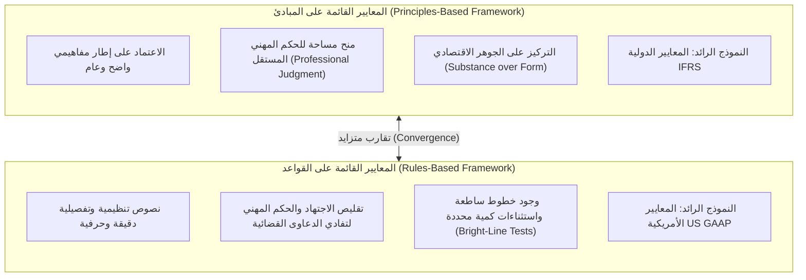
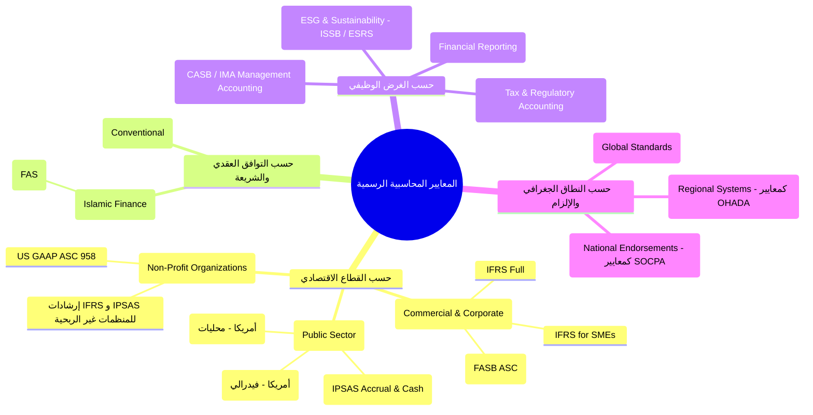
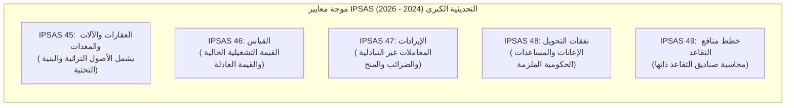
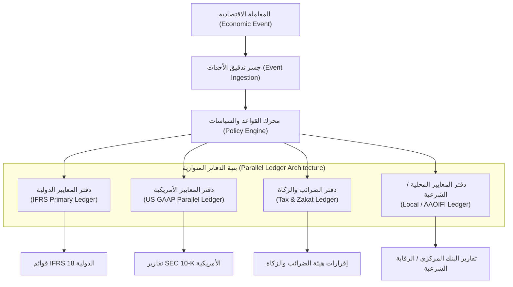

# البحث المرجعي الشامل في أنواع المعايير المحاسبية وأطرها الدولية والرسمية

## Comprehensive Research on Accounting Standards Types, Official Frameworks & Global Taxonomies

**تاريخ الإعداد والتوثيق:** 12 نوفمبر 2026  
**الموقع التنظيمي:** المستودع الهندسي للنواة المحاسبية (`accounting_engine/docs`)  
**الحالة:** معتمد كمرجع بحثي وتأسيسي لتصميم النظم المحاسبية متعددة المعايير (Multi-GAAP Engine Design)  
**المصادر الرسمية الأساسية:**

- مجلس معايير المحاسبة الدولية (IASB) ومؤسسة معايير التقرير المالي الدولية (IFRS Foundation)
- مجلس معايير المحاسبة المالية الأمريكي (FASB) ومؤسسة المحاسبة المالية (FAF)
- مجلس معايير المحاسبة الدولية للقطاع العام (IPSASB) التابع للاتحاد الدولي للمحاسبين (IFAC)
- هيئة المحاسبة والمراجعة للمؤسسات المالية الإسلامية (AAOIFI)
- مجلس معايير الاستدامة الدولية (ISSB)
- الهيئة السعودية للمراجعين والمحاسبين (SOCPA)
- مجلس معايير المحاسبة الحكومية الأمريكي (GASB)
- مجلس معايير محاسبة التكاليف الفيدرالي الأمريكي (CASB)
- مجلس معايير التدقيق والتأكيد الدولي (IAASB)

---

## 1. المدخل النظري والتصنيف الهيكلي للمعايير المحاسبية

### 1.1 ماهية المعايير المحاسبية (Concept & Purpose)

المعايير المحاسبية (**Accounting Standards**) هي مجموعة موحدة ومنسقة من المبادئ، القواعد، الإرشادات، والأسس الفنية الملزمة التي تحكم كيفية تحديد، قياس، تبويب، عرض، والإفصاح عن الأحداث والعمليات المالية والاقتصادية في القوائم والتقارير المالية ذات الغرض العام.

الهدف الأساسي من وجود هذه المعايير هو:

1. **الحد من التباين في الممارسات:** القضاء على العشوائية في المعالجات وتوحيد لغة المال والأعمال.
2. **تحقيق التمثيل الصادق (Faithful Representation):** ضمان أن القوائم المالية تعكس الجوهر الاقتصادي للأحداث قبل شكلها القانوني المكتبي (*Substance over Form*).
3. **تعزيز القابلية للمقارنة والتحقق (Comparability & Verifiability):** تمكين المستثمرين، المقرضين، والمشرعين من إجراء مقارنات دقيقة عبر الفترات الزمنية المختلفة وبين المنشآت المحلية والدولية.
4. **حماية أسواق المال والمستثمرين:** تقليص حالة عدم تناسق المعلومات (*Information Asymmetry*) وتوفير بيئة قائمة على الشفافية والمساءلة (*Accountability & Stewardship*).

---

### 1.2 الفلسفتان التأسيسيتان: المعايير القائمة على المبادئ مقابل القائمة على القواعد

تنقسم الأنظمة المحاسبية عالمياً إلى فلسفتين تصميميتين رئيسيتين:



1. **المعايير القائمة على المبادئ (Principles-Based):**
   - ترتكز على أهداف واضحة ومفاهيم جوهرية، وتضع المبدأ العام وتترك للإدارة والمحاسب القانوني تطبيق الحكم والاجتهاد المهني الموثق بما يعكس الواقع.
   - تمتاز بالمرونة والقدرة على استيعاب المعاملات المالية المبتكرة والمعقدة دون الحاجة لإصدار معيار جديد لكل حالة.
   - مثالها الأبرز: معايير التقرير المالي الدولية (**IFRS**).

2. **المعايير القائمة على القواعد (Rules-Based):**
   - تتضمن قواعد إجرائية دقيقة، تعليمات تفصيلية، واستثناءات متعددة لكل قطاع، بالإضافة إلى اختبارات رقمية صريحة (مثل اختبار الـ 75% أو 90% في تصنيف الإيجار سابقاً).
   - نشأت وتطورت في بيئات قانونية صارمة تعتمد على حماية المراجعين والشركات من ملاحقات قضايا التقاضي والمنازعات المالية.
   - مثالها الأبرز: معايير المحاسبة المالية الأمريكية (**US GAAP**).

---

### 1.3 خارطة تصنيف المعايير المحاسبية (Taxonomy Map)

تُصنف المعايير المحاسبية وفقاً لخمسة أبعاد محورية رئيسية:



---

## 2. النوع الأول: معايير التقرير المالي الدولية (IFRS / IAS Standards)

### 2.1 الجهة المصدرة والإطار المؤسسي

- **المؤسسة الأم:** مؤسسة معايير التقرير المالي الدولية (**IFRS Foundation**)، وهي منظمة مستقلة وغير ربحية تعمل للمصلحة العامة.
- **الهيئة التنفيذية:** مجلس معايير المحاسبة الدولية (**IASB - International Accounting Standards Board**)، مقره لندن.
- **الموقع الرسمي:** `https://www.ifrs.org`
- **نطاق الانتشار:** إلزامي أو مسموح به رسمياً في أكثر من **144 ولاية قضائية** حول العالم (بما فيها الاتحاد الأوروبي، المملكة المتحدة، كندا، أستراليا، دول الخليج العربي، وأغلب دول آسيا وأمريكا اللاتينية).

---

### 2.2 بنية المعايير الدولية الكاملة (Full IFRS)

تشتمل معايير IFRS على أربعة مكونات أساسية متكاملة:

1. **معايير التقرير المالي الدولية (IFRS Standards):** الصادرة عن مجلس IASB منذ تأسيسه في عام 2001 (من IFRS 1 حتى IFRS 19).
2. **معايير المحاسبة الدولية (IAS Standards):** المعايير التي أصدرتها لجنة معايير المحاسبة الدولية السابقة (IASC) بين 1973 و2001 وتم تبنيها واستمرارها بعد مراجعتها (من IAS 1 حتى IAS 41).
3. **تفسيرات لجنة تفسيرات المعايير الدولية (IFRIC Interpretations):** التفسيرات الصادرة لحل الخلافات التطبيقية المستجدة.
4. **تفسيرات لجنة التفسيرات الدائمة (SIC Interpretations):** التفسيرات التاريخية القديمة السارية.

---

### 2.3 المعايير الدولية الجوهرية (Core Heavyweight Standards)

#### أ. IFRS 9: الأدوات المالية (Financial Instruments)

- **مجال التطبيق:** التصنيف، القياس، انخفاض القيمة (الاضمحلال)، ومحاسبة التحوط.
- **نماذج القياس الثلاثة:**
  1. التكلفة المطفأة (*Amortized Cost*): لاختبار نموذج الأعمال التدفقات النقدية التعاقدية فقط (SPPI).
  2. القيمة العادلة من خلال الدخل الشامل الآخر (*FVOCI*).
  3. القيمة العادلة من خلال الأرباح أو الخسائر (*FVTPL*).
- **نموذج الخسائر الائتمانية المتوقعة (Expected Credit Losses - ECL):**
  - **المرحلة 1 (Stage 1):** أداء ائتماني طبيعي -> مخصص خسائر متوقعة لـ 12 شهراً.
  - **المرحلة 2 (Stage 2):** ارتفاع جوهري في المخاطر الائتمانية (SICR) -> مخصص خسائر متوقعة لكامل عمر الأداة (Lifetime ECL).
  - **المرحلة 3 (Stage 3):** تعثر ائتماني صريح (Credit-Impaired) -> مخصص كامل العمر واعتراف بالإيراد على أساس صافي القيمة الدفترية.

#### ب. IFRS 15: الإيراد من العقود مع العملاء (Revenue from Contracts with Customers)

- **النموذج الخماسي الموحد للاعتراف بالإيراد (Five-Step Model):**
  1. تحديد العقد (Identify the contract).
  2. تحديد التزامات الأداء المنفصلة (Identify performance obligations).
  3. تحديد سعر المعاملة (Determine transaction price).
  4. تخصيص سعر المعاملة على التزامات الأداء (Allocate transaction price).
  5. الاعتراف بالإيراد عند استيفاء التزام الأداء (Recognize revenue over time or point in time).

#### ج. IFRS 16: عقود الإيجار (Leases)

- **إلغاء الفصل بين الإيجار التشغيلي والتمويلي بالنسبة للمستأجر (Single Lessee Model):**
  - تسجيل أصل حق الاستخدام (*Right-of-Use Asset - ROU*) في جانب الأصول.
  - تسجيل التزام عقد الإيجار (*Lease Liability*) في جانب الخصوم محسوباً بالقيمة الحالية للمدفوعات المتبقية مخصومة بمعدل الفائدة الضمني أو معدل الاقتراض الإضافي للمستأجر.
  - استثناءات التخفيف: العقود قصيرة الأجل (أقل من 12 شهراً) والأصول منخفضة القيمة (Low-value assets).

#### د. IFRS 17: عقود التأمين (Insurance Contracts)

- استبدل المعيار المؤقت IFRS 4 اعتباراً من عام 2023.
- يُلزم شركات التأمين بحساب التزامات وثائق التأمين وفق التدفقات النقدية الحالية المعدلة للمخاطر (*Risk Adjustment*) مع تسجيل هامش الخدمة التعاقدية (*Contractual Service Margin - CSM*) الذي يمثل الربح غير المكتسب ويُعترف به تدريجياً عبر فترة التغطية.

---

### 2.4 المعايير الثورية الحديثة (إصدارات 2024 وتأثير 2026/2027)

#### أولاً: IFRS 18 — العرض والإفصاح في القوائم المالية (Presentation and Disclosure)

- **تاريخ الإصدار:** 9 أبريل 2024.
- **تاريخ السريان الإلزامي:** 1 يناير 2027 (مع السماح بالتطبيق المبكر).
- **الأثر المحوري:** **يلغي ويستبدل المعيار الأساسي التاريخي IAS 1**.
- **أهم التغييرات الهيكلية:**
  1. **تصنيف بيان الدخل إلى 5 فئات صلبة:**
     - الأنشطة التشغيلية (*Operating*): تشمل جميع الإيرادات والمصروفات المتعلقة بالأنشطة الأساسية (تُحسب بالاستبعاد لبقية الفئات).
     - الأنشطة الاستثمارية (*Investing*): عوائد الاستثمارات المستقلة وأدوات الملكية والنقد وما في حكمه.
     - الأنشطة التمويلية (*Financing*): تكاليف الاقتراض وتمويل رأس المال.
     - ضرائب الدخل (*Income Taxes*).
     - العمليات غير المستمرة (*Discontinued Operations*).
  2. **إلزامية المجاميع الفرعية (Mandatory Subtotals):**
     - فرض مقياس موحد وصارم لـ **الربح التشغيلي (Operating Profit)** الذي كان غائباً في IAS 1.
     - الربح قبل التمويل والضرائب.
  3. **تنظيم مقاييس الأداء المحددة من الإدارة (MPMs - Management-defined Performance Measures):**
     - إلزام الشركات بالإفصاح عن الأرقام غير المعيارية (Non-GAAP مثل EBITDA المعدل) في إيضاح مستقل مدقق، مع توفير تسوية حسابية دقيقة (*Reconciliation*) بينها وبين أقرب رقم مطابق في IFRS وتفسير سبب استخدامها.
  4. **مبادئ التجميع والتفصيل (Aggregation & Disaggregation):** منع دمج البنود الضخمة غير المتجانسة تحت بند "مصروفات أخرى" بدون بيان تفصيلي لمكوناتها.

#### ثانياً: IFRS 19 — الشركات التابعة التي لا تخضع للمساءلة العامة (Subsidiaries without Public Accountability: Disclosures)

- **تاريخ الإصدار:** 9 مايو 2024 (مع تحديثات 2025/2026).
- **تاريخ السريان الإلزامي:** 1 يناير 2027.
- **الهدف والتطبيق:**
  - موجه للشركات التابعة لشركات أم تطبق معايير IFRS الكاملة، ولكن الشركة التابعة نفسها ليس لديها أدوات دين أو أسهم مدرجة في البورصة وليست مؤسسة مالية ذات مساءلة عامة.
  - تطبق الشركة التابعة جميع متطلبات **الاعتراف والقياس (Recognition & Measurement)** الخاصة بـ IFRS الكامل، ولكنها تعفى من الغالبية العظمى من الإفصاحات المطولة والمعقدة، مما يوفر مليارات الدولارات من تكاليف الاحتفاظ بنظامين محاسبيين مختلفين للمجموعة والشركة التابعة.

---

### 2.5 معيار المنشآت الصغيرة والمتوسطة (IFRS for SMEs)

- معيار مستقل بذاته يقع في حوالي 250 إلى 300 صفحة، مقارنة بآلاف الصفحات في المعايير الكاملة.
- مخصص للكيانات التي ليست لها مساءلة عامة وتنشر قوائم مالية ذات أغراض عامة.
- **أهم التبسيطات:**
  - إلغاء الاعتراف بالأصول غير الملموسة المولدة داخلياً (كل تكاليف البحث والتطوير تذهب كمصروف).
  - عدم الاعتراف بالأدوات المالية المشتقة المعقدة إلا بالقيمة العادلة البسيطة.
  - إهلاك الشهرة (*Goodwill Amortization*) على مدار عمرها المفترض (إذا تعذر تحديده فيكون 10 سنوات)، بدلاً من اختبار الاضمحلال السنوي المعقد في IFRS الكامل.
  - تسجيل عقود الإيجار والضرائب المؤجلة بطرق مبسطة وخالية من تكاليف النمذجة الإحصائية المتقدمة.
  - حالياً في طور الإصدار الثالث المحدث والمحاذي لمعايير IFRS 9 و 15.

---

## 3. النوع الثاني: معايير المحاسبة الأمريكية (US GAAP) وتدوين ASC

### 3.1 الجهة المصدرة والإشراف الفيدرالي

- **الجهة المعيارية:** مجلس معايير المحاسبة المالية (**FASB - Financial Accounting Standards Board**).
- **المؤسسة الراعية والمشرفة:** مؤسسة المحاسبة المالية (**FAF - Financial Accounting Foundation**).
- **المرجع القانوني الاتحادي:** هيئة الأوراق المالية والبورصات الأمريكية (**SEC - Securities and Exchange Commission**)، والتي تمتلك بموجب القانون الفيدرالي (Securities Exchange Act of 1934) السلطة القانونية لفرض المعايير، وتفوض FASB رسمياً بصفتها الواضع المعياري للقطاع الخاص.
- **الموقع الرسمي:** `https://www.fasb.org` وقاعدة التدوين `https://asc.fasb.org`

---

### 3.2 هيكل تدوين معايير المحاسبة (FASB Accounting Standards Codification - ASC)

منذ يوليو 2009، ألغى مجلس FASB مئات المستندات التاريخية المنفصلة (FASB Statements, APB Opinions, ARBs) وأعاد ترتيب وتنظيم الأدبيات المحاسبية الأمريكية بالكامل تحت هيكل رقمي موحد يعرف بـ **ASC**، مقسم إلى أربعة مستويات:
`Topic (الموضوع) -> Subtopic (الموضوع الفرعي) -> Section (القسم) -> Paragraph (الفقرة)`

#### خريطة موضوعات التدوين الرئيسية (ASC Topics)

```text
ASC Structure Overview:
├── 100: General Principles (المبادئ التوجيهية العامة)
├── 200: Presentation (طرق وعناصر العرض)
│   ├── ASC 205: Presentation of Financial Statements
│   ├── ASC 210: Balance Sheet
│   ├── ASC 220: Income Statement & Comprehensive Income
│   └── ASC 230: Statement of Cash Flows
├── 300: Assets (الأصول)
│   ├── ASC 310: Receivables
│   ├── ASC 320: Investments - Debt Securities
│   ├── ASC 326: Financial Instruments - Credit Losses (CECL)
│   ├── ASC 330: Inventory
│   ├── ASC 350: Intangibles - Goodwill & Other
│   └── ASC 360: Property, Plant, and Equipment
├── 400: Liabilities (الالتزامات والخصوم)
│   ├── ASC 450: Contingencies
│   ├── ASC 470: Debt
│   └── ASC 480: Distinguishing Liabilities from Equity
├── 500: Equity (حقوق الملكية)
│   └── ASC 505: Equity
├── 600: Revenue (الإيرادات)
│   └── ASC 606: Revenue from Contracts with Customers
├── 700: Expenses (المصروفات والمنافع والضرائب)
│   ├── ASC 715: Compensation - Retirement Benefits
│   ├── ASC 718: Compensation - Stock Compensation
│   └── ASC 740: Income Taxes
├── 800: Broad Transactions (المعاملات المالية الشاملة والاندماجات)
│   ├── ASC 805: Business Combinations
│   ├── ASC 810: Consolidation
│   ├── ASC 820: Fair Value Measurement
│   └── ASC 842: Leases
└── 900: Industry Specific (معايير الصناعات المتخصصة)
    ├── ASC 946: Financial Services - Investment Companies
    ├── ASC 958: Not-for-Profit Entities
    ├── ASC 985: Software Development
    └── ASC 995: Utilities
```

- **آلية التحديث:** تصدر FASB تعديلات دورية تحت اسم "تحديثات معايير المحاسبة" (**ASUs - Accounting Standards Updates**) لتعديل نصوص تدوين ASC الرسمي.

---

### 3.3 مقارنة فنية جوهرية: IFRS مقابل US GAAP

| البعد الفني / المعاملة المحاسبية | المعايير الدولية (IFRS) | المعايير الأمريكية (US GAAP) | الأثر في هندسة النواة البرمجية |
| :--- | :--- | :--- | :--- |
| **تقييم المخزون بطريقة الوارد أخيراً صادر أولاً (LIFO)** | **محظور قطعياً** وفق معيار IAS 2 | **مسموح به قانونياً** (ASC 330) ومستخدم بكثرة لاعتبارات الضرائب الأمريكية | يتطلب محرك المخزون مرونة دعم خوارزميات LIFO فقط عند تشغيل وضع US GAAP |
| **رد خسائر انخفاض القيمة (Reversal of Impairment)** | **مسموح به** (باستثناء الشهرة Goodwill) إذا تحسنت الظروف الاقتصادية (IAS 36) | **محظور بشكل قاطع** للأصول طويلة الأجل؛ التخفيض يعتبر قاعدة تكلفة جديدة دائمة | مسار التدقيق يجب أن يمنع دالة الرد `ReverseImpairment` في بيئة GAAP |
| **تصنيف عقود الإيجار لدى المستأجر (Leases)** | **نموذج أحادي:** جميع العقود تسجل كأصل حق استخدام وإطفاء مع مصروف تمويل (IFRS 16) | **نموذج ثنائي (Dual Model):** تصنيف العقد إلى إيجار تشغيلي (Operating) أو تمويلي (Finance) (ASC 842) | الحاجة لمحركين لاحتساب مصروف الإيجار (Straight-line vs Front-loaded) |
| **خسائر الائتمان المتوقعة (Credit Losses)** | نموذج IFRS 9 ثلاثي المراحل (Stage 1: 12-month, Stage 2 & 3: Lifetime) | نموذج CECL (ASC 326): تسجيل الخسائر الائتمانية لكامل العمر الاقتصادي من لحظة النشأة | تباين في معادلات احتساب الاحتمالية والتعثر الزمني |
| **تكاليف التطوير (Development Costs)** | **تُرسمل كأصل غير ملموس** إجبارياً إذا استوفت معايير الجدوى الستة (IAS 38) | **تُحمل كمصروف فوراً** باستثناء برمجيات الاستخدام الداخلي أو البيع (ASC 350 / 985) | شجرة الحسابات وقواعد ترحيل الرواتب وتكاليف التطوير |
| **إعادة تقييم الأصول الثابتة (Revaluation Model)** | **مسموح به كسياسة محاسبية** بديلة للتكلفة التاريخية عبر الدخل الشامل (IAS 16) | **محظور كلياً؛** التقييم يقتصر فقط على التكلفة التاريخية ناقص مجمع الإهلاك | فصل دفاتر إعادة التقييم الموازية (Valuation Ledgers) |

---

## 4. النوع الثالث: معايير المحاسبة الدولية للقطاع العام (IPSAS) والمحاسبة الحكومية

### 4.1 الجهة المصدرة والأهداف

- **الجهة المسؤولة:** مجلس معايير المحاسبة الدولية للقطاع العام (**IPSASB - International Public Sector Accounting Standards Board**)، وهو مجلس مستقل مدعوم ومراقب من الاتحاد الدولي للمحاسبين (**IFAC**).
- **الموقع الرسمي:** `https://www.ipsasb.org`
- **المستهدفون:** الحكومات الفيدرالية والمركزية، الوزارات، الإدارات والهيئات العامة الإقليمية والبلدية، والمنظمات الدولية الحكومية مثل الأمم المتحدة (UN)، منظمة التعاون الاقتصادي والتنمية (OECD)، ومفوضية الاتحاد الأوروبي.
- **الهدف الجوهري:** تحسين الشفافية والمساءلة المالية، وقياس تكلفة الخدمات العامة وحجم الديون الحقيقية والالتزامات السيادية طويلة الأجل، والتحول من النظرة الميزانية الضيقة إلى إدارة الثروة العامة الشاملة.

---

### 4.2 نوعا معايير IPSAS الرئيسية: الأساس النقدي مقابل أساس الاستحقاق

#### 1. معيار الأساس النقدي (Cash Basis IPSAS)

- معيار شامل واحد: *Financial Reporting Under The Cash Basis of Accounting*.
- يعترف بالإيرادات عند استلام النقد في الخزينة العامة، ويعترف بالنفقات عند الصرف الفعلي.
- لا يتضمن ميزانية عمومية (قائمة مركز مالي) بالمعنى التجاري ولا يسجل الأصول الرأسمالية أو الالتزامات المستقبلية.
- يستخدم كـ "مرحلة انتقالية" للدول النامية قبل جاهزيتها للانتقال إلى أساس الاستحقاق.

#### 2. معايير أساس الاستحقاق (Accrual Basis IPSAS - Standards 1 to 49)

- تحاكي معايير IFRS مع تكييفها وتطويرها لتلائم خصوصيات القطاع الحكومي والسيادي.
- تسجل الأصول الحكومية والالتزامات وحقوق الدولة، وتقيس الاستهلاك والإهلاك والديون السيادية بدقة.

---

### 4.3 الخصائص الفريدة وأحدث المعايير الثورية في القطاع العام (IPSAS 45 – 49)



1. **IPSAS 45 — العقارات والآلات والمعدات (بديل IPSAS 17):**
   - استوعب المعالجة الفنية الصعبة لـ **أصول البنية التحتية (Infrastructure Assets)** مثل الطرق، الجسور، وشبكات الصرف، و**الأصول التراثية (Heritage Assets)** كالمتاحف والآثار التاريخية.
2. **IPSAS 46 — القياس (Measurement Framework):**
   - أدخل مفهوماً محاسبياً ثورياً خاصاً بالقطاع العام هو **"القيمة التشغيلية الحالية" (Current Operational Value)**؛ حيث تقيم الأصول الحكومية بقدرتها على تقديم الخدمة العامة والمنفعة الاجتماعية، وليس بقيمتها المالية في سوق البيع (القيمة العادلة).
3. **IPSAS 47 — الإيرادات (Revenue):**
   - دمج معايير الإيرادات القديمة (IPSAS 9 و 11 و 23) في معيار شامل، مع إرساء قواعد قوية للمحاسبة عن **المعاملات غير التبادلية (Non-Exchange Transactions)** كالضرائب، الرسوم السيادية، الغرامات، والمنح الدولية.
4. **IPSAS 48 — نفقات التحويل (Transfer Expenses):**
   - وضع إطاراً علمياً للاعتراف بالنفقات التي تدفعها الدولة دون مقابل مباشر كمعاشات الضمان الاجتماعي والإعانات والتحويلات للبلديات.
5. **IPSAS 49 — خطط منافع التقاعد (Retirement Benefit Plans):**
   - صاغ قواعد إعداد التقارير المالية الخاصة بصناديق ومعاشات التقاعد الحكومية لبيان العجز الاكتواري وحماية أموال المتقاعدين.

---

### 4.4 معايير المحاسبة الحكومية الأمريكية الموازية: GASB و FASAB

- **مجلس معايير المحاسبة الحكومية الأمريكي (GASB - Governmental Accounting Standards Board):**
  - جهة مستقلة شقيقة لـ FASB تتبع مؤسسة FAF، ومسؤولة حصراً عن وضع معايير المحاسبة للولايات والمدن والمقاطعات والبلديات والجامعات الحكومية داخل الولايات المتحدة.
  - موقعها: `https://www.gasb.org`.
  - تتميز بمفهوم **محاسبة الصناديق (Fund Accounting)** وقوائم الموارد الاقتصادية والتدفقات المالية الجارية.
- **مجلس استشارات معايير المحاسبة الفيدرالية الأمريكي (FASAB):**
  - مسؤول عن وضع معايير إعداد التقارير للحكومة الفيدرالية الأمريكية بكامل وزاراتها ووكالاتها المركزية.

---

## 5. النوع الرابع: معايير المحاسبة المالية الإسلامية (AAOIFI FAS)

### 5.1 الجهة المصدرة والمكانة الدولية

- **الجهة المسؤولة:** هيئة المحاسبة والمراجعة للمؤسسات المالية الإسلامية (**AAOIFI - Accounting and Auditing Organization for Islamic Financial Institutions**)، تأسست عام 1991 ومقرها العاصمة البحرينية المنامة.
- **الموقع الرسمي:** `https://aaoifi.com`
- **مجالات المعايير:** تصدر الهيئة 5 حزم معيارية رئيسية:
  1. معايير المحاسبة المالية (**FAS - Financial Accounting Standards**).
  2. معايير الضبط والحوكمة (**GSIFI - Governance Standards**).
  3. المعايير الشرعية (**Shari'ah Standards**) وهي المرجع الفقهي والتعاقدي الأكبر في العالم.
  4. معايير التدقيق والمراجعة (**ISFI**).
  5. معايير الأخلاقيات المهنية (**Ethics Standards**).

---

### 5.2 الخصوصية الفلسفية والشرعية لمعايير AAOIFI

تختلف معايير AAOIFI جذرياً عن المعايير التقليدية لأنها تنبع من أحكام الفقه الإسلامي المالي:

1. **حظر الفوائد الربوية (Riba Prohibition):** إلغاء أي مفهوم للفائدة كإيراد أو تكلفة زمنية بحتة للنقود دون أصل أو جهد.
2. **ارتباط المعاملة بالأصول الحقيقية (Asset-Backed / Asset-Based):** التمويل لا يتم نقد بنقد بزيادة، بل من خلال عقود بيع أو إجارة أو شراكة حقيقية تقع على أعيان ومنافع.
3. **اقتسام الأرباح وتحمل الخسائر (Profit & Loss Sharing):** استبدال الودائع الاستثمارية ذات العائد الثابت المضمون بحسابات استثمار قائمة على المضاربة والمشاركة.
4. **حظر الغرر والمقامرة (Gharar & Maysir):** حظر المشتقات المالية الاحتيالية والمضاربات الصفرية.

---

### 5.3 أحدث المعايير المحاسبية المالية الإسلامية (إصدارات وتحديثات 2024 – 2026)

| رقم المعيار | عنوان المعيار الرسمي | التوصيف الفني وأهميته للنظام المحاسبي | تاريخ السريان |
| :--- | :--- | :--- | :--- |
| **FAS 40** | القوائم المالية لنوافذ الصيرفة الإسلامية (*Islamic Finance Windows*) | يحكم المؤسسات المالية التقليدية التي تمتلك فروعاً أو نوافذ إسلامية؛ فرض الفصل التام بين الأموال وحظر الخلط وتحديد الدفاتر المستقلة | سارٍ (مع تحديثات 2026) |
| **FAS 42** | العرض والإفصاح في القوائم المالية لمؤسسات التكافل | تنظيم القوائم المالية لشركات التأمين الإسلامي (التكافل)، وفصل حسابات المشتركين (حملة الوثائق) عن حسابات المساهمين | سارٍ ومحدث |
| **FAS 43** | المحاسبة عن التكافل: الاعتراف والقياس | إعادة هيكلة الاعتراف بصندوق التكافل، وتوزيع الفائض التأميني، وقياس العجز والقرض الحسن، والتكامل مع النماذج العالمية | نافذ في دورات 2025/2026 |
| **FAS 44** | تحديد السيطرة على الأصول والأعمال | وضع ضوابط سيطرة تتوافق مع ملكية الأصول الشرعية ومخاطر الضمان، لبيان ما يدخل في الميزانية العمومية | سارٍ |
| **FAS 45** | شبه حقوق الملكية (شاملاً حسابات الاستثمار) (*Quasi-Equity*) | **معيار تاريخي:** ألغى المعالجات القديمة؛ حسابات الاستثمار المطلقة لا تصنف التزاماً ولا حقوق ملكية بل فئة وسيطة مستقلة تماماً (*Quasi-Equity*) تعكس الشراكة | **إلزامي 1 يناير 2026** |
| **FAS 46** | الأصول المدارة خارج الميزانية العمومية (*Off-Balance-Sheet AUM*) | يحكم قياس والإفصاح عن أموال العملاء والمحافظ والصناديق التي يديرها البنك بصفته وكيلاً بالاستثمار دون تحمل مخاطر رأس المال | **إلزامي 1 يناير 2026** |
| **FAS 47** | تحويل الأصول بين الأوعية الاستثمارية | استبدل FAS 21؛ وضع قواعد صارمة لمنع تضارب المصالح عند نقل أصل من محفظة البنك إلى محفظة المودعين أو العكس بقيمة عادلة | **إلزامي 1 يناير 2026** |
| **FAS 49** | إعداد التقارير المالية في الاقتصادات شديدة التضخم | معيار جديد أصدرته AAOIFI لتعديل القوائم المالية للمصارف الإسلامية التي تعمل في بيئات ذات تضخم نقدي حاد | **إلزامي 1 يناير 2026** |
| **FAS 50** | التقارير المالية لمؤسسات وصناديق الاستثمار الإسلامية | استبدل المعيار القديم FAS 14؛ وفرض إفصاحات حديثة عن صافي قيمة الأصول (NAV) والرسوم ومصروفات الإدارة الشرعية | قيد التطبيق المؤسسي |

---

## 6. النوع الخامس: معايير الاستدامة والإفصاح المالي المرتبط بالمناخ (Sustainability & ESG)

### 6.1 مجلس معايير الاستدامة الدولية (ISSB) التابع لـ IFRS Foundation

- **التأسيس:** أعلنت مؤسسة IFRS عن تأسيس مجلس معايير الاستدامة الدولية (**ISSB - International Sustainability Standards Board**) في مؤتمر المناخ COP26 في غلاسكو، لتلبية متطلبات المستثمرين لبيانات استدامة موحدة وقابلة للمقارنة مالياً.
- **المعايير الصادرة رسمياً (بدء السريان الفعلي):**
  1. **IFRS S1: المتطلبات العامة للإفصاح عن المعلومات المالية المتعلقة بالاستدامة:**
     - يطلب من المنشأة الإفصاح عن المخاطر والفرص المتعلقة بالاستدامة والتي قد تؤثر على التدفقات النقدية للمنشأة، وقدرتها على الحصول على التمويل وتكلفة رأس المال على المدى القصير والمتوسط والبعيد.
     - مبني على 4 ركائز حوكمة مأخوذة من إطار TCFD: (الحوكمة، الاستراتيجية، إدارة المخاطر، والمقاييس والأهداف).
  2. **IFRS S2: الإفصاحات المتعلقة بالمناخ:**
     - يتطلب إفصاحاً كمياً صريحاً عن انبعاثات الغازات الدفيئة عبر النطاقات الثلاثة:
       - **النطاق 1 (Scope 1):** الانبعاثات المباشرة من مصادر المنشأة.
       - **النطاق 2 (Scope 2):** الانبعاثات غير المباشرة الناتجة عن الكهرباء والطاقة المشتراة.
       - **النطاق 3 (Scope 3):** انبعاثات سلسلة القيمة والتوريد الشاملة للمنشأة.

---

### 6.2 معايير الاستدامة الأوروبية (ESRS) ومفهوم الأهمية النسبية المزدوجة

- **الجهة المصدرة:** المجموعة الاستشارية الأوروبية للتقارير المالية (**EFRAG**)، بتفويض من المفوضية الأوروبية بموجب توجيه تقارير استدامة الشركات (**CSRD**).
- **مفهوم الأهمية النسبية المزدوجة (Double Materiality):**
  - **الأهمية النسبية المالية (Financial Materiality):** كيف تؤثر البيئة والمناخ على القيمة المالية للشركة (من الخارج إلى الداخل - Outside-In)، وهو ما يركز عليه ISSB.
  - **الأهمية النسبية للأثر (Impact Materiality):** كيف تؤثر عمليات الشركة ونشاطها على المجتمع والبيئة وحقوق الإنسان (من الداخل إلى الخارج - Inside-Out).
  - تجمع معايير ESRS الأوروبية بين البعدين إلزامياً لآلاف الشركات العاملة في أوروبا.

---

## 7. النوع السادس: المعايير الوطنية وتعديلاتها الرسمية (National Endorsement Frameworks)

تتبنى العديد من الدول المعايير الدولية IFRS ولكن من خلال عملية تدقيق واعتماد وطني رسمية (Endorsement Process)، ومن أبرز النماذج:

### 7.1 المملكة العربية السعودية (SOCPA)

- **الجهة الرسمية:** الهيئة السعودية للمراجعين والمحاسبين (**SOCPA - Saudi Organization for Chartered and Professional Accountants**).
- **الموقع الرسمي:** `https://socpa.org.sa`
- **المعايير المعتمدة:**
  1. **معايير التقرير المالي الدولية المعتمدة في المملكة العربية السعودية (IFRS endorsed by SOCPA):**
     - تعتمد نص معايير IFRS الكامل مع إصدار مذكرات توضيحية وإلزامية لبعض الجوانب (مثل اشتراط الإفصاح عن الزكاة الشرعية وضريبة الدخل في القوائم وفق المعيار السعودي المعتمد للزكاة وضريبة الدخل).
  2. **معيار التقرير المالي للمنشآت الصغيرة والمتوسطة المعتمد في المملكة.**
  3. **معيار الزكاة وضريبة الدخل:** الذي يحكم احتساب الوعاء الزكوي وقواعد هيئة الزكاة والضريبة والجمارك (ZATCA).

### 7.2 المملكة المتحدة (UK GAAP - FRC)

- **مجلس التقارير المالية البريطاني (FRC):**
  - أصدر سلسلة معايير FRS (مثل FRS 100, 101, 102, 105).
  - المعيار الأبرز هو **FRS 102**، وهو نظام محاسبي مبسط ومرتكز على معيار IFRS for SMEs ولكن مع تعديلات جوهرية توافق قانون الشركات البريطاني وقواعد الضرائب المحلية.

### 7.3 النظم القارية الأوروبية (مثل HGB في ألمانيا و PCG في فرنسا)

- تعتمد على نصوص القانون التجاري المنظم للدفاتر المحاسبية.
- تهتم بمبدأ **الحيطة والحذر الشديد (Prudence Principle)** وحماية الدائنين والربط الوثيق بين القوائم المالية والمحاسبة الضريبية، مقارنة بتركيز IFRS على القيمة العادلة للمستثمرين.

### 7.4 النظام المحاسبي الموحد لدول غرب ووسط إفريقيا (OHADA / SYSCOHADA)

- نظام موحد يحكم 17 دولة إفريقية ناطقة بالفرنسية، يدمج بين القانون التجاري، شجرة حسابات رقمية موحدة وإلزامية لجميع الشركات، وتنسيق إعداد القوائم الختامية.

---

## 8. النوع السابع: معايير محاسبة التكاليف والمحاسبة الإدارية

### 8.1 مجلس معايير محاسبة التكاليف الأمريكي (CASB)

- **السلطة القانونية:** مجلس فيدرالي أمريكي تابع لمكتب سياسات الشراء الفيدرالي (OFPP) بموجب اللوائح الفيدرالية (**48 CFR Part 9904**).
- **نطاق التطبيق:** إلزامي على جميع الشركات والكيانات التي تبرم عقود توريد كبرى مع الحكومة الفيدرالية ووزارة الدفاع الأمريكية (DoD).
- **أهم المعايير (CAS 401 إلى CAS 420):**
  - **CAS 401:** الاتساق في تقدير وتراكم وتسجيل التكاليف.
  - **CAS 402:** الاتساق في تخصيص التكاليف المباشرة وغير المباشرة لنفس الغرض.
  - **CAS 403 / 404:** تخصيص نفقات المكاتب الرئيسية ورسملة الأصول الثابتة.
  - **CAS 414:** تكلفة الأموال كعنصر من تكلفة رأس المال العامل والتسهيلات.

### 8.2 إرشادات معهد المحاسبين الإداريين (IMA) ومحاسبة الإدارة

- بيانات المحاسبة الإدارية (**Statements on Management Accounting - SMAs**).
- تركز على صنع القرارات الداخلية، محاسبة التكاليف على أساس الأنشطة (**ABC**)، والتسعير المستهدف (**Target Costing**)، ونماذج الموازنات التقديرية والتخطيط المالي (FP&A)، ولا تخضع لمتطلبات النشر الخارجي.

---

## 9. التقاطعات الهندسية والحدود الفاصلة بين الأنظمة المحاسبية

### 9.1 المحاسبة المالية (Financial Accounting) مقابل المحاسبة الضريبية (Tax Accounting)

- **المحاسبة المالية:** موجهة للمستثمرين والمقرضين وفقاً لمبدأ الاستحقاق والجوهر الاقتصادي.
- **المحاسبة الضريبية:** موجهة للسلطات الضريبية وفقاً لقوانين جباية الإيرادات العامة ونصوص اللوائح المنفذة.
- **الفروق الناتجة (Differences):**
  1. **فروق دائمة (Permanent Differences):** مصروفات معترف بها محاسبياً ولا تسمح بها الأنظمة الضريبية إطلاقاً (مثل الغرامات والعقوبات القانونية)، أو إيرادات معفاة من الضرائب.
  2. **فروق توقيت مؤقتة (Temporary Differences):** تباين زمني في لحظة الاعتراف بين المحاسبة والضريبة (مثل إهلاك الأصول السريع ضريبياً مقابل الإهلاك الخطي محاسبياً).
  3. **الأثر المالي في النواة:** ينتج عنها أصول ضريبية مؤجلة (**DTA**) والتزامات ضريبية مؤجلة (**DTL**) وفق معيار **IAS 12** أو **ASC 740**.

### 9.2 المعايير المحاسبية مقابل معايير التدقيق (Auditing Standards)

- **المعايير المحاسبية (Accounting Standards):** مسؤولية **إدارة المنشأة** لإعداد وعرض الأرقام والبيانات.
- **معايير التدقيق والمراجعة (Auditing Standards):** مسؤولية **المراجع الخارجي المستقل** لتقييم وفحص مدى عدالة ومصداقية تلك القوائم.
  - **المعايير الدولية للمراجعة (ISA):** الصادرة عن مجلس معايير التدقيق والتأكيد الدولي (**IAASB - IFAC**).
  - **معايير PCAOB:** لمراجعي الشركات العامة المدرجة في الأسواق الأمريكية.
  - **معايير INTOSAI (ISSAI):** للأجهزة العليا للرقابة المالية والمحاسبة في القطاع الحكومي (دواوين المحاسبة).

---

## 10. مصفوفة المقارنة الشاملة بين الأطر الرسمية الرئيسية

| الخاصية / المعيار | معايير IFRS الدولية | معايير US GAAP الأمريكية | معايير IPSAS الحكومية | معايير AAOIFI الإسلامية | معايير ISSB الاستدامة |
| :--- | :--- | :--- | :--- | :--- | :--- |
| **الجهة المصدرة** | IASB / IFRS Foundation | FASB / SEC | IPSASB / IFAC | AAOIFI | ISSB / IFRS Foundation |
| **المستفيد الأول** | مستثمرو ومقرضو أسواق المال عالمياً | المستثمرون والأسواق المالية الأمريكية | المواطنون، البرلمانات، والمقرضون الدوليون | المتعاملون والمودعون وفق الشريعة الإسلامية | المستثمرون المهتمون بمخاطر المناخ والـ ESG |
| **فلسفة البناء** | مبادئ وإطار مفاهيمي مرن (Principles) | قواعد تفصيلية ونصوص قطاعية (Rules) | ملاءمة المصلحة والخدمة العامة والسيادة | مطابقة تامة لأحكام ومقاصد الشريعة | إفصاح مالي متكامل مع القوائم المالية |
| **أساس الإثبات** | استحقاق كامل (Accrual) | استحقاق كامل (Accrual) | استحقاق أو نقدي (Accrual or Cash) | استحقاق مقيد بضوابط القبض والملك الشرعي | إفصاحات كمية ونوعية وتنبؤية |
| **التقييم الرئيسي** | نموذج مختلط (تكلفة وقيمة عادلة واسعة) | تكلفة تاريخية صارمة وقيمة عادلة مقيدة | تكلفة وقيمة تشغيلية حالية وقيمة عادلة | تكلفة تاريخية وقيمة عادلة منضبطة شرعياً | مقاييس الانبعاثات وتحليل السيناريوهات |
| **أحدث الإصدارات الحاكمة** | IFRS 18 (2027) و IFRS 19 (2027) | تحديثات CECL و ASUs المستمرة | IPSAS 45 حتى IPSAS 49 (2025/2026) | FAS 45, 46, 47, 49 (2026) | IFRS S1 و IFRS S2 (2024/2026) |

---

## 11. التوصيات الهندسية المعمارية لتصميم النواة المحاسبية (Multi-Standard Engine)

لبناء محرك محاسبي متطور وقادر على العمل في بيئات دولية متعددة المعايير (Global Enterprise Multi-Standard Engine)، يجب مراعاة المبادئ المعمارية التالية:



1. **اعتماد نمط الدفاتر المتوازية (Parallel Ledgers / Valuation Ledgers):**
   - تخصيص "دفتر أستاذ رئيسي" (Primary Ledger) لمعيار التقارير المعتمد للشركة الأم (مثلاً IFRS).
   - تخصيص "دفاتر موازية" (Secondary / Extension Ledgers) لتسجيل قيود التسوية والتعديلات الخاصة بمعيار آخر (مثل فروق LIFO في US GAAP أو فروق إهلاك الضرائب أو مخصصات AAOIFI)، دون تلويث الدفتر الرئيسي.

2. **عزل سياسات القياس المحاسبي (Configurable Policy Units):**
   - عدم تضمين الحسابات المعيارية الصلبة داخل الكود الأساسي (*No Hardcoded Accounting Rules*).
   - تصميم محرك السياسات بحيث يستقبل قواعد الإهلاك، نماذج خسائر الائتمان (ECL مقابل CECL)، واعتراف الإيجار كمدخلات وسياسات وظيفية مستقلة (`Units`).

3. **شجرة حسابات متعددة التبويب (Multi-Dimensional COA):**
   - دعم التعيين المزدوج للحسابات (*Dual Chart of Accounts Mapping*) لتمكين المنشأة من استخراج القوائم وفق IFRS 18 بتصنيفاته الخمسة الجديدة، وفي الوقت ذاته توليد الإقرارات الضريبية والزكوية المحلية المتوافقة مع متطلبات الدولة المضيفة.

---

## 12. فهرس المصادر والروابط الرسمية المعتمدة (Primary Official References)

1. **مؤسسة المعايير الدولية للتقرير المالي (IFRS Foundation):**
   - البوابة الرسمية للمعايير: [https://www.ifrs.org/issued-standards/list-of-standards/](https://www.ifrs.org/issued-standards/list-of-standards/)
   - مشروع القوائم المالية الأساسية ومعيار IFRS 18: [https://www.ifrs.org/projects/work-plan/primary-financial-statements/](https://www.ifrs.org/projects/work-plan/primary-financial-statements/)
   - معيار IFRS 19 للشركات التابعة: [https://www.ifrs.org/issued-standards/list-of-standards/ifrs-19-subsidiaries-without-public-accountability-disclosures/](https://www.ifrs.org/issued-standards/list-of-standards/ifrs-19-subsidiaries-without-public-accountability-disclosures/)
2. **مجلس معايير المحاسبة المالية الأمريكي (FASB):**
   - بوابة تدوين المعايير الأمريكية (FASB ASC): [https://asc.fasb.org/](https://asc.fasb.org/)
   - التحديثات والإصدارات الجديدة: [https://www.fasb.org/standards/accounting-standards-updates](https://www.fasb.org/standards/accounting-standards-updates)
3. **مجلس معايير المحاسبة الدولية للقطاع العام (IPSASB):**
   - كتيب معايير المحاسبة الحكومية والقطاع العام: [https://www.ipsasb.org/publications/handbook-international-public-sector-accounting-pronouncements](https://www.ipsasb.org/publications/handbook-international-public-sector-accounting-pronouncements)
   - المعايير الجديدة IPSAS 45 إلى 49: [https://www.ipsasb.org/standards-projects](https://www.ipsasb.org/standards-projects)
4. **هيئة المحاسبة والمراجعة للمؤسسات المالية الإسلامية (AAOIFI):**
   - بوابة المعايير المحاسبية المالية (FAS): [https://aaoifi.com/financial-accounting-standards/?lang=en](https://aaoifi.com/financial-accounting-standards/?lang=en)
   - قرارات وتحديثات المجلس المحاسبي: [https://aaoifi.com/category/news/?lang=en](https://aaoifi.com/category/news/?lang=en)
5. **مجلس معايير الاستدامة الدولية (ISSB):**
   - معايير IFRS S1 و IFRS S2: [https://www.ifrs.org/issued-standards/sustainability-reporting-standards-list/](https://www.ifrs.org/issued-standards/sustainability-reporting-standards-list/)
6. **الهيئة السعودية للمراجعين والمحاسبين (SOCPA):**
   - معايير المحاسبة المعتمدة في المملكة العربية السعودية: [https://socpa.org.sa/SOCPA/Standards/Accounting-Standards.aspx](https://socpa.org.sa/SOCPA/Standards/Accounting-Standards.aspx)
7. **مجلس معايير التدقيق والتأكيد الدولي (IAASB):**
   - معايير التدقيق الدولية (ISA): [https://www.iaasb.org/standards-pronouncements](https://www.iaasb.org/standards-pronouncements)
8. **مجلس معايير المحاسبة الحكومية الأمريكي (GASB):**
   - معايير الولايات والبلديات: [https://www.gasb.org/standards](https://www.gasb.org/standards)
