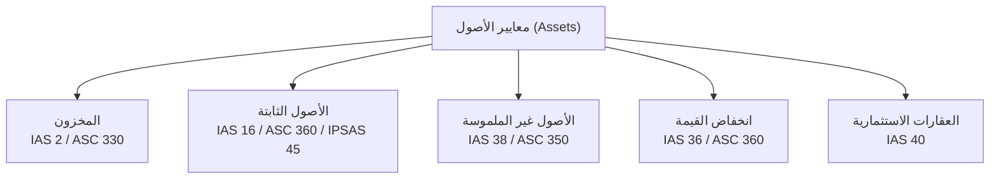
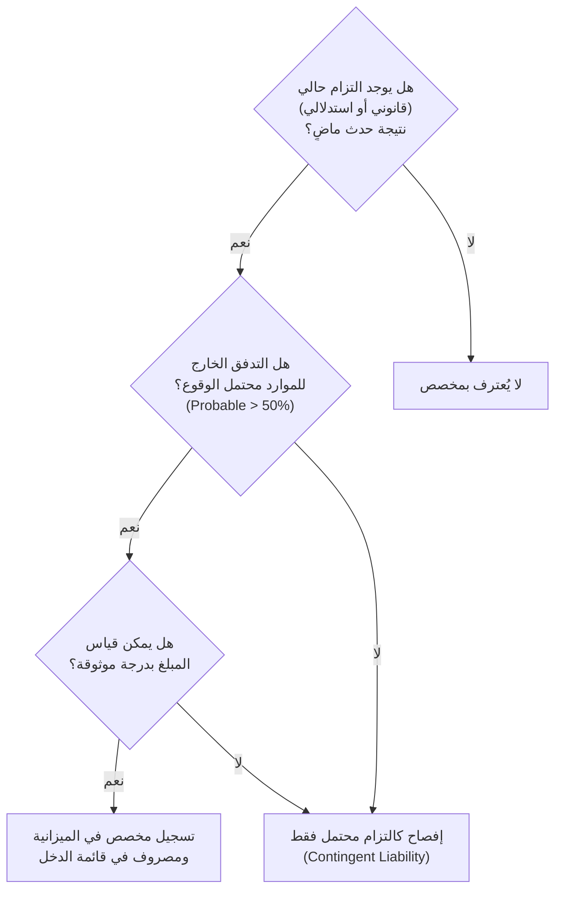
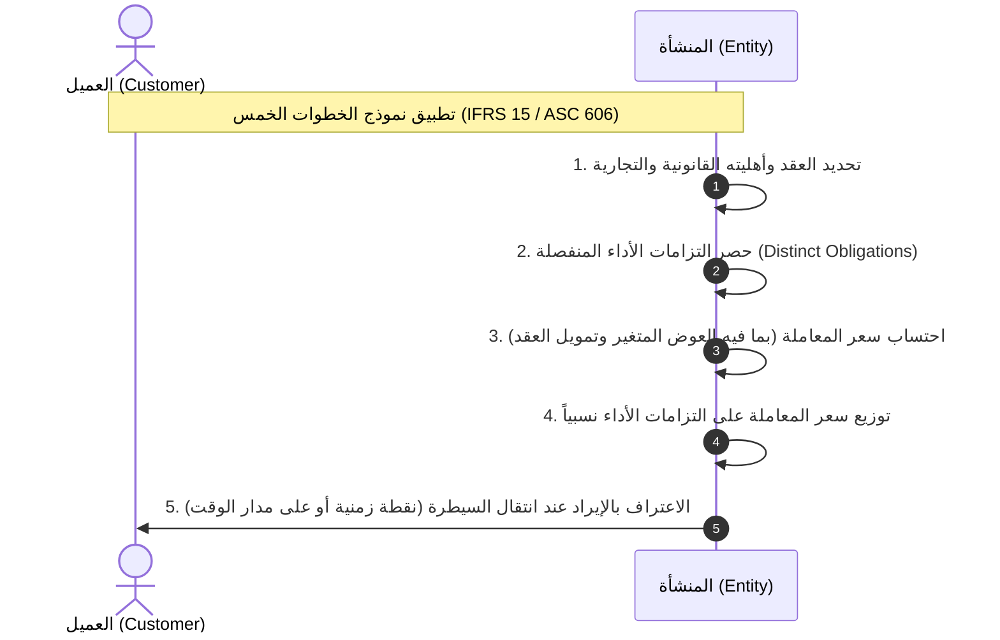
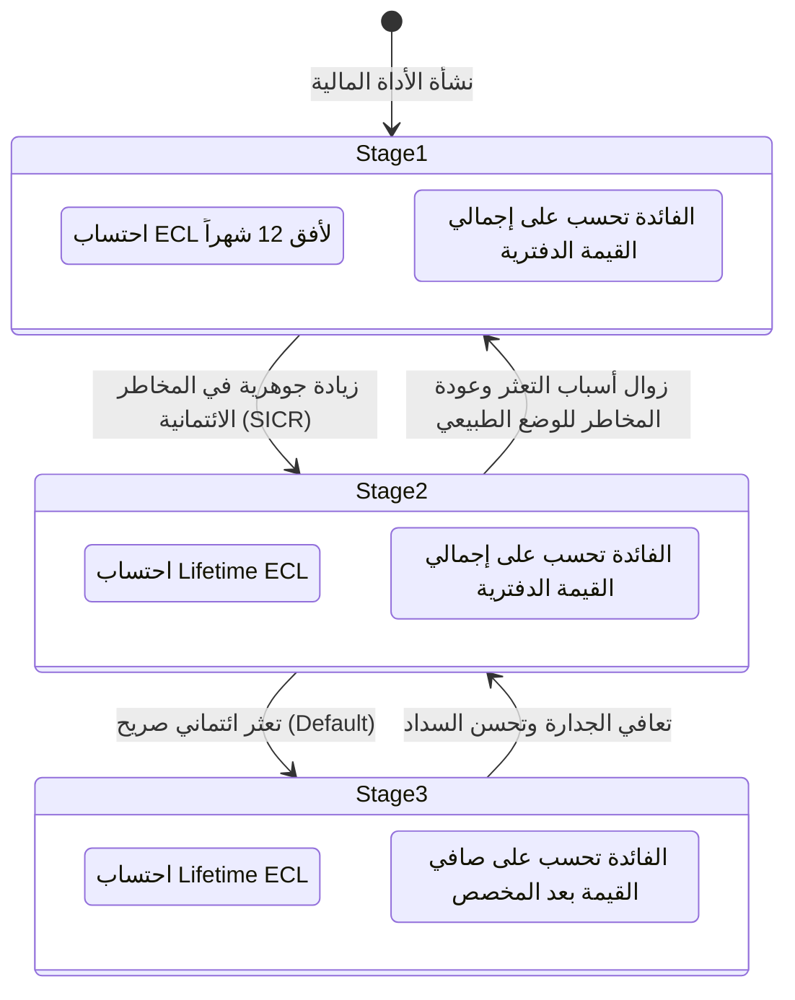
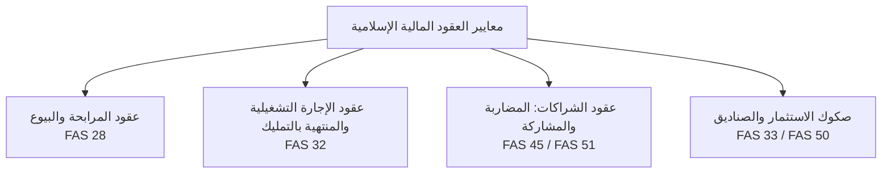

# الدليل الفني الشامل لأنواع المعايير المحاسبية ومعالجاتها التشغيلية

## Comprehensive Technical Guide to Accounting Standards Types, Mechanics & Measurement Models

**تاريخ التوثيق:** 12 نوفمبر 2026  
**الموقع التنظيمي:** المستودع الفني للنواة المحاسبية (`accounting_engine/docs`)  
**طبيعة الوثيقة:** مرجع محاسبي تطبيقي متخصص يركز حصرياً على **نصوص، أنواع، آليات، وقياسات المعايير المحاسبية** بدلاً من الهيئات أو المؤسسين.

---

## 1. الفهرس الهيكلي لتصنيف المعايير المحاسبية بحسب الموضوع الفني

تنقسم المعايير المحاسبية تطبيقياً إلى **10 قطاعات موضوعية** تغطي الدورة المالية المحاسبية بالكامل:


---

## 2. معايير العرض وهيكلة القوائم المالية (Presentation & Structure)

تهدف هذه المعايير إلى ضبط النموذج البنائي للقوائم المالية، وشروط تبويب البنود، وقواعد الإفصاح والتسوية.

### 2.1 معايير العرض الشامل للقوائم المالية (IAS 1 / IFRS 18 / ASC 205)

#### أ. قواعد التبويب والاعتراف

- **الفصل بين البنود المتداولة وغير المتداولة (Current vs Non-Current Distinction):**
  - **الأصل/الالتزام المتداول:** ما يتوقع تحققه أو تسويته خلال الدورة التشغيلية العادية (Operating Cycle) أو خلال 12 شهراً من تاريخ التقرير، أو ما يحتفظ به لغرض المتاجرة.
  - **الأصل/الالتزام غير المتداول:** كافة الأصول والالتزامات طويلة الأجل التي تزيد مدة حيازتها أو استحقاقها عن عام مالي كامل.
- **حظر المقاصة (No Offsetting Rule):** يحظر إجراء مقاصة بين الأصول والخصوم أو بين الإيرادات والمصروفات إلا إذا كان ذلك منصوصاً عليه صراحة في معيار مستقل، أو عند تصفية معاملات غير جوهرية ناتجة عن نفس العملية.

#### ب. تصنيف قائمة الدخل إلى 5 فئات تشغيلية وهيكلية (وفق أحدث معايير العرض IFRS 18)

1. **فئة الأنشطة التشغيلية (Operating Category):** تشمل جميع الإيرادات والمصروفات الناتجة عن الأنشطة المولدة للدخل الرئيسي للمنشأة (وتُحسب بالاستبعاد لكافة الفئات الأربع الأخرى).
2. **فئة الأنشطة الاستثمارية (Investing Category):** الدخل والمصروفات المتولدة من الأصول التي تولد عائداً مستقلاً عن بقية موارد المنشأة (مثل أرباح الأسهم، عوائد الاستثمارات العقارية المستقلة، الفوائد المحصلة من الودائع النقدية).
3. **فئة الأنشطة التمويلية (Financing Category):** الالتزامات الناشئة حصراً عن رفع التمويل الرأسمالي أو الديون (فوائد القروض، إصدارات السندات، توزيعات الأرباح على الأسهم الممتازة).
4. **فئة ضرائب الدخل (Income Taxes):** مصروف الضريبة الجاري والمؤجل.
5. **فئة العمليات غير المستمرة (Discontinued Operations):** نتائج تصفية خطوط الإنتاج أو القطاعات التشغيلية المستبعدة.

#### ج. مقاييس الأداء المحددة من الإدارة (MPMs)

- يُلزم المعيار بإدراج أي مقياس ربحية غير خاضع للمعايير الصريحة (مثل Adjusted EBITDA) داخل إيضاح مدقق، مع تسوية حسابية تبين الفروق بينه وبين أقرب رقم معياري معتمد.

---

### 2.2 معايير قائمة التدفقات النقدية (IAS 7 / ASC 230 / IPSAS 2)

توزع السيولة والتدفقات النقدية الداخلة والخارجة على **ثلاثة أنشطة رئيسية**:

```text
قائمة التدفقات النقدية (Cash Flow Statement Taxonomy):
├── 1. التدفقات من الأنشطة التشغيلية (Operating Activities)
│   ├── الطريقة المباشرة (Direct Method): إجمالي المقبوضات النقدية من العملاء ناقص المدفوعات للموردين والموظفين
│   └── الطريقة غير المباشرة (Indirect Method): تعديل صافي الربح بالبنود غير النقدية (الإهلاك، المخصصات) والتغير في رأس المال العامل
├── 2. التدفقات من الأنشطة الاستثمارية (Investing Activities)
│   ├── شراء واستبعاد العقارات والآلات والمعدات (CapEx)
│   └── شراء أو بيع استثمارات مالية أو شركات تابعة
└── 3. التدفقات من الأنشطة التمويلية (Financing Activities)
    ├── النقد المستلم من إصدار أسهم أو قروض وسندات
    └── توزيعات الأرباح المسددة وسداد أصول القروض
```

---

### 2.3 معايير السياسات والتقديرات المحاسبية والأخطاء (IAS 8 / ASC 250)

- **التغير في السياسة المحاسبية (Change in Accounting Policy):** يُعالج **بأثر رجعي (Retrospective Application)**، مما يتطلب إعادة صياغة الأرقام المقارنة وتعديل الرصيد الافتتاحي للأرباح المبقاة لأبكر فترة معروضة.
- **التغير في التقدير المحاسبي (Change in Accounting Estimate):** يُعالج **بأثر مستقبلي (Prospective Application)** فقط (مثل تغيير العمر الإنتاجي للأصل أو طريقة الإهلاك أو نسب مخصص الديون).
- **تصحيح الأخطاء الجوهرية (Correction of Prior Period Errors):** يُعالج **بأثر رجعي** إلزامي.

---

## 3. معايير الأصول والتقييم (Asset Accounting & Valuation)

تضبط هذه المعايير لحظة الاعتراف بالأصل، وتكلفة اقتنائه الأولية، ونماذج قياسه اللاحقة، وقواعد استهلاكه واضمحلاله.



### 3.1 المخزون (Inventory - IAS 2 / ASC 330)

- **قاعدة القياس الأساسية:** يُقاس المخزون بـ **التكلفة أو صافي القيمة القابلة للتحقق أيهما أقل (Lower of Cost and Net Realizable Value - LCNRV)**.
  - **صافي القيمة القابلة للتحقق (NRV):** سعر البيع التقديري في السياق العادي للأعمال مطروحاً منه التكاليف التقديرية للإتمام والبيع.
- **صيغ تدفق التكلفة المسموح بها:**
  1. التكلفة المحددة بعينها (*Specific Identification*): للسلع الفريدة مرتفعة القيمة.
  2. الوارد أولاً صادر أولاً (*FIFO*).
  3. المتوسط المرجح المرجح (*Weighted Average*).
  - **قيد جوهري:** يُحظر استخدام طريقة "الوارد أخيراً صادر أولاً" (**LIFO**) تحت معايير IFRS بشكل قطعي، بينما يُسمح بها تحت معايير US GAAP.
- **معالجة التخفيض:**
  $$\text{Inventory Impairment} = \max(0, \text{Cost} - \text{NRV})$$
  يُعترف بالخسارة مباشرة في قائمة الدخل ضمن تكلفة البضاعة المباعة. يُسمح بإلغاء التخفيض في IFRS إذا زادت الـ NRV لاحقاً، بينما يُحظر الإلغاء تحت US GAAP.

---

### 3.2 العقارات والآلات والمعدات (PPE - IAS 16 / ASC 360 / IPSAS 45)

- **الاعتراف الأولي:** بالتكلفة، وتشمل: سعر الشراء، الرسوم الجمركية، تكاليف النقل والتركيب، والتقدير الأولي لتكاليف فك وإزالة الأصل وإعادة تأهيل الموقع (*Decommissioning Provision*).
- **القياس اللاحق (Subsequent Measurement):** المنشأة مخيرة بين نموذجين:
  1. **نموذج التكلفة (Cost Model):** التكلفة مطروحاً منها مجمع الإهلاك ومجمع خسائر الاضمحلال.
  2. **نموذج إعادة التقييم (Revaluation Model):** القيمة العادلة في تاريخ إعادة التقييم ناقصاً أي إهلاك لاحق.
     - الفائض الدائن يُسجل في **الدخل الشامل الآخر (OCI)** تحت "احتياطي إعادة التقييم".
     - العجز المدين يُسجل فوراً في **قائمة الدخل (P&L)** ما لم يكن استنزافاً لفائض سابق لنفس الأصل.
- **إهلاك المكونات (Component Depreciation):** يُلزم المعيار بإهلاك كل جزء جوهري من الأصل بشكل مستقل إذا اختلف عمره الإنتاجي (مثل محرك الطائرة مقابل هيكلها).

---

### 3.3 الأصول غير الملموسة (Intangible Assets - IAS 38 / ASC 350)

- **التمييز الصارم بين مرحلتي البحث والتطوير (R&D):**
  - **تكاليف البحث (Research Phase):** تسجل **كمصروف فوراً** في قائمة الدخل ولا تُرسمل مطلقاً.
  - **تكاليف التطوير (Development Phase):** تُرسمل **كأصل غير ملموس** فقط إذا استوفت المعايير الستة:
    1. الجدوى الفنية لإتمام الأصل.
    2. نية الإدارة لإتمام الأصل واستخدامه أو بيعه.
    3. القدرة على استخدام أو بيع الأصل.
    4. كيفية توليد الأصل لمنافع اقتصادية مستقبلية محتملة (وجود سوق أو منفعة داخلية).
    5. توافر الموارد الفنية والمالية الكافية للإتمام.
    6. القدرة على قياس النفقات المنسوبة للأصل بدقة وموثوقية.
- **الأصول المحددة العمر مقابل غير محددة العمر:**
  - الأصول محددة العمر تطفأ (*Amortized*) على عمرها الاقتصادي.
  - الأصول غير محددة العمر (مثل الشهرة والعلامات التجارية المحمية) **لا تطفأ**، وتخضع لاختبار اضمحلال سنوي إلزامي.

---

### 3.4 انخفاض قيمة الأصول (Impairment of Assets - IAS 36 / ASC 360)

- **اختبار الاضمحلال:** يحدث عندما تكون القيمة الدفترية للأصل أعلى من **مبلغه القابل للاسترداد (Recoverable Amount)**:
  $$\text{Recoverable Amount} = \max(\text{Fair Value Less Costs of Disposal}, \text{Value in Use})$$
  - **القيمة الاستخدامية (Value in Use):** القيمة الحالية للتدفقات النقدية المستقبلية المقدرة من استمرار استخدام الأصل ومن استبعاده في نهاية عمره، مخصومة بمعدل خصم ما قبل الضريبة يعكس مخاطر السوق.
- **وحدات توليد النقد (Cash-Generating Units - CGUs):** أصغر مجموعة أصول تولد تدفقات نقدية داخلة مستقلة عن تدفقات بقية الأصول.
- **تخصيص خسارة الاضمحلال على مستوى الـ CGU:**
  1. تخفيض الشهرة (*Goodwill*) المخصصة للوحدة بالكامل أولاً.
  2. توزيع المتبقي على بقية أصول الوحدة بالتناسب مع قيمتها الدفترية (بشرط عدم إنقاص أي أصل عن أعلى قيمته العادلة أو قيمته الاستخدامية).
- **رد خسائر الاضمحلال (Reversal):** مسموح به لكافة الأصول عند تحسن المؤشرات، **ومحظور نهائياً للشهرة**.

---

### 3.5 العقارات الاستثمارية (Investment Property - IAS 40)

- أراضٍ أو مبانٍ يحتفظ بها لكسب إيجارات أو لارتفاع قيمتها الرأسمالية أو كليهما، ولا تستخدم في الإنتاج أو العمليات الإدارية.
- **النموذجان المحاسبيان المتاحان:**
  1. **نموذج القيمة العادلة (Fair Value Model):** تقييم سنوي بالقيمة السوقية العادلة، و**تُقفل كافة فروق التقييم مباشرة في قائمة الدخل (P&L)** (تختلف جذرياً عن إعادة تقييم الأصول الثابتة التي تمر عبر OCI)، ولا يُحسب إهلاك للأصل.
  2. **نموذج التكلفة (Cost Model):** إهلاك منتظم واختبار اضمحلال مع الإفصاح الإلزامي عن القيمة العادلة في الإيضاحات.

---

## 4. معايير الالتزامات والمخصصات وحقوق الملكية (Liabilities & Equity)

### 4.1 المخصصات والالتزامات المحتملة (Provisions & Contingencies - IAS 37 / ASC 450)



- **شروط الاعتراف الإلزامية الثلاثة:**
  1. وجود التزام حالي (قانوني أو حكمي استدلالي *Constructive Obligation*) نتيجة حدث ماضٍ.
  2. احتمال تدفق موارد اقتصادية لتسوية الالتزام بنسبة ترجيح أكبر من 50% (*Probable*).
  3. إمكانية إجراء تقدير موثوق لمبلغ الالتزام.
- **القياس:** أفضل تقدير للمبلغ المطلوب لتسوية الالتزام في تاريخ التقرير مخصوماً بالقيمة الحالية إذا كان الأثر الزمني للنقود جوهرياً.

---

### 4.2 تمييز الالتزامات عن حقوق الملكية (IAS 32 / ASC 480)

- **المعيار الجوهري:** إذا كانت المنشأة لا تملك حقاً مطلقاً لتفادي تسليم نقد أو أصل مالي آخر للطرف المقابل، فإن الأداة تصنف كـ **التزام مالي (Liability)** وليس كحق ملكية.
- **الأدوات المالية المركبة (Compound Instruments):** كالسندات القابلة للتحويل إلى أسهم (*Convertible Bonds*):
  $$\text{Equity Component} = \text{Total Issue Proceeds} - \text{Fair Value of Liability Component (PV of Debt Cash Flows)}$$
  يُفصل التزام الدين أولاً بقيمته المخصومة دون ميزة التحويل، ويُسجل المتبقي كـ "علاوة تحويل" في حقوق الملكية (*Split Accounting*).

---

## 5. معايير الاعتراف بالإيرادات (Revenue Recognition Standards)

توحد هذه المعايير (IFRS 15 و ASC 606) المعالجة المحاسبية عبر **نموذج الخطوات الخمس الإلزامي**:



### الخطوة 1: تحديد العقد مع العميل

يشترط: موافقة الأطراف، وجود حقوق دفع واضحة، جوهر تجاري، واحتمالية ترجيح تحصيل المقابل المالي.

### الخطوة 2: تحديد التزامات الأداء المنفصلة (Performance Obligations)

تُعد السلعة أو الخدمة منفصلة إذا:

1. كان العميل قادراً على الاستفادة منها بمفردها أو مع موارد أخرى متوفرة بسهولة (*Capable of being distinct*).
2. كانت قابلة للتحديد كبند مستقل ضمن سياق العقد (*Distinct within context of contract*).

### الخطوة 3: تحديد سعر المعاملة (Transaction Price)

- **المقابل المتغير (Variable Consideration):** يُقدر بـ "القيمة المتوقعة" أو "المبلغ الأكثر احتمالاً"، ويقيد بـ **شرط عدم الإلغاء الجوهري (Constraint Rule)** (يُعترف به فقط إذا كان من غير المرجح حدوث انعكاس جوهري في الإيراد لاحقاً).
- **عنصر التمويل الهام (Significant Financing Component):** إذا تجاوز الأجل بين التسليم والدفع عاماً كاملاً، تُفصل الفائدة التمويلية عن الإيراد التشغيلي.

### الخطوة 4: توزيع سعر المعاملة على التزامات الأداء

توزيع إجمالي سعر المعاملة بناءً على **أسعار البيع المستقلة النسبية (Relative Stand-Alone Selling Prices)** لكل التزام.

### الخطوة 5: الاعتراف بالإيراد عند استيفاء التزام الأداء

- **على مدار الوقت (Over Time):** إذا استوفي أحد المعايير الثلاثة:
  1. استلام واستهلاك العميل لمنافع الأداء في نفس وقت تأديته.
  2. إنشاء أو تحسين أصل يسيطر عليه العميل تدريجياً.
  3. عدم وجود استخدام بديل للأصل لدى المنشأة، مع تمتع المنشأة بحق قابل للإنفاذ في تحصيل المقابل عن الأداء المكتمل حتى تاريخه.
  - يُقاس التقدم إما بطرق المدخلات (*Input Methods* كتكلفة الإنجاز) أو طرق المخرجات (*Output Methods* كالوحدات المنتجة).
- **عند نقطة زمنية (Point in Time):** عند انتقال **السيطرة (Control)** الفيزيائية والقانونية والمخاطر والمنافع إلى العميل.

---

## 6. معايير الأدوات المالية والمخاطر الائتمانية (Financial Instruments & ECL)

تنظم هذه المعايير (IFRS 9 / ASC 320 / ASC 326) كيفية تصنيف، قياس، واضمحلال الأصول والالتزامات المالية.

### 6.1 تصنيف وقياس الأصول المالية

| فئة القياس المحاسبي | شروط التصنيف الفني (نموذج الأعمال و SPPI) | المعالجة المحاسبية للأرباح/الخسائر غير المحققة | توزيعات الأرباح والفوائد |
| :--- | :--- | :--- | :--- |
| **التكلفة المطفأة (Amortized Cost)** | 1. الاحتفاظ بالأصل لتحصيل التدفقات النقدية التعاقدية.<br>2. التدفقات تمثل دفعات أصل الدين والفائدة فقط (SPPI Test). | لا توجد أرباح/خسائر تقييم؛ يُسجل الأصل برصيده الاسمي ناقصاً الخصم/العلاوة واضمحلال ECL | تسجل الفائدة بطريقة الفائدة الفعلية (EIR) في قائمة الدخل |
| **القيمة العادلة من خلال الدخل الشامل الآخر (FVOCI) - أدوات دين** | 1. نموذج أعمال مزدوج (تحصيل التدفقات التعاقدية وبيع الأصل).<br>2. استيفاء اختبار SPPI بنجاح. | تسجل فروق تقلبات القيمة العادلة في **الدخل الشامل الآخر (OCI)**، و**يُعاد تدويرها (Recycled)** إلى الدخل عند البيع | تسجل الفائدة المحتسبة وفق EIR ومخصص ECL مباشرة في قائمة الدخل |
| **القيمة العادلة من خلال الدخل الشامل الآخر (FVOCI) - أدوات ملكية (أسهم)** | خيار لا رجعة فيه يُحدد عند النشأة لأدوات حقوق ملكية غير محتفظ بها للمتاجرة. | تسجل الفروق في **OCI**، و**يُحظر تدويرها مطلقاً** إلى قائمة الدخل عند البيع (تُنقل مباشرة للأرباح المبقاة) | تسجل توزيعات الأرباح المستلمة في قائمة الدخل |
| **القيمة العادلة من خلال الربح أو الخسارة (FVTPL)** | أي أصل يفشل في اختباري نموذج الأعمال أو SPPI، أو أصول المشتقات المالية والمتاجرة. | **تسجل كافة تغيرات القيمة العادلة فوراً في قائمة الدخل (P&L)** | تسجل مباشرة ضمن إيرادات الدخل التشغيلي/الاستثماري |

---

### 6.2 نموذج الخسائر الائتمانية المتوقعة (Expected Credit Losses - ECL)



- **معادلة احتساب الخسارة الائتمانية المتوقعة الأساسية:**
  $$\text{ECL} = \text{PD} \times \text{LGD} \times \text{EAD} \times \text{DF}$$
  - $\text{PD}$ (احتمالية التعثر Probability of Default): نسبة احتمال عجز المقترض عن الوفاء.
  - $\text{LGD}$ (الخسارة عند التعثر Loss Given Default): النسبة المئوية المفقودة من المبلغ عند وقوع التعثر بعد تسييل الضمانات.
  - $\text{EAD}$ (التعرض عند التعثر Exposure at Default): الرصيد القائم المتوقع وقت التخلف عن السداد.
  - $\text{DF}$ (معامل الخصم Discount Factor): للخصم بمعدل الفائدة الفعلي الأصلي.

---

## 7. معايير عقود الإيجار (Leases Accounting)

### 7.1 النموذج المحاسبي للمستأجر (IFRS 16 مقابل ASC 842)

- **تحديد عقد الإيجار:** عقد يمنح حق السيطرة على استخدام أصل محدد لفترة زمنية مقابل عوض مالي.
- **القيد المحاسبي الأولي لدى المستأجر (عند بدء العقد):**
  - **من حـ/ أصل حق الاستخدام (Right-of-Use Asset - ROU)**
  - **إلى حـ/ التزام عقد الإيجار (Lease Liability)**
- **حساب التزام الإيجار:** القيمة الحالية لمدفوعات الإيجار المستقبلية غير المدفوعة مخصومة بـ **معدل الفائدة الضمني في العقد (Implicit Rate)** أو **معدل الاقتراض الإضافي للمستأجر (IBR)**.

#### المقارنة الميكانيكية بين المعيارين

```text
المعالجة اللاحقة لدى المستأجر:
├── IFRS 16 (Single Model - نموذج أحادي لكافة العقود):
│   ├── أصل ROU: يستهلك خطياً على فترة العقد (Amortization Expense)
│   ├── التزام الإيجار: يتناقص بالأقساط ويزداد بمصروف الفائدة (Interest Expense)
│   └── النتيجة: مصروف مالي متناقص (Front-loaded) يؤثر على EBITDA إيجاباً
└── ASC 842 (Dual Model - نموذج ثنائي):
    ├── إيجار تمويلي (Finance Lease): مماثل تماماً لـ IFRS 16
    └── إيجار تشغيلي (Operating Lease): قيد مصروف إيجار خطي ثابت في P&L يدمج الإهلاك والفائدة
```

---

## 8. معايير تجميع الأعمال والقوائم الموحدة (Consolidation & M&A)

### 8.1 اندماج الأعمال والشهرة (IFRS 3 / ASC 805)

- **طريقة الشراء والاستحواذ (Acquisition Method):**
  1. تحديد المنشأة المستحوذة وتاريخ الاستحواذ.
  2. قياس المقابل المحول (Purchase Consideration) بالقيمة العادلة.
  3. الاعتراف بالأصول والالتزامات المحددة المستحوذ عليها بالقيمة العادلة في تاريخ الاستحواذ.
- **حساب الشهرة (Goodwill Calculation):**
  $$\text{Goodwill} = \text{Consideration Transferred} + \text{NCI} - \text{Net Identifiable Assets at Fair Value}$$
  - **شراء بسعر بخس (Bargain Purchase):** إذا كانت النتيجة سالبة، تُسجل فوراً كـ **أرباح اندماج في قائمة الدخل**.

### 8.2 القوائم المالية المجمعة (IFRS 10 / ASC 810)

- **معيار السيطرة (Control Criteria):** تتطلب التجميع الكامل للقوائم عند توفر العناصر الثلاثة:
  1. **السلطة (Power):** حقوق قائمة تمنح القدرة الحالية على توجيه الأنشطة ذات الأثر الجوهري على العوائد.
  2. **العوائد (Exposure to Returns):** حقوق في عوائد متغيرة من الارتباط بالمنشأة التابعة.
  3. **الربط بين السلطة والعوائد (Link):** القدرة على استخدام السلطة للتأثير على مقدار عوائد المستثمر.

---

## 9. معايير الضرائب والزكاة ومنافع الموظفين

### 9.1 ضرائب الدخل والضرائب المؤجلة (IAS 12 / ASC 740)

- **القاعدة المحاسبية:** الاعتراف بالأثر الضريبي المستقبلي للفروق المؤقتة الناتجة عن مقارنة **القيمة الدفترية للأصل أو الالتزام في القوائم المالية** بـ **أساسه الضريبي (Tax Base)**:

$$\text{Temporary Difference} = \text{Carrying Amount} - \text{Tax Base}$$

```text
قواعد نشوء الضرائب المؤجلة:
├── 1. التزام ضريبي مؤجل (Deferred Tax Liability - DTL):
│   ├── قيمة الأصل الدفترية > أساسه الضريبي (ينتج عنه خضوع مستقبلي للضريبة)
│   └── قيمة الالتزام الدفترية < أساسه الضريبي
└── 2. أصل ضريبي مؤجل (Deferred Tax Asset - DTA):
    ├── قيمة الأصل الدفترية < أساسه الضريبي (ينتج عنه خصم ضريبي مستقبلي)
    └── قيمة الالتزام الدفترية > أساسه الضريبي
    * شرط حاسم: لا يُعترف بالأصل الضريبي المؤجل إلا بالقدر الذي يُرجح فيه توافر أرباح ضريبية مستقبلية لاسترداده.
```

### 9.2 معايير الزكاة الشرعية (SOCPA Framework)

- يُحسب الوعاء الزكوي للمنشآت باتباع طريقة رأس المال العامل أو مصادر التمويل:
  $$\text{Zakat Base} = \text{Equity} + \text{Long-Term Liabilities} - \text{Net Fixed Assets & Long-Term Investments}$$
- نسبة الزكاة النظامية: **2.5%** للسنة الهجرية (أو 2.577% للسنة الميلادية لمراعاة الفارق الزمني).
- تُعامل الزكاة وفق المعايير المعتمدة كمصروف تشغيلي يُظهر في قائمة الدخل المستقلة أو ضمن قائمة الأرباح المبقاة بحسب التبويب النظامي.

### 9.3 منافع الموظفين ومكافأة نهاية الخدمة (IAS 19 / ASC 715)

- **خطط المنافع المحددة (Defined Benefit Obligations - DBO):**
  - كالتزامات مكافأة نهاية الخدمة القانونية غير الممولة.
  - تُقاس محاسبياً باستخدام **طريقة وحدة الائتمان المقدرة (Projected Unit Credit Method - PUCM)** بواسطة خبير اكتواري معتمد.
  - **تكلفة الخدمة الحالية ومصروف الفائدة:** تسجلان في قائمة الدخل (P&L).
  - **الأرباح والخسائر الاكتوارية (Remeasurement Gains/Losses):** تسجل فوراً وبالكامل في **الدخل الشامل الآخر (OCI)** ولا يُعاد تدويرها لقائمة الدخل إطلاقاً.

---

## 10. معايير المعاملات والعقود المالية الإسلامية (Islamic Finance Standards)

تركز هذه المعايير (كـ معايير AAOIFI) على التوصيف والقياس المالي للعقود الشرعية والملكية الحقيقية للأصول.



### 10.1 معايير بيوع المرابحة (Murabaha - FAS 28)

- بيع سلعة بثمن الشراء مضافاً إليه ربح محدد متفق عليه.
- **تأجيل الاعتراف بالأرباح:** تُسجل السلعة في دفاتر الممول بالتكلفة أولاً؛ وعند إتمام البيع، يُسجل إجمالي الدين في جانب الأصول كـ "مدينو مرابحة" بالقيمة الإجمالية، ويُسجل الفرق كـ **"أرباح مرابحة مؤجلة"** (حساب دائن مخصوم من الأصول).
- يُعترف بالربح المؤجل تدريجياً في قائمة الدخل على مدار فترات الائتمان بالتناسب مع فترات الاستحقاق (*Accrual Proportionate to Period*).

### 10.2 معايير الإجارة المنتهية بالتمليك (Ijarah Muntahia Bittamleek - FAS 32)

- تختلف جذرياً عن IFRS 16:
  - **الأصل المؤجر:** يظل مسجلاً في **دفاتر المؤجر (المصرف)** كأصل مؤجر ويُهلك على مدار عمره الإنتاجي أو مدة الإجارة، مع تحمله لمصروفات الصيانة الأساسية والتأمين التكافلي.
  - **المستأجر:** يسجل فقط مصروف دفعات الإيجار الدورية المقابلة لانتفاعه بالأصل دون رسملة أصل حق الاستخدام بالطريقة التقليدية حتى انتقال الملكية عبر عقد هبة أو بيع بثمن رمزي في نهاية الأجل.

### 10.3 معايير حسابات الاستثمار وشبه حقوق الملكية (Quasi-Equity - FAS 45)

- **طبيعة حسابات الاستثمار المطلقة (Unrestricted Investment Accounts):**
  - لا يجوز تصنيفها كـ **التزام (Liability)** لأن المصرف لا يضمن رأس المال شرعاً ولا يلتزم بعائد محدد، كما لا يجوز تصنيفها كـ **حقوق ملكية مساهمين (Equity)** لأن أصحابها لا يملكون حقوق تصويت في الجمعية العمومية.
  - المعالجة: تسجيلها كـ فئة وسيطة ثالثة ومستقلة تماماً في قائمة المركز المالي تسمى **"حقوق أصحاب حسابات الاستثمار / شبه حقوق الملكية" (Quasi-Equity)** تقع بين الخصوم وحقوق المساهمين.
- **مخصصات استقرار الأرباح (PER & IRR):** استقطاع جزء من أرباح المضاربة في السنوات الرابحة لتعويض أصحاب الحسابات وحماية رأس المال في سنوات الركود.

---

## 11. معايير العمليات السيادية والاستدامة (Public Sector & Sustainability)

### 11.1 معايير الإيرادات والنفقات السيادية (IPSAS 47 & IPSAS 48)

- **المعاملات غير التبادلية (Non-Exchange Transactions):** المعاملات التي تستلم فيها الدولة موارد (كالضرائب الجمركية، ضريبة القيمة المضافة، المنح الدولية) دون إعطاء مقابل مادي مباشر ومكافئ للطرف الآخر.
  - **الاعتراف بإيراد الضريبة:** يعترف به كأصل وإيراد في اللحظة التي يقع فيها الحدث الخاضع للضريبة وتكون الموارد قابلة للتحقق.
  - **المنح المشروطة (Grants with Conditions):** تسجل المنحة النقدية كالتزام أولاً، ولا يتحول إلى إيراد إلا بالقدر الذي تستوفي به الحكومة التزامات الإنفاق المحددة في اتفاقية المنحة.

### 11.2 معايير تقييم الأصول الخدمية والبنية التحتية (IPSAS 45 & IPSAS 46)

- **القيمة التشغيلية الحالية (Current Operational Value):**
  - قياس الأصول العامة التي لا تباع في الأسواق وتستخدم حصرياً للمنفعة المجتمعية (كالطرق السريعة وشبكات المياه والحدائق والمستشفيات العامة).
  - تُقاس بتكلفة استبدال الأصل المتبقية لتقديم نفس مستوى الخدمة المجتمعية (*Depreciated Replacement Cost*) بدلاً من القيمة السوقية العادلة.

### 11.3 معايير مقاييس الاستدامة والمناخ (IFRS S1 / S2 / ESRS)

- تتطلب الربط بين البيانات المالية وإفصاحات المناخ الكمية:
  - **انبعاثات النطاق 1 (Scope 1):** قياس انبعاثات الوقود والأفران المملوكة للشركة مباشرة بالطن المكافئ من ثاني أكسيد الكربون ($tCO_2e$).
  - **انبعاثات النطاق 2 (Scope 2):** قياس الانبعاثات الناتجة عن استهلاك شبكات الطاقة والكهرباء المشتراة.
  - **انبعاثات النطاق 3 (Scope 3):** حساب الانبعاثات التراكمية في سلاسل التوريد والإنتاج والاستخدام النهائي للسلع المباعة، وبيان مدى تعرض المنشأة لمخاطر فرض الضرائب الكربونية.

---

## 12. مصفوفة المقارنة المرجعية لأسس القياس المحاسبي (Measurement Bases Matrix)

| أساس القياس المحاسبي (Measurement Basis) | طبيعة القيمة الفنية | المعايير المحاسبية المطبقة | أثر فروق إعادة التقييم على القوائم | متى يكون هذا الأساس إلزامياً؟ |
| :--- | :--- | :--- | :--- | :--- |
| **التكلفة التاريخية (Historical Cost)** | السعر النقدي المدفوع فعلياً لاقتناء الأصل أو استلام الالتزام وقت نشأته | IAS 16, IAS 2, ASC 330, ASC 360 | لا توجد فروق تقييم؛ فقط استهلاك أو إهلاك وإطفاء واضمحلال | عند النشأة الأولى لكافة الأصول، والمخزون، والأصول الثابتة التي لا تتبع نموذج إعادة التقييم |
| **القيمة العادلة من خلال P&L (FVTPL)** | السعر الذي يُستلم لبيع أصل أو يُدفع لنقل التزام في معاملة نظامية بين مشاركين في السوق | IFRS 9, IAS 40, ASC 820 | **تقفل الفروق مباشرة وفوراً في قائمة الدخل (Profit or Loss)** | المشتقات المالية، استثمارات الأسهم المضاربية، والعقارات الاستثمارية في نموذج القيمة العادلة |
| **القيمة العادلة من خلال OCI (FVOCI)** | القيمة السوقية اللحظية المحسوبة بنماذج التسعير وسلاسل أسعار السوق النشطة | IFRS 9, IAS 16 (Revaluation) | **تسجل في الدخل الشامل الآخر (OCI)** كاحتياطي مستقل دون التأثير على ربح النشاط | أدوات الدين المستوفية لاختبار نموذج الأعمال المزدوج و SPPI، أو نموذج إعادة تقييم الآلات والمباني |
| **التكلفة المطفأة (Amortized Cost)** | القيمة المقاسة عند النشأة مخصوماً منها أقساط السداد ومعدلة بفروق الفائدة الفعلية (EIR) | IFRS 9, ASC 310, IPSAS 41 | إطفاء الخصم/العلاوة ينتج عنه إيراد أو مصروف تمويلي في قائمة الدخل | القروض والسندات والديون المحتفظ بها حتى تاريخ الاستحقاق |
| **صافي القيمة البيعية (NRV)** | سعر البيع التقديري ناقصاً تكاليف الإتمام والبيع الضرورية | IAS 2, ASC 330 | خسائر هبوط تقيد في قائمة الدخل ضمن تكلفة النشاط | تقييم بضاعة آخر المدة إذا انخفض سعر السوق عن التكلفة |
| **القيمة الاستخدامية (Value in Use)** | القيمة الحالية للتدفقات النقدية التشغيلية المستقبلية للأصل | IAS 36, ASC 360 | خسارة اضمحلال في الدخل تخفض الأصل أو الشهرة | عند وجود مؤشرات تلف، تراجع تكنولوجي، أو هبوط في العوائد الاقتصادية |
| **القيمة التشغيلية الحالية (Operational Value)** | تكلفة استبدال الطاقة الخدمية المتبقية للأصل العام | IPSAS 45, IPSAS 46 | تسجل كفائض أو عجز في صافي الأصول السيادية العامة | أصول البنية التحتية، المستشفيات الحكومية، والأصول التراثية العامة |

---

## 13. المتطلبات البرمجية لتنفيذ المعايير في النواة المحاسبية (`Accounting Engine`)

لبناء محرك محاسبي برمجي قادر على تشغيل هذه المعايير المتعددة بكفاءة وحتمية، تفرض القواعد المحاسبية السابقة ما يلي:

1. **نموذج القيود غير القابلة للتعديل (Immutable Double-Entry Ledger):**
   - حظر التعديل المباشر أو الحذف؛ أي تصحيح خطأ معياري (وفق IAS 8) يجب أن يتم بقيد عكسي وإعادة ترحيل موثقة في سجل التدقيق (`WORM Audit Log`).
2. **محرك سياسات القياس المخصص (Pluggable Policy Engine):**
   - فصل خوارزميات القياس (مثل حساب مخصص ECL وفق نموذج المراحل الثلاث أو احتساب إهلاك ROU وفق IFRS 16) في وحدات وظيفية مستقلة (`Units`) دون تضمين أرقام المعايير الثابتة داخل كود قاعدة البيانات.
3. **دفاتر موازية للتقارير المزدوجة (Parallel Accounting Ledgers):**
   - تمكين النظام من ترحيل المعاملة الواحدة إلى **دفتر أساسي (Primary Ledger)** وفق معايير IFRS، وفي نفس الوقت ترحيل قيود التسوية إلى **دفتر موازٍ (Valuation / Secondary Ledger)** لتوليد تقارير الزكاة المحلية أو تقارير US GAAP أو متطلبات AAOIFI دون الإخلال باتزان الدفتر الرئيسي.
