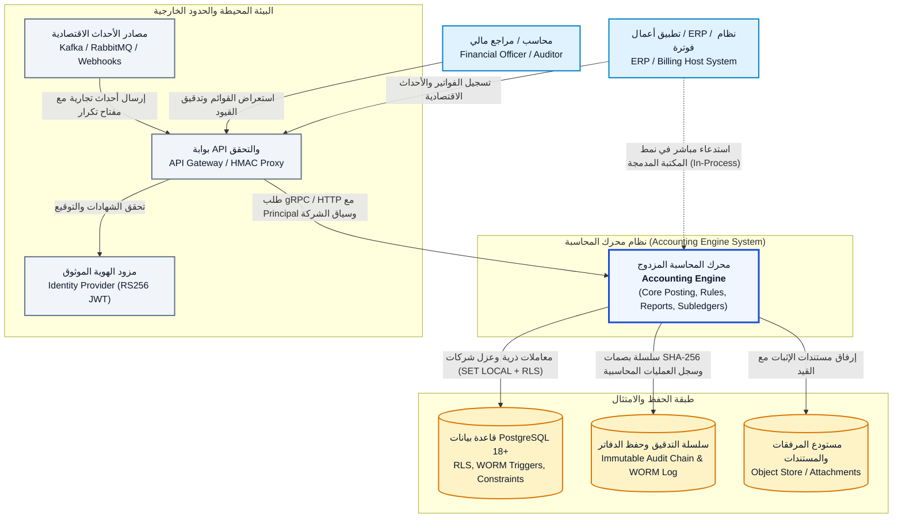

# مخطط سياق النظام (C4 Level 1 — System Context)

- **النطاق (Scope):** تموضع المحرك المحاسبي كصندوق أسود مع الأنظمة المحيطة والجهات الفاعلة.
- **مصدر الحقيقة (Source of Truth):** `cmd/accounting-service`, `pkg/sdk`, `pkg/spi`, `docs/architecture/service_boundary.md`.
- **آخر تحقق (Last Verified):** 2026-11-17 (Commit: `dd1483a`).

---

## 1. المخطط المعماري

---

## 2. مفتاح المخطط (Legend)

| الرمز / اللون | المعنى | التفاصيل في الكود |
| --- | --- | --- |
| **الأزرق الفاتح** | جهات فاعلة بشرية وأنظمة أعمال | المحاسبون، أنظمة ERP، خدمات التجارة الإلكترونية |
| **الرمادي** | خدمات الحدود والمصادقة | Gateway الموقّع بـ HMAC، مزود الهوية JWT RS256 |
| **الأزرق الداكن** | نظام محرك المحاسبة الأساسي | `accounting_engine` (سواء كـ SDK مدمج أو كخدمة gRPC) |
| **الأصفر/البرتقالي** | مستودعات البيانات والامتثال | PostgreSQL (مُجبر بسياسات RLS)، وسلسلة التدقيق SHA-256 |
| **الخط المتقطع** | نمط المكتبة المدمجة (Embedded) | يتجاوز Gateway ويعمل داخل مساحة عناوين الـ Host process |

---

## 3. شروط التفاعل وقواعد الحدود

1. **لا ثقة في الهوية القادمة من المتصفح مباشرة:** الحد الخارجي هو بوابة موثوقة (`gateway-hmac`) أو رمز JWT معتمد من IdP مؤسسي.
2. **عزل الشركات الصارم:** كل استدعاء ملزم بتمرير `company_id` موثق، وتفرضه قاعدة البيانات آليًا عبر `app_current_company_id()`.
3. **منع التعديل (WORM):** لا تملك أي واجهة خارجية صلاحية حذف أو تعديل قيد مالي مرحل (`posted`).
