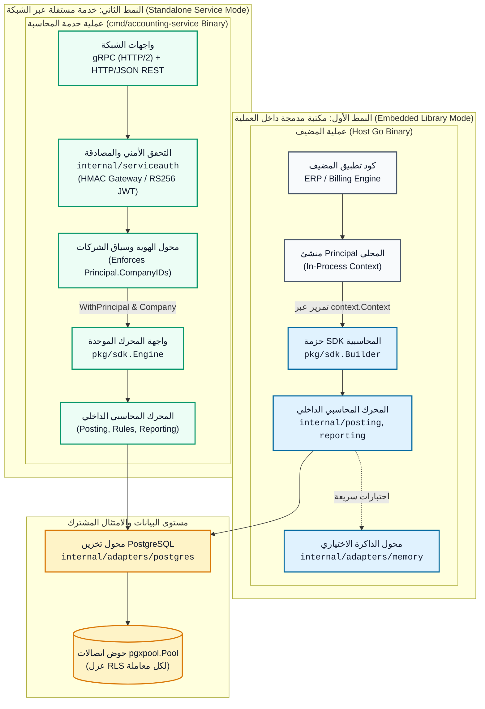

# مخطط الحاويات ونمط النشر (Container & Deployment View)

- **النطاق (Scope):** المقارنة المعمارية بين نمط **المكتبة المدمجة (Embedded Library)** ونمط **الخدمة المستقلة (Standalone Service)**.
- **مصدر الحقيقة (Source of Truth):** `cmd/accounting-service`, `pkg/sdk`, `internal/serviceauth`, `docs/architecture/service_boundary.md`.
- **آخر تحقق (Last Verified):** 2026-11-17 (Commit: `dd1483a`).

---

## 1. المخطط المعماري

---

## 2. المقارنة التفصيلية بين النمطين

| الخاصية | نمط المكتبة المدمجة (Embedded Library) | نمط الخدمة المستقلة (Standalone Service) |
| --- | --- | --- |
| **العملية التنفيذية (Process)** | داخل نفس عملية المضيف (`In-Process memory`) | عملية مستقلة ومنفصلة عبر الشبكة (`Out-of-Process`) |
| **بروتوكول التواصل** | استدعاء دوال Go مباشر (`In-memory function calls`) | gRPC (Protobuf v1) أو HTTP/JSON REST |
| **المصادقة والتفويض** | لا وجود للمصادقة؛ المضيف يبني `application.Principal` بنفسه | إجبارية بالإنتاج: `gateway-hmac` أو `jwt-rs256` أو `jwt-hs256` |
| **الكمون (Latency)** | أقل من 1 ملي ثانية (صفر تكلفة شبكة) | تكلفة فك تشفير الشبكة والتسلسل (gRPC/HTTP overhead) |
| **الاعتماديات البرمجية** | يتطلب أن يكون المضيف مكتوبًا بلغة Go | حيادي تجاه لغات البرمجة (يمكن استدعاؤه من Python, Java, Node) |
| **حالة الفشل** | انهيار المضيف يوقف المحرك والعكس | عزل كامل للعمليات؛ فشل المضيف لا يؤثر على خدمة المحاسبة |
| **عزل المستأجرين (RLS)** | يفرضه المحول عبر `SET LOCAL app.current_company_id` | نفس الضمانة تمامًا على مستوى المعاملة بقاعدة البيانات |

---

## 3. محددات الأمان في وضع الخدمة المستقلة

1. **الرفض التلقائي للوضع غير الآمن:** يفشل إقلاع الخدمة فورًا في بيئة `APP_ENV=production` إذا كان `AUTH_MODE=none` أو فارغًا.
2. **منع حقن هوية زائفة:** لا يُعتد بأي `actor_id` أو `company_id` موجود في جسم الطلب (JSON body) لأغراض التفويض؛ بل يُستخرج حصرًا من ترويسات التوقيع المعتمدة (`Principal`).
