# مخطط المكونات (C4 Level 2 — Component Diagram)

- **النطاق (Scope):** تقسيم المحرك إلى طبقات معمارية وحزم مكونات وفق مبدأ المنافذ والمحولات (Ports & Adapters).
- **مصدر الحقيقة (Source of Truth):** شجرة الحزم `pkg/api`, `pkg/spi`, `internal/*`, `storage/*`, `modules/*`, `cmd/*`.
- **آخر تحقق (Last Verified):** 2026-11-17 (Commit: `dd1483a`).

---

## 1. المخطط المعماري للمكونات

```mermaid
flowchart TB
    classDef entry fill:#f8fafc,stroke:#334155,stroke-width:2px,color:#0f172a;
    classDef pubapi fill:#eff6ff,stroke:#2563eb,stroke-width:2px,color:#0f172a;
    classDef spi fill:#f0fdf4,stroke:#16a34a,stroke-width:2px,color:#0f172a;
    classDef domain fill:#fffbeb,stroke:#d97706,stroke-width:2px,color:#0f172a;
    classDef adapter fill:#faf5ff,stroke:#9333ea,stroke-width:2px,color:#0f172a;
    classDef modules fill:#fdf2f8,stroke:#db2777,stroke-width:2px,color:#0f172a;

    subgraph Entrypoints ["1. نقاط الدخول والتشغيل (Entrypoints & Binaries)"]
        CmdService["cmd/accounting-service<br/>(gRPC/REST Server)"]:::entry
        CmdAgy["cmd/agy<br/>(Admin & IFRS CLI)"]:::entry
    end

    subgraph PublicContracts ["2. العقود العامة والمكتبة (Public SDK & API v1)"]
        PkgSDK["pkg/sdk<br/>(Engine Facade & Builder)"]:::pubapi
        PkgAPI["pkg/api/v1/*<br/>(ledger, reporting, events, types)"]:::pubapi
    end

    subgraph ServiceProviderInterfaces ["3. واجهات التكامل والمنافذ (SPI Ports)"]
        SPITypes["pkg/spi/storage<br/>(CoreLedgerStore, EventStore)"]:::spi
        SPIStandards["pkg/spi/standards<br/>(StandardUnit, Evaluator)"]:::spi
        SPIMasterData["pkg/spi/masterdata<br/>(Company, Account, Period)"]:::spi
        SPIApplication["pkg/spi/application<br/>(Principal, Context)"]:::spi
    end

    subgraph StandardsModules ["4. وحدات المعايير الدولية (Standards Modules)"]
        ModIFRS9["modules/ifrs9<br/>(ECL & Classification)"]:::modules
        ModIFRS15["modules/ifrs15<br/>(Revenue Contracts)"]:::modules
        ModIFRS16["modules/ifrs16<br/>(Leases & ROU)"]:::modules
        ModIAS12["modules/ias12<br/>(Deferred Taxes)"]:::modules
    end

    subgraph DomainCore ["5. النواة المحاسبية وتطبيق الأعمال (Internal Domain & App)"]
        PostingCore["internal/posting<br/>(Invariants, Validation, Locking, Reversal)"]:::domain
        MasterDataCore["internal/masterdata<br/>(Accounts, Fiscal Calendar, Periods)"]:::domain
        ReportingCore["internal/reporting<br/>(BS, P&L, Cash Flow, Traceability)"]:::domain
        SubledgersCore["internal/subledgers<br/>(AR, AP, Fixed Assets, Treasury)"]:::domain
        GovernanceCore["internal/governance<br/>(Audit Chain, Approvals, Policies)"]:::domain
        SDKApp["internal/sdkapplication<br/>(Use Case Handlers & Adapters)"]:::domain
    end

    subgraph AdaptersLayer ["6. محولات التخزين والبنية التحتية (Storage Adapters)"]
        StoragePostgres["storage/postgres<br/>internal/adapters/postgres<br/>(48 Migrations, RLS, WORM Triggers)"]:::adapter
        StorageMemory["storage/memory<br/>internal/adapters/memory<br/>(In-Memory Testing Harness)"]:::adapter
    end

    %% علاقات التدفق
    CmdService --> PkgSDK
    CmdService --> StoragePostgres
    CmdAgy --> StoragePostgres

    PkgSDK --> PkgAPI
    PkgSDK --> SPITypes
    PkgSDK --> SPIStandards
    PkgSDK --> SPIApplication

    ModIFRS9 --> SPIStandards
    ModIFRS15 --> SPIStandards
    ModIFRS16 --> SPIStandards
    ModIAS12 --> SPIStandards

    %% ربط المنافذ بالنواة
    SDKApp --> PostingCore
    SDKApp --> MasterDataCore
    SDKApp --> ReportingCore
    SDKApp --> SubledgersCore

    PostingCore --> MasterDataCore
    ReportingCore --> PostingCore
    SubledgersCore --> PostingCore
    GovernanceCore --> PostingCore

    %% ربط المحولات
    StoragePostgres -.->|ينفذ واجهات| SPITypes
    StoragePostgres -.->|ينفذ واجهات| SPIMasterData
    StorageMemory -.->|ينفذ واجهات| SPITypes
```

---

## 2. مسؤوليات الطبقات المعمارية

| الطبقة | الحزم | المسؤولية الصريحة |
| --- | --- | --- |
| **Public API** | `pkg/api/v1/*` | تعريف الهياكل البيانية النقية (`Data Transfer Objects`) دون منطق أعمال أو اعتماديات خارجية. |
| **Public SPI** | `pkg/spi/*` | المنافذ المجردة (`Interfaces`) لمخازن البيانات، ووحدات المعايير، وتفويض الهوية. |
| **Public SDK** | `pkg/sdk` | واجهة الاستهلاك الآمنة للنظام المضيف، وتوفر بناء المحرك وتهيئته (`Builder Pattern`). |
| **Domain Core** | `internal/posting`, `masterdata`, `subledgers`, `reporting` | قواعد المحاسبة الصلبة، وفحص التوازن المزدوج، وقفل الفترات، وسلاسل التدقيق. |
| **Modules** | `modules/*` | تطبيقات معايير المحاسبة الدولية المعزولة القابلة للتشغيل بشكل مستقل عبر عقود SPI. |
| **Storage Adapters** | `storage/postgres`, `storage/memory` | التفاعل الفعلي مع محركات التخزين؛ فرض الأمان عبر RLS وتفعيل الـ Triggers وحفظ المعاملات. |
