# مخطط اتجاه الاعتماديات وتسريبات الطبقات (Dependency Graph & Leaks)

- **النطاق (Scope):** الاتجاه المسموح هندسيًا للاعتماديات مقابل **الانتهاكات الفعلية الحالية** في شجرة الكود.
- **مصدر الحقيقة (Source of Truth):** مُشتق آليًا من تشغيل `go list -f '{{.ImportPath}}|{{join .Imports " "}}' ./...` على الـ 61 حزمة الحالية، ومطابق لوثيقة `current_dependency_map.md`.
- **آخر تحقق (Last Verified):** 2026-11-17 (Commit: `dd1483a`).

---

## 1. المخطط المعماري: الاتجاهات المسموحة والانتهاكات الفعلية

```mermaid
flowchart TD
    classDef allowed fill:#f0fdf4,stroke:#16a34a,stroke-width:2px,color:#0f172a;
    classDef leak fill:#fee2e2,stroke:#dc2626,stroke-width:3px,stroke-dasharray: 5 5,color:#7f1d1d;
    classDef layer fill:#f8fafc,stroke:#475569,stroke-width:2px,color:#0f172a;
    classDef boundary fill:#f1f5f9,stroke:#94a3b8,stroke-width:1px,stroke-dasharray: 3 3,color:#0f172a;

    subgraph PublicLayer ["1. الطبقة العامة (Public Packages)"]
        PkgAPI["pkg/api/v1/*<br/>(types, ledger, reporting, events)"]:::allowed
        PkgSPI["pkg/spi/*<br/>(storage, masterdata, standards, application)"]:::allowed
        PkgSDK["pkg/sdk<br/>(Public Client Facade)"]:::allowed
    end

    subgraph ModulesLayer ["2. الوحدات المعيارية (Modules)"]
        Modules["modules/*<br/>(ifrs9, ifrs15, ifrs16, ias12)"]:::allowed
    end

    subgraph InternalDomain ["3. النواة والمجال الداخلي (Internal Core)"]
        InternalPosting["internal/posting"]:::allowed
        InternalMasterData["internal/masterdata"]:::allowed
        InternalSubledgers["internal/subledgers"]:::allowed
        InternalReporting["internal/reporting"]:::allowed
        InternalPolicy["internal/policy"]:::allowed
        InternalSDKApp["internal/sdkapplication"]:::allowed
        InternalAutomation["internal/ifrsautomation"]:::allowed
    end

    subgraph AdaptersLayer ["4. محولات التخزين والبنية (Adapters)"]
        StoragePostgres["storage/postgres<br/>internal/adapters/postgres"]:::allowed
        StorageMemory["storage/memory<br/>internal/adapters/memory"]:::allowed
    end

    %% الاتجاهات السليمة المسموحة (Solid Green/Blue)
    PkgSDK -->|مسموح: يعتمد على العقود العامة| PkgAPI
    PkgSDK -->|مسموح: يعتمد على المنافذ| PkgSPI
    Modules -->|مسموح: يعتمد على عقود المعايير| PkgSPI
    InternalSDKApp -->|مسموح: ينسق حالات الاستخدام| InternalPosting
    InternalPosting -->|مسموح: يقرأ البيانات الرئيسية| InternalMasterData
    InternalReporting -->|مسموح: يقرأ القيود والأرصدة| InternalPosting
    InternalSubledgers -->|مسموح: ينشئ قيود أستاذ عام| InternalPosting

    %% الانتهاكات والتسريبات الحالية (Red Dashed Leaks)
    subgraph LeaksNotice ["⚠️ الانتهاكات والتسريبات المرصودة حاليًا"]
        direction TB
        L1["تسرب 1: pkg/sdk يستورد internal مباشرًا"]:::leak
        L2["تسرب 2: storage/postgres يستورد النواة الداخلية"]:::leak
        L3["تسرب 3: storage/memory يستورد النواة الداخلية"]:::leak
        L4["تسرب 4: internal/ifrsautomation يستورد postgres"]:::leak
    end

    PkgSDK -.->|❌ تسرب معماري: يستورد internal/policy, reporting, subledgers| InternalPolicy
    PkgSDK -.->|❌ تسرب معماري: يستورد internal/sdkapplication| InternalSDKApp

    StoragePostgres -.->|❌ تبعية عكسية: Adapter يستورد posting بدل الاكتفاء بـ SPI| InternalPosting
    StoragePostgres -.->|❌ تبعية عكسية: Adapter يستورد reporting| InternalReporting
    StoragePostgres -.->|❌ تبعية عكسية: Adapter يستورد masterdata| InternalMasterData

    StorageMemory -.->|❌ تبعية عكسية: Adapter يستورد posting| InternalPosting

    InternalAutomation -.->|❌ تسرب طبقي: وحدة أعمال تستورد محول Postgres| StoragePostgres

    linkStyle 7,8,9,10,11,12,13 stroke:#dc2626,stroke-width:3px,stroke-dasharray: 4 4;
```

---

## 2. مصفوفة تدقيق الاعتماديات الفعلية (Audit Inventory)

| الحزمة المصدر | الحزم المستوردة (Imports) | التقييم المعماري | الأثر الحقيقي وخطة التصحيح |
| --- | --- | --- | --- |
| `pkg/api/v1/*` | `pkg/api/v1/*` فقط | **سليم ونقي 100%** | متوافق تمامًا مع مبدأ العقود المجردة. |
| `pkg/spi/*` | `pkg/api/v1/*` فقط | **سليم ونقي 100%** | منافذ مستقلة لا تعرف أي تفاصيل تنفيذية. |
| `pkg/sdk` | `internal/policy`, `reporting`, `sdkapplication`, `subledgers` | **❌ تسرب حرج (Public Leak)** | Go تمنع استيراد الحزم التي تستورد `internal` من خارج المستودع؛ مما يجعل `pkg/sdk` غير قابل للاستهلاك كمكتبة خارجية حتى فك الارتباط عبر `pkg/spi`. |
| `storage/postgres` | `internal/posting`, `masterdata`, `reporting`, `governance` | **❌ تبعية عكسية (Inverted Dep)** | المحول يجب أن ينفذ واجهات `pkg/spi/storage` و`masterdata` دون أن يعرف تفاصيل `posting.Engine` الداخلية. |
| `storage/memory` | `internal/posting`, `masterdata`, `subledgers`, `valuation` | **❌ تبعية عكسية (Inverted Dep)** | نفس مشكلة محول PostgreSQL؛ ربط المحول بكيانات المجال مباشرة. |
| `internal/ifrsautomation` | `internal/adapters/postgres` | **❌ خرق لقواعد الطبقات** | وحدة المنطق المحاسبي الآلي تستورد محول قاعدة بيانات مباشر بدلًا من التجريد عبر SPI. |
| `cmd/accounting-service` | `pkg/sdk`, `internal/*`, `storage/*` | **مقبول مؤقتًا لنقطة تركيب** | كنقطة تكوين وتجميع (Composition Root)، يصح استيرادها للمحولات والنواة. |

---

## 3. لماذا تنجح سكربتات الفحص الحالية؟

> [!WARNING] **ثغرة فحص النقاء (Purity Gate Gap)**
> سكربت الفحص `scripts/check_public_api_purity.sh` يفحص فقط `./pkg/api/...` ولا يشمل `./pkg/sdk`؛ ولذلك تنجح أدوات CI الحالية على الرغم من وجود تسربات `internal` واضحة في `pkg/sdk`. المخطط أعلاه يعكس الحقيقة البرمجية المثبتة بـ `go list`.
