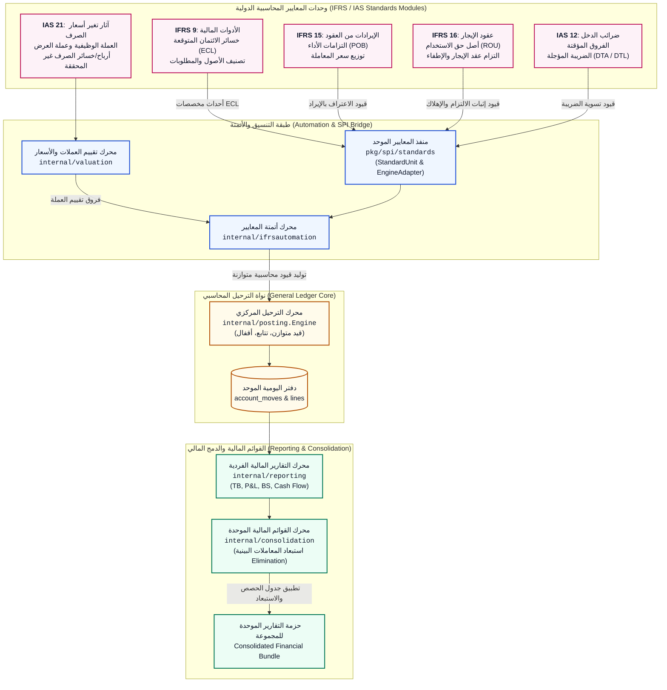

# خريطة الوحدات المعيارية والدمج (Module Map — IFRS / IAS & Consolidation)

- **النطاق (Scope):** موقع معايير المحاسبة الدولية (IFRS 9, 15, 16, IAS 12, IAS 21) ومحرك القوائم الموحدة (Consolidation)، وكيفية اتصالها بمحرك الترحيل والتقارير.
- **مصدر الحقيقة (Source of Truth):** `modules/*`, `internal/ifrs*`, `internal/ias12`, `internal/consolidation`, `internal/valuation`.
- **آخر تحقق (Last Verified):** 2026-11-17 (Commit: `dd1483a`).

---

## 1. المخطط المعماري

---

## 2. مصفوفة تكامل المعايير الدولية

| المعيار المحاسبي | الحزمة في الكود | المدخلات الأساسية | نوع القيد المولد في الدفتر العام | حسابات الأستاذ العام المتأثرة |
| --- | --- | --- | --- | --- |
| **IFRS 9** | `internal/ifrs9`, `modules/ifrs9` | أعمار الديون، مراحل التعثر (Stage 1/2/3) | قيد تسوية مخصص (`adjusting`) | من حـ/ مصروف مخصص خسائر الائتمان إلى حـ/ مخصص التعثر المتراكم |
| **IFRS 15** | `internal/ifrs15`, `modules/ifrs15` | بنود عقود العملاء، إنجاز التزامات الأداء | قيد إيراد وإثبات عقد (`regular`) | من حـ/ أصول العقود إلى حـ/ التزامات العقود وحـ/ الإيراد المحقق |
| **IFRS 16** | `internal/ifrs16`, `modules/ifrs16` | جدول دفعات الإيجار، سعر الخصم الفعلي | قيد أصل والتزام وإهلاك شهري | حـ/ أصل حق الاستخدام (ROU)، حـ/ التزام الإيجار، حـ/ مصروف الفائدة |
| **IAS 12** | `internal/ias12`, `modules/ias12` | الفروق بين الأساس المحاسبي والأساس الضريبي | قيد ضريبة مؤجلة نهاية الفترة | حـ/ أصول ضريبية مؤجلة (DTA) أو حـ/ التزامات ضريبية مؤجلة (DTL) |
| **IAS 21** | `internal/valuation`, `reporting/currency` | أسعار الإقفال الفورية (Closing Spot Rates) | قيد إعادة تقييم بنود نقدية (`adjusting`) | حـ/ أرباح أو خسائر فروق أسعار الصرف غير المحققة (FX Gain/Loss) |
| **Consolidation** | `internal/consolidation`, `reporting/consolidated` | موازين مراجعة الشركات التابعة ونسب التملك | قيود استبعاد دفترية (Elimination Entries) | استبعاد الاستثمار مقابل حقوق الملكية، وإلغاء المبيعات والذمم البينية |
