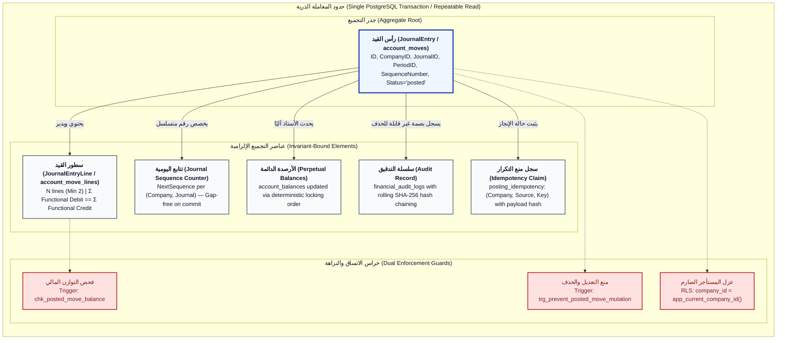

# حدود التجميع والذرية (Aggregate & Consistency Boundaries)

- **النطاق (Scope):** تحديد الوحدة الذرية (Unit of Work) في قاعدة البيانات وحرمة حدود التجميع (Aggregate Root).
- **مصدر الحقيقة (Source of Truth):** `internal/posting`, `internal/adapters/postgres/posting.go`, `docs/architecture/unit_of_work_and_transactions.md`.
- **آخر تحقق (Last Verified):** 2026-11-17 (Commit: `dd1483a`).

---

## 1. المخطط المعماري: حدود المعاملة الذرية الواحدة

---

## 2. قواعد الاتساق الصارمة (Consistency Invariants)

1. **لا انفصال للسطور عن رأس القيد:** لا يمكن كتابة أو تعديل سطر قيد (`account_move_lines`) خارج دورة حياة رأس القيد (`account_moves`).
2. **الكل أو لا شيء (All-or-Nothing Atomicity):** في حال حدوث أي خطأ (مثل: تعارض تسلسل، خطأ توازن، قفل فترة مغلقة، أو فشل سلسلة تدقيق)، تتراجع المعاملة بالكامل (`ROLLBACK`) ولا يتبقى أي أثر جزئي.
3. **الترتيب الحتمي لمنع التعليق (Deadlock Prevention Order):** عند تحديث أرصدة الحسابات المتعددة (`account_balances`)، يتم ترتيب معرفات الحسابات تصاعديًا (`Order by AccountID ASC`) قبل طلب الأقفال لتفادي التعليق المتشابك.
4. **تزامن التدقيق مع العملية المالية:** لا ينجح الترحيل إلا إذا سُجلت البصمة المشفرة في `financial_audit_logs` ضمن نفس المعاملة.
