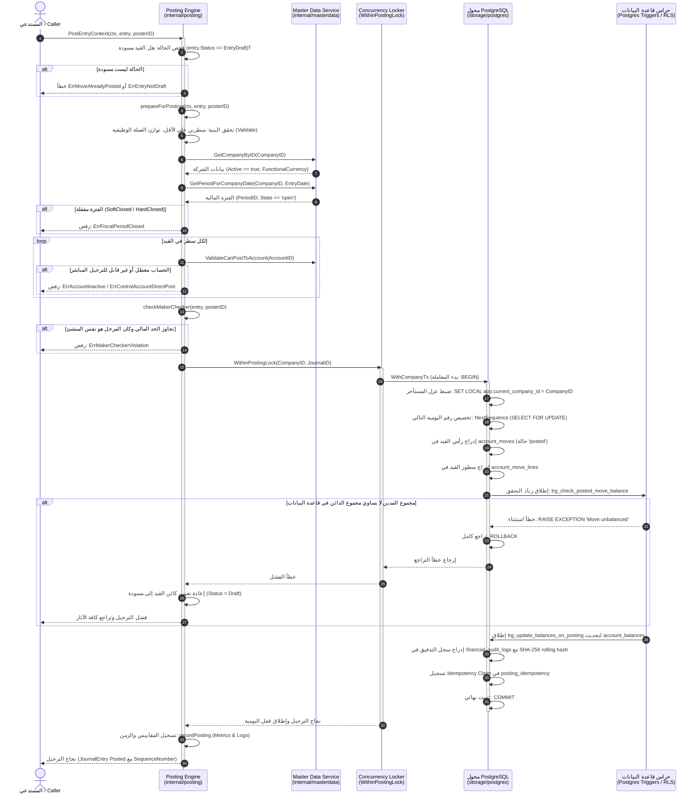

# مخطط تتابع ترحيل القيد المحاسبي (Sequence: PostEntry)

- **النطاق (Scope):** المسار الزمني التفصيلي لترحيل القيد (`PostEntry`) شاملاً الفحوصات، تخصيص التسلسل، الترحيل الذري، ومسار الفشل والتراجع (`Rollback`).
- **مصدر الحقيقة (Source of Truth):** `internal/posting/engine.go`, `internal/adapters/postgres/posting.go`, `internal/adapters/postgres/transactions.go`.
- **آخر تحقق (Last Verified):** 2026-11-17 (Commit: `dd1483a`).

---

## 1. المخطط المعماري: مسار النجاح والـ Rollback عند الفشل

---

## 2. مفتاح المخطط ومسار الفشل (Legend & Failure Semantics)

| الخطوة | المكون المسؤول | نتيجة الفشل والضمانة |
| --- | --- | --- |
| **فحص الفترة** | `internal/masterdata` | يتم الرفض قبل طلب أي أقفال أو بدء أي معاملة قاعدة بيانات. |
| **قفل التزامن** | `WithinPostingLock` | يضمن عدم تصادم تسلسل أرقام اليومية لنفس الشركة واليومية في العمليات المتزامنة. |
| **عزل المستأجر** | `SET LOCAL app.current_company_id` | تنتهي صلاحية المتغير بانتهاء المعاملة، مما يمنع تسرب البيانات بين اتصالات الحوض. |
| **زناد التوازن** | `trg_check_posted_move_balance` | خط الدفاع الأخير في DB؛ يمنع كتابة أي قيد غير متوازن حتى لو تم تجاوز كود التطبيق. |
| **الـ Rollback** | `PostgreSQL Transaction` | في حال حدوث أي خطأ، تتراجع كل من: (الأرصدة، السطور، الرأس، التدقيق، والتسلسل) دون ترك أي بقايا. |
