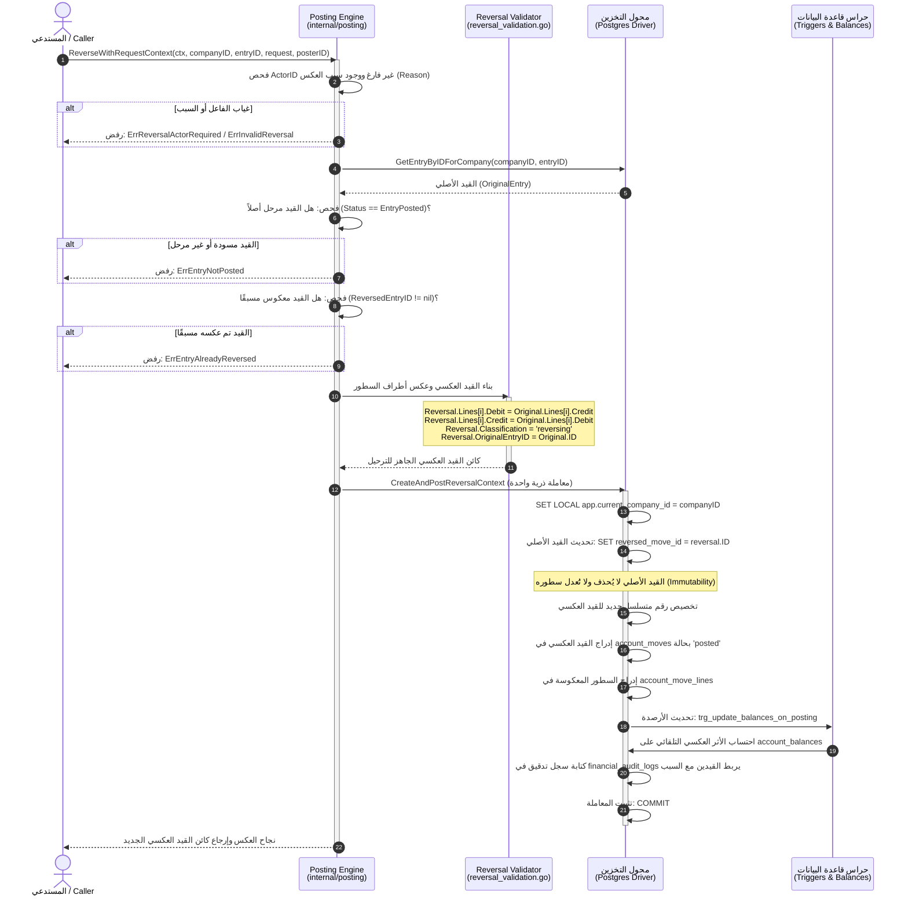

# مخطط تتابع عكس القيد المحاسبي (Sequence: ReverseEntry)

- **النطاق (Scope):** المسار الزمني لعملية عكس قيد مرحل (`ReverseEntry`)، وتوليد القيد العكسي المعكوس الأطراف، وتحديث حالة القيد الأصلي وتوثيق سبب الإلغاء في سجل التدقيق.
- **مصدر الحقيقة (Source of Truth):** `internal/posting/reversal.go`, `internal/adapters/postgres/posting.go`, `docs/accounting/reversal_specification.md`.
- **آخر تحقق (Last Verified):** 2026-11-17 (Commit: `dd1483a`).

---

## 1. المخطط المعماري

---

## 2. المبادئ المحاسبية الحاكمة لعملية العكس

1. **حرمة القيد الأصلي (No Mutation of Original Move):** لا يُحذف القيد الأصلي ولا يُعدل تاريخه أو أرقام سطوره؛ بل يظل محفوظًا للأبد في الدفاتر ويُربط حقل `reversed_move_id` فيه فقط.
2. **العكس المحاسبي الحقيقي (True Accounting Reversal):** يتم عكس المدين بالدائن والدائن بالمدين بالعملة الوظيفية نفسها وسعر الصرف ذاته؛ مما يؤدي إلى تصفير الأثر الصافي على الحسابات في الدفتر العام.
3. **منع العكس المزدوج (Idempotent Reversal Protection):** محاولة عكس قيد معكوس مسبقًا تُرفض رفضًا قاطعًا بـ `ErrEntryAlreadyReversed`، ما لم تكن إعادة تسليم لنفس مفتاح الـ Idempotency وبنفس البصمة المشفرة.

