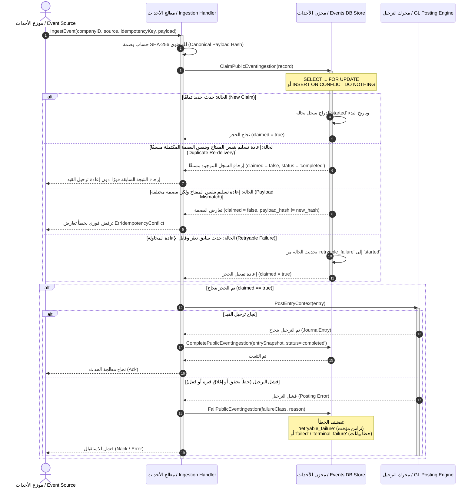

# مخطط تتابع استقبال الأحداث الاقتصادية (Sequence: Event Ingestion)

- **النطاق (Scope):** المسار الزمني لاستقبال ومعالجة الأحداث الاقتصادية، وحجز مفتاح التكرار (`Claim`)، واستدعاء محرك الترحيل، وتثبيت الإنجاز (`Complete`)، وسيناريوهات إعادة التسليم والتعارض.
- **مصدر الحقيقة (Source of Truth):** `internal/adapters/postgres/public_events.go`, `pkg/spi/events`, `docs/architecture/unit_of_work_and_transactions.md`.
- **آخر تحقق (Last Verified):** 2026-11-17 (Commit: `dd1483a`).

---

## 1. المخطط المعماري: دورة حياة حجز ومعالجة الحدث

---

## 2. جدول حالات مفتاح التكرار وإعادة التسليم

| السيناريو | مفتاح التكرار | بصمة المحتوى (Hash) | الحالة المسجلة بالجدول | الإجراء المتخذ | النتيجة للمرسل |
| --- | --- | --- | --- | --- | --- |
| **وصول أول مرة** | جديد | جديدة | لا يوجد سجل | يتم الحجز بحالة `started` والمضي للترحيل | ترحيل جديد |
| **إعادة إرسال مطابقة** | مستخدم | مطابقة تمامًا | `completed` | عدم الترحيل؛ قراءة القيد المحفوظ في `entry_snapshot` | إرجاع القيد نفسه (Idempotent 200 OK) |
| **تعارض حمولة (Spoof/Tamper)** | مستخدم | مختلفة عن المحفوظة | أي حالة | إيقاف الطلب فورًا بـ `ErrIdempotencyConflict` | رفض (409 Conflict) لمنع التزوير |
| **تعافي بعد انهيار (Crash Recovery)** | مستخدم | مطابقة | `started` (انهارت العملية قبل إكمال القيد) | الفحص في الدفتر العام: إن وجد القيد يُثبت `completed`، وإن لم يوجد يُعاد استئناف الترحيل | معالجة سالمة بلا تكرار |
| **خطأ مؤقت قابل للمحاولة** | مستخدم | مطابقة | `retryable_failure` | يُعاد فتح السجل إلى `started` وتجربة الترحيل مجددًا | إعادة محاولة مسموحة |
