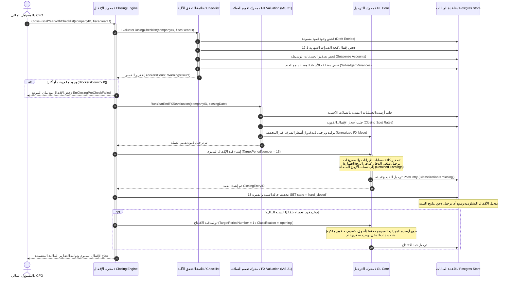

# مخطط تتابع الإقفال السنوي وإعادة تقييم العملات (Sequence: Year-End Close & FX Revaluation)

- **النطاق (Scope):** المسار الزمني لقائمة التحقق الآلية قبل الإقفال، إعادة تقييم العملات الأجنبية (IAS 21)، توليد قيد الإقفال السنوي في فترة التسوية (Period 13)، وتوليد قيد الافتتاح للسنة الجديدة.
- **مصدر الحقيقة (Source of Truth):** `internal/reporting/closing_engine.go`, `internal/reporting/closing_checklist.go`, `docs/accounting/closing_and_reopening_policy.md`.
- **آخر تحقق (Last Verified):** 2026-11-17 (Commit: `dd1483a`).

---

## 1. المخطط المعماري: دورة الإقفال المالي السنوي

---

## 2. عناصر قائمة التحقق الإلزامية (Pre-Close Checklist Invariants)

| الفحص | النوع | شرط النجاح | الإجراء عند الرسوب |
| --- | --- | --- | --- |
| **القيود المسودة (Drafts)** | **مانع حاسم (Blocker)** | عدم وجود أي قيد بحالة `draft` في السنة | منع الإقفال حتى ترحيل أو حذف المسودات. |
| **تتابع إقفال الفترات (1-12)** | **مانع حاسم (Blocker)** | جميع الفترات من 1 إلى 12 بحالة `hard_closed` | منع الإقفال حتى استكمال إقفال الفترات شهريًا. |
| **فترة التسوية (Period 13)** | **مانع حاسم (Blocker)** | وجود فترة تسوية نشطة مخصصة لقيد الإقفال | إلزام النظام بإنشاء الفترة 13 قبل الترحيل. |
| **الحسابات الوسيطة (Suspense)** | **مانع حاسم (Blocker)** | رصيد حساب التسوية الوسيط يساوي صفرًا تمامًا | منع الإقفال لوجود عمليات معلقة غير معالجة. |
| **فروقات الأستاذ المساعد** | **مانع حاسم (Blocker)** | مطابقة الأستاذ المساعد مع حساب المراقبة بنسبة 100% | منع الإقفال لحين تصحيح الفروقات المعلقة. |
| **تقييم العملات الأجنبية** | **تحذير (Warning)** | تشغيل إعادة التقييم لآخر يوم في السنة المالية | تنبيه المسؤول المالي لتطبيق معيار IAS 21. |
