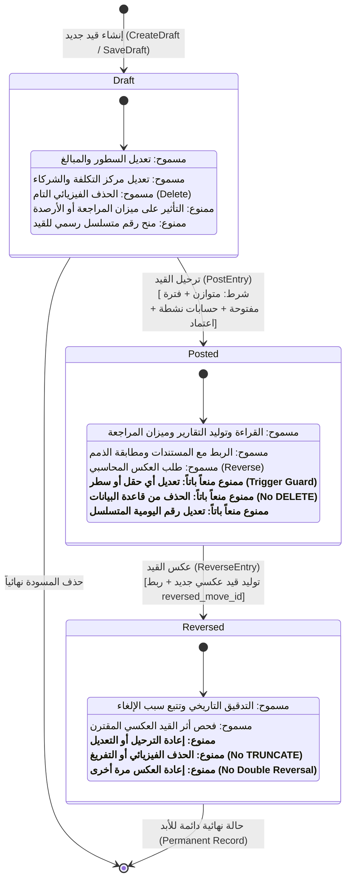

# آلة حالة القيد المحاسبي (State Machine: JournalEntry Lifecycle)

- **النطاق (Scope):** الحالات المسموحة للقيد المحاسبي (`Draft` → `Posted` → `Reversed`) وما هو مسموح وممنوع قطعيًا في كل حالة.
- **مصدر الحقيقة (Source of Truth):** `internal/posting/entry.go`, `internal/posting/engine.go`, `internal/posting/reversal.go`, `internal/adapters/postgres/migrations/202611010001_baseline_schema.sql`.
- **آخر تحقق (Last Verified):** 2026-11-17 (Commit: `dd1483a`).

---

## 1. المخطط المعماري: دورة حياة القيد

---

## 2. مصفوفة الصلاحيات والحظر لكل حالة

| العملية / الإجراء | حالة مسودة (`draft`) | حالة مرحل (`posted`) | حالة معكوس (`reversed`) |
| --- | --- | --- | --- |
| **تعديل السطور والمبالغ** | **مسموح** | **ممنوع قطعيًا** (خطأ: `ErrCannotModifyPostedMove` + زناد DB) | **ممنوع قطعيًا** |
| **حذف السجل (DELETE SQL)** | **مسموح** (للمسودات فقط) | **مرفوض بـ Exception** من خلال زناد `trg_prevent_posted_move_mutation` | **مرفوض بـ Exception** |
| **التأثير على الأرصدة (`account_balances`)** | لا يوجد أي أثر مالي | يُضاف للأرصدة عبر `trg_update_balances_on_posting` | يُلغى الأثر المحاسبي بالقيد العكسي المناظر |
| **تخصيص الرقم المتسلسل (`SequenceNumber`)** | لا يوجد (قيمته 0) | إلزامي ودائم ويمنع تعديله نهائيًا | يظل محتفظًا برقمه الأصلي |
| **الظهور في القوائم المالية الرسمية** | غير مرئي في التقارير المعتمدة | يظهر ويدخل في حساب ميزان المراجعة والأرباح | يظهر مع القيد العكسي ليتلاشى أثرهما الصافي |
| **عملية العكس المحاسبي (`Reverse`)** | غير قابلة للعكس (تُحذف فقط) | **مسموح** إذا لم تكن معكوسة مسبقًا | **ممنوع** (خطأ: `ErrEntryAlreadyReversed`) |
