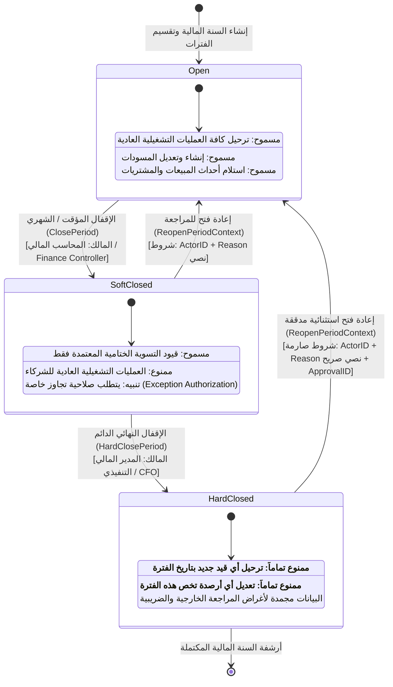

# آلة حالة الفترة المالية وإعادة الفتح (State Machine: Fiscal Period)

- **النطاق (Scope):** التحولات المسموحة لحالة الفترة المالية (`open` → `soft_closed` → `hard_closed`) ومسار إعادة الفتح الاستثنائي الخاضع للتدقيق والموافقة (`Audited Reopening`).
- **مصدر الحقيقة (Source of Truth):** `internal/masterdata/fiscal_calendar.go`, `internal/adapters/postgres/migrations/202611170001_p9_period_reopen_approval.sql`, `docs/accounting/closing_and_reopening_policy.md`.
- **آخر تحقق (Last Verified):** 2026-11-17 (Commit: `dd1483a`).

---

## 1. المخطط المعماري: دورة حياة الفترة المالية

---

## 2. مصفوفة التحولات والجهات المالكة والصلاحيات

| الحالة الابتدائية | الحالة المستهدفة | الدالة المسؤولة | الجهة المالكة (Owner) | الشروط الإلزامية في الكود |
| --- | --- | --- | --- | --- |
| `open` | `soft_closed` | `ValidatePeriodTransition` | مدير الحسابات / Controller | استكمال قيود الشهر ومطابقة الذمم المبدئية. |
| `soft_closed` | `hard_closed` | `ValidatePeriodTransition` | المدير المالي / CFO | نجاح قائمة التحقق الآلية (`Pre-Close Checklist`). |
| `open` | `hard_closed` | `ValidatePeriodTransition` | **مرفوض** | لا يجوز القفز المباشر؛ يلزم المرور بـ `soft_closed`. |
| `soft_closed` | `open` | `ValidatePeriodReopen` | المشرف المالي المعتمد | توفر معرف الفاعل (`actorID != Nil`) وسبب نصي مسبب. |
| `hard_closed` | `open` | `ValidatePeriodReopenWithApproval` | مجلس الإدارة / المدقق الخارجي | **إلزامي:** `actorID` + `reason` + **طلب موافقة معتمد (`approvalID`)** وفق هجرة `202611170001`. |

---

## 3. الضمانة على مستوى قاعدة البيانات

> [!IMPORTANT] **الحماية في النواة والمحول**
> عند وصول الفترة إلى `hard_closed`، ترفض دالة `d.updateAccountBalancesLocked` في محول PostgreSQL وأيضًا `posting.prepareForPosting` أي محاولة لترحيل قيود جديدة بتاريخ يقع ضمن تلك الفترة، مع إرجاع الخطأ المحاسبي `masterdata.ErrFiscalPeriodClosed`.
