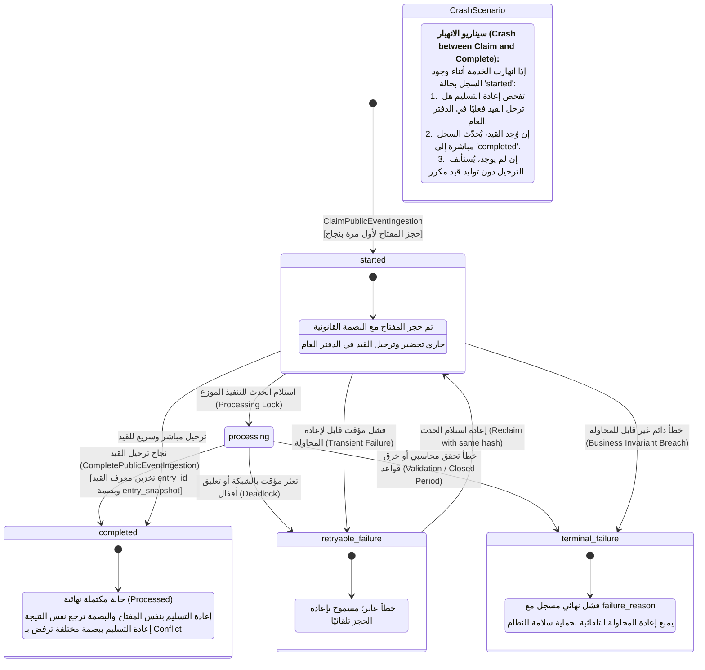

# آلة حالة مفاتيح التكرار للأحداث (State Machine: Event Idempotency Lifecycle)

- **النطاق (Scope):** دورة حياة حجز ومطابقة ومعالجة الأحداث الاقتصادية (`started` → `processing` → `completed` مقابل مسارات الفشل والتعافي من الانهيار).
- **مصدر الحقيقة (Source of Truth):** `internal/adapters/postgres/public_events.go`, `pkg/spi/events`, `internal/adapters/postgres/migrations/202611120001_public_event_ingestion_idempotency.sql`.
- **آخر تحقق (Last Verified):** 2026-11-17 (Commit: `dd1483a`).

---

## 1. المخطط المعماري: دورة حياة حالة الحدث والتعافي من الانهيار

---

## 2. جدول تفسير الحالات ورموز الخطأ المقترنة

| الحالة بالجدول (`status`) | نوع الفشل (`failure_class`) | المعنى الهندسي | قابلية إعادة المحاولة |
| --- | --- | --- | --- |
| `started` | `""` | تم حجز `(company_id, source_system, idempotency_key)` وجارٍ استدعاء محرك الترحيل. | تحت المعالجة النشطة. |
| `processing` | `""` | الحدث قيد المعالجة الموزعة في Worker نشط. | قيد التشغيل. |
| `completed` / `processed` | `""` | القيد المحاسبي مرحل بنجاح ومحفوظ في `entry_snapshot`. | **مكتمل نهائيًا**؛ يُرجع نفس الرد فورًا. |
| `retryable_failure` | `transient` | خطأ تعليق تزامن مؤقت (Deadlock 40P01) أو انقطاع شبكة مؤقت. | **نعم**؛ يُعاد فتحه عند تكرار وصول الحدث. |
| `failed` / `terminal_failure` | `terminal` | قيد غير متوازن، فترة مقفلة، أو حساب محظور (فشل غير قابل للتصحيح التلقائي). | **لا**؛ يتطلب تدخلًا بشريًا وتعديل الحدث بمفتاح جديد. |
