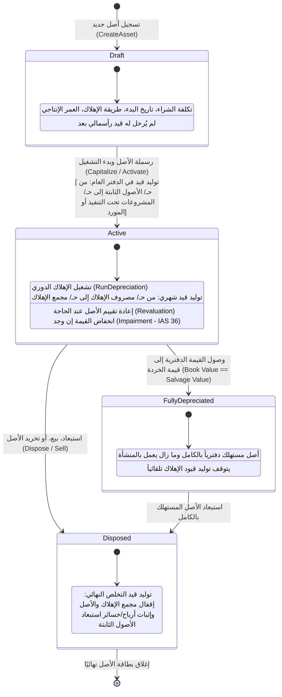
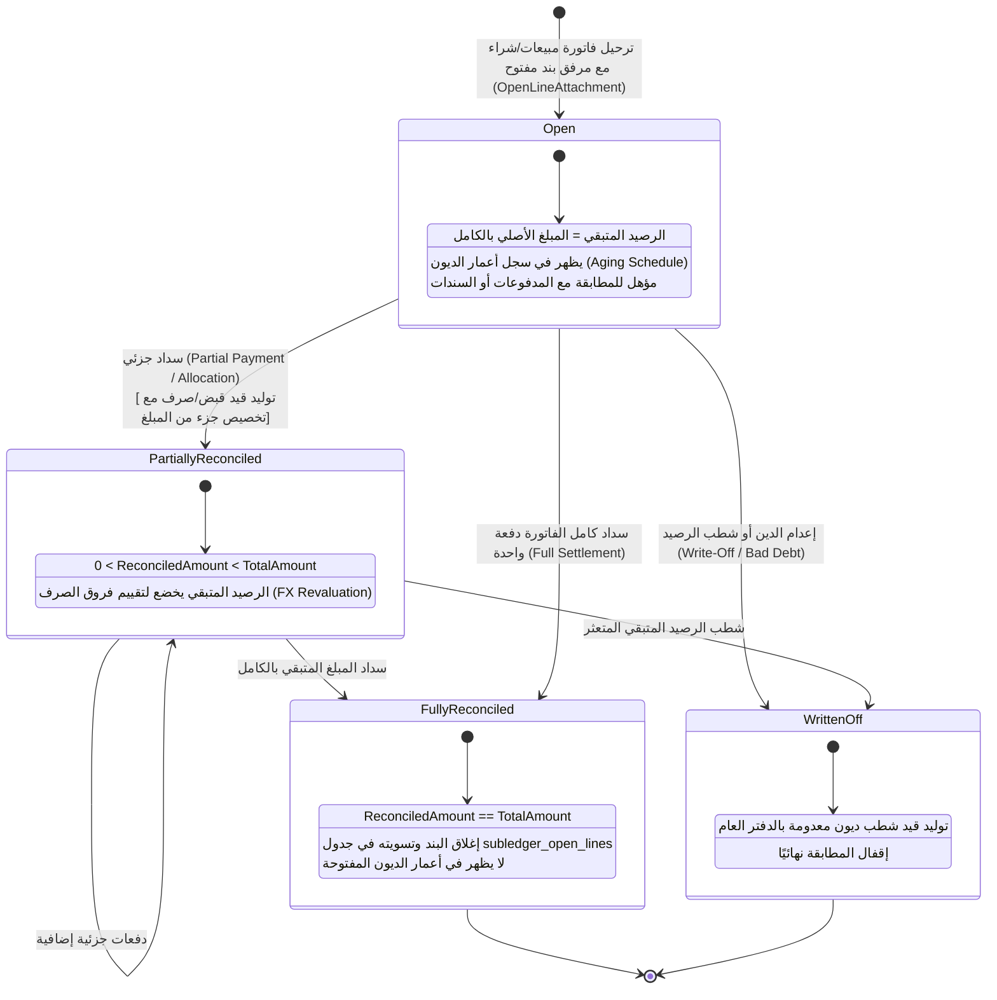

# آلة حالة بنود الأستاذ المساعد (State Machine: Fixed Assets & AR/AP Open Items)

- **النطاق (Scope):** دورة حياة بطاقة الأصل الثابت (Fixed Asset Lifecycle) ودورة حياة البنود المفتوحة للعملاء والموردين (AR/AP Open Item Lifecycle).
- **مصدر الحقيقة (Source of Truth):** `internal/subledgers/fixed_assets.go`, `internal/subledgers/public_arap.go`, `internal/subledgers/receivable.go`, `docs/architecture/subledgers_architecture.md`.
- **آخر تحقق (Last Verified):** 2026-11-17 (Commit: `dd1483a`).

---

## 1. دورة حياة الأصل الثابت (Fixed Asset Lifecycle — IAS 16)

---

## 2. دورة حياة البنود المفتوحة للذمم المدينة والدائنة (AR/AP Open Item Lifecycle)

