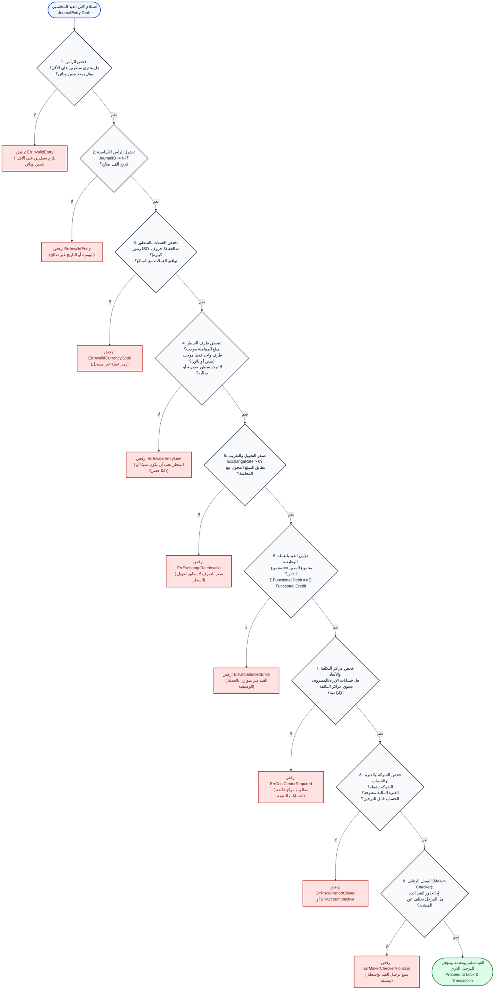

# مخطط مسار تدقيق وصحة القيد المحاسبي (Validation Pipeline Flowchart)

- **النطاق (Scope):** التسلسل الهرمي الصارم لترتيب فحوصات القيد المحاسبي ومواضع الرفض، مطابقًا لوثيقة `entry_validation_invariants.md`.
- **مصدر الحقيقة (Source of Truth):** `internal/posting/entry_validation.go`, `internal/posting/engine.go`, `docs/accounting/entry_validation_invariants.md`.
- **آخر تحقق (Last Verified):** 2026-11-17 (Commit: `dd1483a`).

---

## 1. المخطط المعماري: مراحل التدقيق الهرمية

---

## 2. جدول الفحوصات ومستوى إنفاذها

| المرحلة | الفحص | مكان الإنفاذ | نوع الخطأ المرتجع |
| --- | --- | --- | --- |
| **1. بنية الرأس** | سطرين على الأقل، وجود مدين ودائن | `entry.Validate()` | `ErrInvalidEntry` |
| **2. اتساق الشركة** | مطابقة معرف الشركة في السطور مع الرأس | `entry.Validate()` | `ErrCompanyMismatch` |
| **3. أطراف السطور** | استبعاد القيم السالبة وتحديد طرف واحد | `line.Validate()` | `ErrInvalidEntryLine` |
| **4. معيار ISO للعملات** | تحقق من الرمز عبر `currency.IsRegistered` | `line.Validate()` | `ErrInvalidCurrencyCode` |
| **5. التوازن المالي** | تطابق إجمالي المدين والدائن الوظيفي | `entry.Validate()` و `Trigger` | `ErrUnbalancedEntry` |
| **6. سياسة التقريب** | تطبيق خوارزمية المصرفيين (Banker's Rounding) | `ValidateWithRounding` | `ErrRoundingDifference` |
| **7. حالة الفترة** | التأكد من أن حالة الفترة `open` | `masterdata.Service` | `ErrFiscalPeriodClosed` |
| **8. أهلية الحساب** | الحساب نشط وليس حساب تجميع أو مقفل | `masterdata.ValidateCanPost` | `ErrAccountInactive` |
| **9. الرقابة الثنائية** | المنشئ ليس هو المرحل للمبالغ الجوهرية | `checkMakerChecker` | `ErrMakerCheckerViolation` |
