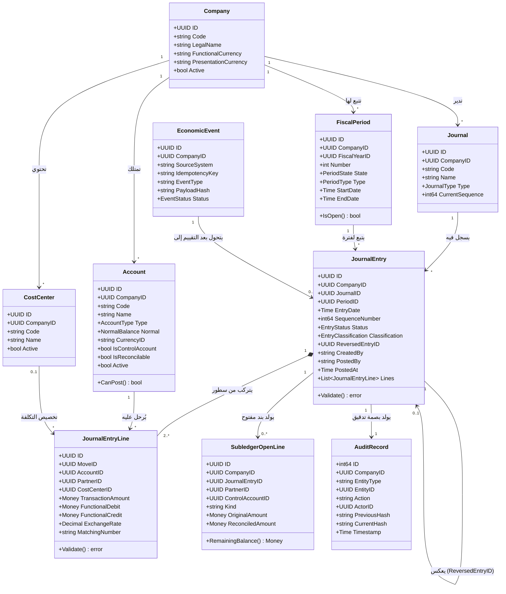

# مخطط نموذج المجال المحاسبي (Domain Model — Class Diagram)

- **النطاق (Scope):** الكيانات المحاسبية الأساسية والعلاقات المجردة في نموذج المجال بلغة Go بعيدًا عن التفاصيل الفيزيائية لقواعد البيانات.
- **مصدر الحقيقة (Source of Truth):** `internal/posting`, `internal/masterdata`, `internal/subledgers`, `internal/governance`, `pkg/api/v1/types`.
- **آخر تحقق (Last Verified):** 2026-11-17 (Commit: `dd1483a`).

---

## 1. المخطط المعماري: فئات نموذج المجال (Domain Classes)

---

## 2. مصفوفة الثوابت والأنواع المحاسبية (Enums & Invariants)

| النوع (Type) | القيم المسموحة في الكود | الموقع في الكود |
| --- | --- | --- |
| `AccountType` | `asset`, `liability`, `equity`, `income`, `expense` | `internal/masterdata` |
| `NormalBalance` | `debit`, `credit` | `internal/masterdata` |
| `EntryStatus` | `draft`, `posted`, `reversed` | `internal/posting` |
| `EntryClassification` | `regular`, `adjusting`, `closing`, `opening`, `reversing` | `internal/posting` |
| `PeriodState` | `open`, `soft_closed`, `hard_closed` | `internal/masterdata` |
| `SubledgerKind` | `receivable` (AR), `payable` (AP) | `internal/subledgers` |
| `EventStatus` | `started`, `processing`, `completed`, `retryable_failure`, `failed` | `pkg/spi/events` |
