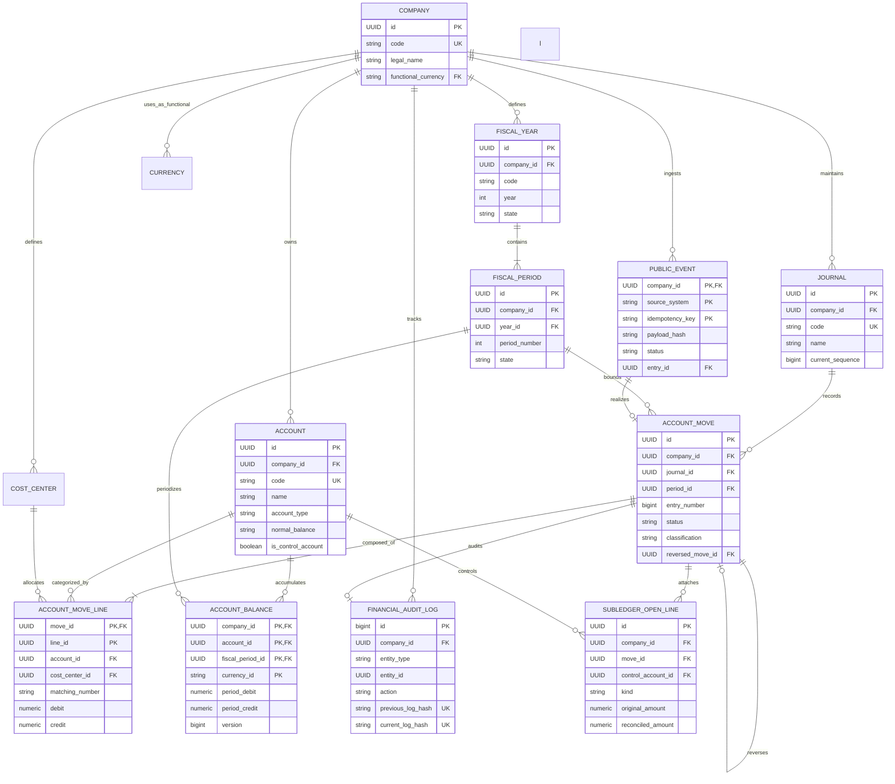

# مخطط العلاقات المنطقي (Logical ERD)

- **النطاق (Scope):** العلاقات المنطقية المجردة بين كيانات النظام المحاسبي على مستوى النطاق دون الخوض في تفاصيل الأنواع الفيزيائية والفهارس.
- **مصدر الحقيقة (Source of Truth):** ملفات التهجير `internal/adapters/postgres/migrations/202611010001_baseline_schema.sql` وما تلاها (48 migration).
- **آخر تحقق (Last Verified):** 2026-11-17 (Commit: `dd1483a`).

---

## 1. المخطط المنطقي للعلاقات (Logical ERD)

---

## 2. القيود المنطقية الرئيسة

1. **مفتاح الشركة المشترك (Multi-Tenant Composite Keys):** كل جدول فرعي يحمل `company_id` لضمان عزل البيانات منطقيًا وفيزيائيًا.
2. **علاقة الرأس بالسطور:** لا وجود لسطر مستقل في `ACCOUNT_MOVE_LINE` دون ارتباطه القاطع برأس القيد في `ACCOUNT_MOVE`.
3. **تراكم الأرصدة المستمر:** جدول `ACCOUNT_BALANCE` يمثل لقطة تجميعية للأستاذ العام برقم إصدار (`version`) لدعم القفل التفاؤلي.
