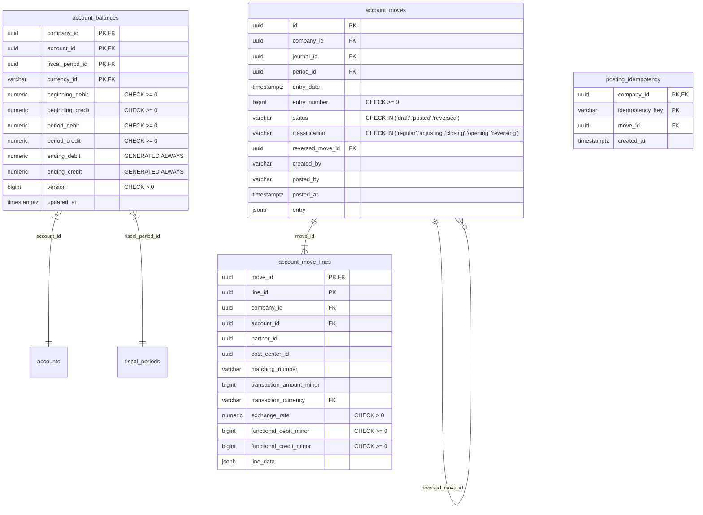
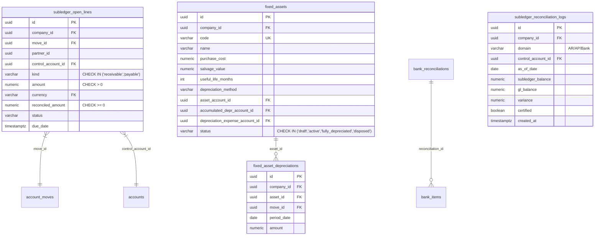
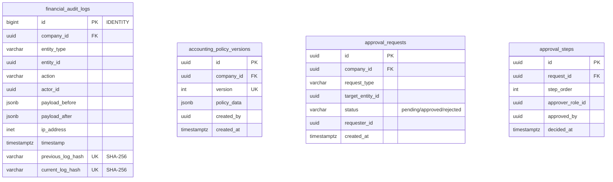
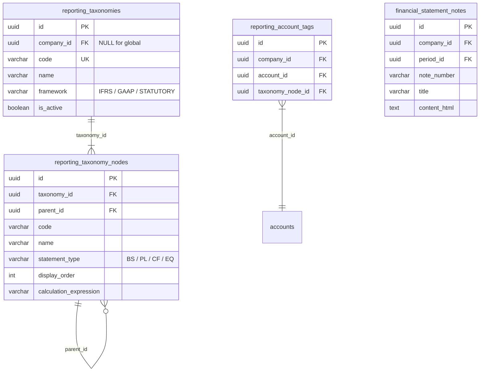
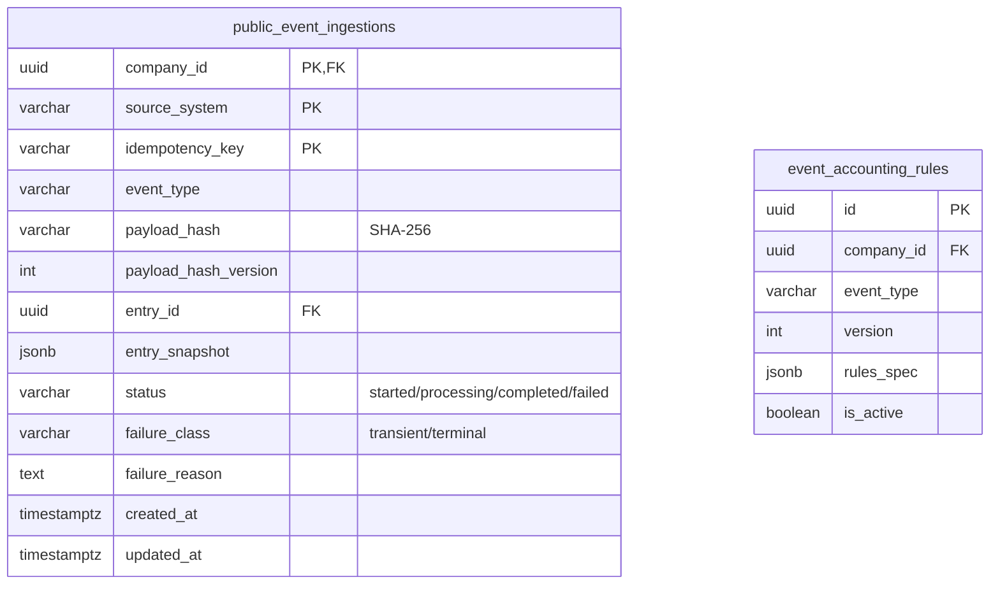

# مخطط الكيانات الفيزيائي المفصل (Physical ERD by Sub-Domains)

- **النطاق (Scope):** المخطط الفيزيائي الدقيق المقسم حسب النطاقات الوظيفية، متضمناً المفاتيح الأساسية والخارجية (FK)، وقيود الفحص (CHECK)، وفهارس التفرد، وأعمدة RLS.
- **مصدر الحقيقة (Source of Truth):** ملفات التهجير الـ 48 في `internal/adapters/postgres/migrations/*.sql`.
- **آخر تحقق (Last Verified):** 2026-11-17 (Commit: `dd1483a`).

---

## 1. نطاق الترحيل والأرصدة العامة (Core Posting & Balances Domain)

---

## 2. نطاق الدفاتر المساعدة والبنود المفتوحة (Subledgers & Open Items Domain)

---

## 3. نطاق الحوكمة وسلسلة التدقيق (Governance & Audit Domain)

---

## 4. نطاق التقارير والتصنيفات (Reporting & Taxonomies Domain)

---

## 5. نطاق استيعاب الأحداث الاقتصادية (Public Events Domain)

