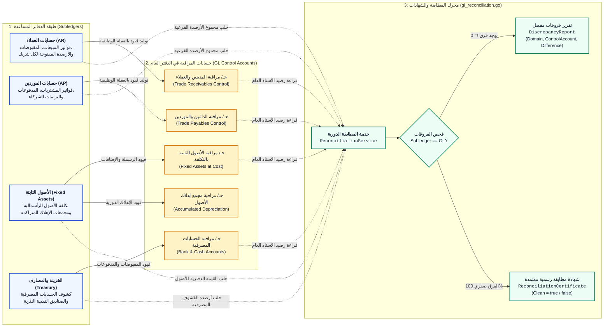

# خريطة مطابقة الدفاتر المساعدة مع الأستاذ العام (Subledger → GL Control Account Map)

- **النطاق (Scope):** العلاقة بين الدفاتر المساعدة (AR, AP, Fixed Assets, Treasury) وحسابات المراقبة المقابلة في الدفتر العام، ومسار المطابقة الآلية وإصدار الشهادات عبر `gl_reconciliation.go`.
- **مصدر الحقيقة (Source of Truth):** `internal/subledgers/gl_reconciliation.go`, `internal/subledgers/control_accounts.go`, `docs/architecture/subledgers_architecture.md`.
- **آخر تحقق (Last Verified):** 2026-11-17 (Commit: `dd1483a`).

---

## 1. المخطط المعماري: خريطة الدفاتر وحسابات المراقبة

---

## 2. معادلة المطابقة الحاكمة (Reconciliation Invariant)

في أي تاريخ تقرير مالي، يجب أن يتحقق شرط التطابق التالي قطعيًا:

$$\sum_{i=1}^{N} \text{Subledger Open Balance}_i = \text{Balance of GL Control Account}$$

### إجراءات التعامل مع الفروقات (Discrepancy Resolution)

1. **في حال وجود فرق (`HasVariance() == true`):**
   - تُسجل الواقعة فورًا في جدول `subledger_reconciliation_logs`.
   - تُدرج الفروقات في `subledger_reconciliation_exceptions`.
   - **تُمنع عملية إقفال الفترة المالية** من خلال قائمة التحقق الآلية (`Checklist Blocker`) حتى تسوية الفارق.
2. **في حال التطابق التام (`Clean == true`):**
   - يُصدر المحرك `ReconciliationCertificate` موثقة برقم وتوقيع زمني وتُربط بحزمة إقفال الفترة.
