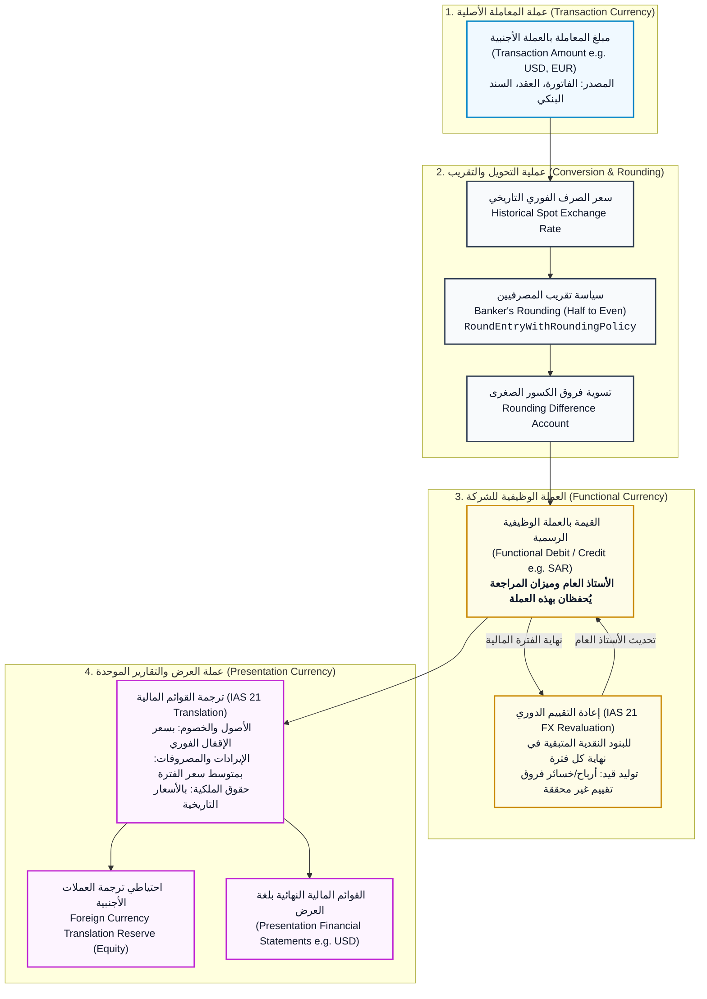

# تدفق الأموال وتعدد العملات (Money & Multi-Currency Flow — IAS 21)

- **النطاق (Scope):** مسار تحويل القيم المالية عبر طبقات العملات الثلاث: عملة المعاملة (`Transaction`)، والعملة الوظيفية (`Functional`)، وعملة العرض (`Presentation`)، ونقاط إعادة التقييم وسياسة التقريب المحاسبي.
- **مصدر الحقيقة (Source of Truth):** `internal/valuation`, `internal/posting/rounding.go`, `internal/reporting/currency_translation.go`, `docs/accounting/ias21_compliance_matrix.md`.
- **آخر تحقق (Last Verified):** 2026-11-17 (Commit: `dd1483a`).

---

## 1. المخطط المعماري: طبقات العملة والتحويل المحاسبي

---

## 2. قواعد معيار المحاسبة الدولي IAS 21 في الكود

1. **العملة المرجعية للنواة (Authoritative Currency):**
   - كافة حسابات الدفتر العام (`account_move_lines.functional_debit_minor` و `functional_credit_minor`) تُحفظ بالوحدات الصغرى (Integers/Minors) للعملة الوظيفية لتجنب أخطاء الفاصلة العائمة.
2. **سياسة التقريب (Rounding Invariant):**
   - يُطبق تقريب المصرفيين المعتمد (`Round to nearest even integer`).
   - أي فروق كسور متبقية بسبب قسمة العملات تُسوى آليًا في حساب مخصص (`RoundingDifferenceAccountID`).
3. **إعادة التقييم في نهاية الفترة (Period-End Spot Revaluation):**
   - البنود النقدية (Monetary Items كالذمم المدينة والدائنة والأرصدة البنكية بالعملات الأجنبية) يُعاد تقييمها بأسعار الإقفال الفورية.
   - البنود غير النقدية (Non-Monetary Items كالأصول الثابتة والمخزون) تظل مسجلة بسعر الصرف التاريخي لتاريخ اقتنائها.
4. **احتياطي ترجمة العملات (CTA Reserve):**
   - الفروق الناتجة عن ترجمة القوائم المالية من العملة الوظيفية إلى عملة العرض لا تمر عبر قائمة الدخل، بل تُرحل مباشرة إلى الدخل الشامل الآخر وحقوق الملكية (`CTA Reserve`).

