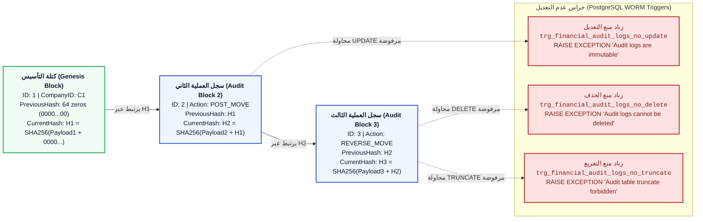

# مخطط سلسلة التدقيق المشفرة (Audit Chain & WORM Architecture)

- **النطاق (Scope):** البنية المشفرة لسلسلة التدقيق المحاسبي المترابطة (Cryptographic Hash Chaining)، وآلية حماية WORM الممنوعة من الحذف والتعديل عبر زنادات PostgreSQL.
- **مصدر الحقيقة (Source of Truth):** `internal/governance`, `internal/adapters/postgres/governance.go`, `internal/adapters/postgres/migrations/202611010001_baseline_schema.sql`.
- **آخر تحقق (Last Verified):** 2026-11-17 (Commit: `dd1483a`).

---

## 1. المخطط المعماري: ترابط كتل سلسلة التدقيق

---

## 2. معادلة حساب البصمة المشفرة (Chaining Invariant)

لكل سجل تدقيق جديد $N$ تابع لنفس الشركة:

$$\text{CurrentHash}_N = \text{SHA-256}\Big(\text{PreviousHash}_{N-1} \,\|\, \text{Timestamp} \,\|\, \text{ActorID} \,\|\, \text{EntityID} \,\|\, \text{Action} \,\|\, \text{PayloadAfter}\Big)$$

### الفهارس الفريدة الحاكمة في قاعدة البيانات

1. `CREATE UNIQUE INDEX uq_audit_chain_previous_hash ON financial_audit_logs(company_id, previous_log_hash);`
   - يضمن عدم وجود أي تشعب أو فرعين لنفس السلسلة (No Forking).
2. `CREATE UNIQUE INDEX uq_audit_chain_current_hash ON financial_audit_logs(company_id, current_log_hash);`
   - يضمن عدم وجود تصادم في البصمات داخل نفس الشركة.

---

## 3. خوارزمية التحقق من السلامة (Audit Integrity Verification)

يقوم المحرك بفحص دوري مستقل (`VerifyAuditChainIntegrity`) لقراءة السلسلة من كتلة التأسيس حتى آخر سجل، ومقارنة البصمات:

- أي محاولة تلاعب بالبيانات التاريخية في قاعدة البيانات (حتى لو تمت بصلاحيات `postgres` عبر تجاوز زناد) ستؤدي فورًا إلى **انكسار السلسلة (Hash Mismatch)** عند أول سجل تم العبث به، وإطلاق إنذار أمني فوري.
