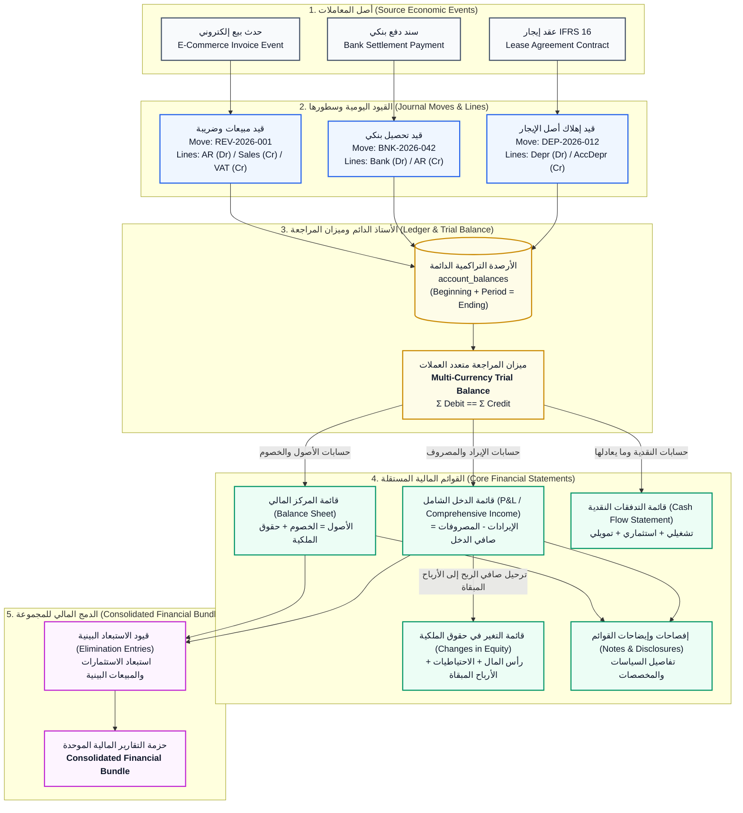

# مخطط تسلسل وتتبع بيانات التقارير المالية (Financial Reporting Lineage)

- **النطاق (Scope):** مسار تتبع الأرقام المالية من الحدث الاقتصادي الأصلي مرورًا بالقيود والأرصدة الدائمة وصولًا إلى بنود القوائم المالية المعتمدة (Financial Statement Traceability).
- **مصدر الحقيقة (Source of Truth):** `internal/reporting/traceability.go`, `internal/reporting/trial_balance.go`, `internal/reporting/consolidated_bundle.go`, `docs/accounting/financial_reporting_scope.md`.
- **آخر تحقق (Last Verified):** 2026-11-17 (Commit: `dd1483a`).

---

## 1. المخطط المعماري: شجرة نسب التقارير المالية (Data Lineage Tree)



---

## 2. محرك التتبع العكسي (Financial Traceability Engine)

تتيح واجهة `FinancialTraceabilityRepository` للمدقق المالي الإجابة بدقة برمجية عن سؤال:  
**"من أين جاء هذا الرقم في القائمة المالية؟"**

```go
type TraceResult struct {
    StatementItem   string                  // اسم البند في القائمة (مثل: إيرادات العقود)
    AccountIDs      []uuid.UUID             // الحسابات المرتبطة في شجرة الحسابات
    MoveLines       []TracedMoveLine        // سطور القيود الفعلية المساهمة في الرقم
    JournalEntries  []posting.JournalEntry  // رؤوس القيود المعتمدة وتواريخها
    SourceEvents    []TracedEconomicEvent   // الأحداث الاقتصادية الأصلية ومفاتيح التكرار
    StatementAmount decimal.Decimal         // القيمة المجمعة في القائمة المالية
    LedgerAmount    decimal.Decimal         // مجموع أرصدة الأستاذ الفعلي
    Reconciled      bool                    // هل يتطابق رقم القائمة مع الأستاذ 100%؟
    AuditChainProof string                  // إثبات التشفير من سلسلة SHA-256
}
```

### ضمانات التدقيق

1. **تطابق بنسبة 100% (`Reconciled == true`):** لا يمكن إظهار رقم في القائمة المالية لا يوجد له سند مباشر في `account_move_lines`.
2. **سلسلة إثبات غير منقطعة (Cryptographic Proof):** كل سطر في القائمة المالية مدعوم برقم قيد معتمد ومربوط بكتلة تدقيق مشفرة بـ SHA-256.
