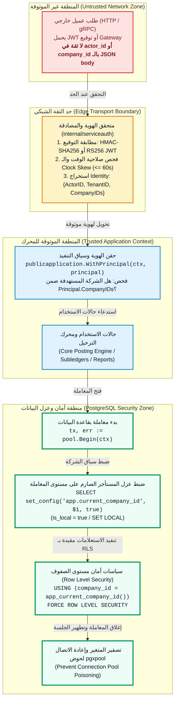

# مخطط حدود الثقة والمصادقة (Trust Boundaries & Service Authentication)

- **النطاق (Scope):** حدود الثقة والتحقق عند تشغيل المحرك كخدمة مستقلة (`cmd/accounting-service`)، وانتقال الهوية من ترويسات الشبكة إلى كائن `Principal` وصولًا إلى حوض الاتصالات.
- **مصدر الحقيقة (Source of Truth):** `internal/serviceauth`, `docs/architecture/service_boundary.md`, `ADR-0004`.
- **آخر تحقق (Last Verified):** 2026-11-17 (Commit: `dd1483a`).

---

## 1. المخطط المعماري: مستويات وحدود الثقة (Trust Boundaries)

---

## 2. جدول المدخلات الموثوقة وغير الموثوقة

| المدخل | موثوق؟ | القاعدة المعمارية الصارمة |
| --- | --- | --- |
| `Authorization: Bearer <JWT>` | **موثوق بعد التحقق** | يُفحص توقيع RS256 مقابل المفتاح العام، ومطابقة `iss` و `aud` وتاريخ الانتهاء `exp`. |
| `X-Accounting-Signature` | **موثوق كدليل** | توقيع HMAC-SHA256 محسوب من نص قانوني منظم يربط الفاعل والشركات والطابع الزمني. |
| `company_id` في استعلام أو جسم الطلب | **غير موثوق إطلاقًا** | لا يمنح أي صلاحية؛ يجب أن يكون معرف الشركة عضوًا صريحًا ضمن `Principal.CompanyIDs`. |
| `actor_id` في جسم الطلب | **غير موثوق إطلاقًا** | يُهمل؛ الفاعل المعتمد في سجلات التدقيق هو المعرف المستخرج من التوقيع الموثق فقط. |
| `X-Source-System` المرسل من العميل | **غير موثوق** | يُستبدل بالقيمة الموثوقة `standalone-service` لمنع تزوير هوية الأنظمة المصدرية. |
