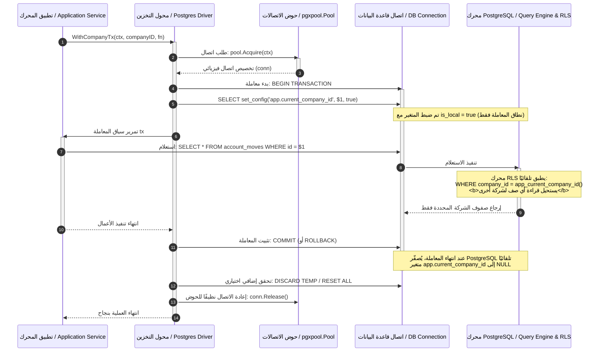

# مخطط عزل المستأجرين وأمان الصفوف (Multi-Tenancy Isolation & RLS)

- **النطاق (Scope):** الآلية الدقيقة لانتقال معرف الشركة (`company_id`) من الطلب إلى دالة `SET LOCAL`، وكيف تُجبر PostgreSQL على حجب بيانات الشركات الأخرى، وآلية تطهير الاتصال لمنع تسرب البيانات.
- **مصدر الحقيقة (Source of Truth):** `internal/adapters/postgres/transactions.go`, `internal/adapters/postgres/migrations/202611100007_force_tenant_rls.sql`, `internal/adapters/postgres/rls_test.go`.
- **آخر تحقق (Last Verified):** 2026-11-17 (Commit: `dd1483a`).

---

## 1. المخطط المعماري: دورة حياة عزل الشركة (Company Isolation Flow)



---

## 2. سياسة الأمان المفروضة إجباريًا (FORCE ROW LEVEL SECURITY)

لضمان عدم تجاوز سياسة العزل حتى من قِبل مالك الجدول (Table Owner):

```sql
-- تطبيق العزل الإجباري على جدول القيود
ALTER TABLE account_moves ENABLE ROW LEVEL SECURITY;
ALTER TABLE account_moves FORCE ROW LEVEL SECURITY;

-- السياسة المطبقة على كافة عمليات القراءة والكتابة
CREATE POLICY tenant_isolation_policy ON account_moves
    USING (company_id = app_current_company_id())
    WITH CHECK (company_id = app_current_company_id());

-- الدالة المساعدة لقراءة معرف الشركة
CREATE OR REPLACE FUNCTION app_current_company_id() RETURNS uuid AS $$
    SELECT NULLIF(current_setting('app.current_company_id', true), '')::uuid
$$ LANGUAGE sql STABLE;
```

---

## 3. نتائج اختبارات الاختراق والعزل (RLS Penetration Tests)

تُثبت حزمة الاختبارات في `internal/adapters/postgres/phase6_rls_penetration_test.go` الحالات التالية:

1. **محاولة استعلام بلا هوية (`No Tenant Context`):** ترجع `0` صفوف؛ لا يُعرض أي بيان لأي شركة.
2. **محاولة حقن شركة ضحية (`Cross-Tenant Injection`):** محاولة تمرير `company_id` مختلف في استعلام `INSERT` يفشل فورًا بخرق سياسة `WITH CHECK`.
3. **تطهير الاتصال (Connection Hygiene):** إعادة استخدام الاتصال بعد تراجع أو فشل المعاملة يضمن أن القيمة العالقة هي `NULL`، مما يحمي حوض الاتصالات المشترك.
