# خريطة الإنفاذ المزدوج للقواعد (Dual Enforcement Map — Domain vs PostgreSQL) ⭐

- **النطاق (Scope):** التوزيع الهندسي المزدوج لحماية القواعد المحاسبية بين **نواة لغة Go (Domain Logic)** و**محرك قاعدة البيانات PostgreSQL (CHECK Constraints, Triggers, RLS)** والاختبارات التثبيتية.
- **مصدر الحقيقة (Source of Truth):** `internal/posting`, `internal/adapters/postgres/migrations/*.sql`, `test/acid`, `test/concurrency`.
- **آخر تحقق (Last Verified):** 2026-11-17 (Commit: `dd1483a`).

---

## 1. المخطط المعماري: طبقات الحماية المتوازية (Dual Layer Defense)

```mermaid
flowchart TD
    classDef domain fill:#eff6ff,stroke:#2563eb,stroke-width:2px,color:#0f172a;
    classDef db fill:#fef3c7,stroke:#d97706,stroke-width:2px,color:#0f172a;
    classDef test fill:#ecfdf5,stroke:#059669,stroke-width:2px,color:#0f172a;
    classDef rule fill:#f8fafc,stroke:#334155,stroke-width:2px,color:#0f172a;

    subgraph BusinessRules ["القواعد المحاسبية الجوهرية (Invariants)"]
        R1["1. التوازن المالي المزدوج<br/>Balanced Double Entry"]:::rule
        R2["2. حرمة القيود المرحّلة<br/>Immutability of Posted Moves"]:::rule
        R3["3. عزل بيانات الشركات<br/>Multi-Tenant Isolation"]:::rule
        R4["4. سجل التدقيق غير القابل للتعديل<br/>WORM Immutable Audit Chain"]:::rule
        R5["5. حظر الفترات المقفلة<br/>Closed Period Protection"]:::rule
        R6["6. منع تكرار الأحداث<br/>Event Idempotency Guarantee"]:::rule
        R7["7. اتساق طبقات العملات والأسعار<br/>Currency Layers & Positive Rates"]:::rule
        R8["8. الفصل الرقابي للمهام<br/>Maker-Checker Segregation"]:::rule
    end

    subgraph DomainLayer ["خط الدفاع الأول: نواة التطبيق (Go Domain Engine)"]
        D1["<code>JournalEntry.Validate()</code><br/>Σ Functional Debit == Σ Credit"]:::domain
        D2["<code>posting.Engine</code><br/>فحص Status != Posted قبل أي عملية"]:::domain
        D3["<code>ExecutionContext</code><br/>فحص انتماء الشركة إلى Principal"]:::domain
        D4["<code>governance.Repository</code><br/>بناء سلسلة SHA-256 المتصلة"]:::domain
        D5["<code>prepareForPosting</code><br/>فحص Period.State == Open"]:::domain
        D6["<code>ClaimPublicEventIngestion</code><br/>حساب ومقارنة Payload Hash"]:::domain
        D7["<code>ValidateWithRounding</code><br/>تقريب المصرفيين وفحص رموز ISO"]:::domain
        D8["<code>checkMakerChecker</code><br/>منع المرحل إذا ساوى المنشئ بمبالغ كبرى"]:::domain
    end

    subgraph DatabaseLayer ["خط الدفاع الثاني: قاعدة البيانات (PostgreSQL Engine)"]
        P1["زناد التوازن:<br/><code>trg_check_posted_move_balance</code>"]:::db
        P2["زنادات منع التعديل:<br/><code>trg_prevent_posted_move_mutation</code><br/><code>trg_protect_posted_move_lines</code>"]:::db
        P3["أمان الصفوف الإجباري:<br/><code>FORCE ROW LEVEL SECURITY</code><br/><code>app_current_company_id()</code>"]:::db
        P4["زنادات WORM المشددة:<br/><code>trg_financial_audit_logs_no_update</code><br/><code>_no_delete</code>, <code>_no_truncate</code>"]:::db
        P5["أقفال التشاؤم وتحديث الأرصدة:<br/><code>d.updateAccountBalancesLocked</code><br/>مع رفض الفترات المقفلة"]:::db
        P6["فهارس التفرد وأقفال الصفوف:<br/><code>uq_public_event_idempotency</code><br/><code>SELECT FOR UPDATE</code>"]:::db
        P7["قيود الفحص الحتمية:<br/><code>CHECK (exchange_rate > 0)</code><br/><code>CHECK (functional_debit_minor >= 0)</code>"]:::db
        P8["تسجيل هوية الفاعلين:<br/>أعمدة <code>created_by</code> و <code>posted_by</code><br/>مع فحص تفويض الاعتماد"]:::db
    end

    subgraph TestGates ["خط التحقق الثالث: بوابات الاختبارات المستمرة (CI / Test Gates)"]
        T1["<code>test/acid</code>: اختبارات التراجع والتوازن"]:::test
        T2["<code>internal/adapters/postgres/mutation_test</code>"]:::test
        T3["<code>phase6_rls_penetration_test</code>"]:::test
        T4["<code>test/standards</code>: فحص تكامل السلسلة"]:::test
        T5["<code>test/contract_parity</code>"]:::test
        T6["<code>test/concurrency</code>: اختبارات السباق"]:::test
    end

    R1 --> D1 --> P1 --> T1
    R2 --> D2 --> P2 --> T2
    R3 --> D3 --> P3 --> T3
    R4 --> D4 --> P4 --> T4
    R5 --> D5 --> P5 --> T5
    R6 --> D6 --> P6 --> T6
    R7 --> D7 --> P7
    R8 --> D8 --> P8
```

---

## 2. جدول الإنفاذ المزدوج الشامل (Comprehensive Enforcement Matrix)

| # | القاعدة المحاسبية / الأمنية | الإنفاذ في كود Go (Domain Engine) | الإنفاذ في PostgreSQL (DB Feature) | وسيلة الاختبار والإثبات |
| --- | --- | --- | --- | --- |
| **1** | **توازن القيد المالي** | `JournalEntry.Validate()`: يطابق مجموع المدين والدائن الوظيفي قبل الترحيل. | زناد `trg_check_posted_move_balance_statement`: يعترض المعاملة فورًا إذا كان الفرق $\ne 0$. | `test/acid/balanced_test.go` |
| **2** | **منع تعديل القيود المرحّلة** | `engine.PostEntry`: يرفض أي قيد حالته `posted` بـ `ErrMoveAlreadyPosted`. | زناد `trg_prevent_posted_move_mutation` وزناد `trg_protect_posted_move_lines`. | `internal/adapters/postgres/immutability_test.go` |
| **3** | **عزل المستأجرين (Tenancy)** | التحقق من `Principal.CompanyIDs` في نقطة النهاية وسياق التنفيذ. | `FORCE ROW LEVEL SECURITY` مع دالة `app_current_company_id()` و `SET LOCAL`. | `internal/adapters/postgres/phase6_rls_penetration_test.go` |
| **4** | **عدم قابلية تعديل التدقيق (WORM)** | `governance.Repository`: بناء تسلسل SHA-256 المتصل فقط دون واجهات تعديل. | ثلاثة زنادات: `_no_update` و `_no_delete` و `_no_truncate` ترفع `EXCEPTION`. | `internal/adapters/postgres/governance_test.go` |
| **5** | **حظر الترحيل بفترة مقفلة** | `prepareForPosting`: فحص حالة الفترة وإرجاع `ErrFiscalPeriodClosed`. | فحص الحالة وقفل السطر `SELECT FOR UPDATE` في `transactions.go`. | `test/contract_parity/period_close_test.go` |
| **6** | **منع تكرار الأحداث (Idempotency)** | حساب بصمة `PayloadHash` ومقارنتها بالسجل الحالي لمنع التعارض. | فهرس فريد `uq_public_event_idempotency` وعملية ذرية `INSERT ON CONFLICT`. | `test/concurrency/idempotency_race_test.go` |
| **7** | **صحة العملة والأسعار** | التحقق من معيار ISO وحساب الكسور المصرفية `Banker's Rounding`. | قيود `CHECK (exchange_rate > 0)` و `CHECK (minor >= 0)` وتطابق الأطراف. | `internal/posting/rounding_test.go` |
| **8** | **فصل المهام (Maker-Checker)** | `checkMakerChecker`: رفض القيد إذا تساوى المنشئ مع المرحل بمبالغ كبرى. | حفظ هوية الفاعلين في `account_moves` وربطها بسجلات الموافقة المستقلة. | `internal/posting/phase2_policy_test.go` |

---

## 3. لماذا الإنفاذ المزدوج حاسم في هذا المحرك؟

> [!IMPORTANT] **مبدأ الدفاع في العمق (Defense in Depth)**
> في الأنظمة المحاسبية الحساسة، لا يُعتمد على كود لغة البرمجة وحده؛ لأن أي خطأ برمجي (Bug)، أو اتصال مباشر من مسؤول قاعدة بيانات (DBA)، أو أداة صيانة خارجية قد يتجاوز كود Go. وجود خط دفاع ثانٍ بداخل نواة PostgreSQL يضمن استحالة كسر القواعد المالية أو تسريب بيانات المستأجرين تحت أي ظرف تشغيلي.
