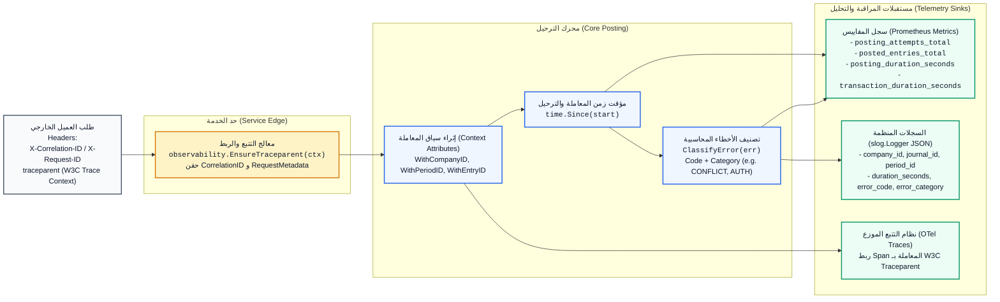

# مخطط المراقبة والرصد وسياق التتبع (Observability & Context Propagation)

- **النطاق (Scope):** منظومة القياس والرصد المالي: تتبع الطلبات عبر `Correlation ID` و `Traceparent`، والمقاييس التشغيلية (Metrics)، والسجلات المنظمة (Structured Logging)، وتصنيف الأخطاء.
- **مصدر الحقيقة (Source of Truth):** `internal/observability`, `internal/posting/engine.go`, `internal/posting/error_classification.go`.
- **آخر تحقق (Last Verified):** 2026-11-17 (Commit: `dd1483a`).

---

## 1. المخطط المعماري: تدفق سياق المراقبة (Observability Pipeline)

---

## 2. جدول مقاييس الأداء المحاسبي (Key Financial Metrics)

| اسم المقياس (Metric Name) | النوع (Type) | وسوم القياس (Labels) | الاستخدام التشغيلي والإنذارات |
|---|---|---|---|
| `accounting_posting_attempts_total` | Counter | `company_id`, `journal_id` | تتبع إجمالي محاولات الترحيل والتنبيه عند ارتفاع معدل الطلبات. |
| `accounting_posted_entries_total` | Counter | `company_id`, `classification` | قياس عدد العمليات المحاسبية الناجحة ومعدل نمو القيود. |
| `accounting_posting_duration_seconds` | Histogram | `operation`, `status` | مراقبة كمون الترحيل والتنبيه عند تجاوز العمليات لحاجز الـ 500ms. |
| `accounting_transaction_duration_seconds`| Histogram | `isolation_level` | قياس مدة حجز أقفال المعاملات في PostgreSQL لتفادي بطء الحوض. |
| `accounting_posting_errors_total` | Counter | `error_code`, `category` | تفريق أخطاء تعارض التزامن عن أخطاء خرق القواعد المالية. |

