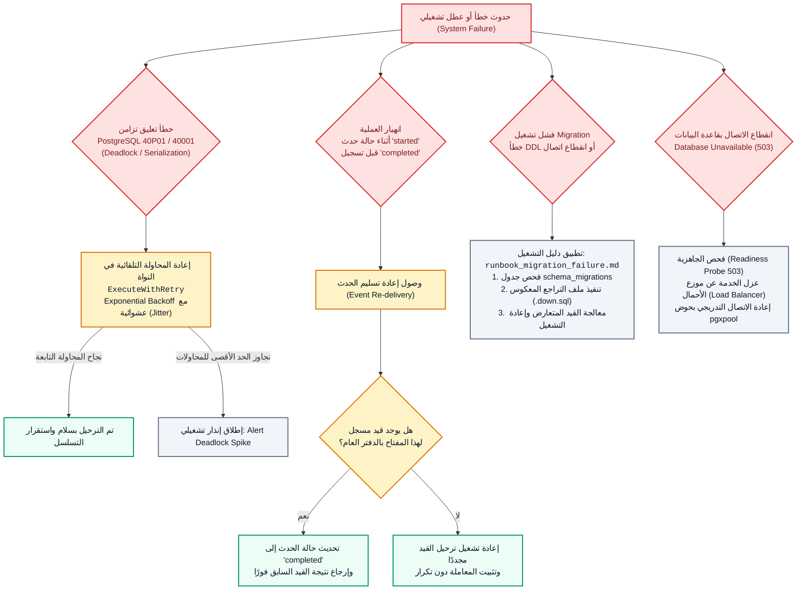

# مخطط التعافي من الأعطال والأخطاء (Failure & Recovery Workflows)

- **النطاق (Scope):** مسارات التعافي الآلي والتشغيلي عند حدوث أعطال حرجة: تعليق المعاملات (Deadlocks)، انهيار العمليات بين الحجز والإكمال، انقطاع قاعدة البيانات، وفشل تطبيق التهجيرات.
- **مصدر الحقيقة (Source of Truth):** `docs/runbooks/*`, `docs/operations/backup_and_recovery_policy.md`, `internal/adapters/postgres/transactions.go`.
- **آخر تحقق (Last Verified):** 2026-11-17 (Commit: `dd1483a`).

---

## 1. المخطط المعماري: مسارات التعامل مع الأخطاء والتعافي

---

## 2. جدول تصنيف الأخطاء وإجراءات التعافي

| نوع العطل / الفشل | رمز الخطأ | آلية التعافي (Recovery Mechanism) | الأثر على البيانات |
| --- | --- | --- | --- |
| **تعليق متزامن (Deadlock)** | `40P01` / `40001` | إعادة محاولة تلقائية في Go عبر `ExecuteWithRetry` مع تأخير أسي. | **صفر أثر؛** تتراجع المعاملة ثم تنجح لاحقًا. |
| **انهيار الخادم بعد الحجز** | حالة `started` عالقة | آلية الحجز الذكي `ClaimPublicEventIngestion` تفحص القيد وتصلحه عند أول إعادة تسليم. | **لا تكرار للقيود؛** الحفاظ على سلامة الدفتر. |
| **تعثر تهجير DDL** | `migration error` | كل ملف `.sql` مقترن بملف `.down.sql` صريح قابل للتراجع التام. | استعادة المخطط السابق فورًا. |
| **تلف وسائط أو كارثة خادم** | `Disaster / Loss` | استعادة لقطة قاعدة البيانات اليومية وتطبيق ملفات WAL (Point-in-Time Recovery). | استرجاع الحالة حتى آخر ثانية قبل الكارثة. |
