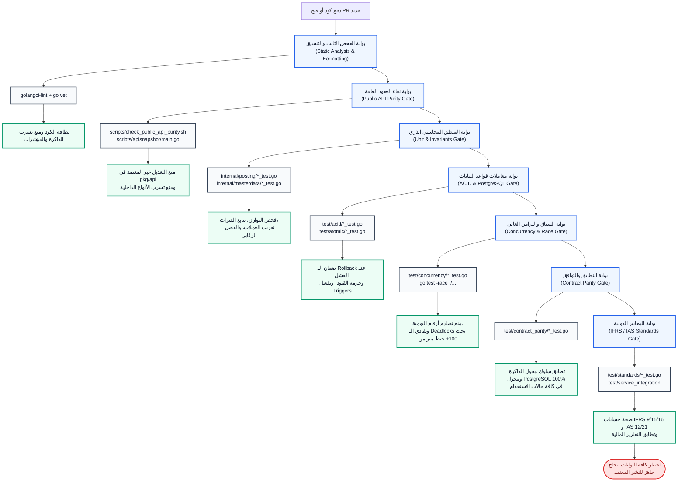

# مخطط بوابات الجودة والتكامل المستمر (CI/CD Quality Gates & Test Map)

- **النطاق (Scope):** ربط كل بوابة فحص في مسار CI بالاختبارات المتخصصة والخاصية المعمارية/المحاسبية التي تحميها لمنع التدهور البرمجي (Regressions).
- **مصدر الحقيقة (Source of Truth):** `docs/ci.md`, `test/acid`, `test/concurrency`, `test/contract_parity`, `test/standards`.
- **آخر تحقق (Last Verified):** 2026-11-17 (Commit: `dd1483a`).

---

## 1. المخطط المعماري: بوابات الفحص الصارمة (Quality Gates Pipeline)

---

## 2. جدول ربط الفحوصات بالخصائص المحمية (Quality Gates Map)

| اسم الفحص / المسار | الأمر المنفذ في CI | الخاصية المحمية (Guaranteed Property) | الأثر عند الفشل |
| --- | --- | --- | --- |
| **API Purity Gate** | `scripts/check_public_api_purity.sh` | استقرار وحرمة العقود العامة ومنع كسر توافق واجهات التكامل الخارجية (`SemVer`). | إيقاف البناء فورًا لمنع كسر عملاء المكتبة. |
| **ACID Integrity** | `go test -v ./test/acid/...` | الذرية التامة (`All-or-Nothing`) وعدم بقاء أي أثر جزئي عند فشل الترحيل. | منع نشر أي تعديل يكسر تراجع المعاملات. |
| **Race & Deadlock** | `go test -race ./test/concurrency/...` | الترتيب الحتمي للأقفال وسلامة تخصيص التسلسل تحت الضغط المتزامن العالي. | منع نشر أي كود يسبب تعليق العمليات. |
| **Contract Parity** | `go test -v ./test/contract_parity/...` | تطابق سلوك `storage/memory` مع `storage/postgres` لضمان صحة الاختبارات. | رفض المحولات غير الملتزمة بالعقود. |
| **RLS Penetration** | `go test -v ./internal/adapters/postgres -run TestRLS` | استحالة قراءة أو كتابة بيانات شركة أخرى حتى مع محاولات التزوير الخبيثة. | خرق أمني يمنع النشر قطعيًا. |
| **Standards Math** | `go test -v ./test/standards/...` | صحة المعادلات المحاسبية لـ IFRS و IAS وتطابق أرقام القوائم المالية. | منع الأخطاء المحاسبية في التقارير. |
