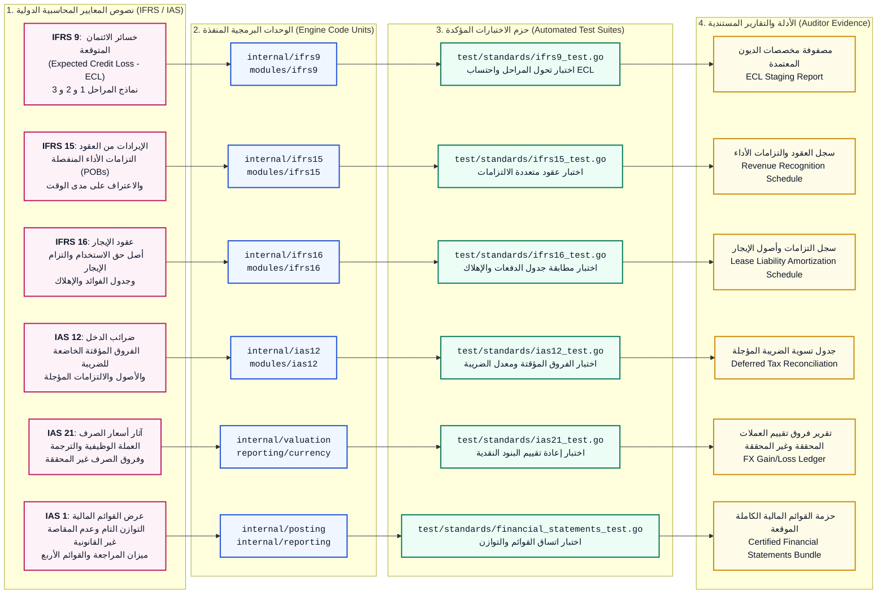

# مخطط تتبع الامتثال للمعايير الدولية (Compliance Traceability Architecture)

- **النطاق (Scope):** شجرة تتبع متطلبات معايير المحاسبة الدولية (IFRS / IAS / AAOIFI) من نصوص المعيار إلى الوحدات البرمجية المنفذة، والاختبارات التثبيتية، والأدلة المستندية.
- **مصدر الحقيقة (Source of Truth):** `docs/ENGINE_COMPLIANCE_MATRIX.md`, `modules/*`, `internal/ifrs*`, `test/standards`.
- **آخر تحقق (Last Verified):** 2026-11-17 (Commit: `dd1483a`).

---

## 1. المخطط المعماري: سلسلة تتبع الامتثال (Compliance Traceability)

---

## 2. جدول إثبات الامتثال للمراجع القانوني والمدقق الخارجي

| المعيار المحاسبي الدولي | المتطلب الإلزامي | التنفيذ في الكود | وسيلة الفحص الآلي المستمر |
| --- | --- | --- | --- |
| **IFRS 9 §5.5** | احتساب مخصص خسائر الائتمان على أساس التطلع المستقبلي (Forward-looking). | حساب احتمالية التعثر (PD) والخسارة عند التعثر (LGD) في `internal/ifrs9`. | اختبار مصفوفة انتقال المراحل الثلاث في `test/standards`. |
| **IFRS 15 §31** | الاعتراف بالإيراد عند الوفاء بالتزام الأداء (Satisfaction of Performance Obligation). | توزيع سعر المعاملة عبر `Relative Standalone Selling Price` في `internal/ifrs15`. | فحص سيناريوهات العقود المجمعة في `ifrs15_test.go`. |
| **IFRS 16 §22** | إثبات أصل حق الاستخدام والتزام عقد الإيجار عند تاريخ بدء العقد. | احتساب القيمة الحالية لدفعات الإيجار بمعدل الفائدة الضمني في `internal/ifrs16`. | مطابقة جداول الإطفاء والإهلاك شهريًا. |
| **IAS 12 §15** | إثبات التزام ضريبي مؤجل لجميع الفروق المؤقتة الخاضعة للضريبة. | حساب الفرق بين الأساس الدفتري والضريبي وضربه في معدل الضريبة المعمول به في `internal/ias12`. | التحقق من ترحيل قيود التسوية الضريبية. |
| **IAS 21 §23** | ترجمة البنود النقدية بالعملات الأجنبية باستخدام سعر الإقفال الفوري في نهاية كل فترة. | فرز البنود النقدية وإعادة تقييمها وتوليد قيود أرباح/خسائر تقييم في `internal/valuation`. | فحص سيناريوهات فروق أسعار الصرف غير المحققة. |
| **IAS 1 §15** | العرض العادل والامتثال التام لمعايير التقارير المالية الدولية وعدم المقاصة. | التحقق من صحة القوائم وعدم دمج المدين مع الدائن إلا بحكم معيار صريح في `internal/reporting`. | اختبار إعادة إنتاج القوائم التاريخية بدقة متطابقة. |
