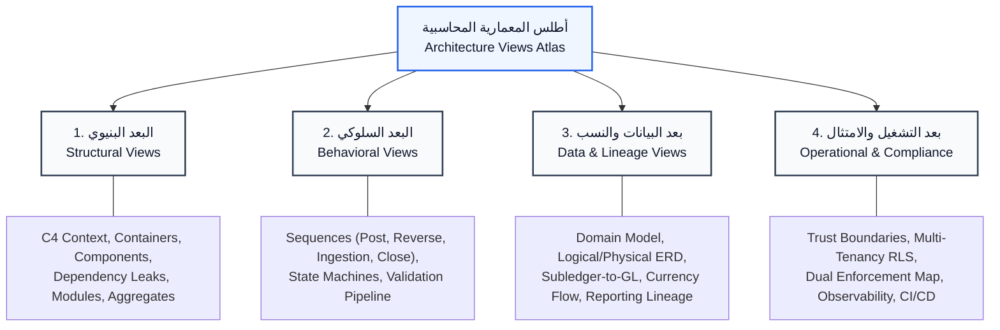

# أطلس المعمارية ومخططات النظام — Accounting Engine

# Architecture Views & Diagrams Atlas

> **تاريخ التوثيق والتحقق:** 2026-11-17  
> **Commit المرجعي:** `dd1483a`  
> **الإصدار الأساسي:** Go `1.26.3` / PostgreSQL `18.6`  
> **الأداة المستخدمة:** Mermaid Diagramming Specification  

---

## 1. الفلسفة المعمارية: لماذا "حزمة عروض" لا مخطط واحد؟

محرك المحاسبة (`Accounting Engine`) نظام حرج متعدد المستويات والأبعاد. محاولة دمج البنية، والسلوك، والبيانات، والتشغيل في رسم واحد تؤدي حتمًا إلى مخطط غير مقروء أو مضلل.
لذلك، صُممت هذه الحزمة المعمارية كـ **أطلس من أربعة أبعاد مستقلة**، يُجيب كل مخطط فيها عن سؤال محدد بدقة:

---

## 2. مصفوفة المخططات التسعة ذات الأولوية القصوى (Core Minimum 80%)

تغطي هذه المخططات التسعة أكثر من 80% من الفهم المعماري والتنفيذي للمحرك، وتُعد حجر الأساس لأي مهندس أو مدقق:

| # | المخطط | الملف | الغرض والتركيز | مصدر الحقيقة في الكود |
| --- | --- | --- | --- | --- |
| **1** | **C4 Context** | [01_system_context.md](./01_structural/01_system_context.md) | تموضع المحرك بين ERP، والـ Gateway، وIdP، وقاعدة البيانات، وسلسلة التدقيق | `cmd/accounting-service`, `pkg/sdk` |
| **2** | **Dependency Graph الملون** | [04_package_dependencies.md](./01_structural/04_package_dependencies.md) | خريطة الاعتماديات المباشرة مع تلوين الانتهاكات والتسريبات الحرجة فورًا | مُشتق من `go list ./...` |
| **3** | **Domain Model + Logical ERD** | [01_domain_model.md](./03_data/01_domain_model.md) / [02_logical_erd.md](./03_data/02_logical_erd.md) | الكيانات المحاسبية والعلاقات المجردة بلا تفاصيل تخزين | `pkg/api/v1/*`, `internal/posting`, `internal/masterdata` |
| **4** | **Sequence: PostEntry** | [01_sequence_post_entry.md](./02_behavioral/01_sequence_post_entry.md) | مسار الترحيل الكامل: التحقق، القفل، التسلسل، السطور، الأرصدة، وسيناريو الـ rollback | `internal/posting/engine.go`, `internal/adapters/postgres/posting.go` |
| **5** | **State Machines الثلاثية** | [05_state_journal_entry.md](./02_behavioral/05_state_journal_entry.md), [06_state_fiscal_period.md](./02_behavioral/06_state_fiscal_period.md), [07_state_event_idempotency.md](./02_behavioral/07_state_event_idempotency.md) | دورة حياة القيد (`Draft/Posted/Reversed`)، الفترة (`Open/Soft/Hard/Reopen`)، وحجز الأحداث (`started/completed/conflict`) | `internal/posting/entry.go`, `internal/masterdata/fiscal_calendar.go`, `pkg/spi/events` |
| **6** | **Subledger -> GL Map** | [04_subledger_gl_map.md](./03_data/04_subledger_gl_map.md) | أي دفتر مساعد يغذي أي حساب مراقبة وآلية المطابقة الدورية | `internal/subledgers/gl_reconciliation.go` |
| **7** | **Reporting Lineage** | [07_reporting_lineage.md](./03_data/07_reporting_lineage.md) | تتبع الأرقام من الحدث الاقتصادي ← القيد ← ميزان المراجعة ← القوائم المالية | `internal/reporting/traceability.go` |
| **8** | **Deployment & Trust Boundaries** | [02_container_deployment.md](./01_structural/02_container_deployment.md) / [01_trust_boundaries.md](./04_operational/01_trust_boundaries.md) | حدود الثقة: من Gateway وJWT إلى RLS session variable وحوض الاتصالات | `docs/architecture/service_boundary.md`, `internal/serviceauth` |
| **9** | **Dual Enforcement Map** ⭐ | [03_dual_enforcement_map.md](./04_operational/03_dual_enforcement_map.md) | أين تُفرض كل قاعدة؟ Go Domain أم PostgreSQL CHECK / Trigger / RLS / Test | `internal/posting`, `internal/adapters/postgres/migrations/*` |

---

## 3. الفهرس الشامل لحزمة العروض المعمارية (All 28 Views)

### 1. مخططات البنية (Structural Views)

1. **[01_system_context.md](./01_structural/01_system_context.md)** — System Context (C4 Level 1).
2. **[02_container_deployment.md](./01_structural/02_container_deployment.md)** — Container & Deployment: Embedded Library vs Standalone Service.
3. **[03_component_c4_l2.md](./01_structural/03_component_c4_l2.md)** — Component Diagram (C4 Level 2): `pkg/api` → `pkg/spi` → `internal` → `storage`.
4. **[04_package_dependencies.md](./01_structural/04_package_dependencies.md)** — Dependency Direction & Current Layer Violations (Colored Graph).
5. **[05_module_map.md](./01_structural/05_module_map.md)** — Module Map: IFRS 9, 15, 16, IAS 12, 21, Consolidation.
6. **[06_aggregate_boundaries.md](./01_structural/06_aggregate_boundaries.md)** — Aggregate & Transactional Consistency Boundaries (Unit of Work).

### 2. مخططات السلوك (Behavioral Views)

1. **[01_sequence_post_entry.md](./02_behavioral/01_sequence_post_entry.md)** — Sequence: `PostEntry` (Validation, Lock, Sequence, Lines, Balances, Rollback).
2. **[02_sequence_reverse_entry.md](./02_behavioral/02_sequence_reverse_entry.md)** — Sequence: `ReverseEntry` (Original move link, Reversal entry, Reason audit).
3. **[03_sequence_event_ingestion.md](./02_behavioral/03_sequence_event_ingestion.md)** — Sequence: Event Ingestion (Claim, Canonical Payload Hash, Complete, Redelivery & Conflict).
4. **[04_sequence_year_end_closing.md](./02_behavioral/04_sequence_year_end_closing.md)** — Sequence: Year-End Close (Checklist, Closing Move Period 13, Opening Move, FX Revaluation).
5. **[05_state_journal_entry.md](./02_behavioral/05_state_journal_entry.md)** — State Machine: Journal Entry (`Draft` → `Posted` → `Reversed`).
6. **[06_state_fiscal_period.md](./02_behavioral/06_state_fiscal_period.md)** — State Machine: Fiscal Period (`Open` → `Soft Closed` → `Hard Closed` → Audited Reopen).
7. **[07_state_event_idempotency.md](./02_behavioral/07_state_event_idempotency.md)** — State Machine: Event Idempotency Lifecycle & Crash Recovery.
8. **[08_state_subledger_items.md](./02_behavioral/08_state_subledger_items.md)** — State Machine: Fixed Assets & AR/AP Open Items.
9. **[09_validation_pipeline.md](./02_behavioral/09_validation_pipeline.md)** — Validation Pipeline Flowchart (Order of invariant checks).

### 3. مخططات البيانات والتتبع (Data & Lineage Views)

1. **[01_domain_model.md](./03_data/01_domain_model.md)** — Domain Model Class Diagram.
2. **[02_logical_erd.md](./03_data/02_logical_erd.md)** — Logical Entity-Relationship Diagram.
3. **[03_physical_erd.md](./03_data/03_physical_erd.md)** — Physical ERD (Segmented by domains: Core Posting, Subledgers, Governance, Reporting, Events).
4. **[04_subledger_gl_map.md](./03_data/04_subledger_gl_map.md)** — Subledger → GL Control Account Reconciliation Map.
5. **[05_currency_money_flow.md](./03_data/05_currency_money_flow.md)** — Money & Multi-Currency Flow (Transaction, Functional, Presentation, IAS 21).
6. **[06_audit_chain.md](./03_data/06_audit_chain.md)** — Audit Chain Diagram (Rolling SHA-256 & WORM Triggers).
7. **[07_reporting_lineage.md](./03_data/07_reporting_lineage.md)** — Financial Reporting Data Lineage.

### 4. مخططات التشغيل والأمان والامتثال (Operational, Security & Compliance Views)

1. **[01_trust_boundaries.md](./04_operational/01_trust_boundaries.md)** — Trust Boundaries & Service Authentication.
2. **[02_multi_tenancy_isolation.md](./04_operational/02_multi_tenancy_isolation.md)** — Multi-Tenancy Isolation (`company_id` → `SET LOCAL` → RLS).
3. **[03_dual_enforcement_map.md](./04_operational/03_dual_enforcement_map.md)** — Dual Enforcement Map (Domain Invariants vs PostgreSQL Hard Constraints). ⭐
4. **[04_observability.md](./04_operational/04_observability.md)** — Observability: Metrics, Tracing, Logging & Correlation.
5. **[05_failure_recovery.md](./04_operational/05_failure_recovery.md)** — Failure & Recovery: Deadlock backoff, Migration rollback, Stale event claim.
6. **[06_ci_cd_quality_gates.md](./04_operational/06_ci_cd_quality_gates.md)** — CI/CD & Quality Gates: Purity, Parity, ACID, Concurrency.
7. **[07_compliance_traceability.md](./04_operational/07_compliance_traceability.md)** — Compliance Traceability Matrix: Standards → Units → Tests → Evidence.

---

## 4. معايير الجودة والتحقق المستمر

كل مخطط في هذا الأطلس يخضع للقواعد التالية:

1. **مخطط واحد لكل سؤال:** لا يتم خلط البنية مع السلوك أو الأمان في نفس الرسم.
2. **بيانات التعريف الإلزامية:** كل ملف يحتوي على `Scope`، و`Source of Truth`، و`Last Verified`، و`Legend`.
3. **اشتقاق حقيقي من الكود:** تم اشتقاق العلاقات والاعتماديات من مخرجات `go list`، والجداول من ملفات `internal/adapters/postgres/migrations/*.sql` البالغة 48 migration، وسلوكيات الدوال من التنفيذ الفعلي في `internal/*`.
4. **حماية التزامن والانعكاس:** ربط كل مخطط بالاختبارات المؤكدة له في الشجرة (`test/acid`, `test/concurrency`, `test/contract_parity`).
