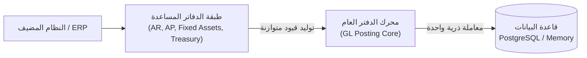

# معمارية وعقود الدفاتر المساعدة (Sub-ledgers Architecture & SPI)

- **النطاق:** `internal/subledgers`، تكاملات `pkg/spi`، والربط بالدفتر العام (General Ledger).
- **المهمة المرتبطة:** تحضير ومطابقة متطلبات المرحلة `P10` في رفع الدفاتر المساعدة إلى الواجهات العامة.
- **الحالة:** مواصفة معمارية للمنتج.

---

## 1. الفلسفة المعمارية ومبدأ الفصل الصارم

تعمل الدفاتر المساعدة (Sub-ledgers) كوحدات متخصصة لإدارة العمليات التشغيلية التراكمية، مع الالتزام التام بالمبادئ المعمارية التالية:

1. **الدفتر العام هو الحاكم الوحيد للترحيل (Single Posting Engine):**
   - لا تقوم الدفاتر المساعدة بكتابة مباشرة في جداول القيود أو الأرصدة العامة.
   - تنشئ الدفاتر المساعدة معاملات وقيودًا محاسبية قياسية تمر عبر مسار `posting.Engine` لضمان فحص التوازن، وتوافق الفترة المالية، وعدم انتهاك عزل الشركات.
2. **مطابقة رصيد الدفتر المساعد مع رصيد حساب المراقبة (Control Account Reconciliation Invariant):**
   - يجب في أي لحظة زمنية أن يتطابق مجموع الأرصدة الفرعية في الدفتر المساعد مع رصيد حساب المراقبة المناظر في الدفتر العام:
   $$\sum \text{Subledger Balances} = \text{Balance of GL Control Account}$$

---

## 2. الدفاتر المساعدة الأساسية وعقودها

### 2.1 دفتر حسابات العملاء والمدينين (Accounts Receivable - AR)

- **المسؤوليات:**
  - إدارة فواتير المبيعات، الإشعارات الدائنة، وسجل أعمار الديون (Aging Schedule).
  - معالجة التسويات والتحصيلات وربطها بالفواتير المفتوحة (Open Items Reconciliation).
  - توفير مؤشرات التعثر وانخفاض القيمة لصالح وحدة IFRS 9.

### 2.2 دفتر حسابات الموردين والدائنين (Accounts Payable - AP)

- **المسؤوليات:**
  - فواتير الشراء، اعتمادات الصرف، ومطابقات المدفوعات.
  - مطابقة الفواتير مع أوامر الشراء وسندات الاستلام (3-Way Matching Support).
  - إدارة جدول التزامات الدفع والتدفقات النقدية المتوقعة.

### 2.3 دفتر الأصول الثابتة (Fixed Assets - FA)

- **المسؤوليات:**
  - سجل الأصول الرأسمالية (Asset Register)، بطاقات الأصول، ومراكز التكلفة المرتبطة.
  - احتساب وتوليد قيود الإهلاك الدوري (طريقة القسط الثابت، الرصيد المتناقص، وحدات الإنتاج) وفق IAS 16.
  - معالجة الاستبعاد، البيع، والتخلص من الأصول.

### 2.4 دفتر الخزينة وإدارة النقدية (Treasury & Cash Management)

- **المسؤوليات:**
  - إدارة الحسابات المصرفية والخزائن النقدية والصناديق النثرية (Petty Cash).
  - التسوية البنكية الآلية وتوفيق كشوف الحسابات المصرفية (Bank Reconciliation).
  - تتبع حركة العملات الأجنبية وتوليد فروق أسعار الصرف غير المحققة والمحققة بالتكامل مع IAS 21.

---

## 3. حدود المعاملات والذرية (Transactional Consistency)

- عند تسجيل عملية تتضمن أثرًا في الدفتر المساعد (مثل سداد فاتورة مورد في AP من حساب بنكي في Treasury):
  - تُنفذ العملية بالكامل داخل **Unit of Work واحدة موحدة**.
  - في حال فشل أي قيد محاسبي أو إغلاق الفترة المالية، تتراجع كافة تحديثات الجداول الفرعية وسجل التدقيق بشكل ذري وتام.
