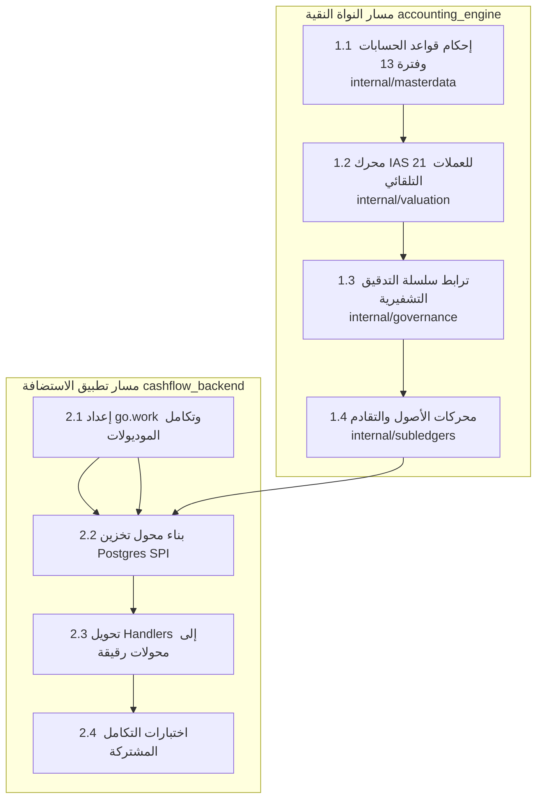

# الخطة التنفيذية لسد الفجوات والعيوب استناداً إلى `cashflow_backend`

## استراتيجية النواة النقية والمحول المحيط (Pure Core Engine & Outer Adapter Architecture)

> **المرجع التحليلي:** [`cashflow_backend_accounting_flaws_and_gap_analysis.md`](./cashflow_backend_accounting_flaws_and_gap_analysis.md)  
> **الهدف الاستراتيجي:** الحفاظ على `accounting_engine` كنواة برمجية نقية ومجردة 100% داخل مجلد `internal/` (Domain/Business-Pure)، واستخدام `cashflow_backend` كـ Host Application / Outer Adapter لمعالجة طلبات الـ HTTP وربط قاعدة بيانات PostgreSQL الحالية دون تلويث النواة.

---

## 1. الرؤية الهندسية ومبدأ الفصل الصارم (The Architectural Boundary)

لتفادي الأخطاء المعمارية السابقة وضمان استقلالية النواة المالية:

1. **`accounting_engine` (النواة النقية - Pure Engine):**
   * كود المحرك منظم حصرياً داخل مجلد `internal/` مقسماً إلى نطاقات ومكونات مستقلة.
   * خالية تماماً من: `net/http`, `chi.Router`, `JSON DTOs` الخاصة بالويب، وإعدادات السيرفر.
   * تحتوي حصراً على: كيانات النطاق (`domain`)، كائنات القيمة (`Value Objects`)، محركات التحقق والترحيل والتسوية والإقفال، وواجهات المستودعات التجريدية (SPIs).
   * تطبق بدقة المعايير الدولية: منع الترحيل للحسابات التجميعية (Parent Accounts)، دعم فترات التسوية (Period 13)، الفرز التلقائي للبنود النقدية وفق IAS 21، وسلسلة التدقيق التشفيرية SHA-256 المتصلة.

2. **`cashflow_backend` (المحول المحيط وتطبيق الاستضافة - Outer Host & Adapter):**
   * يستورد `accounting_engine` كـ Go Module.
   * يحتوي على: معالجات الـ HTTP (REST Handlers)، الـ Routing، المصادقة والـ JWT، استخراج الـ ActorID من الجلسة، والتحويل بين JSON DTOs ونماذج النواة.
   * يحتوي على مشغل PostgreSQL الفعلي الذي ينفذ واجهات الـ SPI المطلوبة من النواة.

```text
+----------------------------------------------------------------------------------------+
|                                  CASHFLOW_BACKEND                                      |
|                                                                                        |
|  [HTTP / REST Layer]                                                                   |
|   ├── POST /api/v1/accounting/moves                                                    |
|   ├── POST /api/v1/accounting/moves/{id}/post                                          |
|   └── GET  /api/v1/accounting/reports/*                                                |
|                                                                                        |
|  [HTTP Handlers & DTO Mappers]                                                         |
|   ├── Read JSON Request -> Validate HTTP Syntax -> Extract ActorID                     |
|   └── Call Engine In-Memory Methods -> Map Domain Result to JSON Response              |
|                                                                                        |
|  [Postgres Storage Adapter] (Implements accounting_engine SPIs)                        |
|   ├── postgres.AccountRepository                                                       |
|   ├── postgres.PostingRepository                                                       |
|   └── postgres.AuditRepository                                                         |
+----------------------------------------------------------------------------------------+
                                           |
                                Imports & Calls
                                           v
+========================================================================================+
|                              PURE ACCOUNTING_ENGINE                                    |
|                                                                                        |
|   ├── internal/types/       -> Money, ISO 4217, Domain Errors                          |
|   ├── internal/masterdata/  -> Leaf Account Enforcer, Fiscal Periods (with Period 13)  |
|   ├── internal/posting/     -> Balanced Moves, Immutability, Atomic Posting, Maker-Ch  |
|   ├── internal/subledgers/  -> Event Ingestion Bridge, AR/AP, Fixed Assets Depreciation |
|   ├── internal/valuation/   -> IAS 21 Automated Monetary Items Revaluation             |
|   ├── internal/reporting/   -> Trial Balance, Financial Statements (IAS 1/7), Closing  |
|   ├── internal/governance/  -> SHA-256 Continuous Hash Chain & SoD Verification        |
|   └── storage/              -> Memory Driver (Testing) & Postgres SPI Contracts        |
+========================================================================================+
```

---

## 2. مصفوفة سد الفجوات المحددة (Gap Remediation Matrix)

| الفجوة المرصودة في `cashflow_backend` | موقع الحل الصحيح | المعيار الحاكم | الآلية التنفيذية لسد الفجوة |
| :--- | :--- | :--- | :--- |
| **1. تلوث النواة بـ HTTP و DTOs** | فصل الكود بين المشروعين | Clean Architecture | بقاء النواة في `internal/` خالية، ونقل الـ Handlers والـ DTOs إلى `cashflow_backend/internal/features/accounting/` |
| **2. السماح بالترحيل للحسابات التجميعية** | داخل `accounting_engine/internal/masterdata` | AICPA / ERP Best Practices | إضافة فحص `HasChildren` الصارم في `ValidateCanPostToAccount` ورفض القيد بـ `ErrCannotPostToParentAccount` |
| **3. رفض فترات التسوية (فرض 12 فترة)** | داخل `accounting_engine/internal/masterdata` | IFRS / US GAAP Period-End | تحديث منطق الفترات لدعم 12 إلى 14 فترة (الشهور + فترات التسوية وجرد التدقيق Period 13/14) |
| **4. قصور إعادة تقييم العملات** | داخل `accounting_engine/internal/valuation` | IAS 21.23 | بناء محرك يفرز آلياً البنود النقدية (Monetary) ويعيد تقييمها ويتخطى البنود غير النقدية |
| **5. ثغرة تسلسل الـ Hash Chain عند الإنشاء** | داخل `accounting_engine/internal/governance` | COSO / SOX 404 | ربط السجل بالسجل السابق لحظياً بتضمين `PreviousLogHash` في دالة التجزئة عند الولادة |
| **6. غياب محرك استهلاك الأصول وإعمار الذمم** | داخل `accounting_engine/internal/subledgers` | IAS 16 & IFRS 9 | بناء محرك الاستهلاك الخطي ومصفوفة أعمار الديون وجداول الـ ECL ضمن الدفاتر المساعدة |

---

## 3. خطة العمل التنفيذية المتسلسلة (Action Plan Phases)

### المسار الأول: بناء وتثبيت النواة النقية (`accounting_engine`)

#### المرحلة 1.1: إحكام حوكمة شجرة الحسابات والفترات الممتدة

* **الملفات المستهدفة:** `internal/masterdata/service.go`, `internal/masterdata/fiscal_calendar.go`

* **المهام:**
  1. تفعيل فحص `HasChildren` أثناء التحقق من ترحيل أي سطر قيد، ومنع الترحيل إلى أي حساب ليس ورقة نهائية (Leaf).
  2. تعديل نموذج السنة المالية ليدعم `PeriodType` (`regular` للشهور 1-12، و `adjustment` لفترات التسوية 13 و 14).
  3. تعديل شروط الإقفال السنوي لقبول الفترات النظامية وفترات التسوية معاً.

#### المرحلة 1.2: اكتمال محرك العملات التلقائي وفق IAS 21

* **الملفات المستهدفة:** `internal/valuation/revaluation.go`, `internal/valuation/monetary.go`

* **المهام:**
  1. بناء خوارزمية تمييز الحسابات: تصنيف الحسابات النقدية (النقد، البنوك، الذمم المدينة، الذمم الدائنة) كـ `Monetary`.
  2. استثناء حسابات الأصول الثابتة وحقوق الملكية والمصروفات من إعادة التقييم الدوري التلقائي.
  3. ربط محرك التقييم بـ `RateProviderSPI` لجلب أسعار الإقفال وتوليد قيود التسوية المتزنة.

#### المرحلة 1.3: إحكام سلسلة التدقيق التشفيرية المترابطة (COSO Hash Chain)

* **الملفات المستهدفة:** `internal/governance/audit_chain.go`, `internal/governance/verifier.go`

* **المهام:**
  1. فرض تمرير `PreviousLogHash` في دالة إنشاء سجل التدقيق `NewAuditLog`.
  2. ربط عملية الترحيل في `internal/posting` بجلب آخر Hash مسجل وتوليد الـ Hash الجديد قبل الحفظ الذري.
  3. توفير دالة فحص النزاهة التشفيرية الشاملة `VerifyIntegrity`.

#### المرحلة 1.4: إضافة محركات الدفاتر المساعدة (Subledgers)

* **الملفات المستهدفة:** `internal/subledgers/receivable.go`, `internal/subledgers/fixed_assets.go`

* **المهام:**
  1. بناء حاسبة أعمار الديون (0-30, 31-60, 61-90, +90 يوماً).
  2. بناء محرك استهلاك الأصول الثابتة وحساب القسط الشهري وتوليد قيود الاستهلاك.

---

### المسار الثاني: تهيئة وتحديث `cashflow_backend` ليعمل كـ Host Adapter

#### المرحلة 2.1: ربط الموديولين عبر Go Work / Go Modules

* **الملفات المستهدفة:** `/home/osm/StudioProjects/cashflow_system/go.work`

* **المهام:**
  1. تحديث `go.work` في جذر المشروع ليشمل كلا المشروعين:

     ```text
     go 1.26.3

     use (
         ./cashflow_backend
         ./accounting_engine
     )
     ```

  2. تمكين `cashflow_backend` من استيراد `accounting_engine` مباشرة دون الحاجة لرفعه إلى مستودع خارجي.

#### المرحلة 2.2: بناء مشغل PostgreSQL للنواة المالية داخل `cashflow_backend`

* **الملفات المستهدفة:** `cashflow_backend/internal/infrastructure/storage/postgres/`

* **المهام:**
  1. تنفيذ واجهات الـ SPI التي يطلبها `accounting_engine`:
     * تنفيذ `masterdata.Repository` باستخدام اتصال `pgxpool.Pool`.
     * تنفيذ `posting.Repository` مع المعاملات الذرية `pgx.Tx` والقفل التنافسي.
     * تنفيذ `governance.Repository` لحفظ وقراءة سجلات التدقيق التشفيرية.
     * تنفيذ `valuation.RateProviderSPI` للقراءة من جدول أسعار الصرف.

#### المرحلة 2.3: تحديث طبقة الـ HTTP في `cashflow_backend`

* **الملفات المستهدفة:** `cashflow_backend/internal/features/accounting/`

* **المهام:**
  1. تحويل الحزمة `accounting` في الباك إند لتصبح رقيقة (Thin Adapter Layer).
  2. مهام الـ Handlers تقتصر على:
     * استقبال وفك تشفير JSON Payload.
     * التحقق من صيغ المدخلات التقنية (Syntax Validation).
     * استخراج معرف المستخدم المصادق عليه (`ActorID`).
     * استدعاء خدمات `accounting_engine` المناسبة.
     * تحويل النتيجة المالية الصادرة من النواة إلى JSON Response.

---

## 4. جدول التسلسل الزمني والاعتماديات (Sequential Execution Roadmap)



---

## 5. مصفوفة التحقق ومعايير القبول (Acceptance & Verification Matrix)

* [ ] **فحص النقاء المعماري:** تشغيل `go list -f '{{.Imports}}' ./...` داخل `accounting_engine` والتأكد التام من عدم وجود أي استيراد لـ `net/http` أو `chi` أو أي حزمة شبكة.
* [ ] **منع الترحيل للحسابات التجميعية:** اختبار محاولة إنشاء أو ترحيل قيد على حساب رئيسي يمتلك فروعاً، والتأكد من رفضه الحتمي بالخطأ المعياري `ErrCannotPostToParentAccount`.
* [ ] **قبول فترة التسوية 13:** اختبار دورة سنة مالية تحتوي على 13 فترة، وإتمام الإقفال السنوي بنجاح.
* [ ] **إعادة التقييم التلقائي وفق IAS 21:** التحقق من إعادة تقييم أرصدة البنوك والعملاء بالعملات الأجنبية وتخطي حسابات الأصول الثابتة.
* [ ] **تكامل الـ Hash Chain:** التحقق من أن كل سجل تدقيق جديد يتم إنشاؤه يحمل في طياته بصمة السجل السابق بصورة مشفرة متصلة.
* [ ] **جاهزية الـ Backend:** استدعاء مسارات الـ API في `cashflow_backend` بنجاح عبر محرك النواة الجديد والتأكد من اجتياز كافة الاختبارات التكاملية.
