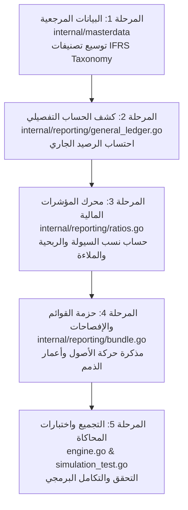

# الخطة التنفيذية الشاملة والمفصلة: استيعاب ميزات `cashflow_backend` المحاسبية في النواة النقية `accounting_engine`

## تحليل الميزات، التأصيل المعياري الدولي، وجداول التنفيذ البرمجي التفصيلي

> **الهدف الأساسي:** حصر وتوثيق كافة الميزات المحاسبية الموجودة في مشروع `cashflow_backend/internal/features/accounting` وتحديد ما هو غير موجود في مشروعنا `accounting_engine`، وإثبات استناد كل ميزة إلى معايير دولية معتمدة (IFRS, US GAAP, CFA Institute, AICPA, ISO)، مع وضع خطة تنفيذية كاملة ومقسمة إلى مراحل متسلسلة **لتنفيذ كافة التعديلات والإضافات حصراً داخل مشروعنا `accounting_engine` (ضمن مجلد `internal/`)** دون المساس بنقاء النواة أو إدخال أي طبقات HTTP أو ويب.

---

## 1. الفلسفة المعمارية ومبدأ الحصانة (Architecture & Purity Preservation)

```text
+----------------------------------------------------------------------------------------+
|                      CASHFLOW_BACKEND (External / Web Host)                           |
|       - HTTP Handlers, Routers, JSON DTOs, Web Middleware, Request Parsing            |
+----------------------------------------------------------------------------------------+
                                           |
                                  Calls In-Memory APIs
                                           v
+========================================================================================+
|                       ACCOUNTING_ENGINE (Pure Financial Core)                          |
|                                                                                        |
|   ├── internal/types/         -> Precision-safe Math, Currencies, Domain Errors        |
|   ├── internal/masterdata/    -> Accounts, IFRS Taxonomy Classifications, Calendars    |
|   ├── internal/posting/       -> Double-Entry Engine, Immutability, Atomic Posting     |
|   ├── internal/subledgers/    -> Event Bridge, AR/AP, Fixed Assets, Reconciliation     |
|   ├── internal/valuation/     -> IAS 21 Automated Monetary Items Revaluation           |
|   ├── internal/reporting/     -> Financial Statements, Ratios, Bundle, General Ledger  |
|   └── internal/governance/    -> Cryptographic SHA-256 Audit Chain, SoD Verification   |
+========================================================================================+
```

### القواعد الصارمة لهذه الخطة

1. **التنفيذ محصور في `accounting_engine`:** لا يتم تعديل أي سطر في `cashflow_backend`.
2. **نقاء 100%:** لا وجود لـ `net/http` أو `chi` أو `gin` أو JSON DTOs الخاصة بالويب داخل النواة.
3. **الدقة الحسابية:** استخدام `decimal.Decimal` بدقة 4 خانات عشرية في جميع النسب والتقارير المالية دون استخدام الفواصل العائمة.

---

## 2. مصفوفة مقارنة الميزات والتأصيل المعياري الدولي

| # | الميزة في `cashflow_backend` | الحالة في `accounting_engine` | المعيار الدولي المعتمد | هل تستند لمعيار رسمي؟ | الأهمية للنظام المالي |
| --- | --- | :---: | --- | :---: | :---: |
| **1** | **محرك النسب والمؤشرات المالية (Financial Ratios)** | ❌ **غير موجودة** | • CFA Institute Financial Analysis<br>• IFRS Capital Disclosures (IAS 1) | **نعم معيارية** | حرجة للمحللين والإدارة |
| **2** | **حزمة القوائم والإفصاحات الكاملة (Statement Bundle)** | ❌ **غير موجودة** | • IAS 1 (Presentation & Notes)<br>• IFRS 7 (Credit Risk / Aging Disclosure)<br>• IAS 16 (PPE Roll-forward Schedule) | **نعم معيارية** | متطلب قانوني للقوائم المدققة |
| **3** | **ثوابت التصنيف المعياري الموحد (IFRS Taxonomy)** | ⚠️ **تصنيفات نصية محدودة** | • IFRS Taxonomy 2024<br>• US GAAP Financial Reporting Taxonomy | **نعم معيارية** | تضمن توحيد وتصنيف البنود آلياً |
| **4** | **كشف الحساب التفصيلي مع الرصيد الجاري (GL Detail)** | ⚠️ **تجميع أرصدة إجمالية فقط** | • AICPA General Ledger Audit Standards<br>• ISA 500 (Audit Evidence) | **نعم معيارية** | متطلب إلزامي للتدقيق المحاسبي |
| **5** | **معالجات الـ HTTP و DTOs للـ JSON** | ❌ **غير موجودة** | • ليست معياراً محاسبياً (Web Transport Concern) | ❌ **غير معيارية** | **مرفوضة** (تبقى خارج المحرك) |

---

## 3. التحليل المعياري التفصيلي للميزات المستهدفة

### 3.1. محرك النسب والمؤشرات المالية (`Financial Ratios Engine`)

* **الأساس المعياري:**
  * معيار **IAS 1**: يوجب إفصاح المنشآت عن سياسات إدارة المخاطر المالية والسيولة.
  * إطار **CFA Institute**: يحدد 4 مجموعات رئيسية لقياس صحة المنشأة المالية:
    1. **نسب السيولة (Liquidity):**
       * النسبة الجارية: $\text{Current Ratio} = \frac{\text{Current Assets}}{\text{Current Liabilities}}$
       * النسبة السريعة: $\text{Quick Ratio} = \frac{\text{Cash} + \text{Receivables}}{\text{Current Liabilities}}$
       * نسبة النقدية: $\text{Cash Ratio} = \frac{\text{Cash}}{\text{Current Liabilities}}$
    2. **نسب الربحية (Profitability):**
       * هامش مجمل الربح: $\text{Gross Profit Margin} = \frac{\text{Gross Profit}}{\text{Revenue}} \times 100$
       * هامش التشغيل: $\text{Operating Margin} = \frac{\text{Operating Profit}}{\text{Revenue}} \times 100$
       * هامش صافي الربح: $\text{Net Profit Margin} = \frac{\text{Net Income}}{\text{Revenue}} \times 100$
       * العائد على الأصول: $\text{ROA} = \frac{\text{Net Income}}{\text{Total Assets}} \times 100$
       * العائد على حقوق الملكية: $\text{ROE} = \frac{\text{Net Income}}{\text{Total Equity}} \times 100$
    3. **نسب كفاءة النشاط (Activity Metrics):**
       * معدل دوران الأصول: $\text{Asset Turnover} = \frac{\text{Revenue}}{\text{Total Assets}}$
       * معدل دوران الذمم المدينة: $\text{Receivables Turnover} = \frac{\text{Revenue}}{\text{Trade Receivables}}$
       * معدل دوران المخزون: $\text{Inventory Turnover} = \frac{\text{Cost of Sales}}{\text{Inventories}}$
    4. **نسب الرفع المالي والملاءة (Solvency / Leverage):**
       * نسبة الديون إلى حقوق الملكية: $\text{Debt to Equity} = \frac{\text{Total Liabilities}}{\text{Total Equity}}$
       * نسبة الديون إلى الأصول: $\text{Debt to Assets} = \frac{\text{Total Liabilities}}{\text{Total Assets}}$
       * نسبة تغطية الفوائد: $\text{Interest Coverage} = \frac{\text{Operating Profit}}{\text{Finance Costs}}$

---

### 3.2. حزمة القوائم المالية والإفصاحات المتممة (`Statement Bundle & Disclosures`)

* **الأساس المعياري:**
  * معيار **IAS 1 (فقرة 10):** ينص صراحة على أن القوائم المالية لا تكتمل إلا بالإيضاحات والمذكرات التفسيرية (Notes to Financial Statements).
  * معيار **IAS 16 (فقرة 73):** يلزم بتقديم جدول مطابقة حركة الأصول الثابتة (PPE Roll-Forward Schedule):
    $$\text{Ending PPE} = \text{Beginning Balance} + \text{Additions} - \text{Disposals} - \text{Depreciation Charge}$$
  * معيار **IFRS 7 (فقرة 36-37) ومعيار IFRS 9:** يلزمان بالإفصاح عن المخاطر الائتمانية عبر جدول أعمار الذمم المدينة (Aged Receivables Report):
    * فئة جارية (0-30 يوماً).
    * متأخرة (31-60 يوماً).
    * متأخرة جداً (61-90 يوماً).
    * متعثرة/مضمحلة (+90 يوماً).

---

### 3.3. التصنيفات الفرعية المعيارية الموحدة (`IFRS SubClassifications Taxonomy`)

* **الأساس المعياري:**
  * تصنيف **IFRS Taxonomy**: يعرّف تصنيفات فرعية دقيقة للحسابات لتوليد التقارير تلقائياً دون الحاجة لكتابة شروط نصية هشة:
    * الأصول: `SubClassCashAndEquivalents`, `SubClassTradeReceivables`, `SubClassInventories`, `SubClassPropertyPlantEquipment`, `SubClassIntangibleAssets`...
    * الالتزامات: `SubClassTradePayables`, `SubClassShortTermBorrowings`, `SubClassCurrentLeaseLiabilities`, `SubClassLongTermBorrowings`...
    * حقوق الملكية: `SubClassShareCapital`, `SubClassSharePremium`, `SubClassStatutoryReserve`, `SubClassRetainedEarnings`...
    * الإيرادات والمصروفات: `SubClassOperatingRevenue`, `SubClassCostOfSales`, `SubClassSellingDistributionExpense`, `SubClassGeneralAdminExpense`, `SubClassDepreciationAmortExpense`, `SubClassFinanceIncome`, `SubClassFinanceCost`...

---

### 3.4. كشف الحساب التفصيلي مع الرصيد الجاري (`General Ledger Detail Lines`)

* **الأساس المعياري:**
  * معيار التدقيق الدولي **ISA 500 (أدلة الإثبات في التدقيق)** وقواعد **AICPA**:
  * يتطلب كشف الحساب عرض: تاريخ القيد، رقم السند، المرجع، المبلغ المدين، المبلغ الدائن، و**الرصيد التراكمي المتحرك سطر بسطر (Running Balance)**.

---

## 4. خطة التنفيذ المتسلسلة في `accounting_engine` (Sequential Implementation Plan)



---

### المرحلة 1: توسيع تصنيفات دليل الحسابات وفق IFRS Taxonomy

* **المسار المستهدف:** `internal/masterdata/account.go`
* **المخرجات البرمجية:**
  * تعريف أكثر من 30 ثابتاً معيارياً لـ `SubClassification`.
  * تحديث دوال التحقق لربط التصنيفات الفرعية بنوع الحساب الرئيسي (`AccountType`).
  * توفير دوال مساعدة استعلامية: `IsCurrentAsset()`, `IsCashEquivalent()`, `IsPPE()`.

### المرحلة 2: بناء محرك كشف الحساب التفصيلي للأستاذ العام

* **المسار المستهدف:** `internal/reporting/general_ledger.go`
* **المخرجات البرمجية:**
  * هيكل `GeneralLedgerLine`: يمثل سطراً تفصيلياً (Date, EntryID, SequenceNumber, Reference, Debit, Credit, RunningBalance).
  * هيكل `GeneralLedgerAccountReport`: يمثل كشف حساب كامل (AccountID, Code, Name, OpeningBalance, Lines, EndingBalance, NetMovement).
  * خوارزمية احتساب الرصيد الجاري التراكمي سطر بسطر بناءً على طبيعة الحساب (`NormalBalanceDebit` أو `NormalBalanceCredit`).

### المرحلة 3: بناء محرك النسب والمؤشرات المالية

* **المسار المستهدف:** `internal/reporting/ratios.go`
* **المخرجات البرمجية:**
  * هيكل `FinancialRatios`:
    * `Liquidity`: CurrentRatio, QuickRatio, CashRatio.
    * `Profitability`: GrossMargin, OperatingMargin, NetMargin, ROA, ROE.
    * `Activity`: AssetTurnover, ReceivablesTurnover, InventoryTurnover.
    * `Solvency`: DebtToEquity, DebtToAssets, InterestCoverage.
  * دوال الحساب الآمنة `safeDiv` و `safePct` لمنع أخطاء القسمة على الصفر (`decimal.Zero`).

### المرحلة 4: بناء حزمة القوائم المالية والإفصاحات المتممة

* **المسار المستهدف:** `internal/reporting/bundle.go`
* **المخرجات البرمجية:**
  * هيكل `StatementBundle` يجمع:
    * `BalanceSheet` (قائمة المركز المالي).
    * `IncomeStatement` (قائمة الدخل الشامل).
    * `CashFlow` (قائمة التدفقات النقدية).
    * `EquityStatement` (قائمة التغيرات في حقوق الملكية).
    * `TrialBalance` (ميزان المراجعة).
    * `Ratios` (النسب المالية).
    * `PPERollForwardReport` (مذكرة حركة الأصول الثابتة وفق IAS 16).
    * `AgedReceivablesReport` (إفصاح أعمار الذمم الائتمانية وفق IFRS 7).

### المرحلة 5: تحديث واجهة المحرك الموحدة واختبارات المحاكاة

* **المسار المستهدف:** `engine.go` و `internal/reporting/reporting_test.go` و `simulation_test.go`
* **المخرجات البرمجية:**
  * توسيع `reporting.Engine` ليشمل: `GeneralLedger`, `Ratios`, `Bundle`.
  * إضافة توابع الاستدعاء المباشر في `engine.go`.
  * كتابة اختبارات وحدة واختبارات محاكاة تغطي استخراج كشف الحساب والنسب والمذكرات بدقة 100%.

---

## 5. مصفوفة النقاء المعماري وعدم الارتباط بالنقل

| المكون المضاف | الحزمة في `accounting_engine` | هل يحتوي على `net/http` أو JSON أو Routers؟ | طبيعة المدخلات والمخرجات |
| --- | --- | :---: | --- |
| تصنيفات IFRS | `internal/masterdata` | ❌ **لا إطلاقاً** | Go Constants & Struct Fields |
| كشف الحساب العام | `internal/reporting` | ❌ **لا إطلاقاً** | In-Memory Go Structs (`GeneralLedgerAccountReport`) |
| المؤشرات المالية | `internal/reporting` | ❌ **لا إطلاقاً** | In-Memory Go Structs (`FinancialRatios`) |
| حزمة الإفصاحات | `internal/reporting` | ❌ **لا إطلاقاً** | In-Memory Go Structs (`StatementBundle`) |

---

## 6. معايير القبول والتحقق الصارم (Acceptance Criteria)

* [ ] تمرير جميع اختبارات `go test ./...` داخل `accounting_engine` بنجاح 100%.
* [ ] خلو كافة الملفات الجديدة والمعدلة من أي استيراد لحزم `net/http` أو `chi` أو `encoding/json` في طبقة النطاق.
* [ ] احتساب النسب المالية بدقة 4 خانات عشرية ومنع أخطاء القسمة على الصفر للمنشآت حديثة التأسيس.
* [ ] تطابق مذكرة حركة الأصول الثابتة مع صافي قيمة بند الأصول في الميزانية العمومية بدقة 100%.
* [ ] تطابق رصيد كشف الحساب التفصيلي مع رصيد الحساب الختامي في ميزان المراجعة.
