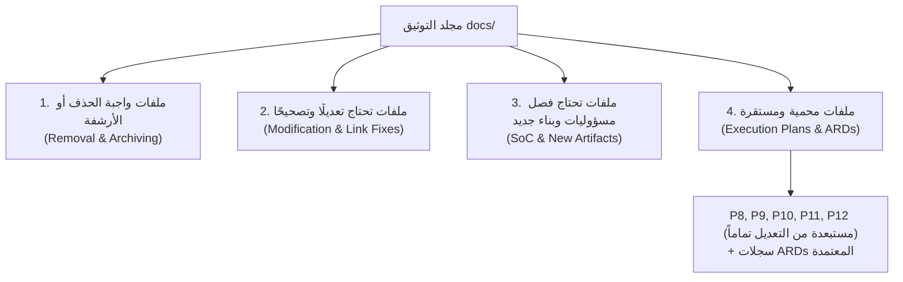

# تقرير التحليل الشامل لمجلد التوثيق (`docs/`) وخطة إعادة الهيكلة وفصل المسؤوليات

- **المشروع:** النواة المحاسبية والمالية (`accounting_engine`)
- **تاريخ التحليل:** 16 نوفمبر 2026
- **النطاق:** فحص شامل لجميع ملفات ومجلدات `docs/` (86 ملفًا، ~1.2 ميجابايت)
- **الحالة:** تقرير تحليلي وتوصيات معمارية لاعتماد خطة إعادة التنظيم
- **استثناء ملزم:** ملفات الخطط التنفيذية **`execution_plan_P8.md`، `execution_plan_P9.md`، `execution_plan_P10.md`، `execution_plan_P11.md`، و`execution_plan_P12.md` تم استبعادها تمامًا من أي تعديل أو مساس**.

---

## 1. الملخص التنفيذي والوضع الراهن

أظهر الفحص الدقيق لمجلد `docs/` أن التوثيق يحتوي على ثروة معرفية ومعمارية ومحاسبية عالية القيمة، إلا أنه يعاني حاليًا من أربعة اختلالات رئيسية نتيجة التطور السريع للمشروع عبر مراحل `P0` إلى `P7` ودخول مراحل `P8` إلى `P12`:

1. **الازدواجية والتكرار (Duplication):** وجود نسخ متعددة للمواصفة نفسها (مثل وجود نسختين من `reversal_specification.md` إحداهما في `architecture/` والأخرى في `accounting/`).
2. **ملفات مسودة تاريخية وغير منسقة (Drafts & Non-normative Clutter):** بقاء ملفات مسودات سريعة (مثل `units.md` غير المهيكل)، وخطط توازي لمراحل سابقة مكتملة (`execute_paralism.md`)، ومستندات تقييم تاريخية مبكرة ينص `README.md` نفسه على عدم حجيتها الإنتاجية ولكنها ما زالت متناثرة في الجذر.
3. **التضخم الأحادي وغياب فصل المسؤوليات (Monolithic Documents):** وجود ملفات موسوعية ضخمة (تتجاوز 87 كيلوبايت وأكثر من 1000 سطر) تدمج معايير عالمية متباينة (IFRS مقابل US GAAP مقابل AAOIFI مقابل IPSAS) في وثيقة واحدة، مما يصعب صيانتها أو ربطها بالـ PRs والوحدات البرمجية.
4. **تشتت التموضع والروابط المكسورة (Broken Links & Misplacement):** ملفات منهجية عامة في هندسة البرمجيات (مثل SOLID وISO metrics) موجودة في جذر المجلد وتزاحم مواصفات النواة المحاسبية، فضلًا عن وجود روابط مكسورة في `ci.md` و`software_engines.md`.

---

## 2. مصفوفة التحليل الشامل لمجلد `docs/`

تم تصنيف كافة محتويات المجلد وفق أربعة مسارات عمل واضحة:



---

## 3. القسم الأول: الملفات المطلوب إزالتها أو نقلها للأرشيف

### أ. ملفات واجبة الحذف فوراً (Deletions)

| الملف | الحجم / الأسطر | سبب الحذف والتوصية |
| --- | --- | --- |
| `docs/architecture/reversal_specification.md` | 96 سطرًا (10.6 KB) | **ازدواجية متأخرة:** نسخة قديمة ومختصرة من مواصفة العكس المحاسبي. النسخة المعتمدة والمحدثة والشاملة توجد في `docs/accounting/reversal_specification.md` (154 سطرًا) وهي المشار إليها رسميًا في `README.md`. بقاء الملف في `architecture/` يربك المطورين. |
| `docs/units.md` | 20 سطرًا (1.8 KB) | **مسودة غير مهيكلة (Scratchpad):** ملف نصي عشوائي لا يحتوي على عناوين Markdown ولا هيكل معتمد؛ تم استيعاب كافة نقاطه بالكامل في `docs/product_boundary.md` وخطة `execution_plan_P10.md` الخاصة بالدفاتر المساعدة. يجب حذفه. |
| `docs/execute_paralism.md` | 457 سطرًا (19.8 KB) | **خطة تشغيلية منتهية + خطأ إملائي بالاسم:** تصف خطوات التنفيذ المتوازي لمهام `P3` حتى `P7` (والتي اكتملت بالكامل واعتُمدت في إصدار v0.1.0). بقاؤها في الجذر يسبب التباسًا مع خطط P8–P12 الحالية، فضلًا عن الخطأ الإملائي في اسمها (`paralism`). تحذف أو تؤرشف. |

### ب. ملفات تاريخية غير معيارية تُنقل إلى مجلد جديد `docs/archive/`

ينص ملف `docs/README.md` صراحةً في البند الرابع على:
> *"The following documents contain older assessments or proposals and must not be used as current readiness, certification, or compliance evidence"*

بقاء هذه الملفات الكبيرة في جذر `docs/` يوحي بأنها مواصفات نشطة، وتوصيتنا هي إنشاء مجلد `docs/archive/` ونقلها إليه مع وضع علامة مائية (Deprecation/Historical banner):

| الملف | الحجم / الأسطر | سبب النقل للأرشيف |
| --- | --- | --- |
| `docs/golden_accounting_benchmark.md` | 137 سطرًا (13.4 KB) | مسودة أرقام تاريخية مبكرة (11 نوفمبر). استُبدلت رسميًا بالوثيقة المعتمدة `docs/golden_accounting_scenarios.md` الناتجة عن مهمة `P4-08`. |
| `docs/production_certification_signoff.md` | 266 سطرًا (12.8 KB) | تقرير تدقيق سابق ملغى وموسوم بـ "Historical artifact — not a current certification". |
| `docs/production_readiness_specification_and_verification.md` | 461 سطرًا (54.5 KB) | وثيقة مواصفات سابقة غير محققة موسومة بأنها مرجعية غير معيارية تاريخية، وتزاحم تقرير الجاهزية الحقيقي `reports/release_readiness_p7-05.md`. |
| `docs/gap_analysis_and_standards_verification_report.md` | 304 سطرًا (25.3 KB) | تقرير فحص يعود لتاريخ 11 نوفمبر قبل تنفيذ مهام P0–P7 وقبل إصدار v0.1.0. مكانه الطبيعي هو الأرشيف التاريخي. |

---

## 4. القسم الثاني: الملفات التي تحتاج إلى تعديل (Modification)

> [!IMPORTANT]
> **التزام تام بالملاحظة:** ملفات `execution_plan_P8.md`, `execution_plan_P9.md`, `execution_plan_P10.md`, `execution_plan_P11.md`, و`execution_plan_P12.md` **لن تُمس بأي تعديل**. التعديلات أدناه تنحصر في ملفات الفهارس والسياسات والأدلة.

| الملف المستهدف | التعديل المطلوب بدقة | الأسباب والمسوغات |
| --- | --- | --- |
| `docs/README.md` | 1. إضافة قسم مخصص لـ **خطة الإكمال P8–P12** ورابط `execution_plan_overview.md`.<br/>2. ربط ملفات المعمارية المهملة في الفهرس: `service_boundary.md` و`unit_of_work_and_transactions.md`.<br/>3. إزالة الروابط إلى الملفات المحذوفة وتوجيه ملفات الأرشيف إلى قسم `docs/archive/`.<br/>4. ربط وثيقة الحالات المعتمدة `golden_accounting_scenarios.md` في جدول المحاسبة. | الفهرس الحالي يعكس حالة المستودع عند نهاية P7 فقط ويهمل الإضافات المعمارية لـ P8-P12 وملفات المعمارية الحيوية. |
| `docs/ci.md` | 1. تصحيح الرابط المكسور في السطر 8 من `./baseline_report.md` إلى `./baselines/engine5_baseline.md`.<br/>2. تصحيح الرابط المكسور `./traceability_matrix.md` ليوجه إلى الوثيقة الفعلية الموازية `ENGINE_COMPLIANCE_MATRIX.md`. | وجود روابط مكسورة (Broken Links) داخل وثيقة مسؤولة عن تدقيق الـ CI يضعف موثوقية المستودع. |
| `docs/software_engines.md` | 1. إزالة أو تصحيح 4 روابط داخلية مكسورة لملفات غير موجودة بالمستودع:<br/>   - `./execution_plan/index.md`<br/>   - `./testing_confidence_report.md`<br/>   - `./engine_problems_verification_and_standards_compliance.md`<br/>   - `./engine_errors_analysis.md`<br/>2. توضيح أن الوثيقة تمثل مرجعًا تعليميًا/منهجيًا عامًا وليس توصيفًا للنواة المحاسبية ذاتها. | إصلاح مراجع الفهرس الداخلي التي تشير إلى ملفات متخيلة أو محذوفة سابقًا. |
| `docs/accounting_engine_impl_plan.md` | إضافة تنويه في رأس الملف (Header Banner) يفيد بأن المهام من `P0` إلى `P7` أصبحت **مغلقة ومكتملة تاريخيًا**، وتوجيه القارئ إلى `docs/execution_plan_overview.md` للمراحل النشطة `P8–P12`. | حجم الملف (143 KB) وكونه يبدأ بعبارة "جميع المهام تبدأ بحالة معلقة" يحدث لبسًا شديدًا لمن يقرأه حاليًا بعد صدور v0.1.0. |
| `docs/migration_policy.md` | تعديل العنوان ليصبح صريحًا: `PostgreSQL Database Schema Migration Policy`، وتوضيح نطاقها بأنها تخص ترحيل قواعد البيانات، لتمييزها بوضوح عن هجرة الشيفرة وواجهات الـ SDK (`docs/migration/root-facade.md`). | فض الاشتباك المفاهيمي بين "Database Migrations" و"Code/API Migration". |
| `docs/ifrs_automation.md` | تعديل تصنيف الملف وموقعه في التوثيق ليصبح دليلاً لاستخدام سطر الأوامر: `IFRS Automation CLI & Daemon Specification`، مع تحديث مسارات التكوين لتتطابق مع معايير P8-P11. | الوثيقة الحالية موضوعة كأنها معيار محاسبي بينما هي دليل استخدام تشغيلي لأمر `agy ifrs`. |

---

## 5. القسم الثالث: فصل المسؤوليات (Separation of Concerns) وبناء ملفات جديدة

هنا يكمن التحسين المعماري الأكبر للتوثيق؛ حيث تم تحديد 4 تكتلات توثيقية تعاني من خلط المسؤوليات:

### 1. تفكيك الدليل المرجعي الموسوعي الشامل (`global_financial_statements_standards_reference.md`)

- **المشكلة الحالية:** ملف عملاق (87.6 KB و 1010 أسطر) يدمج معًا: معايير IFRS التقليدية، ومعيار IFRS 18 الجديد (عرض القوائم وتصنيفات الأنشطة التشغيلية والاستثمارية والتمويلية)، والمعايير الأمريكية (US GAAP)، ومعايير المحاسبة الإسلامية (AAOIFI)، ومعايير القطاع العام (IPSAS)، ومعايير الاستدامة (ISSB). هذا الخلط يجعل من المستحيل على مراجعي الكود تتبع الامتثال لمعيار محدد.
- **إعادة الهيكلة وفصل المسؤوليات:** إنشاء مجلد متخصص `docs/standards/` وتقسيم الملف إلى وثائق مستقلة:

```
docs/standards/
├── README.md                           # فهرس المعايير ومجالات تطبيقها في المحرك
├── ifrs_core_financial_statements.md  # متطلبات IAS 1 و IAS 7 (الميزانية، الدخل، التدفقات النقدية)
├── ifrs18_presentation_structure.md   # الهيكل التشغيلي المستحدث وفق IFRS 18 (ساري 2027)
├── aaoifi_islamic_accounting.md       # معايير المحاسبة المالية للمؤسسات الإسلامية (المضاربة/المرابحة)
├── us_gaap_reconciliation.md          # الفروق الجوهرية والمعالجات البديلة وفق US GAAP
└── ipsas_public_sector.md             # محاسبة القطاع العام والمنشآت غير الهادفة للربح
```

### 2. عزل الأدلة المنهجية العامة لهندسة المحركات (`docs/methodology/`)

- **المشكلة الحالية:** تزاحم خمسة ملفات تعليمية جذر `docs/`:
  - `docs/software_engines.md` (26.5 KB)
  - `docs/engineering_principles.md` (5.0 KB)
  - `docs/engine_development_method.md` (8.3 KB)
  - `docs/engine_quality_metrics.md` (5.0 KB)
  - `docs/engine_development_documentation.md` (2.0 KB)
  هذه الملفات تشرح مبادئ عامة في هندسة البرمجيات (SOLID، Clean Architecture، مقاييس الجودة الدولية ISO 25010) وليست مواصفات خاصة بالنظام المالي.
- **إعادة الهيكلة:** نقل هذه الملفات إلى مجلد فرعي مستقل `docs/methodology/` (أو `docs/guidelines/`) لتصفية الجذر للوثائق المالية والهندسية الخاصة بالمشروع فقط.

### 3. بناء وثائق معمارية مفقودة للدفاتر المساعدة والمعايير المعيارية

استنادًا إلى متطلبات المراحل `P8` إلى `P12` وتحليل ملف `units.md`:

- **المشكلة:** يفتقر مجلد `docs/accounting/` إلى مواصفات معمارية مستقلة للدفاتر المساعدة (Sub-ledgers) ومصفوفات مطابقة المعايير المتخصصة (توجد حاليًا فقط مصفوفة `ias21_compliance_matrix.md`).
- **الملفات الجديدة المقترح إنشاؤها:**

| الملف الجديد المقترح | موقعه المستهدف | نطاق ومسؤولية الملف |
| --- | --- | --- |
| `subledgers_architecture.md` | `docs/architecture/` | توصيف معمارية وعقود الدفاتر المساعدة (AR, AP, Fixed Assets, Treasury) وربطها بالدفتر العام (GL) عبر SPI متوافقة مع متطلبات P10. |
| `ifrs9_compliance_matrix.md` | `docs/accounting/` | مصفوفة مطابقة نموذج خسائر الائتمان المتوقعة (ECL)، ومراحل التعثر (Stages 1, 2, 3)، وتصنيف الأدوات المالية. |
| `ifrs15_compliance_matrix.md` | `docs/accounting/` | مصفوفة مطابقة خطوات الاعتراف بالإيراد الخمس، والتزامات الأداء، وتتبع أصول وعقود العملاء. |
| `ifrs16_compliance_matrix.md` | `docs/accounting/` | مصفوفة مطابقة محاسبة عقود الإيجار (أصول حق الاستخدام ROU والالتزامات وجداول الإطفاء). |

### 4. توحيد السياسات التشغيلية في `docs/operations/`

- **المشكلة:** تشتت المستندات التشغيلية بين الجذر (`migration_policy.md`, `ci.md`) ومجلد `operations/` (`backup_and_recovery_policy.md`) ومجلد `runbooks/`.
- **إعادة الهيكلة:**
  - نقل `docs/migration_policy.md` إلى `docs/operations/database_migration_policy.md`.
  - نقل `docs/ci.md` إلى `docs/operations/ci_cd_policy.md` (مع الإبقاء على رابط إحالة في الجذر إذا تطلب الأمر).
  - بقاء مجلد `docs/runbooks/` مخصصًا لإجراءات الطوارئ والحوادث (Runbooks).

---

## 6. الهيكل التنظيمي المستهدف لمجلد `docs/` (Target Directory Structure)

يوضح المخطط التالي الشجرة التنظيمية بعد إتمام عمليات الحذف والنقل وفصل المسؤوليات:

```text
docs/
├── README.md                                    # الفهرس الموحد المحدث للمشروع
├── ENGINEERING_AND_ACCOUNTING_STANDARD.md       # المعيار الحاكم للمشروع
├── ENGINE_COMPLIANCE_MATRIX.md                  # مصفوفة الامتثال العامة
├── compatibility_policy.md                      # سياسة التوافق والإصدارات
├── product_boundary.md                          # حدود المنتج والنطاق
├── error_taxonomy.md                            # تصنيف الأخطاء والمراقبة
│
├── accounting/                                  # القواعد والمحددات المحاسبية للنواة
│   ├── closing_and_reopening_policy.md
│   ├── entry_validation_invariants.md
│   ├── financial_reporting_scope.md
│   ├── reversal_specification.md               # النسخة المعتمدة الرسمية
│   ├── ias21_compliance_matrix.md
│   ├── ifrs9_compliance_matrix.md              # [جديد] مصفوفة مطابقة IFRS 9
│   ├── ifrs15_compliance_matrix.md             # [جديد] مصفوفة مطابقة IFRS 15
│   └── ifrs16_compliance_matrix.md             # [جديد] مصفوفة مطابقة IFRS 16
│
├── architecture/                                # معمارية النظام وعقود التصميم
│   ├── current_dependency_map.md
│   ├── service_boundary.md
│   ├── unit_of_work_and_transactions.md
│   ├── public_contracts_design.md              # [منقول من الجذر]
│   ├── subledgers_architecture.md              # [جديد] معمارية الدفاتر المساعدة
│   └── financial_accounting_system_architecture.md # [منقول من الجذر]
│
├── execution_plans/                             # خطط التنفيذ (أو إبقاؤها في الجذر حسب الحاجة)
│   ├── execution_plan_overview.md              # نظرة عامة P8-P12
│   ├── execution_plan_P8.md                    # [محمي - لا تعديل]
│   ├── execution_plan_P9.md                    # [محمي - لا تعديل]
│   ├── execution_plan_P10.md                   # [محمي - لا تعديل]
│   ├── execution_plan_P11.md                   # [محمي - لا تعديل]
│   ├── execution_plan_P12.md                   # [محمي - لا تعديل]
│   └── legacy_p0_p7_plan.md                    # (accounting_engine_impl_plan.md موسوم)
│
├── standards/                                   # [جديد] تفكيك المعايير العالمية
│   ├── README.md
│   ├── ifrs_core_financial_statements.md
│   ├── ifrs18_presentation_structure.md
│   ├── aaoifi_islamic_accounting.md
│   └── us_gaap_reconciliation.md
│
├── methodology/                                 # [جديد] الأدلة المنهجية الهندسية العامة
│   ├── software_engines.md
│   ├── engineering_principles.md
│   ├── engine_development_method.md
│   ├── engine_quality_metrics.md
│   └── engine_development_documentation.md
│
├── operations/                                  # السياسات التشغيلية والبنية التحتية
│   ├── backup_and_recovery_policy.md
│   ├── database_migration_policy.md            # [منقول من الجذر]
│   └── ci_cd_pipeline_policy.md                # [منقول من الجذر ci.md]
│
├── runbooks/                                    # كتيبات الاستجابة للحوادث التشغيلية
│   ├── runbook_database_restore.md
│   ├── runbook_db_unavailable.md
│   ├── runbook_deadlock_spike.md
│   ├── runbook_migration_failure.md
│   └── runbook_rls_incident.md
│
├── adr/                                         # قرارات التصميم المعماري (Architecture Decision Records)
│   └── ADR-0001 ... ADR-0007
├── ard/                                         # سجلات مراجعة المراحل (Architecture Review Decisions)
│   └── ARD-P0-01 ... ARD-P7-06
├── baselines/                                   # خطوط الأساس المرجعية
│   └── engine5_baseline.md
├── reports/                                     # تقارير الجودة والجاهزية
│   ├── contract_parity_report.md
│   ├── release_archive_v0.1.0.md
│   └── release_readiness_p7-05.md
├── archive/                                     # [جديد] المستندات التاريخية السابقة
│   ├── README.md (يوضح سياق الأرشيف وعدم حجيته الإنتاجية)
│   ├── golden_accounting_benchmark.md
│   ├── production_certification_signoff.md
│   ├── production_readiness_specification_and_verification.md
│   ├── gap_analysis_and_standards_verification_report.md
│   └── execute_paralism.md
└── api/
    └── v1.snapshot
```

---

## 7. خطة العمل التدريجية المقترحة (Action Roadmap)

نوصي بتنفيذ هذا التحول على ثلاث مراحل متتالية وآمنة لضمان عدم كسر أي مراجع أو مسارات عمل:

### المرحلة 1: التنظيف السريع والتصحيح المباشر (Quick Wins - Zero Risk)

1. حذف الملف المكرر غير المعتمد: `docs/architecture/reversal_specification.md`.
2. حذف المسودة غير المهيكلة: `docs/units.md`.
3. إصلاح الروابط المكسورة في `docs/ci.md` و`docs/software_engines.md`.
4. إضافة شارة التحذير والتوثيق للمراحل المكتملة في `docs/accounting_engine_impl_plan.md`.

### المرحلة 2: إنشاء الأرشيف وتجميع المنهجيات العامة (Archiving & Segregation)

1. إنشاء مجلد `docs/archive/` ونقل الملفات الأربعة غير المعيارية التاريخية وملف التوازي السابق إليه.
2. إنشاء مجلد `docs/methodology/` ونقل الملفات التعليمية العامة الخمسة إليه مع تحديث الروابط البينية.
3. نقل ملفات السياسات التشغيلية المتفرقة إلى `docs/operations/`.

### المرحلة 3: تفكيك الملفات الموسوعية وبناء مصفوفات المعايير (Decomposition & Expansion)

1. تفكيك ملف `docs/global_financial_statements_standards_reference.md` إلى مجلد `docs/standards/`.
2. إنشاء مصفوفات مطابقة المعايير المتخصصة (`ifrs9`, `ifrs15`, `ifrs16`) في مجلد `docs/accounting/`.
3. إنشاء وثيقة معمارية الدفاتر المساعدة `subledgers_architecture.md` في `docs/architecture/`.
4. تحديث شامل لملف `docs/README.md` ليعكس الهيكل الجديد بكفاءة وسهولة تصفح.

---

> **خلاصة:**
> هذا التحليل يمنح مشروع `accounting_engine` بنية توثيق احترافية بمستوى المعايير العالمية؛ حيث يفصل بدقة بين النواة المحاسبية، والمعايير الدولية، والبنية المعمارية، والإجراءات التشغيلية، مع المحافظة الصارمة على بقاء وثائق `P8–P12` في موضعها دون مساس.
