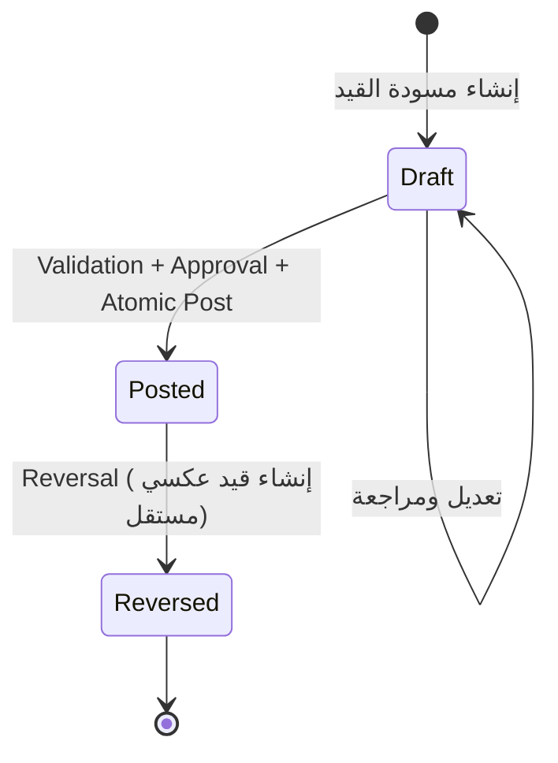
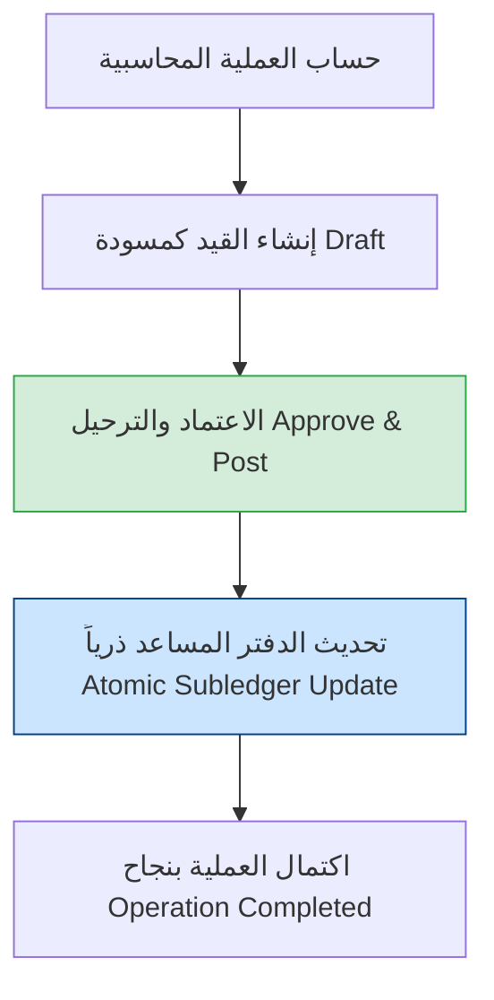
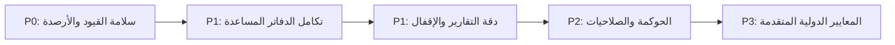

# تقرير التحليل المعماري والمحاسبي لمحرك المحاسبة المالية

## Comprehensive Architectural & Accounting Analysis of the Financial Accounting Engine

---

> [!ملاحظة]
> **نطاق التحليل والمنهجية:**
> يتعامل هذا التقرير مع المشروع باعتباره **محرك محاسبة مالية (Financial Accounting Engine)**، وليس مجرد مراجعة برمجية لجودة كود Go.
>
> يهدف التحليل إلى الإجابة عن ثلاثة محاور أساسية:
>
> 1. **كيف يعمل المحرك فعلياً؟** تتبع دورة المعاملة المالية من لحظة استقبال الحدث الاقتصادي حتى ترحيل القيد وظهور أثره في القوائم المالية.
> 2. **ما مدى قوة التصميم؟** فحص المبادئ المحاسبية، سلامة وتماسك البيانات، النمط المعماري، قابلية التوسع، الحوكمة والاختبارات.
> 3. **ما الذي ينقصه؟** تحديد الفجوات الوظيفية، والوظائف غير المكتملة، والمخاطر التقنية والمعمارية التي قد تؤثر في دقة وصحة النتائج المالية.
>
> يُميّز التقرير بدقة بين:
>
> - **الميزة المطبقة فعلياً في الكود (Implemented)**
> - **الميزة المذكورة في الوثائق فقط (Documented Only)**
> - **الميزة التي تتطلب استكمالاً واختبارات قبل جاهزيتها للإنتاج (Incomplete / In Progress)**

---

## 1. الحكم التنفيذي على المحرك (Executive Verdict)

> [!WARNING]
> **التقييم الهندسي العام:** ⚠️ **غير جاهز للإنتاج (Not Production Ready)**  
> **التصنيف:** **نواة محاسبية متقدمة وواعدة (Advanced Prototype)** — يحتاج إلى استكمال دورات الدفاتر المساعدة، ومعالجة فجوات التقارير المالية، وتدعيم قيود سلامة البيانات، وإجراء اختبارات اعتماد شاملة قبل الاستخدام المالي الفعلي.

ما يميز المشروع بشكل استثنائي أنه **لا يحاول بناء نظام تخطيط موارد مؤسسية (ERP) كامل داخل المحرك**، بل يفصل النواة المحاسبية (Accounting Core) عن الأنظمة التجارية والتشغيلية، وهو قرار معماري ممتاز.

ولكن، هناك فرق جوهري بين **امتلاك مكونات محاسبية متعددة** وبين **امتلاك دورة محاسبية متكاملة ومضمونة النزاهة من الناحية المالية والتقنية**.

من خلال فحص ملفات المشروع (أكثر من 85 ملفاً)، يتضح أن المحرك يتألف من ستة مجالات وظيفية رئيسية:

| المجال الوظيفي | المكون البرمجي (Package) | الوصف والدور |
| :--- | :--- | :--- |
| **البيانات المرجعية** | `masterdata` | إدارة شجرة الحسابات، الشركات، الفترات والسنوات المالية، والدفاتر اليومية. |
| **القيود والترحيل** | `posting` | إنشاء مسودات القيود، التحقق من التوازن، الترقيم التسلسلي والترحيل الذري. |
| **الدفاتر المساعدة** | `subledgers` | الذمم المدينة (AR)، الذمم الدائنة (AP)، الأصول الثابتة، والعمليات المصرفية. |
| **العملات والتقييم** | `valuation` | أسعار الصرف، تحويل العملات، وإعادة التقييم الدوري واحتساب فروق العملات. |
| **التقارير والقوائم** | `reporting` | ميزان المراجعة، الأستاذ العام، قائمة المركز المالي، الدخل، التدفقات النقدية، ونسب التحليل. |
| **الحوكمة والتدقيق** | `governance` | سجل التدقيق المشفر التراكمي (Hash Chain) وسياسات الفصل بين المهام (Maker-Checker). |

بالإضافة إلى طبقتي تخزين (Storage Adapters):

- `storage/memory`: للتجارب والاختبارات السريعة.
- `storage/postgres`: للتخزين الدائم في بيئات العمل الحقيقية.

---

## 2. كيف يعمل المحرك فعلياً؟ (Workflow & Mechanics)

فيما يلي تدفق المعاملة المالية من لحظة دخولها وحتى ظهورها في القوائم والتقارير المالية:

### 2.1 البيانات المرجعية (Master Data)
>
> **الحالة:** ✅ مطبق في الكود

المسؤولية الأساسية لهذه الطبقة هي توفير البنية الأساسية التي تعتمد عليها جميع العمليات المحاسبية، وتتضمن:

- **الشركات** (`Company`).
- **شجرة الحسابات** (`Account`).
- **أنواع الحسابات وطبيعتها** (مدينة / دائنة).
- **الدفاتر المحاسبية** (`Journal`).
- **السنوات المالية** (`FiscalYear`).
- **الفترات المالية** (`FiscalPeriod`).
- **التصنيفات المالية والتحليلية**.

عند تسجيل قيد مالي، يتحقق النظام من وجود الحساب وانتمائه للشركة، وأنه حساب تشغيلي يقبل الترحيل المباشر وليس حساباً تجميعياً، عبر دوال متخصصة مثل:

```go
ValidateCanPostToAccountForCompany(
    companyID,
    accountID,
)
```

كما يدعم النظام **الحسابات العكسية (Contra Accounts)**:

```go
IsContraAccount bool
```

مما يسمح بإنشاء حساب مثل «مجمع الاستهلاك» بطبيعة دائنة ضمن أصول الشركة.

> **التقييم:** تصميم البيانات المرجعية متين، لكن إدارة دورة حياة البيانات المرجعية (Master Data Lifecycle & Versioning) تتطلب استكمالاً، لا سيما معالجة تغيير التصنيفات للحسابات المستخدمة في قيود مرحّلة سابقاً.

---

### 2.2 محرك القيود (Posting Engine)
>
> **الحالة:** 🌟 من أقوى أجزاء المشروع المعمارية

يمثل محرك القيود قلب النظام المحاسبي، وتتلخص مسؤولياته في:

1. إنشاء القيد كمسودة.
2. التحقق من صحة أسطر القيد.
3. التحقق الرياضي من توازن المدين والدائن ($\sum \text{Debit} = \sum \text{Credit}$).
4. التحقق من تطابق الحسابات مع الشركة.
5. التحقق من فتح الفترة المالية وسريانها.
6. التحقق من الصلاحيات والموافقات المحاسبية.
7. ترحيل القيد وإسناد رقم تسلسلي فريد وغير مكرر.
8. قفل القيد ومنع أي تعديل عليه نهائياً.

#### دورة حياة القيد (Journal Entry Lifecycle)



**نقاط تميز هندسية في آلية الترحيل:**

1. **منع التلاعب بالمسودة:** يتحقق المحرك من عدم تعديل محتوى المسودة بين الإنشاء والموافقة:

   ```go
   posting.DraftContentMatches(current, entry)
   ```

2. **الترحيل الذري في قاعدة البيانات:** تستخدم طبقة PostgreSQL معاملة واحدة مع قفل متشائم لليومية لضمان عدم تكرار الأرقام التسلسلية:

   ```sql
   SELECT current_sequence
   FROM journals
   WHERE company_id = $1
     AND id = $2
   FOR UPDATE;
   ```

---

### 2.3 الدفاتر المساعدة (Subledgers)
>
> **الحالة:** ⚠️ مطبق جزئياً ويحتاج إلى استكمال دورات الربط

يحتوي المشروع على أربعة دفاتر مساعدة رئيسية:

1. **الذمم المدينة (Accounts Receivable - AR):** الفواتير المستحقة، أعمار الديون، واحتساب مخصص الخسائر الائتمانية المتوقعة (ECL).
2. **الذمم الدائنة (Accounts Payable - AP):** فواتير الموردين، آجال السداد، والالتزامات المستحقة.
3. **الأصول الثابتة (Fixed Assets):** تسجيل الأصول، احتساب الإهلاك، الهبوط في القيمة (Impairment)، والاستبعاد (Disposal).
4. **الخزينة والمصارف (Treasury & Cash):** الحركات البنكية، المطابقة الآلية، والتسويات المصرفية.

كما يتضمن وحدات داعمة:

- `MatchingEngine`: لمطابقة قيود الذمم والتحصيلات.
- `MatchWithFX`: لمعالجة تسوية فروق العملات المحققة.
- `EventBridge`: جسر استقبال الأحداث المالية التشغيلية الخارجية وترجمتها إلى أثر قيد محاسبي.

> **التقييم:** فكرة الـ `EventBridge` ممتازة معمارياً لأن الأنظمة الخارجية لا تحتاج لمعرفة شجرة الحسابات، لكن دورات الدفاتر المساعدة الحالية غير مقفلة بإحكام مع الأستاذ العام (راجع قسم الفجوات).

---

### 2.4 محرك تقييم العملات (Valuation Engine)
>
> **الحالة:** ⚠️ مطبق جزئياً

يدعم المحرك:

- سجل العملات وأسعار الصرف وتواريخها.
- أنواع أسعار الصرف (فوري، إقفال، متوسط).
- التحويل بين العملات.
- إعادة تقييم الأرصدة واحتساب فروق تقييم العملات (المحققة وغير المحققة).

```text
valuation/
├── conversion.go
├── rates.go
├── revaluation.go
├── engine.go
└── spi.go
```

يتميز التصميم بفصل مصدر أسعار الصرف عن منطق التحويل عبر واجهة خدمة:

```go
RateProviderSPI
```

> **ملاحظة محاسبية:** وجود محرك حساب فروق العملات خطوة جيدة، لكن دورة معيار **IAS 21** لا تزال غير مكتملة فيما يخص ترجمة القوائم المالية الأجنبية والربط التلقائي بمراكز العملات في الأستاذ العام.

---

### 2.5 محرك التقارير المالية (Reporting Engine)
>
> **الحالة:** ⚠️ موجود برمجياً، لكن يحتاج إلى مراجعة وتدقيق محاسبي دقيق

| التقرير المالي | الملف المقابل | الوصف |
| :--- | :--- | :--- |
| **ميزان المراجعة** | `trial_balance.go` | الأرصدة الافتتاحية، الحركات خلال الفترة، والأرصدة الختامية. |
| **الأستاذ العام** | `general_ledger.go` | كشف حساب تفصيلي للحركات ورصيد الحساب التراكمي. |
| **قائمة المركز المالي** | `balance_sheet.go` | تصنيف الأصول والالتزامات وحقوق الملكية. |
| **قائمة الدخل** | `income_statement.go` | الإيرادات والمصروفات وصافي الربح والدخل الشامل الآخر (OCI). |
| **قائمة التدفقات النقدية** | `cash_flow.go` | الطريقة المباشرة وغير المباشرة للأنشطة التشغيلية والاستثمارية والتمويلية. |
| **التغيرات في حقوق الملكية** | `equity_statement.go` | رأس المال، الأرباح المبقاة، الاحتياطيات وتوزيعات الأرباح. |
| **النسب والتحليل المالي** | `ratios.go` | مؤشرات السيولة، النشاط، الربحية والرافعة المالية. |
| **محرك الإقفال السنوي** | `closing_engine.go` | توليد قيود إقفال حسابات الأرباح والخسائر ونقل الرصيد للأرباح المبقاة. |

---

## 3. نقاط القوة الهندسية الحقيقية في المشروع

هذه أهم المزايا المعمارية المتينة التي ينبغي الحفاظ عليها والبناء عليها:

### 3.1 الفصل التام بين النظام التجاري والنواة المحاسبية (Business Decoupling)

أفضل قرار معماري بالمشروع. المحرك لا يتعامل مع مفاهيم مثل: المنتجات، أوامر الشراء والبيع، المخزون، أو المستودعات. بدلاً من ذلك، يستقبل **أثراً مالياً مجرداً (Financial Event)**:

```yaml
Event:
  Type: SALES_RECOGNITION
  Amount: 1000 USD
  Company: Company-A
  Reference: INV-1001
```

ويقوم المحرك بتحويله إلى أثر قيد مزدوج:

```text
Debit:
  Accounts Receivable     1000 USD
Credit:
  Sales Revenue           1000 USD
```

### 3.2 الاعتماد الصارم على الحسابات العشرية الدقيقة (Decimal vs Float)

استخدام مكتبة:

```go
github.com/shopspring/decimal
```

بدلاً من الأنواع العائمة `float64` يمنع كوارث التقريب الثنائي في العمليات المالية.  
كما تم بناء كائن القيمة المالية `Money` كـ Domain Model مستقل يحتوي على:

- المبلغ بالدقة العشرية.
- كود العملة والتحقق من التطابق.
- التقريب المصرفي (Banker's Rounding).
- التحويل إلى أصغر وحدة نقدية (Minor Units/Cents).

### 3.3 عزل بيانات الشركات (Multi-Company Architecture)

تم إدراج `CompanyID` في معظم الكيانات المحاسبية مع فرض قيود تكامل مركبة في PostgreSQL:

```sql
FOREIGN KEY (company_id, account_id)
REFERENCES accounts(company_id, id)
```

مما يمنع ترحيل قيد لشركة باستخدام حساب يتبع شركة أخرى على مستوى قيود قاعدة البيانات.

### 3.4 الترحيل الذري المضمون (Atomic Posting)

تعتمد عمليات الترحيل في PostgreSQL على معاملات ذرية (`BEGIN ... COMMIT`) مع قفل الحركات (`FOR UPDATE`)، مما يضمن أن توليد الرقم التسلسلي والترحيل وتحديث الأرصدة ينجح ككتلة واحدة أو يفشل كلياً دون ترك قيود مكسورة أو أرقام مفقودة.

### 3.5 عدم قابلية تعديل القيود المرحّلة (Immutable Ledger)

يتبنى النظام فلسفة دفاتر الأستاذ الثابتة:

- لا يمكن تعديل أو حذف أي قيد تم ترحيله (`Posted`).
- التصحيح المحاسبي يتم حصرياً عبر إنشاء قيد عكسي جديد (`Reversal Entry`).
- توجد مشغلات (Triggers) على مستوى قاعدة البيانات لحماية أسطر الحركات من التعديل.

### 3.6 سجل التدقيق المشفر والمحصن (Cryptographic Audit Chain)

يحتوي على:

- تجزئة SHA-256 مرتبطة (`PreviousHash` + `CurrentHash`).
- تتبع حالة البيانات قبل وبعد العملية (`PayloadBefore` و `PayloadAfter`).
- قفل ذري لمعاملات التعديل في PostgreSQL باستخدام:

  ```sql
  SELECT pg_advisory_xact_lock(...)
  ```

  مما يقضي على احتمالية انشطار سلسلة التدقيق التزامنية (Chain Splitting).

---

## 4. العيوب والفجوات المكتشفة في الكود (Critical Findings & Gaps)

تم تصنيف المشكلات بدقة حسب طبيعتها وخطورتها على النزاهة المحاسبية:

### 4.1 مشكلات حرجة في سلامة المحاسبة (Accounting Correctness)

#### 🔴 المشكلة 1: الحسابات العكسية لا تُعالج بصورة صحيحة في قائمة الدخل
>
> [!CAUTION]
> **مستوى الخطورة:** حرجة (Critical) — خطر تضخيم الإيرادات وتشويه صافي الدخل

يدعم النظام الحسابات العكسية `IsContraAccount bool`. في `balance_sheet.go` يتم عكس الإشارة برمجياً:

```go
if account.IsContraAccount {
    amount = amount.Neg()
}
```

بينما في `income_statement.go` **لا توجد أي معالجة مقابلة!**

*مثال عملي يوضح الخطأ:*

| الحساب | نوع الحساب | الطبيعة المحاسبية | طبيعة الرصيد |
| :--- | :--- | :--- | :--- |
| **Sales Revenue** (إيراد المبيعات) | Income | Credit | دائن |
| **Sales Returns** (مردودات المبيعات) | Income (Contra) | Debit | مدين |

عند تسجيل مردودات مبيعات بقيمة 100، يجمعها تقرير قائمة الدخل كمبلغ موجب بدلاً من طرحها من إجمالي الإيرادات، مما يؤدي إلى **تضخيم إيرادات الشركة** بدلاً من تخفيضها.
> **المطلوب:** توحيد دالة احتساب الأرصدة المحاسبية في كافة التقارير وفقاً لخاصية `IsContraAccount` ونوع الحساب.

---

#### 🔴 المشكلة 2: التقارير لا تدعم عملة العرض فعلياً (Presentation Currency)
>
> [!CAUTION]
> **مستوى الخطورة:** حرجة (Critical) — قصور في الشركات متعددة الجنسيات

يحتوي النظام على حقول `FunctionalCurrency` و `PresentationCurrency`، ولكن عند فحص دالة `lineAmounts` في `trial_balance.go`:

- إذا طابقت العملة المطلوبة العملة الوظيفية، تعيد الأرقام الوظيفية.
- إذا طلبت عملة أخرى، **تعيد صفراً!**

إذا كانت العملة الوظيفية لفرع هي USD والمجموعة تصدر قوائمها بالـ EUR، فالنظام يفشل تماماً في ترجمة القوائم؛ إذ يفتقر لآلية معيار **IAS 21** لترجمة الأصول والالتزامات بأسعار الإقفال، والدخل بمتوسط الأسعار، وإثبات فروق الترجمة في الدخل الشامل الآخر (OCI).

---

#### 🟠 المشكلة 3: ميزان المراجعة لا يعرض الأرصدة الأجنبية بصورة مستقلة
>
> [!WARNING]
> **مستوى الخطورة:** عالية (High)

يطلب ميزان المراجعة عملة واحدة فقط:

```go
Generate(startDate, endDate, currency)
```

ولا يوجد خيار لعرض ميزان مراجعة يعكس:

- الرصيد بالعملة الأصلية للمعاملة (Transaction Currency).
- الرصيد الموازي بالعملة الوظيفية (Functional Currency).
- كشف فروق إعادة التقييم غير المحققة لكل حساب أجنبي.

---

#### 🟠 المشكلة 4: وضع Adjusted في ميزان المراجعة لا يغير الحسابات إطلاقاً
>
> [!WARNING]
> **مستوى الخطورة:** عالية (High) — مؤشر شكلي بلا منطق برمجي

في `internal/reporting/trial_balance.go`:

```go
GenerateAdjusted(startDate, endDate, currency, adjusted)
```

تُسند قيمة `adjusted` إلى حقل وصفي فقط:

```go
IsAdjusted: adjusted
```

لكن منطق الاستعلام والفلترة **لا يتغير إطلاقاً**؛ فلا يتم تصفية قيود التسويات الجردية (Adjusting Entries) أو استبعادها عند طلب ميزان المراجعة قبل التسويات (Unadjusted Trial Balance).

---

### 4.2 مشكلات محرك الترحيل وقاعدة البيانات (Posting & Database Integrity)

#### 🔴 المشكلة 5: حماية عدم قابلية التعديل غير مكتملة في قاعدة البيانات
>
> [!CAUTION]
> **مستوى الخطورة:** حرجة (Critical) — ثغرة أمنية تتيح تعديل القيود بعد ترحيلها

1. في `schema.sql`، يوجد مشغل (Trigger) يمنع تعديل أسطر `account_move_lines` بعد ترحيلها، ولكن جدول رأس القيد `account_moves` يحتوي على حقل:

   ```sql
   entry JSONB
   ```

   **ولا يوجد Trigger يمنع تعديل هذا الحقل بعد الترحيل!**
2. يفحص Trigger الأسطر حالة القيد الأب المرتبط بـ `NEW.move_id` فقط، ولا يفحص `OLD.move_id`، مما يفتح ثغرة برمجية لإعادة ربط سطر مرحل بقيد مسودة والتلاعب به.

---

#### 🟠 المشكلة 6: توازن القيد مفروض في Go وليس كقيد فحص في قاعدة البيانات
>
> [!WARNING]
> **مستوى الخطورة:** عالية (High)

يتحقق محرك Go من شرط التوازن المحاسبي:
$$\sum \text{Debit} = \sum \text{Credit}$$
ولكن على مستوى قاعدة البيانات PostgreSQL:

- توجد قيود `CHECK` تمنع أن يكون السطر الواحد مديناً ودائناً معاً.
- **لا يوجد قيد مؤجل (Deferred Constraint / Trigger) يضمن توازن مجموع أسطر القيد عند الـ `COMMIT`!**  
أي كتابة مباشرة في قاعدة البيانات أو خطأ في مسار بديل يمكن أن يخل بتوازن الدفتر العام دون اعتراض من قاعدة البيانات.

---

#### 🟠 المشكلة 7: عزل الشركات يفتقر إلى Row-Level Security (RLS)
>
> [!WARNING]
> **مستوى الخطورة:** عالية (High)

الاعتماد فقط على استعلامات تطبيق Go مع غياب `ALTER TABLE ... ENABLE ROW LEVEL SECURITY` في PostgreSQL يعني أن أي ثغرة استعلام أو استدعاء لدالة مثل:

```go
GetEntryByID(id) // لا تتطلب CompanyID في بارامتراتها
```

قد يؤدي إلى تسريب أو اختراق العزل بين الشركات إذا اعتمد المطور على الـ UUID فقط.

---

#### 🟡 المشكلة 8: استخدام `context.Background()` داخل طبقة PostgreSQL
>
> [!NOTE]
> **مستوى الخطورة:** متوسطة إلى عالية (Medium to High)

يتم استدعاء `context.Background()` داخل دوال التخزين بدلاً من تمرير `ctx` الطلب الأصلي:

- فقدان قدرات الإلغاء (Cancellation) عند انقطاع اتصال العميل.
- عدم تفعيل المهلات الزمنية (Deadlines / Timeouts).
- تعطل تتبع الطلبات (Distributed Tracing / OpenTelemetry).

---

### 4.3 مشكلات الدفاتر المساعدة (Subledgers Architecture Flaws)

#### 🔴 المشكلة 9: تحديث حالة الأصل قبل ترحيل القيد المحاسبي
>
> [!CAUTION]
> **مستوى الخطورة:** حرجة (Critical) — خطر انفصال الدفتر المساعد عن الأستاذ العام

في `internal/subledgers/fixed_assets.go`:
عند تشغيل الإهلاك الشهري، يقوم الكود بـ:

1. احتساب مبلغ الإهلاك وتعديل القيمة الدفترية للأصل في جدول الأصول.
2. إنشاء قيد محاسبي بحالة **مسودة (`Draft`)**.
3. حفظ الأصل والقيد معاً.

**الخلل:** إذا رُفض القيد المسودة لاحقاً أو لم يُرحّل، تظل قيمة الأصل مخفضة في سجل الأصول (مثلاً 9,500)، بينما رصيد الأصل في الأستاذ العام لا يزال يعكس القيمة القديمة (10,000)!



---

#### 🟠 المشكلة 10: عدم تطابق ومطابقة أرصدة الذمم (AR/AP Control Reconciliation)
>
> [!WARNING]
> **مستوى الخطورة:** عالية (High)

في `receivable.go` و `payable.go`، يتم فتح خطوط الذمم (`OpenLine`)، ولكن:

- لا توجد دورة تحقق تضمن دائماً أن:
  $$\text{AR Subledger Balance} = \text{General Ledger AR Control Account}$$
- ينقص النظام دعم متكامل لحالات: السداد الجزئي المعقد، الدفعات المقدمة، إشعارات الخصم والإضافة، وشطب الديون المعدومة مع أثرها المحاسبي المباشر.

---

#### 🟠 المشكلة 11: محرك الأصول الثابتة لا يغطي دورة معيار IAS 16
>
> [!WARNING]
> **مستوى الخطورة:** عالية (High)

- غياب جدول إهلاك زمني متكامل (Depreciation Schedule).
- عدم معالجة تغير العمر الإنتاجي أو القيمة التخريدية المتبقية.
- غياب سياسات الإهلاك النسبي (شراء أو استبعاد الأصل خلال الشهر/الفترة).
- عدم وجود محاسبة المكونات الرئيسية للأصل (Component Accounting).

---

#### 🟠 المشكلة 12: التسوية البنكية غير مهيأة للمطابقة المصرفية الحقيقية
>
> [!WARNING]
> **مستوى الخطورة:** عالية (High)

تدعم دالة `ReconcileWithTolerance` تفاوت تواريخ الاستحقاق، لكنها تعتمد فقط على تطابق المرجع والمبلغ وتفاوت الأيام. ينقصها:

- المطابقة متعددة الأطراف (واحد إلى متعدد، متعدد إلى واحد).
- معالجة العمولات والمصاريف البنكية أثناء التسوية آلياً.
- استيراد وتفسير كشوف الحسابات المصرفية القياسية الدولية (MT940 / CAMT.053 ISO 20022).

---

### 4.4 مشكلات الحوكمة والرقابة (Governance & Internal Controls)

#### 🟠 المشكلة 13: قيود تدقيق الـ Hash Chain لا تكفي قانونياً وحدها
>
> [!WARNING]
> **مستوى الخطورة:** عالية (High)

رغم نجاح الكود في إدراج `PayloadBefore` واستخدام القفل الاستشاري لمنع انشطار السلسلة، إلا أن النظام يفتقر إلى:

- حماية جداول التدقيق من عمليات الـ `DELETE` أو `TRUNCATE` المباشرة بواسطة مسؤول النظام.
- تصدير بصمات البلوكشين / الهاش يومياً إلى مخزن خارجي مستقل ومقاوم للتعديل (WORM Storage).

---

#### 🟠 المشكلة 14: نظام الموافقة المزدوجة (Maker-Checker) مجرد فحص شرطي بسيط
>
> [!WARNING]
> **مستوى الخطورة:** عالية (High)

تتحقق الدوال من اختلاف منشئ القيد عن المعتمد، ولكن:

- لا يوجد نموذج مستخدمين وأدوار وصلاحيات (RBAC / ABAC) مرتبط بالشركات والدفاتر.
- غياب مصفوفة حدود الصلاحيات المالية والموافقات متعددة المستويات (Approval Hierarchies).

---

## 5. نواقص المعايير المحاسبية الدولية (IFRS / IAS Gaps)

| المعيار المحاسبي الدولي | المتطلبات المحاسبية الغائبة أو غير المكتملة في المحرك |
| :--- | :--- |
| **IFRS 9** (الأدوات المالية) | نموذج متكامل للخسائر الائتمانية المتوقعة (ECL)، مراحل التعثر الثلاث، وتصنيف الأدوات المالية (Amortised Cost / FVOCI / FVTPL). |
| **IAS 12** (ضرائب الدخل) | احتساب الضرائب المؤجلة، ومطابقة الفروق المؤقتة والدائمة بين الأساس الضريبي والدفتري. |
| **IAS 16** (العقارات والآلات والمعدات) | نموذج إعادة التقييم المالي، وتفكيك وتوزيع مكونات الأصول الكبرى. |
| **IAS 19** (منافع الموظفين) | مخصصات مكافأة نهاية الخدمة، الالتزامات قصيرة الأجل ومنافع ما بعد التقاعد. |
| **IFRS 15** (الإيرادات من العقود مع العملاء) | الالتزامات التعاقدية (Contract Liabilities)، والاعتراف بالإيراد بمرور الوقت أو بنقطة زمنية محددة. |
| **IFRS 16** (عقود الإيجار) | حساب أصل حق الاستخدام (ROU Asset) والتزامات عقود الإيجار الحالية والمستقبلية. |
| **IAS 21** (آثار التغيرات في أسعار الصرف) | ترجمة القوائم المالية من العملة الوظيفية إلى عملة العرض وإثبات فروق الترجمة في OCI. |
| **IFRS 10** (القوائم المالية الموحدة) | توحيد حسابات الشركات الشقيقة والتابعة واستبعاد العمليات والتعاملات البينية (Intercompany Eliminations). |
| **IAS 7** (قائمة التدفقات النقدية) | تصنيف الحركات غير النقدية، وتفصيل ضرائب الدخل والفوائد المدفوعة والمقبوضة. |
| **IAS 8** (السياسات والتغيرات والتقديرات المحاسبية والأخطاء) | المعالجة بأثر رجعي للتغيرات في السياسات المحاسبية وتصحيح أخطاء السنوات السابقة. |
| **IFRS 18** (عرض القوائم المالية والإفصاحات) | تصنيف قائمة الدخل إلى: تشغيلي، استثماري، وتمويلي بدقة متوافقة مع متطلبات المعيار الجديد. |

---

## 6. مشكلات إضافية في التصميم البرمجي (Code Architecture Debt)

### 6.1 دقة `Money` ليست موحدة في جميع العمليات

في `internal/types/money.go`:

```go
const FinancialScale = 4
```

يتم تقريب القسمة دائماً لأربع خانات عشرية:

```go
return newMoney(
    m.amount.DivRound(scalar, FinancialScale),
    m.currency,
)
```

وهذا يسبب أخطاء تراكمية في:

- توزيع النسب المئوية للخصومات والتكاليف.
- حساب جداول الإهلاك على فترات طويلة.
- تحويل العملات بأسعار صرف ذات 6-8 خانات.

> **الحل المقترح:** الفصل المعماري بين:
>
> 1. **Calculation Precision:** دقة الحساب الداخلي (8 إلى 12 خانة).
> 2. **Currency Minor Units:** دقة العملة الفعلية (مثلاً خانتان للـ USD، و3 خانات للـ KWD، و0 للـ JPY).
> 3. **Display Precision:** دقة العرض التقريري للواجهات.

---

### 6.2 محرك الأحداث `EventBridge` محدود بسطرين فقط

يحول `EventBridge` الحالي أي حدث إلى قيد بسيط يتألف من حساب مدين وحساب دائن فقط:

```text
Event -> [1 Debit Line, 1 Credit Line]
```

بينما تتطلب العمليات التجارية الحقيقية قيوداً متعددة الأسطر، مثل:

| الحساب | مدين (Debit) | دائن (Credit) |
| :--- | :--- | :--- |
| **Accounts Receivable** | 1,150 | |
| **Sales Revenue** | | 1,000 |
| **VAT / Tax Payable** | | 150 |

كما أن قواعد التوجيه (Mapping) مخزنة في ذاكرة البرنامج بدلاً من جدول `subledger_mappings`.

---

### 6.3 إدارة البيانات المرجعية تحتاج إلى تاريخ الفعالية (Effective-Dated Master Data)

إذا عُدّل تصنيف حساب معين من «مصروفات تشغيلية» إلى «مصروفات عمومية وإدارية»:

- هل تنعكس القيود القديمة للتصنيف الجديد؟
- أم يحتفظ كل قيد بالتصنيف الساري لحظة ترحيله؟  
غياب تواريخ السريان (`EffectiveFrom`, `EffectiveTo`) يجعل إصدار التقارير المقارنة عبر السنوات غير دقيق.

---

### 6.4 الأبعاد التحليلية (Cost Center / Project / Segment) تفتقر لمحرك تحقق

تحتوي أسطر القيود على حقول مثل `CostCenterID` و `ProjectID`، ولكن:

- لا توجد قواعد إلزامية لربط مراكز التكلفة بحسابات المصروفات.
- لا توجد شجرة هرمية لمراكز التكلفة.
- لا توجد قواعد توزيع تلقائي (Cost Allocation Rules).

---

### 6.5 واجهات الـ Repository واسعة وغير محددة (Interface Segregation)

في وحدة التقارير مثلاً:

```go
type Repository interface{}
```

ويتم الاعتماد على الـ Type Assertions في وقت التشغيل (Runtime)، مما يضعف العقد البرمجي. يجب تقسيمها لواجهات صغيرة ومتخصصة:

```go
type LedgerReader interface {
    ListPostedEntries(
        ctx context.Context,
        companyID uuid.UUID,
        from time.Time,
        to time.Time,
    ) ([]posting.JournalEntry, error)
}
```

---

## 7. فحص اكتمال التقارير المالية (Financial Reporting Completeness)

| التقرير المالي | الحالة في الكود | أوجه النقص والقصور المالي |
| :--- | :--- | :--- |
| **Trial Balance** | موجود | لا يدعم تعدد العملات، ووضع `Adjusted` مجرد علامة شكلية. |
| **General Ledger** | موجود | يفتقر لتقارير تتبع الأبعاد والعملات الأجنبية وسجل التدقيق المرتبط. |
| **Balance Sheet** | موجود | تصنيف الحسابات جامد، لا يدعم عملة العرض، وحسابات الـ Contra بحاجة لمعايرة. |
| **Income Statement** | موجود | **مشكلة حرجة في الحسابات العكسية**، وغياب تقسيمات IFRS 18 التشغيلية. |
| **Cash Flow** | موجود | بحاجة لاختبارات صارمة للأنشطة غير النقدية وتفصيل الفوائد والضرائب. |
| **Equity Statement** | موجود جزئياً | التحويل للاحتياطيات يعيد صفراً دائماً، واحتساب التوزيعات غير دقيق. |
| **Financial Ratios** | موجود | يعتمد أرصدة نهاية الفترة بدلاً من استخدام متوسط الأرصدة (Average Balances). |
| **Annual Closing** | موجود جزئياً | يولد قيداً مسودة للإقفال، لكن تنقصه دورة اعتماد وتدوير الأرصدة الافتتاحية آلياً. |

---

## 8. التناقض بين وثائق المشروع والكود الفعلي (Documentation Drift)

أظهرت المراجعة أن وثيقة:
`docs/accounting_engine_maturity_and_compliance_gap_analysis.md`
**أصبحت قديمة في نقاط جوهرية** ولا تعكس التحسينات المنجزة في الكود الحديث:

| النقطة في الوثيقة القديمة | واقع الكود الفعلي اليوم |
| :--- | :--- |
| تعدد الشركات غير مدعوم إطلاقاً | `CompanyID` مدمج في الكيانات وقيود الجداول البرمجية |
| الحسابات العكسية محظورة | `IsContraAccount` موجود ومدعوم في النماذج وميزان المركز المالي |
| القيود متعددة العملات غير مدعومة | حقول Transaction Currency و Functional Currency موجودة |
| بصمة التدقيق لا تشمل PayloadBefore | الكود الحديث يدمج `PayloadBefore` و `PayloadAfter` في الهاش |
| سلسلة التدقيق معرضة للانشطار التزامني | الكود يستخدم PostgreSQL Advisory Locks لحماية السلسلة |
| هبوط واستبعاد الأصول غير موجود | توجد دوال `ImpairAsset` و `DisposeAsset` في الدفتر المساعد |
| التسوية البنكية تشترط تطابق التاريخ الحرفي | توجد دالة `ReconcileWithTolerance` بتفاوت الأيام |

> **التوصية:** يجب اعتماد هذا التقرير وتحديث وثيقة الفجوات السابقة لتعكس الحالة الواقعية للمشروع.

---

## 9. بطاقة التقييم الشاملة حسب المجالات (Domain Scorecard)

| المجال الوظيفي | التقييم الهندسي | ملاحظات الحالة والجاهزية |
| :--- | :---: | :--- |
| **الفصل المعماري والنمط العام** | ⭐⭐⭐⭐☆ (جيد جداً) | فصل متميز لنواة المحاسبة عن الأنظمة التجارية. |
| **أنواع البيانات المالية (Money Domain)** | ⭐⭐⭐☆☆ (جيد) | استخدام مكتبة Decimal ممتاز، مع حاجة لتنظيم مستويات الدقة. |
| **البيانات المرجعية (Master Data)** | ⭐⭐⭐☆☆ (جيد) | تصميم مستقر يحتاج لدعم التواريخ الفعالة (Effective Dating). |
| **محرك القيود والترحيل (Posting)** | ⭐⭐⭐⭐☆ (جيد جداً) | ترحيل ذري ممتاز وحماية للمسودات، مع حاجة لتدعيم قيود DB. |
| **المعاملات الذرية (Transactions)** | ⭐⭐⭐⭐☆ (جيد جداً) | آليات قفل متشائم وتحكم تزامني قوي في PostgreSQL. |
| **تعدد الشركات (Multi-Company)** | ⭐⭐⭐☆☆ (متوسط إلى جيد) | موجود في النماذج والمخطط، ينقصه تفعيل RLS على مستوى الـ DB. |
| **العملات والتقييم (Valuation & FX)** | ⭐⭐☆☆☆ (متوسط) | واجهات SPI جيدة، لكن ترجمة القوائم (IAS 21) غير مكتملة. |
| **الدفاتر المساعدة (Subledgers)** | ⭐⭐☆☆☆ (ضعيف إلى متوسط) | تحديث الأصول يسبق ترحيل القيود، وانفصال عن حسابات الرقابة في GL. |
| **التقارير المالية (Reporting)** | ⭐⭐☆☆☆ (متوسط) | تغطية واسعة، لكن تعاني من ثغرات الحسابات العكسية وعملة العرض. |
| **الحوكمة وسجل التدقيق (Governance)** | ⭐⭐⭐☆☆ (متوسط إلى جيد) | سلسلة الهاش وقفل التزامن ممتازان، لكن الصلاحيات مبسطة جداً. |
| **تكامل قاعدة البيانات (DB Integrity)** | ⭐⭐☆☆☆ (متوسط) | اعتماد مفرط على JSONB وغياب قيود التوازن الشاملة على مستوى الـ DB. |
| **بيئة التشغيل والإنتاج (Operations)** | ⭐☆☆☆☆ (غير مكتمل) | غياب خطط الترحيل (Migrations)، وإلغاء السياق (Context Dropping). |

---

## 10. خارطة الطريق الهندسية للإصلاح (Remediation Roadmap)

لا يُنصح بإضافة ميزات وظيفية جديدة قبل حل المشكلات المعمارية الحالية وفق الأولويات التالية:



### المرحلة الأولى: سلامة البيانات المحاسبية (P0 — أولوية قصوى وعاجلة)

1. **إصلاح معالجة الحسابات العكسية** في قائمة الدخل وميزان المراجعة.
2. **تصحيح منطق عملة العرض** وترجمة القوائم المالية وفق معيار IAS 21.
3. **تفعيل دور قيود التسوية الجردية** في ميزان المراجعة المعدل (`Adjusted Trial Balance`).
4. **منع تحديث سجلات الأصول الثابتة** إلا بعد إتمام الترحيل الذري للقيد المحاسبي.
5. **سد ثغرات تعديل القيود بعد الترحيل** على مستوى حقول `entry JSONB` في قاعدة البيانات.
6. **معايرة دقة نوع `Money`** والفصل بين دقة الحساب الداخلي والوحدات الكسرية للعملة.

### المرحلة الثانية: تكامل الدفاتر المساعدة (P1 — أولوية عالية)

1. **بناء الربط المباشر بين حسابات المراقبة (AR/AP Control Accounts)** والأستاذ العام.
2. **استكمال دورة حياة الأصول الثابتة** (جدول الإهلاك، العمر المتبقي، استبعاد الأصل).
3. **تطوير محرك تسوية بنكية متقدم** يدعم المطابقة متعددة الأطراف واستيراد كشوف MT940 / CAMT.
4. **توسيع `EventBridge`** لإنتاج قيود محاسبية مركبة ومتعددة الأسطر بناءً على جداول التوجيه.

### المرحلة الثالثة: التقارير والقوائم المالية والإقفال (P1 — أولوية عالية)

 1. **إصلاح قائمة التغيرات في حقوق الملكية** وتفعيل التحويل للاحتياطيات وتوزيعات الأرباح.
 2. **مراجعة وتدقيق قائمة التدفقات النقدية** بالأنشطة غير النقدية.
 3. **تطوير محرك الإقفال السنوي** لتدوير الأرصدة الافتتاحية آلياً للفترات اللاحقة.
 4. **بناء محرك الأبعاد المالية** (Cost Centers / Projects Allocation).

### المرحلة الرابعة: الحوكمة وتأمين العمليات (P2 — أولوية متوسطة)

 1. **بناء محرك صلاحيات متقدم (RBAC/ABAC)** مع مصفوفة الموافقات متعددة المستويات.
 2. **تفعيل Row-Level Security (RLS)** في PostgreSQL لمنع تجاوز عزل الشركات.
 3. **تحصين سجل التدقيق** وتصدير بصمات السلسلة لمستودع خارجي غير قابل للتعديل.
 4. **تمرير `context.Context`** لجميع عمليات التخزين في PostgreSQL والتخلص من `context.Background()`.

### المرحلة الخامسة: التوسع في المعايير الدولية (P3 — توسع وظيفي)

 1. دعم متطلبات **IFRS 9** (الخسائر الائتمانية المتوقعة).
 2. دعم عقود الإيجار **IFRS 16**.
 3. دعم القوائم المالية الموحدة **IFRS 10**.
 4. الالتزام بمتطلبات العرض والإفصاح وفق **IFRS 18**.

---

## 11. بيئة الاختبارات ومستوى الثقة بالنتائج (Testing Confidence)

يحتوي المشروع على بنية اختبارات واعدة تشمل:

- `simulation_test.go`
- `benchmark_test.go`
- `internal/posting/engine_test.go`
- `internal/reporting/reporting_test.go`
- `internal/subledgers/subledgers_test.go`
- `internal/governance/audit_chain_test.go`

> [!NOTE]
> يتطلب تشغيل الاختبارات حزمة Go Toolchain بإصدار `1.26.3`، وهو إصدار لم يكن متاحاً أثناء التحليل في البيئة المعزولة؛ لذلك بُنيت نتائج هذا التقرير على الفحص المعماري المصدري للكود واختبارات الوحدة المنطقية والمخططات.

### اختبارات حاسمة مطلوبة قبل الاعتماد الإنتاجي

1. **الترحيل المتزامن العالي (High Concurrency Posting):** ترحيل آلاف القيود في نفس اللحظة لنفس اليومية للتأكد من عدم تكرار الأرقام أو حدوث Deadlocks.
2. **فشل النظام أثناء المعاملة (Failure Injection):** محاكاة انقطاع الاتصال بقاعدة البيانات في منتصف عملية ترحيل الدفتر المساعد للتأكد من عدم انفصال الحالات.
3. **تكرار معالجة الأحداث (Idempotency Test):** إرسال نفس الحدث الاقتصادي من النظام التجاري والتأكد من عدم تكرار أثر القيد.
4. **محاولات اختراق عزل الشركات:** اختبار تمرير حساب يتبع شركة B في قيد يتبع شركة A وملاحظة استجابة قاعدة البيانات.
5. **اختبار القوائم المحاسبية المعيارية:** إدخال بيانات شركات افتراضية معيارية ومقارنة القوائم المالية بمخرجات برامج محاسبية معتمدة.

---

## 12. أهم القرارات المعمارية الواجب حسمها (Key Architectural Decisions)

> [!NOTE]
> **وثيقة التحليل التفصيلي:** للاطلاع على التحليل التشريحي المعمق لكل قرار من القرارات الخمسة مع فحص الكود الحالي ومخططات المعالجة والتنفيذ، راجع الوثيقة المستقلة: [key_architectural_decisions_analysis.md](file:///home/osm/StudioProjects/cashflow_system/accounting_engine/docs/key_architectural_decisions_analysis.md).


### القرار 1: هل المحرك Perpetual Ledger أم Periodic Ledger؟
>
> **التوصية:** تثبيت خيار الدفتر المستمر (**Perpetual Ledger**)؛ حيث تنعكس كل حركة فوراً على الأرصدة، مع تحديد آليات واضحة للقيود الافتتاحية والإقفال الدوري.

### القرار 2: ما هو عمق تعدد العملات المعتمد؟
>
> **التوصية:** الفصل الدائم بين:
>
> 1. عملة المعاملة (`Transaction Currency`).
> 2. العملة الوظيفية (`Functional Currency`).
> 3. عملة العرض والتقارير (`Presentation Currency`).

### القرار 3: من يملك سلطة الترحيل المحاسبي؟
>
> **التوصية:** يجب أن يكون **Posting Engine** هو المكون الوحيد المخول بترحيل القيود وتحديث الأستاذ العام؛ بينما تعمل الدفاتر المساعدة كمصدّر للعمليات ومخزن للتفاصيل التشغيلية.

### القرار 4: كيف نضمن تطابق الدفاتر المساعدة مع الأستاذ العام؟
>
> **التوصية:** إنشاء محرك مصالحة دوري مستقل:
>
> ```go
> LedgerReconciliationEngine
> ```
>
> يقوم بفحص يومي لأرصدة الـ Subledgers ومقارنتها بحسابات المراقبة في الـ General Ledger وتنبيه مسؤولي النظام بأي فروقات.

### القرار 5: كيف نفصل بين المحاسبة المالية والتقارير المالية؟
>
> **التوصية:** عدم جعل التقارير مجرد تجميع حسابي للأرصدة؛ بل بناؤها على هيكل شجرة تصنيف مالي مرنة وقابلة للتهيئة بحسب متطلبات المعايير الدولية المطبقة (IFRS / GAAP).

---

## 13. الخلاصة والتوصية الهندسية النهائية

المشروع يمتلك **أساساً معمارياً واعداً وفكراً هندسياً نظيفاً**، خصوصاً في تجريد النواة المحاسبية والترحيل الذري واستخدام مكتبات الحسابات العشرية الدقيقة.

لكن المحرك لا يزال في مرحلة **النموذج الأولي المتقدم (Advanced Prototype)**، ولا يصح الاعتماد عليه في تسجيل حسابات مالية لشركات فعلية قبل معالجة المحاور الثلاثة:

1. **الصحة المحاسبية (Accounting Correctness):** ضمان خلو معادلات القوائم المالية والحسابات العكسية والعملات من أي تشويه.
2. **نزاهة الدفاتر (Ledger Integrity):** ربط دورة حياة الدفاتر المساعدة بالأستاذ العام بطريقة ذرية لا تسمح بالانفصال.
3. **أمان وحوكمة البيانات (Data & Audit Governance):** تفعيل القيود الصارمة في قاعدة البيانات وتطبيق نظام صلاحيات مؤسسي.

> **الخطوة العملية التالية الموصى بها:**  
> إعداد وثيقة **خطة المعالجة الهندسية (Engineering Remediation Plan)** التفصيلية، تحدد لكل فجوة من الفجوات الحرجة: الملفات المتأثرة، التعديل البرمجي المقترح، واختبار الاعتماد الآلي الذي يثبت إصلاحها.
