# خطوات التنفيذ المتوازي — دليل عملي

> [!IMPORTANT]
> **المتطلب المسبق:** جميع مهام P0, P1, P2 مكتملة (بما فيها P2-06).
> **P6-04 و P6-05** خارج نطاق الإصدار الأول (مؤجلتان).

---

## مخطط التدفق الشامل

```mermaid
flowchart TD
    Start(("البداية<br/>P0–P2 ✅")) --> Step1

    subgraph Step1["الخطوة 1"]
        direction LR
        T1A["🔵 P3-01"]
        T1B["🟢 P5-01"]
    end

    Step1 --> Step2

    subgraph Step2["الخطوة 2 ⚡ أقصى توازي"]
        direction LR
        T2A["🔵 P3-02"]
        T2B["🔵 P3-03"]
        T2C["🔵 P3-04"]
        T2D["🔵 P3-05"]
        T2E["🟢 P5-02"]
        T2F["🟢 P5-03"]
    end

    Step2 --> Step3

    subgraph Step3["الخطوة 3"]
        direction LR
        T3A["🔵 P3-06"]
        T3B["🟠 P4-02"]
        T3C["🟢 P5-04"]
        T3D["🔴 P6-01"]
    end

    Step3 --> Step4

    subgraph Step4["الخطوة 4"]
        direction LR
        T4A["🔵 P3-07"]
        T4B["🟠 P4-04"]
        T4C["🔴 P6-02"]
    end

    Step4 --> Step5

    subgraph Step5["الخطوة 5"]
        direction LR
        T5A["🟠 P4-01"]
        T5B["🟠 P4-05"]
        T5C["🔴 P6-03"]
        T5D["🔴 P6-06"]
    end

    Step5 --> Step6

    subgraph Step6["الخطوة 6"]
        direction LR
        T6A["🟠 P4-03"]
        T6B["🟠 P4-06"]
    end

    Step6 --> Step7

    subgraph Step7["الخطوة 7"]
        T7A["🟠 P4-07"]
    end

    Step7 --> Step8

    subgraph Step8["الخطوة 8 — عنق الزجاجة"]
        T8A["🟠 P4-08"]
    end

    Step8 --> Step9

    subgraph Step9["الخطوة 9"]
        direction LR
        T9A["🟢 P5-05"]
        T9B["🟢 P5-06"]
        T9C["🟢 P5-07"]
        T9D["🟢 P5-08"]
        T9E["🟢 P5-09"]
    end

    Step9 --> Step10

    subgraph Step10["الخطوة 10"]
        direction LR
        T10A["🟣 P7-01"]
        T10B["🟣 P7-02"]
    end

    Step10 --> Step11

    subgraph Step11["الخطوة 11"]
        direction LR
        T11A["🟣 P7-03"]
        T11B["🟣 P7-04"]
    end

    Step11 --> Step12

    subgraph Step12["الخطوة 12"]
        T12A["🟣 P7-05"]
    end

    Step12 --> Step13

    subgraph Step13["الخطوة 13"]
        T13A["🟣 P7-06"]
    end

    Step13 --> Done(("✅ الإصدار جاهز"))
```



**دليل الألوان:** 🔵 P3 التخزين | 🟢 P5 الوحدات | 🟠 P4 الضوابط المحاسبية | 🔴 P6 الأمان | 🟣 P7 الإصدار

---

## الخطوات التفصيلية

---

### الخطوة 1 — بداية فورية

```
┌─────────────────────────────────────────┐
│  ▶ ابدأ بالتوازي:                       │
│                                         │
│  🔵 P3-01  Unit of Work والعقود العامة    │
│  🟢 P5-01  بنية Capability الأساسية      │
│                                         │
│  ⏳ انتظر: لا شيء — ابدأ فوراً           │
│  ✅ شرط الانتقال: إنهاء P3-01 و P5-01    │
└─────────────────────────────────────────┘
```

| المهمة | الوصف | تعتمد على |
|--------|-------|-----------|
| **P3-01** | تنفيذ Unit of Work وTransaction Ports العامة | P2 ✅ |
| **P5-01** | تعريف بنية Capability Registration الأولية | P1 ✅, P2 ✅ |

**لا تضارب بينهما** — P3-01 تعمل على `pkg/spi/storage` و P5-01 على `modules/`.

---

### الخطوة 2 — أقصى توازي ⚡ (6 مهام)

```
┌─────────────────────────────────────────────────────┐
│  ▶ ابدأ بالتوازي:                                   │
│                                                     │
│  🔵 P3-02  مواءمة PostgreSQL مع Public SPI           │
│  🔵 P3-03  مواءمة Memory مع Public SPI               │
│  🔵 P3-04  تنفيذ Event Outbox/Audit عبر SPI          │
│  🔵 P3-05  إثبات Adapter خارجي مستقل                 │
│  🟢 P5-02  فصل Capability Registration               │
│  🟢 P5-03  فصل Capability Lifecycle                  │
│                                                     │
│  ⏳ انتظر: إنهاء P3-01 (لـ P3) و P5-01 (لـ P5)      │
│  ✅ شرط الانتقال: إنهاء P3-02 و P3-04 على الأقل      │
│     (لا تنتظر P3-03 و P3-05 إن تأخرتا)              │
└─────────────────────────────────────────────────────┘
```

| المهمة | الوصف | تعتمد على |
| -------- | ------- | ----------- |
| **P3-02** | PostgreSQL Adapter يحقق Public SPI الجديد | P3-01 |
| **P3-03** | Memory Adapter يحقق Public SPI الجديد | P3-01 |
| **P3-04** | Event Outbox و Audit Adapter عبر SPI | P3-01 |
| **P3-05** | مشروع Go خارجي ينفذ SPI بلا internal | P3-01 |
| **P5-02** | فصل آلية تسجيل الوحدات | P5-01 |
| **P5-03** | فصل دورة حياة الوحدات | P5-01 |

> [!TIP]
> **نصيحة تخصيص الفرق:** خصص فريقاً لـ P3-02 (المسار الحرج) وآخر لـ P3-03/P3-05، وثالثاً لـ P5-02/P5-03.
> P3-02 هي على المسار الحرج — أولويتها أعلى.

---

### الخطوة 3 — 4 مهام من 4 مراحل مختلفة

```
┌─────────────────────────────────────────────────────┐
│  ▶ ابدأ بالتوازي:                                   │
│                                                     │
│  🔵 P3-06  اختبارات تكافؤ PostgreSQL و Memory        │
│  🟠 P4-02  ضوابط العملات وأسعار الصرف                │
│  🟢 P5-04  تجميع Capability Framework                │
│  🔴 P6-01  أمان Transport Layer الأساسي              │
│                                                     │
│  ⏳ انتظر:                                          │
│     P3-06 ← P3-02 ✅ + P3-04 ✅                      │
│     P4-02 ← P3-02 ✅ (لا تنتظر P3 كلها!)            │
│     P5-04 ← P5-02 ✅ + P5-03 ✅                      │
│     P6-01 ← P3-02 ✅ (لا تنتظر P3 كلها!)            │
│                                                     │
│  ✅ شرط الانتقال: إنهاء P3-06 على الأقل              │
└─────────────────────────────────────────────────────┘
```

> [!IMPORTANT]
> **هنا يحدث كسر حاجز المراحل!**
> P4-02 و P6-01 تبدآن فور إنهاء P3-02 — **دون انتظار بقية P3**.
> هذا يوفر وقتاً كبيراً مقارنة بالتنفيذ المرحلي التسلسلي.

---

### الخطوة 4 — 3 مهام

```
┌─────────────────────────────────────────────────────┐
│  ▶ ابدأ بالتوازي:                                   │
│                                                     │
│  🔵 P3-07  بوابة اكتمال التخزين                      │
│  🟠 P4-04  ضوابط الأستاذ المساعد                     │
│  🔴 P6-02  عزل الشركات والمصادقة                     │
│                                                     │
│  ⏳ انتظر:                                          │
│     P3-07 ← P3-02..P3-06 ✅ (كل P3 الداخلية)        │
│     P4-04 ← P3-06 ✅                                 │
│     P6-02 ← P6-01 ✅                                 │
│                                                     │
│  ✅ شرط الانتقال: إنهاء P3-07                        │
└─────────────────────────────────────────────────────┘
```

> P3-03 و P3-05 إن لم تنتهيا في الخطوة 2، يجب إنهاؤهما هنا قبل P3-07.

---

### الخطوة 5 — 4 مهام

```
┌─────────────────────────────────────────────────────┐
│  ▶ ابدأ بالتوازي:                                   │
│                                                     │
│  🟠 P4-01  ضوابط الفترة المحاسبية والإقفال           │
│  🟠 P4-05  التقارير المحاسبية الأساسية               │
│  🔴 P6-03  Readiness و Health Checks                 │
│  🔴 P6-06  بوابة أمان P6 النهائية                    │
│                                                     │
│  ⏳ انتظر:                                          │
│     P4-01 ← P3-07 ✅                                 │
│     P4-05 ← P3-07 ✅ + P4-02 ✅                      │
│     P6-03 ← P6-02 ✅                                 │
│     P6-06 ← P6-01 ✅ + P6-03 (ستنتهي هنا) + P3-06 ✅│
│                                                     │
│  ✅ شرط الانتقال: إنهاء P4-01 و P4-02 و P4-05       │
│  📌 ملاحظة: P6-06 قد تنتهي هنا — P6 مكتملة! 🎉      │
└─────────────────────────────────────────────────────┘
```

> [!TIP]
> **P6 تنتهي في هذه الخطوة** (باستثناء P6-04/P6-05 المؤجلتين). هذا يحرر الفريق المسؤول عن الأمان للمساعدة في P4.

---

### الخطوة 6 — مهمتان

```
┌─────────────────────────────────────────┐
│  ▶ ابدأ بالتوازي:                       │
│                                         │
│  🟠 P4-03  إقفال الفترة الشامل          │
│  🟠 P4-06  دورة التقارير والإقفال       │
│                                         │
│  ⏳ انتظر:                              │
│     P4-03 ← P4-01 ✅ + P4-02 ✅          │
│     P4-06 ← P4-02 ✅ + P4-05 ✅          │
│                                         │
│  ✅ شرط الانتقال: إنهاء كليهما          │
└─────────────────────────────────────────┘
```

---

### الخطوة 7 — مهمة واحدة

```
┌─────────────────────────────────────────┐
│  ▶ نفّذ:                                │
│                                         │
│  🟠 P4-07  بوابة التكامل المحاسبي       │
│                                         │
│  ⏳ انتظر: P4-03 ✅ + P4-05 ✅ + P4-06 ✅ │
│  ✅ شرط الانتقال: إنهاء P4-07           │
└─────────────────────────────────────────┘
```

---

### الخطوة 8 — عنق الزجاجة ⚠️

```
┌───────────────────────────────────────────────────┐
│  ▶ نفّذ:                                          │
│                                                   │
│  🟠 P4-08  بوابة اكتمال الضوابط المحاسبية         │
│                                                   │
│  ⏳ انتظر: P4-01..P4-07 ✅ (جميع مهام P4)         │
│  ✅ شرط الانتقال: إنهاء P4-08                     │
│                                                   │
│  ⚠️ هذه المهمة تحجب 7 مهام لاحقة                  │
│     (P5-05..P5-09 + P7-01 + P7-04)                │
└───────────────────────────────────────────────────┘
```

> [!WARNING]
> **عنق الزجاجة الأكبر في المشروع.** P5-04 منتهية منذ الخطوة 3 وتنتظر هنا. كل تأخير في P4-08 يؤخر 7 مهام.

---

### الخطوة 9 — انفراج P5 (5 مهام)

```
┌─────────────────────────────────────────────────────┐
│  ▶ ابدأ بالتوازي:                                   │
│                                                     │
│  🟢 P5-05  وحدة IFRS/IAS كـ Capability              │
│  🟢 P5-06  وحدة Revenue Recognition كـ Capability    │
│  🟢 P5-07  وحدة Industry Adapters كـ Capability      │
│  🟢 P5-08  وحدة Governance كـ Capability             │
│  🟢 P5-09  بوابة اكتمال Capabilities                 │
│                                                     │
│  ⏳ انتظر: P4-08 ✅ (+ P5-04 ✅ من الخطوة 3)         │
│  ✅ شرط الانتقال: إنهاء P5-09 على الأقل              │
└─────────────────────────────────────────────────────┘
```

> 5 مهام تنطلق دفعة واحدة — ثاني أكبر موجة توازي بعد الخطوة 2.

---

### الخطوة 10 — بداية P7

```
┌─────────────────────────────────────────────────────┐
│  ▶ ابدأ بالتوازي:                                   │
│                                                     │
│  🟣 P7-01  Golden Accounting Scenarios               │
│  🟣 P7-02  اختبارات القبول الشاملة                   │
│                                                     │
│  ⏳ انتظر:                                          │
│     P7-01 ← P3-07 ✅ + P4-08 ✅ + P5-09 ✅ + P6-06 ✅ │
│     P7-02 ← P3-07 ✅ + P6-06 ✅                      │
│                                                     │
│  ✅ شرط الانتقال: إنهاء كليهما                       │
└─────────────────────────────────────────────────────┘
```

---

### الخطوة 11 — مهمتان

```
┌─────────────────────────────────────────────────────┐
│  ▶ ابدأ بالتوازي:                                   │
│                                                     │
│  🟣 P7-03  توثيق النشر والتشغيل                     │
│  🟣 P7-04  Compliance Matrix النهائية                │
│                                                     │
│  ⏳ انتظر:                                          │
│     P7-03 ← P6-01 ✅ + P6-03 ✅ + P7-02 ✅            │
│     P7-04 ← P1-06 ✅ + P2-06 ✅ + P5-09 ✅            │
│            (⚠️ P6-04 مؤجلة — يلزم قرار)             │
│                                                     │
│  ✅ شرط الانتقال: إنهاء كليهما                       │
└─────────────────────────────────────────────────────┘
```

---

### الخطوة 12 — بوابة الإصدار

```
┌─────────────────────────────────────────┐
│  ▶ نفّذ:                                │
│                                         │
│  🟣 P7-05  تقرير Go/No-Go              │
│                                         │
│  ⏳ انتظر: P7-01..P7-04 ✅              │
│  ✅ شرط الانتقال: إنهاء P7-05           │
└─────────────────────────────────────────┘
```

---

### الخطوة 13 — الإصدار 🚀

```
┌─────────────────────────────────────────┐
│  ▶ نفّذ:                                │
│                                         │
│  🟣 P7-06  نشر الإصدار المستقر          │
│                                         │
│  ⏳ انتظر: P7-05 ✅                     │
│  ✅ النهاية: الإصدار الأول جاهز 🎉      │
└─────────────────────────────────────────┘
```

---

## جدول Gantt التقريبي

بافتراض أن كل مهمة تستغرق وحدة زمنية واحدة متساوية:

```
الوقت ──────────────────────────────────────────────────────────────────────►
       t1    t2         t3       t4      t5       t6    t7   t8    t9        t10   t11   t12  t13

P3:   [01] [02|03|04|05] [06]   [07]
P5:   [01] [02|03]       [04]                                    [05|06|07|08|09]
P4:                      [02]   [04]  [01|05]   [03|06] [07] [08]
P6:                      [01]   [02]  [03|06]

P7:                                                               [01|02]   [03|04] [05] [06]
```

```
📊 إحصائيات:
   • التنفيذ التسلسلي الكامل: 34 وحدة زمنية
   • التنفيذ المتوازي:        13 وحدة زمنية
   • نسبة التوفير:            ~62% من الوقت
   • أقصى فرق متزامنة:       6 (في الخطوة 2)
```

---

## ملخص سريع — ورقة مرجعية

| الخطوة | المهام المتوازية | عدد | المراحل |
| -------- | ----------------- | ----- | --------- |
| 1 | P3-01, P5-01 | 2 | P3, P5 |
| **2** | **P3-02, P3-03, P3-04, P3-05, P5-02, P5-03** | **6** ⚡ | **P3, P5** |
| 3 | P3-06, P4-02, P5-04, P6-01 | 4 | P3, P4, P5, P6 |
| 4 | P3-07, P4-04, P6-02 | 3 | P3, P4, P6 |
| 5 | P4-01, P4-05, P6-03, P6-06 | 4 | P4, P6 |
| 6 | P4-03, P4-06 | 2 | P4 |
| 7 | P4-07 | 1 | P4 |
| 8 | P4-08 ⚠️ | 1 | P4 |
| 9 | P5-05, P5-06, P5-07, P5-08, P5-09 | 5 | P5 |
| 10 | P7-01, P7-02 | 2 | P7 |
| 11 | P7-03, P7-04 | 2 | P7 |
| 12 | P7-05 | 1 | P7 |
| 13 | P7-06 | 1 | P7 |

> [!CAUTION]
> **قرار معلّق:** P7-04 تعتمد على P6-04 المؤجلة. يجب حسم هذا قبل الوصول للخطوة 11.
