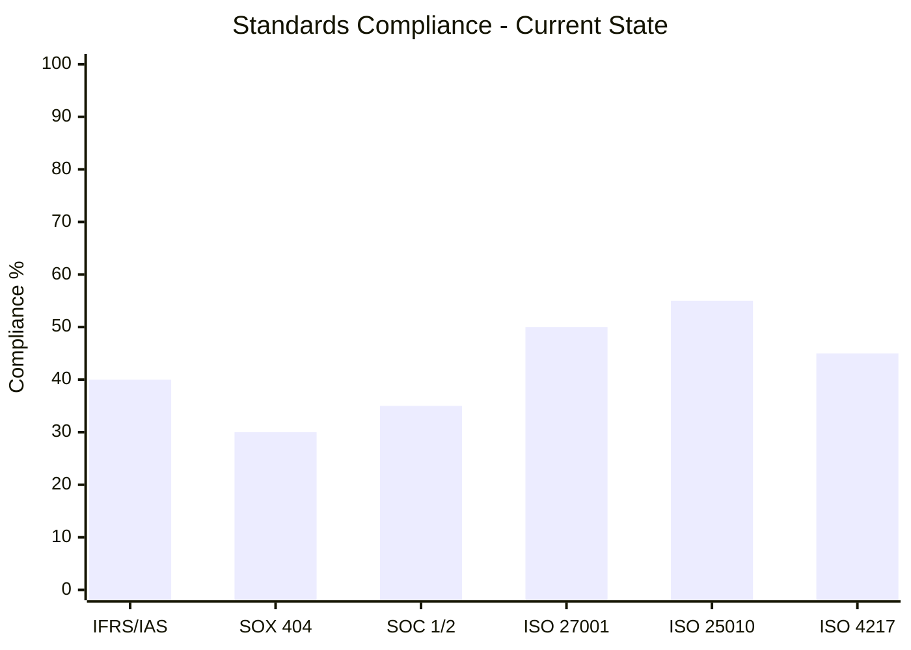
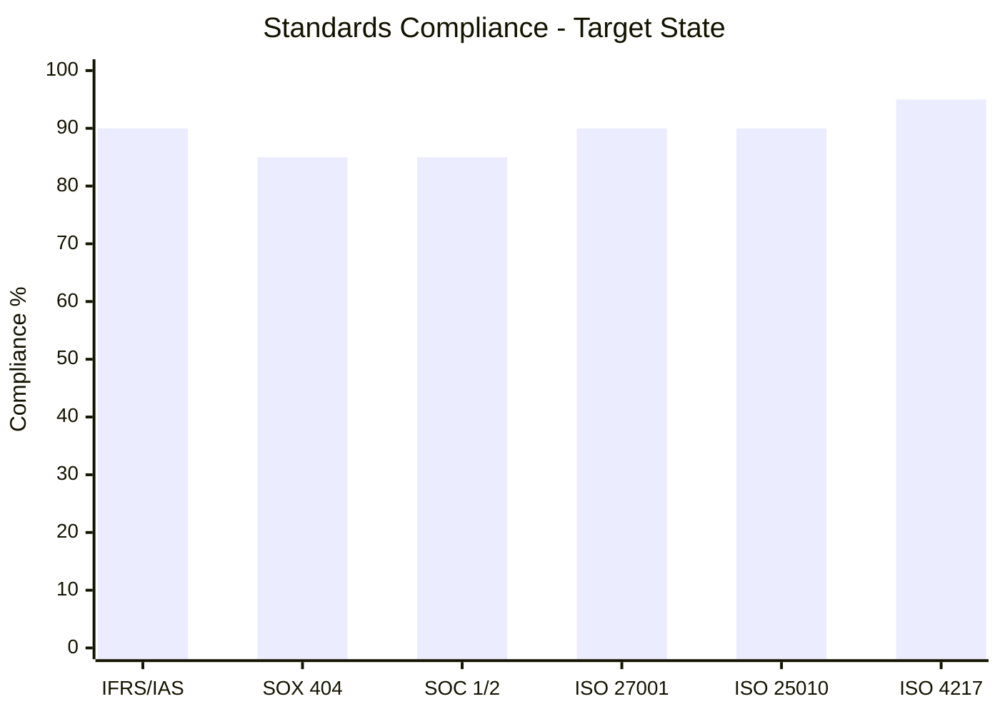

# الخطة التنفيذية الشاملة لإصلاح واعتماد المحرك المحاسبي

## Comprehensive Execution Plan for Accounting Engine Remediation & Certification

---

> [!IMPORTANT]
> **الهدف الاستراتيجي:** تحويل المحرك المحاسبي من **نموذج أولي متقدم (Advanced Prototype)** إلى **محرك مؤسسي معتمد للإنتاج وجاهز لتدقيق مراجعي الحسابات الدوليين (Production-Grade, Big 4 Audit-Ready Engine)**.

---

## 1. المستندات المرجعية (Reference Documents)

تستند هذه الخطة بالكامل إلى نتائج وتوصيات الوثائق التالية:

| الوثيقة | الوصف | الرابط |
| :--- | :--- | :--- |
| **تقرير التحليل المعماري** | فحص شامل لمعمارية المحرك وتحديد 14 مشكلة و11 فجوة IFRS | [engine_analysis.md](file:///home/osm/StudioProjects/cashflow_system/accounting_engine/docs/engine_analysis.md) |
| **تقرير التحقق والمعايير** | إثبات ميداني للمشكلات ومطابقتها مع ISO, IEEE, IFRS, SOX, SOC | [engine_problems_verification_and_standards_compliance.md](file:///home/osm/StudioProjects/cashflow_system/accounting_engine/docs/engine_problems_verification_and_standards_compliance.md) |

---

## 2. ملخص الحالة الراهنة (Current State Summary)

### 2.1 المشكلات المُثبتة ميدانياً

| التصنيف | العدد | التفصيل |
| :---: | :---: | :--- |
| 🔴 **حرجة (Critical / P0)** | **4** | #1 الحسابات العكسية، #2 عملة العرض، #5 ثغرة JSONB/Line Relinking، #9 تحديث الأصول المبكر |
| 🟠 **عالية (High / P1)** | **8** | #3 ميزان متعدد العملات، #4 Adjusted شكلي، #6 لا قيد توازن DB، #7 لا RLS، #10 AR/AP منفصلة، #11 IAS 16 ناقص، #12 تسوية بنكية بدائية، #13 تدقيق غير محصن، #14 لا RBAC |
| 🟡 **متوسطة (Medium / P2)** | **2** | #8 context.Background (55 موضعاً)، دقة Money ثابتة عند 4 خانات |

### 2.2 نسب الامتثال الحالية للمعايير الدولية

### 2.3 نسب الامتثال المستهدفة بعد التنفيذ

---

## 3. هيكل الخطة التنفيذية (Plan Structure)

تتألف الخطة من **5 مراحل متسلسلة**، كل مرحلة مفصّلة في ملف مستقل:

### فهرس الملفات التنفيذية

| الملف | المرحلة | النطاق | المدة المتوقعة |
| :--- | :---: | :--- | :---: |
| [`01_phase0_emergency_fixes.md`](file:///home/osm/StudioProjects/cashflow_system/accounting_engine/docs/execution_plan/01_phase0_emergency_fixes.md) | **المرحلة 0** | إصلاحات الطوارئ — سلامة المحاسبة ونزاهة البيانات | **أسبوعان** |
| [`02_phase1_currency_and_reporting.md`](file:///home/osm/StudioProjects/cashflow_system/accounting_engine/docs/execution_plan/02_phase1_currency_and_reporting.md) | **المرحلة 1** | العملات، دقة التقارير، إصلاح Money | **4 أسابيع** |
| [`03_phase2_subledger_integration.md`](file:///home/osm/StudioProjects/cashflow_system/accounting_engine/docs/execution_plan/03_phase2_subledger_integration.md) | **المرحلة 2** | تكامل الدفاتر المساعدة مع الأستاذ العام | **6 أسابيع** |
| [`04_phase3_governance_and_security.md`](file:///home/osm/StudioProjects/cashflow_system/accounting_engine/docs/execution_plan/04_phase3_governance_and_security.md) | **المرحلة 3** | الحوكمة، الصلاحيات، أمان قاعدة البيانات | **8 أسابيع** |
| [`05_phase4_ifrs_engines.md`](file:///home/osm/StudioProjects/cashflow_system/accounting_engine/docs/execution_plan/05_phase4_ifrs_engines.md) | **المرحلة 4** | محركات المعايير الدولية المتخصصة | **10 أسابيع** |

---

## 4. قواعد التنفيذ الملزمة (Execution Rules)

> [!CAUTION]
> **لا يُسمح بالانتقال إلى المرحلة التالية قبل اجتياز جميع معايير القبول (Acceptance Criteria) للمرحلة الحالية واجتياز كامل الاختبارات الآلية المرتبطة بها.**

1. **كل مهمة تُنفذ بالتسلسل TDD:** كتابة الاختبار أولاً → التنفيذ → التحقق → المراجعة.
2. **كل مرحلة تنتهي بـ Milestone Review:** مراجعة شاملة للكود والاختبارات والتوثيق.
3. **لا تُضاف ميزات وظيفية جديدة** خلال المراحل 0-1 (إصلاح فقط).
4. **الاختبارات التراجعية (Regression Tests)** إلزامية عند كل تغيير.
5. **التوثيق الفني** يُحدّث تزامنياً مع كل تغيير في الكود.

---

## 5. سجل المخاطر العامة (Risk Register)

| المخاطرة | الاحتمال | الأثر | استراتيجية التخفيف |
| :--- | :---: | :---: | :--- |
| تعارض إصلاحات schema.sql مع البيانات الموجودة | عالي | حرج | بناء Migration Scripts مع نسخ احتياطية قبل كل تعديل |
| تراجع أداء التقارير بعد إضافة ترجمة العملات | متوسط | عالي | إنشاء Benchmarks قبل وبعد، مع فهارس مخصصة |
| كسر التوافقية مع الـ API الحالي عند تغيير Repository | عالي | عالي | تصميم Adapter Layer يحافظ على التوافق الخلفي |
| تأخر بناء محركات IFRS لتعقيد المعايير | عالي | متوسط | البدء بـ MVP لكل محرك مع خطة توسع تدريجية |
| نقص الاختبارات التكاملية لسيناريوهات Multi-Company | متوسط | حرج | بناء Test Fixtures لشركات افتراضية متعددة منذ المرحلة 0 |

---

## 6. معايير النجاح النهائية (Final Success Criteria)

- [ ] جميع الـ 14 مشكلة المُثبتة ميدانياً → **مُعالَجة ومختبرة**
- [ ] نسب الامتثال للمعايير الدولية → **≥ 85% لكل معيار**
- [ ] تغطية الاختبارات (Code Coverage) → **≥ 80% للحزم الحرجة**
- [ ] اجتياز الـ 5 اختبارات الحاسمة المذكورة في القسم 11 من تقرير التحليل
- [ ] لا يوجد أي `context.Background()` في طبقة التخزين
- [ ] جميع القوائم المالية تدعم عملة العرض (Presentation Currency)
- [ ] سجل التدقيق محصّن ضد DELETE/TRUNCATE
- [ ] نظام RBAC/SoD فعّال ومتكامل
- [ ] وثائق المشروع مُحدّثة وتعكس الحالة الفعلية للكود

