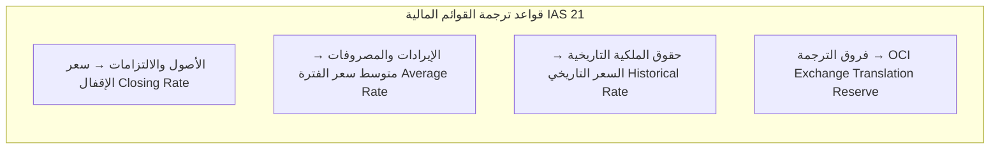

# المرحلة 1: العملات ودقة التقارير المالية وإصلاح Money

## Phase 1: Currency Translation, Reporting Accuracy & Money Precision (P1)

---

> [!WARNING]
> **الأولوية:** عالية (High / P1)
> **المدة:** 4 أسابيع (Week 3-6)
> **المتطلب السابق:** اكتمال المرحلة 0 بنسبة 100%
> **الهدف:** تمكين المحرك من إصدار تقارير مالية صحيحة بأي عملة عرض، وإصلاح دقة الحسابات المالية وتقارير حقوق الملكية والنسب المالية.

---

## فهرس المهام

| المهمة | الوصف | المشكلة المرجعية | المعيار الملزم |
| :---: | :--- | :---: | :--- |
| **T1.1** | بناء محرك ترجمة عملة العرض وفق IAS 21 | #2 | IAS 21, ISO 4217 |
| **T1.2** | تفعيل ميزان المراجعة المعدل (Adjusted Trial Balance) | #4 | IAS 8, ISO 25010 |
| **T1.3** | إصلاح دقة Money.Divide لاستخدام Internal Scale | — | IEEE 754, ISO 4217 |
| **T1.4** | بناء ميزان المراجعة متعدد العملات | #3 | IFRS 7, AICPA Audit Guide |
| **T1.5** | إصلاح قائمة التغيرات في حقوق الملكية | — | IAS 1 |
| **T1.6** | إصلاح النسب المالية لاستخدام متوسط الأرصدة | — | IAS 1, CFA Standards |

---

## T1.1 — بناء محرك ترجمة عملة العرض وفق IAS 21

### Build IAS 21 Presentation Currency Translation Engine

**المشكلة المرجعية:** المشكلة #2 — التقارير تُعيد صفراً لعملات العرض المختلفة
**مستوى الخطورة:** 🔴 حرجة (Critical)

### 1. الملفات المتأثرة

| الملف | نوع التعديل |
| :--- | :---: |
| [`internal/reporting/trial_balance.go`](file:///home/osm/StudioProjects/cashflow_system/accounting_engine/internal/reporting/trial_balance.go) | **تعديل** |
| `internal/reporting/currency_translation.go` | **إنشاء** |
| [`internal/reporting/balance_sheet.go`](file:///home/osm/StudioProjects/cashflow_system/accounting_engine/internal/reporting/balance_sheet.go) | **تعديل** |
| [`internal/reporting/income_statement.go`](file:///home/osm/StudioProjects/cashflow_system/accounting_engine/internal/reporting/income_statement.go) | **تعديل** |
| [`internal/reporting/equity_statement.go`](file:///home/osm/StudioProjects/cashflow_system/accounting_engine/internal/reporting/equity_statement.go) | **تعديل** |

### 2. قواعد الترجمة وفق IAS 21 (الفقرات 38-49)



### 3. التصميم البرمجي المقترح

```go
// internal/reporting/currency_translation.go

// CurrencyTranslator translates financial statements from functional
// currency to presentation currency per IAS 21 paragraphs 38-49.
type CurrencyTranslator struct {
    rateProvider valuation.RateProviderSPI
}

// TranslateBalanceSheet translates balance sheet items using closing rate.
// IAS 21.39(a): Assets and liabilities shall be translated at the closing rate.
func (ct *CurrencyTranslator) TranslateBalanceSheet(
    items []BalanceSheetItem,
    fromCurrency, toCurrency string,
    closingDate time.Time,
) ([]BalanceSheetItem, financialtypes.Money, error) {
    closingRate, err := ct.rateProvider.GetRate(
        fromCurrency, toCurrency, closingDate, valuation.RateTypeClosing,
    )
    // ...
    // Returns: translated items + translation difference for OCI
}

// TranslateIncomeStatement translates P&L items using average rate.
// IAS 21.39(b): Income and expenses shall be translated at exchange
// rates at the dates of the transactions (or average rate approximation).
func (ct *CurrencyTranslator) TranslateIncomeStatement(
    items []IncomeStatementItem,
    fromCurrency, toCurrency string,
    periodStart, periodEnd time.Time,
) ([]IncomeStatementItem, error) {
    avgRate, err := ct.rateProvider.GetRate(
        fromCurrency, toCurrency, periodEnd, valuation.RateTypeAverage,
    )
    // ...
}

// TranslateEquity translates equity items using historical rates.
// IAS 21.39(c): Equity items at historical rates.
func (ct *CurrencyTranslator) TranslateEquity(
    items []EquityItem,
    fromCurrency, toCurrency string,
) ([]EquityItem, error) {
    // Each equity item uses its own historical rate
}
```

### 4. إصلاح `lineAmounts` في trial_balance.go

```go
// قبل (خاطئ) — يُعيد صفراً:
if currency == "" || functionalCurrency == currency {
    return line.FunctionalDebit.Amount(), line.FunctionalCredit.Amount()
}
return decimal.Zero, decimal.Zero  // ← كارثة!

// بعد (صحيح) — يترجم إلى عملة العرض:
if currency == "" || functionalCurrency == currency {
    return line.FunctionalDebit.Amount(), line.FunctionalCredit.Amount()
}
// ترجمة إلى عملة العرض باستخدام السعر المناسب
translatedDebit, _ := translator.Convert(
    line.FunctionalDebit, currency, line.PostingDate,
)
translatedCredit, _ := translator.Convert(
    line.FunctionalCredit, currency, line.PostingDate,
)
return translatedDebit.Amount(), translatedCredit.Amount()
```

### 5. معايير القبول

- [ ] قائمة المركز المالي تُترجم بسعر الإقفال
- [ ] قائمة الدخل تُترجم بمتوسط سعر الفترة
- [ ] فروق الترجمة تُسجل في OCI
- [ ] لا تعود أي دالة بـ `decimal.Zero` عند طلب عملة عرض مختلفة
- [ ] اختبار: شركة عملتها SAR تُصدر تقارير بـ USD → أرقام صحيحة

---

## T1.2 — تفعيل ميزان المراجعة المعدل

### Implement Real Adjusted Trial Balance Logic

**المشكلة المرجعية:** المشكلة #4 — وضع Adjusted مؤشر شكلي فقط

### 1. الملفات المتأثرة

| الملف | نوع التعديل |
| :--- | :---: |
| [`internal/reporting/trial_balance.go`](file:///home/osm/StudioProjects/cashflow_system/accounting_engine/internal/reporting/trial_balance.go) | **تعديل** |
| يحتاج إضافة حقل في `posting.JournalEntry` | **تعديل** |

### 2. التعديل المطلوب

```go
// الخطوة 1: إضافة تصنيف لنوع القيد في JournalEntry
type EntryClassification string

const (
    EntryClassRegular    EntryClassification = "regular"
    EntryClassAdjusting  EntryClassification = "adjusting"  // تسويات جردية
    EntryClassClosing    EntryClassification = "closing"     // قيود إقفال
    EntryClassOpening    EntryClassification = "opening"     // قيود افتتاحية
    EntryClassReversing  EntryClassification = "reversing"   // قيود عكسية
)

// الخطوة 2: تعديل منطق GenerateAdjusted
func (g *TrialBalanceGenerator) GenerateAdjusted(
    start, end time.Time,
    currency string,
    adjusted bool,
) (*TrialBalance, error) {
    entries, err := g.repo.ListPostedEntries(ctx, companyID, start, end)

    var filteredEntries []posting.JournalEntry
    if adjusted {
        // ميزان المراجعة المعدل: يشمل جميع القيود بما فيها التسويات
        filteredEntries = entries
    } else {
        // ميزان المراجعة قبل التسويات: يستبعد قيود التسوية الجردية
        for _, e := range entries {
            if e.Classification != EntryClassAdjusting {
                filteredEntries = append(filteredEntries, e)
            }
        }
    }
    // ... حساب الأرصدة من filteredEntries فقط
}
```

### 3. معايير القبول

- [ ] `Adjusted=true` يُنتج أرصدة تشمل قيود التسوية الجردية
- [ ] `Adjusted=false` يُنتج أرصدة تستبعد قيود التسوية الجردية
- [ ] الفرق بين الميزانين يساوي تماماً قيم قيود التسوية
- [ ] إضافة حقل `Classification` في `JournalEntry` مع Migration

---

## T1.3 — إصلاح دقة Money.Divide

### Fix Money Intermediate Calculation Precision

**المشكلة المرجعية:** دقة `FinancialScale = 4` ثابتة في جميع العمليات

### 1. الملفات المتأثرة

| الملف | نوع التعديل |
| :--- | :---: |
| [`internal/types/money.go`](file:///home/osm/StudioProjects/cashflow_system/accounting_engine/internal/types/money.go) | **تعديل** |
| `internal/types/money_test.go` | **تعديل** |

### 2. التعديل المطلوب

```go
const (
    FinancialScale = 4   // دقة العرض والترحيل النهائي
    InternalScale  = 12  // دقة الحسابات الوسيطة (موجود بالفعل كـ internalScale)
)

// قبل (خاطئ):
func (m Money) Divide(scalar decimal.Decimal) (Money, error) {
    return newMoney(m.amount.DivRound(scalar, FinancialScale), m.currency)
}

// بعد (صحيح):
func (m Money) Divide(scalar decimal.Decimal) (Money, error) {
    // الحساب الوسيط بدقة 12 خانة لتقليل أخطاء التقريب التراكمي
    // التقريب النهائي يتم فقط عند الترحيل (RoundToScale)
    result := m.amount.DivRound(scalar, InternalScale)
    return newMoney(result, m.currency)
}

// دالة جديدة: تقريب نهائي عند الترحيل فقط
func (m Money) RoundForPosting() Money {
    rounded := m.amount.Round(FinancialScale)
    result, _ := newMoney(rounded, m.currency)
    return result
}
```

### 3. معايير القبول

- [ ] `Money.Divide` يستخدم `InternalScale` (12 خانة) للحسابات الوسيطة
- [ ] دالة `RoundForPosting()` متاحة للتقريب النهائي عند الترحيل
- [ ] اختبار: قسمة 1000 على 3 لـ 360 شهراً → المجموع يساوي 1000 بالضبط
- [ ] اختبار: تحويل عملات بسعر 3.7512846 → لا فقدان دقة

---

## T1.4 — بناء ميزان المراجعة متعدد العملات

### Build Multi-Currency Trial Balance

**المشكلة المرجعية:** المشكلة #3

### 1. التصميم المقترح

```go
// MultiCurrencyTrialBalance عرض ثلاثي الأبعاد للأرصدة
type MultiCurrencyTrialBalance struct {
    Rows []MultiCurrencyTBRow
}

type MultiCurrencyTBRow struct {
    AccountID   uuid.UUID
    AccountName string
    // الأرصدة بالعملة الأصلية للمعاملات
    TransactionCurrencyBalances map[string]CurrencyBalance
    // الرصيد بالعملة الوظيفية
    FunctionalBalance CurrencyBalance
    // فروق إعادة التقييم غير المحققة
    UnrealizedFXGainLoss decimal.Decimal
}

type CurrencyBalance struct {
    Currency    string
    OpenDebit   decimal.Decimal
    OpenCredit  decimal.Decimal
    PeriodDebit decimal.Decimal
    PeriodCredit decimal.Decimal
    CloseDebit  decimal.Decimal
    CloseCredit decimal.Decimal
}
```

### 2. معايير القبول

- [ ] عرض الأرصدة بعملة المعاملة الأصلية لكل حساب
- [ ] عرض الرصيد الموازي بالعملة الوظيفية
- [ ] عرض فروق إعادة التقييم غير المحققة
- [ ] الميزان متوازن بكل عملة على حدة

---

## T1.5 — إصلاح قائمة التغيرات في حقوق الملكية

### Fix Equity Statement (TransfersToReserve & Distributions)

### 1. الملفات المتأثرة

| الملف | نوع التعديل |
| :--- | :---: |
| [`internal/reporting/equity_statement.go`](file:///home/osm/StudioProjects/cashflow_system/accounting_engine/internal/reporting/equity_statement.go) | **تعديل** |

### 2. التعديل المطلوب

- **`TransfersToReserve`** يعود حالياً بصفر دائماً → يجب ربطه بقيود التحويل الفعلية من الأرباح المبقاة إلى الاحتياطيات.
- **توزيعات الأرباح** تحتاج لربطها بقيود الإعلان والصرف الفعلية.

```go
// بدلاً من إرجاع صفر:
// TransfersToReserve: financialtypes.Money{},

// يجب حساب التحويلات الفعلية:
transfersToReserve := calculateTransfersToReserve(
    entries, reserveAccounts, retainedEarningsAccount,
)
```

### 3. معايير القبول

- [ ] `TransfersToReserve` يعكس قيود التحويل الفعلية
- [ ] توزيعات الأرباح محسوبة من القيود المرتبطة
- [ ] إجمالي حقوق الملكية الختامي = الافتتاحي + الدخل الشامل + إصدارات - توزيعات ± تحويلات

---

## T1.6 — إصلاح النسب المالية

### Fix Financial Ratios to Use Average Balances

### 1. الملفات المتأثرة

| الملف | نوع التعديل |
| :--- | :---: |
| [`internal/reporting/ratios.go`](file:///home/osm/StudioProjects/cashflow_system/accounting_engine/internal/reporting/ratios.go) | **تعديل** |

### 2. التعديل المطلوب

```go
// قبل (خاطئ) — يستخدم أرصدة نهاية الفترة فقط:
totalAssets := endOfPeriodBalance(assetAccounts)
roe := netIncome / equity  // equity نهاية الفترة فقط

// بعد (صحيح) — يستخدم متوسط الأرصدة:
avgTotalAssets := (beginningBalance + endingBalance) / 2
avgEquity := (beginningEquity + endingEquity) / 2
roa := netIncome / avgTotalAssets
roe := netIncome / avgEquity
```

### 3. معايير القبول

- [ ] `ROA` = صافي الدخل ÷ متوسط إجمالي الأصول
- [ ] `ROE` = صافي الدخل ÷ متوسط حقوق الملكية
- [ ] `Receivables Turnover` = صافي المبيعات ÷ متوسط الذمم المدينة
- [ ] `Inventory Turnover` = تكلفة المبيعات ÷ متوسط المخزون

---

## ملخص المرحلة 1 — معايير الانتقال للمرحلة 2

> [!IMPORTANT]
> **شروط الانتقال إلى المرحلة 2:**

- [ ] ✅ T1.1: جميع القوائم المالية تدعم عملة العرض مع ترجمة IAS 21 صحيحة
- [ ] ✅ T1.2: ميزان المراجعة المعدل يعمل بمنطق فعلي (تصفية قيود التسوية)
- [ ] ✅ T1.3: Money.Divide يستخدم InternalScale للحسابات الوسيطة
- [ ] ✅ T1.4: ميزان المراجعة متعدد العملات يعمل
- [ ] ✅ T1.5: قائمة حقوق الملكية تعكس التحويلات والتوزيعات الفعلية
- [ ] ✅ T1.6: النسب المالية تستخدم متوسط الأرصدة
- [ ] ✅ `go test ./...` — جميع الاختبارات تمر بنجاح

### تأثير المرحلة على نسب الامتثال

| المعيار | بعد المرحلة 0 | بعد المرحلة 1 | التحسن |
| :--- | :---: | :---: | :---: |
| **IFRS / IAS** | 55% | 72% | +17% |
| **ISO 4217** | 45% | 80% | +35% |
| **ISO 25010** | 70% | 80% | +10% |

