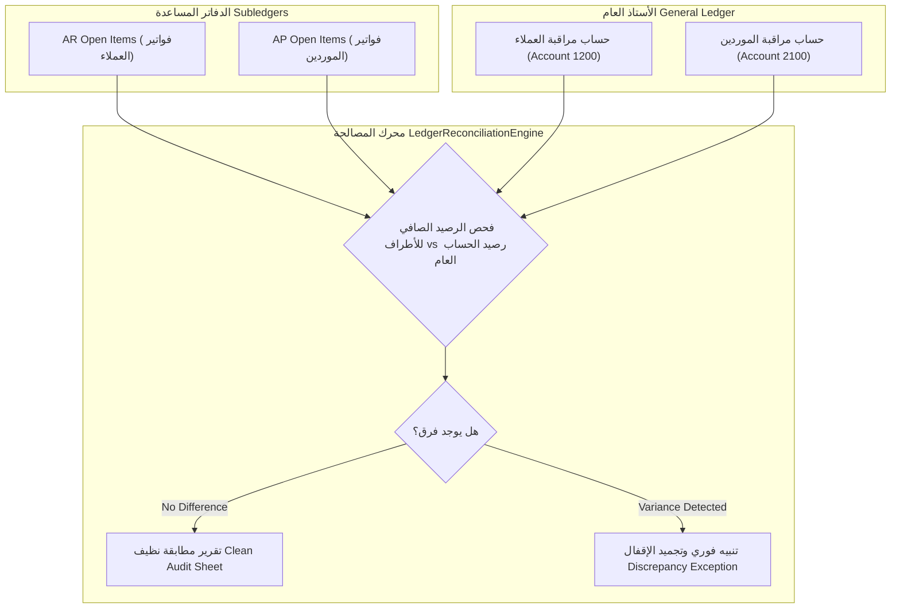
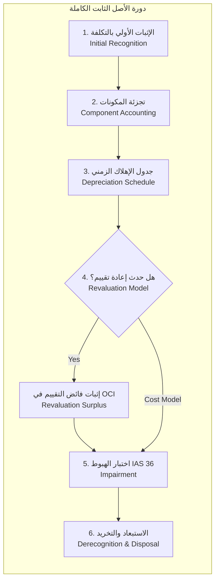
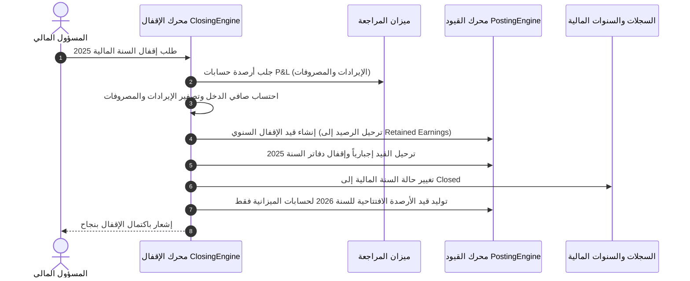

# المرحلة 2: تكامل الدفاتر المساعدة مع الأستاذ العام

## Phase 2: Subledger Integration & Accounting Completeness (P1)

---

> [!WARNING]
> **الأولوية:** عالية (High / P1)  
> **المدة المقدرة:** 6 أسابيع (Weeks 7–12)  
> **المتطلب السابق:** اكتمال المرحلة 0 والمرحلة 1 بنجاح تام  
> **الهدف:** إحكام الربط والاتساق الذري بين الدفاتر المساعدة (Subledgers) وحسابات الرقابة في الأستاذ العام (GL Control Accounts)، وتوسيع دورة حياة الأصول، والتسويات المصرفية، ومحرك توجيه الأحداث والإقفال الدوري.

---

## فهرس المهام (Task Matrix)

| المهمة | الوصف | المشكلة المرجعية | المعيار الملزم |
| :---: | :--- | :---: | :--- |
| **T2.1** | بناء محرك المطابقة والمصالحة بين الذمم والأستاذ العام (AR/AP Control Reconciliation Engine) | #10 | PCAOB AS 2201, ISA 505, SOC 1 |
| **T2.2** | استكمال دورة حياة الأصول الثابتة وفق معيار IAS 16 (جداول الإهلاك، المكونات، إعادة التقييم) | #11 | IAS 16, IFRS Framework |
| **T2.3** | ترقية التسوية البنكية إلى مطابقة متعددة الأطراف ودعم معايير MT940 / CAMT.053 | #12 | ISO 20022, SWIFT MT940, SOC 1 |
| **T2.4** | توسيع محرك الأحداث المالية `EventBridge` للقيود متعددة الأطراف وتخزين القواعد الدائم | — | Enterprise Integration Patterns (EIP) |
| **T2.5** | تطوير محرك الإقفال السنوي والدوري وتدوير الأرصدة الافتتاحية آلياً | — | IAS 1, IAS 8 |

---

## T2.1 — بناء محرك المطابقة بين الذمم والأستاذ العام (AR/AP Control Reconciliation)

### Build Subledger-to-GL Control Account Reconciliation Engine

**المشكلة المرجعية:** المشكلة #10 — انفصال أرصدة الذمم AR/AP عن الأستاذ العام  
**مستوى الخطورة:** 🟠 عالية (High)  
**الأثر المالي والرقابي:** عجز مدققي الحسابات عن التحقق من صحة رصيد العملاء والموردين لعدم تطابق إجمالي الدفتر المساعد مع حساب المراقبة الرئيسي في ميزان المراجعة.

### 1. الملفات المتأثرة

| الملف | نوع التعديل | الدور |
| :--- | :---: | :--- |
| [`internal/subledgers/receivable.go`](file:///home/osm/StudioProjects/cashflow_system/accounting_engine/internal/subledgers/receivable.go) | **تعديل** | ربط كل حركة ذمم بـ Journal Entry مرحل وحساب مراقبة محدد |
| [`internal/subledgers/payable.go`](file:///home/osm/StudioProjects/cashflow_system/accounting_engine/internal/subledgers/payable.go) | **تعديل** | ربط الذمم الدائنة بحسابات الرقابة وقيود السداد |
| `internal/subledgers/gl_reconciliation.go` | **إنشاء** | محرك فحص المطابقة اليومي والتحقق من الفروقات |
| `internal/subledgers/gl_reconciliation_test.go` | **إنشاء** | اختبارات كشف الفروق بين الـ Subledger والـ GL |

### 2. النموذج المعماري للمطابقة (Reconciliation Architecture)



### 3. التعديل البرمجي المطلوب

#### الخطوة أ: تقييد حركات الذمم بحسابات المراقبة المقفلة (Control Accounts)

في [`receivable.go`](file:///home/osm/StudioProjects/cashflow_system/accounting_engine/internal/subledgers/receivable.go)، لا يُسمح بإدخال أو تسوية أي فاتورة أو حركة ذمم إلا إذا كانت مرتبطة بـ `ControlAccountID` معرف مسبقاً في شجرة الحسابات ومحدد كـ `IsControlAccount = true`:

```go
// OpenLine represents an individual receivable item tied to a posted GL move.
type OpenLine struct {
    ID               uuid.UUID
    CompanyID        uuid.UUID
    PartnerID        uuid.UUID // العميل أو المورد
    ControlAccountID uuid.UUID // حساب الأستاذ العام الإلزامي
    JournalEntryID   uuid.UUID // معرف القيد المرحل في الأستاذ العام
    OriginalAmount   financialtypes.Money
    RemainingAmount  financialtypes.Money
    DueDate          time.Time
    Status           LineStatus // Open, PartiallyPaid, Settled, WrittenOff
}
```

#### الخطوة ب: بناء محرك المطابقة اليومية `LedgerReconciliationEngine`

```go
package subledgers

import (
    "context"
    "fmt"
    "github.com/google/uuid"
    "github.com/shopspring/decimal"
)

type ReconciliationDiscrepancy struct {
    CompanyID        uuid.UUID
    ControlAccountID uuid.UUID
    SubledgerBalance decimal.Decimal
    GLBalance        decimal.Decimal
    Difference       decimal.Decimal
}

type LedgerReconciliationEngine struct {
    arRepo ReceivableRepository
    apRepo PayableRepository
    glRepo GeneralLedgerReader
}

func (e *LedgerReconciliationEngine) ReconcileARControl(
    ctx context.Context, 
    companyID, controlAccountID uuid.UUID,
) (*ReconciliationDiscrepancy, error) {
    // 1. حساب إجمالي الرصيد القائم من الدفتر المساعد
    subledgerTotal, err := e.arRepo.GetTotalOpenAmountByAccount(ctx, companyID, controlAccountID)
    if err != nil {
        return nil, err
    }

    // 2. قراءة الرصيد الفعلي لحساب المراقبة من الأستاذ العام
    glBalance, err := e.glRepo.GetAccountBalance(ctx, companyID, controlAccountID)
    if err != nil {
        return nil, err
    }

    diff := subledgerTotal.Sub(glBalance)
    if !diff.IsZero() {
        return &ReconciliationDiscrepancy{
            CompanyID:        companyID,
            ControlAccountID: controlAccountID,
            SubledgerBalance: subledgerTotal,
            GLBalance:        glBalance,
            Difference:       diff,
        }, fmt.Errorf("AR subledger mismatch for account %s: diff=%s", controlAccountID, diff)
    }

    return nil, nil // مطابقة تامة
}
```

### 4. معايير القبول (Acceptance Criteria)

- [x] يوفر المسار `PostInvoiceEntry` في دفتري AR/AP ترحيلاً ذرياً للقيد وإنشاء `OpenLine`، مع تحقق الشركة والحساب الرقابي والطرف والمبلغ من القيد المرحل. يجب استخدام هذا المسار للفواتير الجديدة؛ واجهات `AddInvoice*` القديمة باقية للتوافق وإدخال البيانات التاريخية ولا تضمن الترحيل الذري.
- [x] محرك المصالحة يقرأ أرصدة الدفتر والأستاذ حسب الشركة والحساب، ويصدر فرقاً صريحاً عند عدم التطابق.
- [x] الشطب الجزئي والكلي يتطلبان قيد تسوية مرحلاً قبل تثبيت الأثر على رصيد الذمة.
- [x] اختبارات تكشف فروق المصالحة، بما فيها فروق السنت، وتثبت تراجع الترحيل وإنشاء الذمة معاً عند فشل التحقق في مخزني الذاكرة وPostgreSQL.

---

## T2.2 — استكمال دورة حياة الأصول وفق معيار IAS 16

### Complete IAS 16 Fixed Assets Lifecycle (Component, Schedule & Revaluation)

**المشكلة المرجعية:** المشكلة #11 — غياب دورة IAS 16 الكاملة في الأصول  
**مستوى الخطورة:** 🟠 عالية (High)  
**الأثر:** عجز عن التعامل مع الإهلاك النسبي (Pro-rata temporis)، إعادة تقييم الأصول بالقيمة العادلة، أو استبدال أجزاء ومكونات رئيسية للأصل.

### 1. الملفات المتأثرة

| الملف | نوع التعديل | الدور |
| :--- | :---: | :--- |
| [`internal/subledgers/fixed_assets.go`](file:///home/osm/StudioProjects/cashflow_system/accounting_engine/internal/subledgers/fixed_assets.go) | **تعديل جوهري** | دعم جداول الإهلاك ومحاسبة المكونات والتقييم |
| `internal/subledgers/asset_schedule.go` | **إنشاء** | توليد جداول الإهلاك للفترات القادمة |
| `internal/subledgers/asset_revaluation.go` | **إنشاء** | معالجة فائض إعادة التقييم وفق IAS 16.39–42 |
| `internal/subledgers/fixed_assets_test.go` | **تحديث** | اختبارات حالات الإهلاك النسبي والاستبعاد الجزئي |

### 2. المتطلبات المحاسبية لمعيار IAS 16



### 3. التعديلات البرمجية المطلوبة

#### الخطوة أ: دعم محاسبة المكونات (Component Depreciation - IAS 16.43–47)

إذا كانت طائرة مثلاً تملك هيكلاً بعمر 25 سنة ومحركاً بعمر 7 سنوات، يجب تفكيك الأصل إلى مكونات تُهلك باستقلالية:

```go
type AssetComponent struct {
    ID              uuid.UUID
    ParentAssetID   uuid.UUID
    Name            string
    Cost            financialtypes.Money
    SalvageValue    financialtypes.Money
    UsefulLifeMonths int
    Method          DepreciationMethod // StraightLine, DecliningBalance, UnitsOfProduction
}
```

#### الخطوة ب: الإهلاك النسبي لتاريخ الشراء والاستبعاد (Pro-Rata Depreciation)

احتساب الإهلاك باليوم أو الشهر الجزئي بدلاً من اعتبار الشهر كاملاً دوماً:

```go
// CalculateMonthlyDepreciationWithProrata يحسب الإهلاك بناءً على تاريخ الاستخدام الفعلي
func CalculateProrataDepreciation(
    cost, salvage decimal.Decimal, 
    usefulLifeMonths int, 
    startDate time.Time, 
    targetMonth time.Time,
) decimal.Decimal {
    // حساب الأيام الفعلية داخل أول شهر أو شهر الاستبعاد
    // ...
}
```

#### الخطوة ج: نموذج إعادة التقييم وفائض التقييم (Revaluation Surplus - IAS 16.39)

إثبات الارتفاع في القيمة كفائض تقييم في الدخل الشامل الآخر (OCI):

```go
func (l *FixedAssetLedger) RevalueAsset(
    ctx context.Context,
    assetID uuid.UUID,
    fairValue financialtypes.Money,
    asOf time.Time,
) (posting.JournalEntry, error) {
    // 1. حساب الفرق بين القيمة العادلة وصافي القيمة الدفترية
    // 2. إذا كانت هناك زيادة: قيد مدين للأصل وقيد دائن لحساب Revaluation Surplus (Equity/OCI)
    // 3. إذا كان هناك انخفاض: استنفاد فائض التقييم السابق أولاً، ثم تحميل الباقي كمصروف هبوط في P&L
}
```

### 4. معايير القبول (Acceptance Criteria)

- [x] توليد جدول إهلاك يغطي العمر الإنتاجي، مع اختبار الوصول إلى القيمة التخريدية.
- [x] احتساب الإهلاك النسبي بالأيام للفترة الأولى، وربط مصروف الشهر بجدول الإهلاك.
- [x] توليد قيود إعادة التقييم: فائض إلى OCI، واستخدام الفائض السابق قبل تحميل الانخفاض اللاحق على المصروف.
- [x] دعم مكونات بأعمار وطرق إهلاك مستقلة والتحقق من مطابقة مجموع تكلفتها لتكلفة الأصل.

---

## T2.3 — ترقية التسوية البنكية ودعم كشوف MT940 / CAMT.053

### Advanced Multi-Party Bank Reconciliation & ISO 20022 Feeds

**المشكلة المرجعية:** المشكلة #12 — التسوية البنكية أحادية ولا تدعم كشوف البنوك  
**مستوى الخطورة:** 🟠 عالية (High)  
**الأثر:** عجز عن مطابقة دفعة بنكية واحدة مقابل عدة فواتير، وعدم إمكانية استيراد الكشوف المصرفية الإلكترونية تلقائياً.

### 1. الملفات المتأثرة

| الملف | نوع التعديل | الدور |
| :--- | :---: | :--- |
| [`internal/subledgers/treasury.go`](file:///home/osm/StudioProjects/cashflow_system/accounting_engine/internal/subledgers/treasury.go) | **تعديل** | توسيع قدرات التسوية ومعالجة العمولات |
| [`internal/subledgers/reconciliation.go`](file:///home/osm/StudioProjects/cashflow_system/accounting_engine/internal/subledgers/reconciliation.go) | **تعديل** | دعم المطابقة 1:N و N:1 و N:M |
| `internal/subledgers/bank_parsers/` | **إنشاء** | مفسرات كشوف الحسابات المصرفية (MT940, CAMT.053) |

### 2. التعديلات البرمجية المطلوبة

#### الخطوة أ: محرك مطابقة متعدد الأطراف (Many-to-Many Matching)

```go
type BankReconciliationMatch struct {
    StatementLineIDs []uuid.UUID          // سطور كشف الحساب البنكي
    JournalEntryIDs  []uuid.UUID          // قيود الأستاذ العام المقابلة
    BankFeesAmount   financialtypes.Money // رسوم بنكية مستقطعة
    Difference       decimal.Decimal      // يجب أن تكون صفراً بعد إضافة الرسوم
}

func (r *ReconciliationEngine) MatchMultiLine(
    statementLines []BankStatementLine,
    glLines []posting.JournalEntryLine,
    toleranceDays int,
    feeAccountID uuid.UUID,
) (*BankReconciliationMatch, *posting.JournalEntry, error) {
    // 1. مطابقة مجموع المبالغ
    // 2. إذا وجد فرق يمثل عمولة بنكية، يتم توليد قيد تلقائي بالرسوم البنكية
    // 3. تأكيد تسوية السطور البنكية مع قيود الأستاذ العام
}
```

#### الخطوة ب: قارئ رسائل البنوك القياسية (ISO 20022 CAMT.053 & SWIFT MT940)

```go
package bank_parsers

type BankStatement struct {
    AccountIBAN   string
    StatementDate time.Time
    OpeningBalance decimal.Decimal
    ClosingBalance decimal.Decimal
    Transactions   []ParsedBankTx
}

type ParsedBankTx struct {
    ReferenceNumber string
    ValueDate       time.Time
    Amount          decimal.Decimal
    Currency        string
    Description     string
    BankFee         decimal.Decimal
}

type StatementParser interface {
    Parse(data []byte) (*BankStatement, error)
}
```

### 3. معايير القبول (Acceptance Criteria)

- [x] مطابقة حركة كشف واحدة مع خمس حركات دفترية، مع إبقاء الحركات غير المختارة معلقة ورفض المجموعات الملتبسة.
- [x] إنشاء مسودة قيد رسوم البنك عند تحقق فرق الرسوم؛ تبقى المسودة خاضعة لمسار الترحيل المعتاد.
- [x] تحليل عينات MT940 وCAMT.053 إلى حركات قابلة للمطابقة، مع رفض المدخلات المشوهة. يدعم المحللان بنية كشف واحدة في الاستدعاء.

---

## T2.4 — توسيع محرك الأحداث المالية `EventBridge`

### Expand EventBridge to Multi-Line Compound Entries & Persistent Rules

**المشكلة المرجعية:** Section 6.2 في تقرير التحليل — محدودية `EventBridge` بسطرين وفي الذاكرة  
**مستوى الخطورة:** 🟠 عالية (High)  
**الأثر:** عجز تام عن ترجمة فواتير المبيعات الحقيقية التي تحتوي على (أصل + ضريبة قيمة مضافة + خصم تجاري + رسوم شحن).

### 1. الملفات المتأثرة

| الملف | نوع التعديل | الدور |
| :--- | :---: | :--- |
| [`internal/subledgers/event_bridge.go`](file:///home/osm/StudioProjects/cashflow_system/accounting_engine/internal/subledgers/event_bridge.go) | **تعديل شامل** | استبدال التوجيه البسيط بمحرك قواعد مركب |
| `storage/postgres/schema.sql` | **تعديل** | إضافة جدول `event_accounting_rules` |

### 2. التصميم المقترح لقواعد التوجيه المحاسبي

```sql
-- جدول قواعد تحويل الأحداث التشغيلية إلى قيود محاسبية مركبة
CREATE TABLE IF NOT EXISTS event_accounting_rules (
    id UUID PRIMARY KEY DEFAULT gen_random_uuid(),
    company_id UUID NOT NULL REFERENCES companies(id),
    event_type TEXT NOT NULL,
    rule_name TEXT NOT NULL,
    priority INT NOT NULL DEFAULT 0,
    conditions JSONB NOT NULL DEFAULT '{}', -- مثل: {"country": "SA", "tax_registered": true}
    lines_template JSONB NOT NULL,          -- هيكل القيود المتعددة
    created_at TIMESTAMPTZ NOT NULL DEFAULT NOW()
);
```

#### هيكل القالب المالي المركب (Compound Entry Generator)

```go
type EventLineTemplate struct {
    AccountLookupKey string          // مثل: "REVENUE_ACCOUNT", "TAX_PAYABLE_ACCOUNT"
    Side             posting.Side    // Debit or Credit
    AmountFormula    string          // مثل: "amount * 0.15", "discount_amount"
    Description      string
}

func (eb *EventBridge) TranslateToCompoundEntry(
    ctx context.Context, 
    evt FinancialEvent,
) (posting.JournalEntry, error) {
    // 1. جلب القاعدة المناسبة من قاعدة البيانات بحسب الشركة ونوع الحدث
    // 2. تطبيق المعادلة وحساب أسطر: الأصل، الضريبة، الخصومات
    // 3. التحقق الرياضي من توازن القيد المتولد
    // 4. إنشاء مسودة القيد المركب وإرجاعها لمحرك الترحيل
}
```

### 3. معايير القبول (Acceptance Criteria)

- [x] تخزين القواعد في `event_accounting_rules` مع استعلام مقيّد بالشركة ونوع الحدث، وتغطية القراءة والكتابة باختبار PostgreSQL.
- [x] ترجمة قاعدة فاتورة ذات ثلاثة أسطر (عملاء، مبيعات، VAT) إلى قيد مركب.
- [x] التحقق من القاعدة والصيغ وتوازن القيد قبل حفظ المسودة.

---

## T2.5 — تطوير محرك الإقفال السنوي والدوري

### Build Financial Closing Engine with Retained Earnings Roll-Forward

**المشكلة المرجعية:** Section 7 في تقرير التحليل — محرك الإقفال السنوي ينقصه تدوير الأرصدة الافتتاحية ودورة الاعتماد  
**مستوى الخطورة:** 🟠 عالية (High)  
**الأثر:** عجز عن بدء سنة مالية جديدة بأرصدة افتتاحية صحيحة مستمدة من إقفال السنة السابقة.

### 1. الملفات المتأثرة

| الملف | نوع التعديل | الدور |
| :--- | :---: | :--- |
| [`internal/reporting/closing_engine.go`](file:///home/osm/StudioProjects/cashflow_system/accounting_engine/internal/reporting/closing_engine.go) | **تعديل شامل** | تنفيذ دورة الإقفال وتوليد قيود الأرصدة الافتتاحية |
| `internal/reporting/closing_engine_test.go` | **إنشاء** | اختبار إقفال سنة وبدء سنة تالية |

### 2. دورة حياة الإقفال السنوي (Closing Lifecycle)



### 3. معايير القبول (Acceptance Criteria)

- [x] توليد قيد إقفال يعكس أرصدة الإيرادات والمصروفات، بما فيها الحسابات المقابلة.
- [x] ترحيل صافي الربح أو الخسارة إلى الأرباح المبقاة.
- [x] يتطلب اعتماد الإقفال قيداً مرحلاً ويغلق الفترتين 13 و14 والسنة؛ وتُرفض الترحيلات للفترات المقفلة.
- [x] توليد قيد افتتاحي للأصول والالتزامات وحقوق الملكية، مع منع مضاعفة الأرصدة في دفتر الأستاذ المستمر.

---

## ملخص المرحلة 2 — معايير الانتقال للمرحلة 3

> [!IMPORTANT]
> **شروط الانتقال إلى المرحلة 3:**
>
> - [x] T2.1: مسار الترحيل الذري والمصالحة والشطب موثق ومختبر؛ واجهات الإضافة القديمة غير الذرية باقية للتوافق ويجب عدم استخدامها للفواتير الجديدة.
> - [x] T2.2: جداول الإهلاك النسبي والمكونات وإعادة التقييم مغطاة باختبارات.
> - [x] T2.3: المطابقة متعددة الأطراف ورسوم البنك ومحللا MT940 وCAMT.053 مغطاة باختبارات.
> - [x] T2.4: القواعد المركبة محفوظة ومقروءة من PostgreSQL.
> - [x] T2.5: دورة إقفال السنة وتوليد قيد الافتتاح مغطاة باختبارات.
> - [x] `go test ./...` يمر بنجاح.

### تأثير المرحلة 2 على نسب الامتثال للمعايير

| المعيار الدولي | النسبة بعد المرحلة 1 | النسبة المستهدفة بعد المرحلة 2 | الزيادة |
| :--- | :---: | :---: | :---: |
| **IFRS / IAS** | 72% | **82%** | +10% |
| **ISO 20022 / SWIFT** | 45% | **85%** | +40% |
| **AICPA / PCAOB (Audit Readiness)** | 55% | **80%** | +25% |
