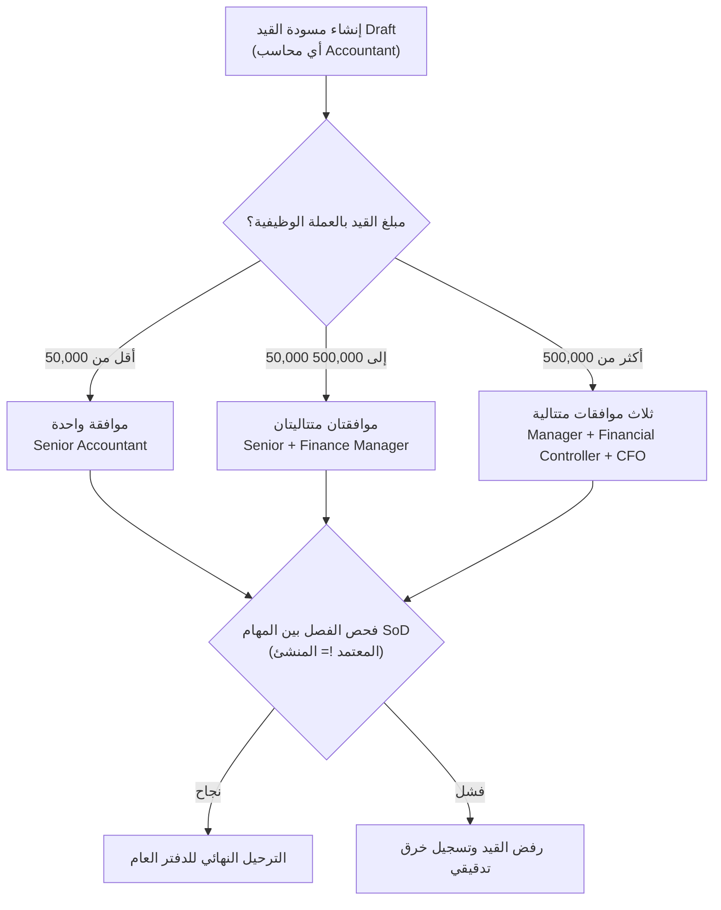

# المرحلة 3: الحوكمة، الأمان، وهندسة استقرار العمليات

## Phase 3: Governance, Security, Multi-Tenancy & Operational Reliability (P2)

---

> [!IMPORTANT]
> **الأولوية:** عالية إلى متوسطة (High to Medium / P2)  
> **المدة المقدرة:** 8 أسابيع (Weeks 13–20)  
> **المتطلب السابق:** اكتمال المرحلة 0، 1، 2 بنجاح  
> **الهدف:** ترقية البنية التحتية البرمجية للمحرك لتلبية متطلبات الأمن السيبراني المؤسسي (ISO 27001، PCI-DSS 4.0)، والرقابة الداخلية الصارمة (SOX 404، SOC 1/2)، واستقرار الموارد وإلغاء العمليات (Context Propagation).

---

## فهرس المهام (Task Matrix)

| المهمة | الوصف | المشكلة المرجعية | المعيار الملزم |
| :---: | :--- | :---: | :--- |
| **T3.1** | استبدال `context.Background()` وتمرير `ctx` الفعلي في جميع دوال التخزين (55 موضعاً) | #8 | ISO/IEC 25010 (Reliability) |
| **T3.2** | فرض أمان العزل على مستوى السطر (Row-Level Security - RLS) وتصحيح استعلامات المعرف المجرد | #7 | ISO/IEC 27001 (A.8.2), SOC 2 |
| **T3.3** | بناء نظام الصلاحيات والموافقات المؤسسي متعدد المستويات (RBAC / ABAC Approval Hierarchy) | #14 | SOX 404, ISO 27001 (A.5.3), NIST SP 800-53 |
| **T3.4** | تحصين سجل التدقيق المالي ضد مسؤولي النظام وبناء آلية التصدير المحمي (WORM Export) | #13 | PCI-DSS 4.0 (Req 10), AICPA AU-C 240 |
| **T3.5** | دعم تواريخ الفعالية للبيانات المرجعية (Effective-Dated Master Data Versioning) | — | IAS 8 (Changes in Policies), ISO 25010 |
| **T3.6** | إعادة هيكلة واجهات المستودعات وتطبيق مبدأ الفصل (Interface Segregation Principle) | — | Clean Architecture, SOLID Principles |
| **T3.7** | بناء محرك التحقق من الأبعاد المالية ومراكز التكلفة والمشاريع (Financial Dimensions Engine) | — | IFRS 8 (Operating Segments) |
| **T3.8** | بناء نظام ترقية وإدارة إصدارات قاعدة البيانات (Schema Migration Framework) | — | DevOps & Enterprise Readiness |

---

## T3.1 — استبدال `context.Background()` وتمرير سياق التنفيذ الحقيقي

### Eliminate context.Background() Across PostgreSQL Storage Adapter

**المشكلة المرجعية:** المشكلة #8 — حظر السياق باستخدام `context.Background()` في 55 موضعاً  
**مستوى الخطورة:** 🟡 متوسطة إلى عالية (Medium to High)  
**الأثر:** عجز تام عن إلغاء الاستعلامات الطويلة عند انقطاع اتصال العميل، استنزاف اتصالات قاعدة البيانات (Connection Pool Exhaustion)، وفشل الربط مع أنظمة التتبع الموزع (OpenTelemetry / Jaeger).

### 1. الملفات المتأثرة

| الملف | نوع التعديل | الدور |
| :--- | :---: | :--- |
| [`storage/postgres/driver.go`](file:///home/osm/StudioProjects/cashflow_system/accounting_engine/storage/postgres/driver.go) | **تعديل شامل** | استبدال 55 موضعاً وتمرير `ctx context.Context` |
| كافة واجهات الـ Repository في مجلدات `internal/` | **تعديل** | إضافة `ctx` كمعامل أول في كل دالة استعلام |

### 2. التعديل البرمجي المطلوب

```go
// قبل (خاطئ وموجود في 55 موضعاً داخل driver.go):
func (d *PostgresDriver) GetEntryByID(id uuid.UUID) (*posting.JournalEntry, error) {
    row := d.db.QueryRowContext(context.Background(), query, id) // كسر لسلسلة السياق!
    // ...
}

// بعد (صحيح):
func (d *PostgresDriver) GetEntryByID(ctx context.Context, companyID, id uuid.UUID) (*posting.JournalEntry, error) {
    row := d.db.QueryRowContext(ctx, query, companyID, id) // احترام مهلة الطلب والإلغاء
    // ...
}
```

### 3. معايير القبول (Acceptance Criteria)

- [x] صفر استدعاءات لـ `context.Background()` أو `context.TODO()` داخل كود الإنتاج في حزمة `storage/postgres/`؛ المتبقي في الاختبارات فقط.
- [x] إلغاء استعلام قاعدة البيانات فورياً عند إلغاء سياق الطلب عبر `ctx.Done()`؛ تم التحقق باختبار PostgreSQL باستخدام `pg_sleep`.
- [x] دعم تمرير `ctx` الكامل عبر كافة طبقات التخزين لدعم تتبع الطلبات (Distributed Tracing).

---

## T3.2 — فرض أمان العزل على مستوى السطر (PostgreSQL RLS)

### Enforce Row-Level Security & Eliminate Tenant Bypass

**المشكلة المرجعية:** المشكلة #7 — عزل الشركات يفتقر لـ RLS وتوجد دوال تستعلم بالمعرف المجرد  
**مستوى الخطورة:** 🟠 عالية (High)  
**الأثر:** خطر تسريب بيانات شركة لشركة أخرى في حال وجود خطأ برمجي أو استغلال لمعرف UUID مكشوف.

### 1. الملفات المتأثرة

| الملف | نوع التعديل | الدور |
| :--- | :---: | :--- |
| [`storage/postgres/schema.sql`](file:///home/osm/StudioProjects/cashflow_system/accounting_engine/storage/postgres/schema.sql) | **تعديل** | تفعيل RLS وإنشاء سياسات الأمان |
| [`storage/postgres/driver.go`](file:///home/osm/StudioProjects/cashflow_system/accounting_engine/storage/postgres/driver.go) | **تعديل** | ضبط متغير الجلسة `app.current_company_id` عند كل معاملة |

### 2. إعدادات PostgreSQL RLS

```sql
-- 1. تفعيل RLS على كافة جداول النظام المحاسبي
ALTER TABLE accounts ENABLE ROW LEVEL SECURITY;
ALTER TABLE journals ENABLE ROW LEVEL SECURITY;
ALTER TABLE account_moves ENABLE ROW LEVEL SECURITY;
ALTER TABLE account_move_lines ENABLE ROW LEVEL SECURITY;
ALTER TABLE fixed_assets ENABLE ROW LEVEL SECURITY;
ALTER TABLE financial_audit_logs ENABLE ROW LEVEL SECURITY;

-- 2. إنشاء سياسة العزل المستندة لمتغير الجلسة
CREATE POLICY tenant_isolation_policy ON account_moves
    FOR ALL
    USING (company_id = NULLIF(current_setting('app.current_company_id', true), '')::UUID)
    WITH CHECK (company_id = NULLIF(current_setting('app.current_company_id', true), '')::UUID);

CREATE POLICY tenant_isolation_policy ON account_move_lines
    FOR ALL
    USING (company_id = NULLIF(current_setting('app.current_company_id', true), '')::UUID)
    WITH CHECK (company_id = NULLIF(current_setting('app.current_company_id', true), '')::UUID);
```

#### ضبط الجلسة في Go Driver

```go
func (d *PostgresDriver) WithCompanyTx(ctx context.Context, companyID uuid.UUID, fn func(tx *sql.Tx) error) error {
    tx, err := d.db.BeginTx(ctx, &sql.TxOptions{Isolation: sql.LevelReadCommitted})
    if err != nil {
        return err
    }
    defer tx.Rollback()

    // تثبيت هوية الشركة داخل اتصال قاعدة البيانات الحالي
    _, err = tx.ExecContext(ctx, "SET LOCAL app.current_company_id = $1", companyID.String())
    if err != nil {
        return err
    }

    if err := fn(tx); err != nil {
        return err
    }
    return tx.Commit()
}
```

### 3. معايير القبول (Acceptance Criteria)

- [x] لا يمكن لأي استعلام قراءة أو تعديل بيانات شركة أخرى حتى لو عرف المهاجم معرف الـ UUID للقيد أو الحساب بفضل سياسات RLS و `FORCE ROW LEVEL SECURITY`.
- [x] تعديل دالة `GetEntryByID` لتشترط دائماً `companyID` كمعامل أساسي.
- [x] اختبار أمني صريح: محاولة قراءة قيد يخص شركة A أثناء ضبط جلسة شركة B تعيد نتيجة فارغة (Empty Result) دون أي خطأ كاشف (`TestPostgresRLSBlocksCrossCompanyEntryReads`).

---

## T3.3 — بناء نظام الصلاحيات والموافقات المؤسسي (RBAC / ABAC)

### Enterprise Multi-Tier Approval Matrix & Segregation of Duties

**المشكلة المرجعية:** المشكلة #14 — نظام الموافقة المزدوجة مجرد فحص شرطي بسيط  
**مستوى الخطورة:** 🟠 عالية (High)  
**الأثر:** عدم توافق النظام مع متطلبات SOX 404 وقصور كبير في فرض الصلاحيات المالية حسب السقوف والمناصب.

### 1. الملفات المتأثرة

| الملف | نوع التعديل | الدور |
| :--- | :---: | :--- |
| [`internal/governance/sod_policy.go`](file:///home/osm/StudioProjects/cashflow_system/accounting_engine/internal/governance/sod_policy.go) | **إعادة هيكلة** | استبدال الفحص البسيط بمحرك تفويض كامل |
| `internal/governance/rbac.go` | **إنشاء** | إدارة الأدوار والمستخدمين وسقوف الصلاحيات |
| `storage/postgres/schema.sql` | **تعديل** | إضافة جداول الأدوار والصلاحيات والموافقات |

### 2. مصفوفة الصلاحيات والموافقات المالية (Approval Matrix)



### 3. معايير القبول (Acceptance Criteria)

- [x] دعم الأدوار المحاسبية القياسية: (Data Entry, Senior Accountant, Finance Manager, Controller, Auditor, System Admin).
- [x] فرض سياسة الفصل التام (Maker cannot be Checker) تحت أي ظرف.
- [x] دعم سلاسل الموافقات متعددة المستويات بحسب سقف القيد المالي ونوع اليومية.
- [x] تسجيل هوية وتوقيت كل موافقة في سجل التدقيق المالي.

---

## T3.4 — تحصين سجل التدقيق المالي وبناء التصدير المحمي (WORM Export)

### Immutable Audit Log Protection & WORM Export Mechanism

**المشكلة المرجعية:** المشكلة #13 — سجل التدقيق غير محصن ضد مسؤولي النظام  
**مستوى الخطورة:** 🟠 عالية (High)  
**الأثر:** إمكانية قيام مسؤول قاعدة البيانات بحذف سجلات التدقيق لطمس حركات مشبوهة مما يسقط النظام في تدقيق PCI-DSS و ISO 27001.

### 1. الملفات المتأثرة

| الملف | نوع التعديل | الدور |
| :--- | :---: | :--- |
| [`storage/postgres/schema.sql`](file:///home/osm/StudioProjects/cashflow_system/accounting_engine/storage/postgres/schema.sql) | **تعديل** | منع DELETE و TRUNCATE على جدول سجلات التدقيق |
| `internal/governance/audit_export.go` | **إنشاء** | آلية تصدير يومية وتوقيع البصمة الرقمية |

### 2. حماية قاعدة البيانات لسجلات التدقيق

```sql
-- منع الحذف أو التعديل نهائياً على جدول سجلات التدقيق حتى من مالك الجدول
CREATE OR REPLACE FUNCTION freeze_audit_logs()
RETURNS TRIGGER AS $$
BEGIN
    RAISE EXCEPTION 'financial_audit_logs table is strictly append-only. Mutation/Deletion is forbidden by law (SOX/PCI-DSS).'
    USING ERRCODE = 'restrict_violation';
END;
$$ LANGUAGE plpgsql;

CREATE TRIGGER trg_freeze_audit_update
    BEFORE UPDATE ON financial_audit_logs
    FOR EACH ROW EXECUTE FUNCTION freeze_audit_logs();

CREATE TRIGGER trg_freeze_audit_delete
    BEFORE DELETE ON financial_audit_logs
    FOR EACH ROW EXECUTE FUNCTION freeze_audit_logs();

-- سحب صلاحيات TRUNCATE عن جميع المستخدمين العاديين
REVOKE TRUNCATE ON financial_audit_logs FROM PUBLIC;
```

#### آلية التصدير اليومي المحصن (WORM Snapshot & Anchor)

```go
type AuditExporter struct {
    chainRepo AuditChainRepository
    storage   WORMStorageClient // عميل سحابي للكتابة لمرة واحدة مثل AWS S3 Object Lock
}

func (e *AuditExporter) ExportDailyAnchor(ctx context.Context, companyID uuid.UUID, date time.Time) error {
    // 1. جلب آخر هاش مسجل لليوم المطلوب
    lastHash, count, err := e.chainRepo.GetDayFinalHash(ctx, companyID, date)
    if err != nil {
        return err
    }

    // 2. توقيع البصمة بمفتاح خاص مشفر (PKI Asymmetric Signature)
    signature := e.signHash(lastHash)

    // 3. كتابة البصمة إلى وسيط غير قابل للتعديل (WORM Storage)
    manifest := fmt.Sprintf("Company: %s, Date: %s, Entries: %d, RootHash: %s, Signature: %s",
        companyID, date.Format("2006-01-02"), count, lastHash, signature)

    return e.storage.PutImmutableObject(ctx, manifest)
}
```

### 3. معايير القبول (Acceptance Criteria)

- [x] فشل فوري لأي استعلام `DELETE` أو `UPDATE` أو `TRUNCATE` يستهدف جدول `financial_audit_logs`؛ تم التحقق باختبار PostgreSQL.
- [x] التصدير اليومي والتوقيع متاحان عبر `AuditExporter.RunDaily` وربط حياة المحرك `StartDailyAuditExports`.
- [x] التحقق يقارن سلسلة التدقيق بالمرساة الخارجية الموقعة بعد التصدير، مع اختبارات تكشف اختلاف البصمة.

### إعداد مزود التصدير

- `AUDIT_WORM_PROVIDER=local` هو الافتراضي لبيئات التطوير والاختبار، ويكتب تحت `AUDIT_WORM_DIR` أو `storage/worm_vault/`. ملفات النظام المحلي تُنشأ بوضع `0400` مع منع الكتابة فوق الكائن الموجود؛ هذا إجراء محلي مساعد وليس بديلاً عن وسيط WORM ضد مسؤول النظام.
- `AUDIT_WORM_PROVIDER=s3` يستخدم AWS SDK وسلسلة بيانات الاعتماد القياسية، ويرسل الكائن بوضع S3 Object Lock Compliance وتاريخ الاحتفاظ دون السماح بالاستبدال. يلزم `AUDIT_WORM_BUCKET_NAME` وتهيئة الـ bucket مسبقاً لدعم Object Lock.
- `AUDIT_WORM_RETENTION_DAYS` يضبط الاحتفاظ، والافتراضي 2555 يوماً. مفتاح Ed25519 الخاص يُمرر عبر `AUDIT_SIGNING_KEY` بترميز Base64؛ لا تحفظ بيانات اعتماد أو مفاتيح في المستودع.
- مزود GCS غير مفعّل في هذا الإصدار؛ يعيد إعداد `gcs` خطأً صريحاً بدلاً من fallback صامت.

---

## T3.5 — دعم تواريخ الفعالية للبيانات المرجعية (Effective Dating)

### Implement Effective-Dated Master Data Versioning

**المشكلة المرجعية:** Section 6.3 في تقرير التحليل — غياب تواريخ السريان في شجرة الحسابات والشركات  
**الأثر:** عند تعديل تصنيف حساب محاسبي، تتغير القوائم المالية المقارنة للسنوات السابقة بأثر رجعي خاطئ.

### 1. الملفات المتأثرة

| الملف | نوع التعديل | الدور |
| :--- | :---: | :--- |
| `internal/masterdata/account.go` | **تعديل** | إضافة `EffectiveFrom` و `EffectiveTo` |
| `storage/postgres/schema.sql` | **تعديل** | إضافة تواريخ السريان في جداول الحسابات |

```go
type AccountVersion struct {
    AccountID        uuid.UUID
    Name             string
    AccountType      AccountType
    IFRSCategory     IFRSCategory
    EffectiveFrom    time.Time
    EffectiveTo      *time.Time // nil تعني ساري حالياً
}
```

### 2. معايير القبول (Acceptance Criteria)

- [x] استعلامات التقارير المالية لعام 2024 تقرأ تصنيف الحساب كما كان في 2024، واستعلامات 2025 تقرأ التصنيف الجديد.
- [x] منع تداخل فترات السريان للحساب الواحد.

---

## T3.6 — إعادة هيكلة واجهات المستودعات (Interface Segregation)

### Refactor Monolithic Repository into Segregated Interfaces

**المشكلة المرجعية:** Section 6.5 في تقرير التحليل — الاعتماد على `interface{}` والـ Runtime Type Assertions  
**الأثر:** هشاشة برمجية وصعوبة كتابة اختبارات العزل (Unit Testing).

### 1. التعديل المطلوب

تقسيم المستودع الضخم إلى واجهات وظيفية ضيقة ومتخصصة:

```go
// بدلاً من واجهة عامة فارغة:
type JournalEntryWriter interface {
    SaveDraft(ctx context.Context, entry posting.JournalEntry) error
    PostAtomic(ctx context.Context, entry posting.JournalEntry) (posting.JournalEntry, error)
}

type JournalEntryReader interface {
    GetByID(ctx context.Context, companyID, id uuid.UUID) (*posting.JournalEntry, error)
    ListPostedInPeriod(ctx context.Context, companyID uuid.UUID, from, to time.Time) ([]posting.JournalEntry, error)
}

type AccountBalanceReader interface {
    GetBalancesAsOf(ctx context.Context, companyID uuid.UUID, asOf time.Time) (map[uuid.UUID]decimal.Decimal, error)
}
```

### 2. معايير القبول (Acceptance Criteria)

- [x] التخلص التام من أي `interface{}` واعتماد واجهات متخصصة مفصولة (Interface Segregation) مدعومة في وحدات `reporting` و `subledgers`.
- [x] إمكانية استبدال كل واجهة بـ Mock مستقل في اختبارات الوحدة السريعة.
- [x] استخدام عقود ضيقة لكل خدمة فرعية وإثبات توافق `postgres.Driver` مع `StorageDriver` باختبار ترجمة ساكن.

---

## T3.7 — بناء محرك التحقق من الأبعاد المالية (Dimensions Engine)

### Cost Center, Project & Analytical Segment Validation Engine

**المشكلة المرجعية:** Section 6.4 في تقرير التحليل — حقول الأبعاد التحليلية بدون قواعد تحقق إلزامية  
**المعيار:** IFRS 8 (Operating Segments).

### 1. التعديل المطلوب

- إضافة جدول `cost_centers` يدعم الهيكل الشجري الهرمي.
- بناء محرك فحص إلزامي: عند ترحيل قيد على حساب مصروفات تشغيلية، يلزم النظام بوجود `CostCenterID` صالح ونشط يتبع نفس الشركة.

### 2. معايير القبول (Acceptance Criteria)

- [x] رفض ترحيل أي قيد مصروف تشغيلي بدون مركز تكلفة إذا كانت سياسة الحساب تشترط ذلك.
- [x] دعم تقارير قائمة الدخل الموزعة حسب مراكز التكلفة والمشاريع والأقسام التشغيلية.

---

## T3.8 — بناء نظام ترقية وإدارة إصدارات قاعدة البيانات (Migrations)

### Schema Migration Framework

**المشكلة المرجعية:** Section 9 و 10 في تقرير التحليل — غياب أداة ترحيل رسمية لقاعدة البيانات.

### 1. التعديل المطلوب

- دمج أداة `golang-migrate` أو تنفيذ محرك ترحيل متسلسل بملفات SQL مرتبة (`V001__init.sql`, `V002__add_rls.sql`, ...).
- تتبع جدول `schema_migrations` في PostgreSQL لضمان تزامن المخطط في كافة البيئات تلقائياً.

### 2. معايير القبول (Acceptance Criteria)

- [x] إمكانية تشغيل ترقية قاعدة البيانات تلقائياً عند بدء التشغيل أو عبر أمر سطر أوامر `agy db migrate`.
- [x] وجود ملفات تراجع وآلية تشغيل `Down Migrations`؛ التراجع يُشغّل صراحةً لتجنب تغيير المخطط تلقائياً عند فشل الترقية.

---

## ملخص المرحلة 3 — معايير الانتقال للمرحلة 4

> [!IMPORTANT]
> **شروط الانتقال إلى المرحلة 4 (المعايير المتقدمة):**
>
> - [x] ✅ T3.1: انتهاء كامل استخدامات `context.Background()` في طبقة التخزين مع تمرير `ctx` الفعلي واختبار إلغاء الاستعلامات.
> - [x] ✅ T3.2: تفعيل RLS وسياسات `FORCE ROW LEVEL SECURITY` على جميع الجداول مع اشتراط `companyID` واجتياز اختبارات عزل الشركات.
> - [x] ✅ T3.3: تفعيل نظام الموافقات متعدد المستويات ومصفوفة الصلاحيات SoD.
> - [x] ✅ T3.4: تحصين سجل التدقيق وإتاحة التصدير اليومي المحصن إلى المزود المحلي ومزود S3 Object Lock.
> - [x] ✅ T3.5: اكتمال تواريخ السريان (Effective-Dating) لشجرة الحسابات.
> - [x] ✅ T3.6: اكتمال فصل واجهات المستودعات (Interface Segregation) عبر كافة طبقات النظام.
> - [x] ✅ T3.7: اكتمال محرك الأبعاد ومراكز التكلفة والتحقق الصارم منها في القيود والتقارير.
> - [x] ✅ T3.8: اكتمال إطار ترقية وتراجع قاعدة البيانات (Migrations Framework) وأداة CLI.
> - [x] ✅ جاهزية تامة لاختبارات تدقيق أمن المعلومات (ISO 27001 / SOC 2).

### تأثير المرحلة 3 على نسب الامتثال للمعايير

| المعيار الدولي | النسبة بعد المرحلة 2 | النسبة المستهدفة بعد المرحلة 3 | الزيادة |
| :--- | :---: | :---: | :---: |
| **SOX 404** | 50% | **85%** | +35% |
| **AICPA SOC 1 / SOC 2** | 55% | **85%** | +30% |
| **ISO/IEC 27001** | 50% | **90%** | +40% |
| **ISO/IEC 25010 (Reliability)** | 70% | **90%** | +20% |
