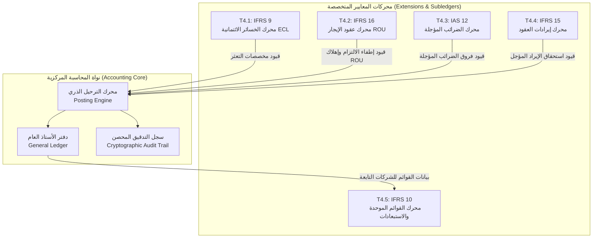
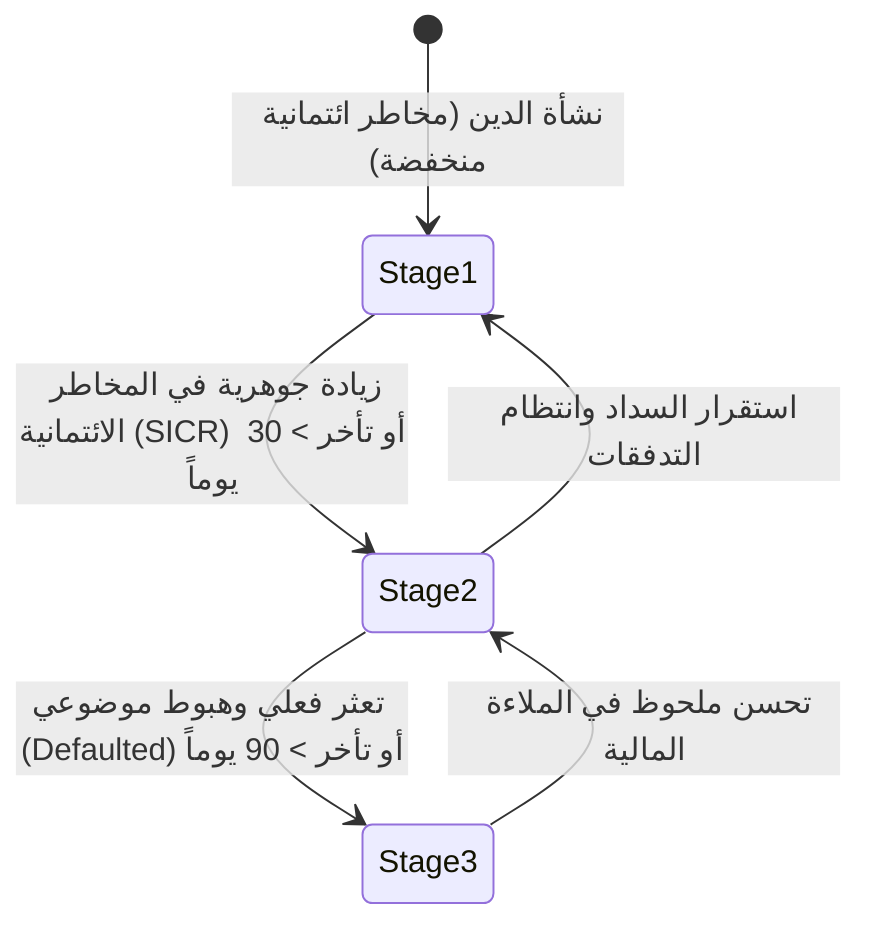
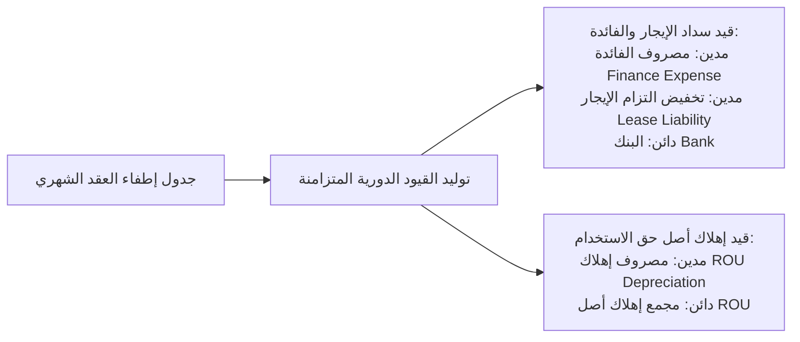
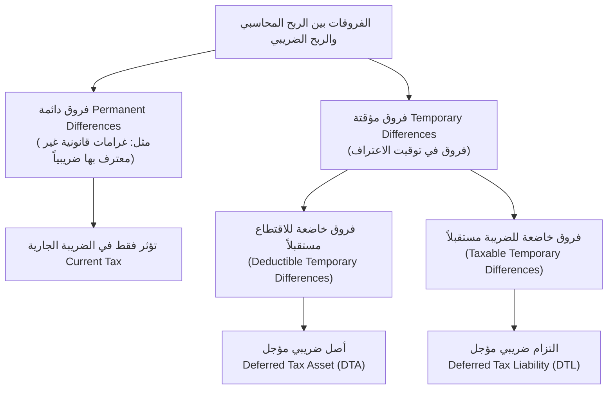
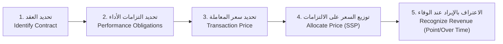
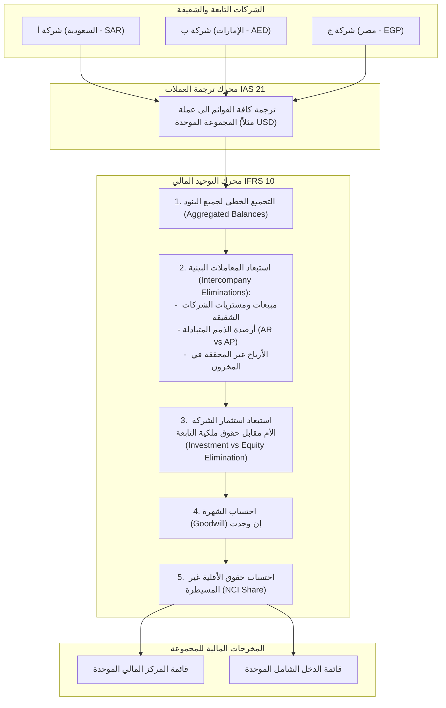
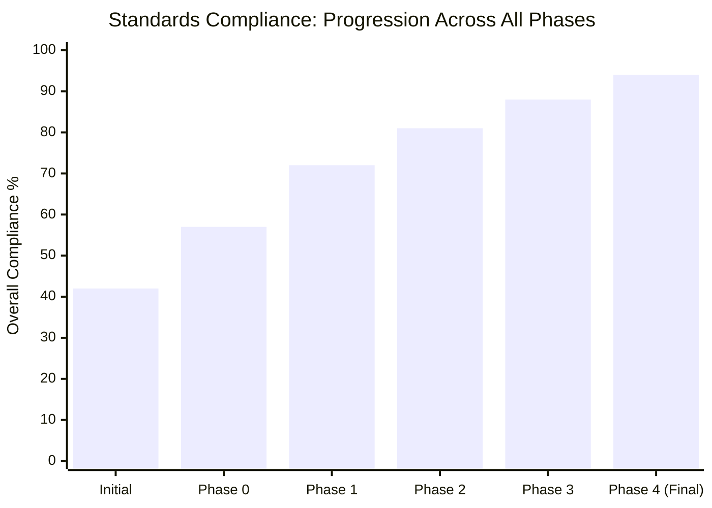

# المرحلة 4: محركات المعايير المحاسبية الدولية المتخصصة

## Phase 4: Specialized IFRS / IAS Engines & Financial Consolidation (P3)

---

> [!NOTE]
> **الأولوية:** توسع وظيفي ومعايير متقدمة (Functional Extension / P3)  
> **المدة المقدرة:** 10 أسابيع (Weeks 21–30)  
> **المتطلب السابق:** اكتمال المراحل 0 و 1 و 2 و 3 (النواة المحاسبية مكتملة ومؤمنة بالكامل)  
> **الهدف:** بناء محركات محاسبية متخصصة للمعايير الدولية الأكثر تعقيداً (IFRS 9, IFRS 16, IAS 12, IFRS 15, IFRS 10) كمحركات فرعية (Subledger & Extension Engines) تصب قيودها في النواة المركزية للوصول بالمحرك إلى الامتثال الكامل (Full IFRS Compliance).

---

## المعمارية العامة لمحركات المعايير الدولية

وفقاً للتصميم المعتمد في القسم 5 من تقرير التحقق الميداني:



---

## فهرس المحركات المتخصصة

| المهمة | المحرك المتخصص | المعيار الدولي | المكونات والمخرجات المحاسبية |
| :---: | :--- | :---: | :--- |
| **T4.1** | محرك الخسائر الائتمانية المتوقعة (ECL Engine) | **IFRS 9** | نموذج المراحل الثلاث (Three Stages)، مصفوفة المخصصات للذمم، توليد قيود المخصصات. |
| **T4.2** | محرك محاسبة عقود الإيجار (Leasing Engine) | **IFRS 16** | أصل حق الاستخدام (ROU)، جدول إطفاء التزام الإيجار، مصروف الفائدة والإهلاك. |
| **T4.3** | محرك الضرائب المؤجلة (Deferred Tax Engine) | **IAS 12** | الفروق المؤقتة والدائمة، الأصول والالتزامات الضريبية المؤجلة، جدول المطابقة. |
| **T4.4** | محرك الاعتراف بإيرادات العقود (Revenue Engine) | **IFRS 15** | التزامات الأداء التعاقدية، جداول الاعتراف الزمني (Over Time)، الأصول والالتزامات التعاقدية. |
| **T4.5** | محرك التوحيد المالي والقوائم المجمعة (Consolidation) | **IFRS 10** | استبعاد المعاملات البينية (Eliminations)، حصص حقوق الأقلية (NCI)، القوائم الموحدة. |

---

## T4.1 — محرك الخسائر الائتمانية المتوقعة (IFRS 9 ECL Engine)

### Expected Credit Loss (ECL) Model & Provisioning Matrix

**المعيار المحاسبي:** IFRS 9 (Financial Instruments)  
**الهدف:** التخلي عن نموذج الخسائر المحققة القديم (Incurred Loss) وتطبيق نموذج الخسائر الائتمانية المتوقعة عبر المراحل الثلاث.

### 1. النموذج الرياضي للمعيار

$$\text{ECL} = \text{EAD} \times \text{PD} \times \text{LGD}$$

حيث:
- **EAD (Exposure at Default):** الرصيد الإجمالي المعرض للتعثر في تاريخ القياس.
- **PD (Probability of Default):** احتمالية تعثر العميل خلال 12 شهراً أو طوال عمر الأداة.
- **LGD (Loss Given Default):** نسبة الخسارة المحققة عند وقوع التعثر (عادة $1 - \text{Recovery Rate}$).

### 2. مراحل التعثر الثلاث (Three-Stage Staging Criteria)



| المرحلة | تصنيف المخاطر | أفق احتساب الخسارة | الاعتراف بالفائدة |
| :--- | :--- | :--- | :--- |
| **Stage 1 (Normal)** | لا زيادة جوهرية في المخاطر | **12-Month ECL** | على إجمالي القيمة الدفترية |
| **Stage 2 (Underperforming)** | زيادة جوهرية في المخاطر (SICR) | **Lifetime ECL** | على إجمالي القيمة الدفترية |
| **Stage 3 (Credit-Impaired)** | وجود تعثر موضوعي أو إفلاس | **Lifetime ECL** | على صافي القيمة الدفترية (بعد المخصص) |

### 3. التطبيق العملي للذمم التجارية (Simplified Provision Matrix)

بالنسبة للذمم المدينة العادية (Trade Receivables)، يوفر المحرك مصفوفة مخصصات استناداً إلى فئات أعمار الديون ومعدلات التعثر التاريخية والمستقبلية (Forward-Looking):

```go
type ProvisionMatrixBucket struct {
    AgingCategory string          // مثل: "Current", "1-30 Days", "31-60 Days", "61-90 Days", ">90 Days"
    DefaultRate   decimal.Decimal // مثل: 0.01, 0.03, 0.08, 0.20, 0.50
}

func (e *IFRS9Engine) CalculateTradeReceivablesECL(
    ctx context.Context, 
    companyID uuid.UUID,
    asOf time.Time,
) (ECLCalculationResult, error) {
    // 1. تصنيف الذمم المفتوحة في الدفتر المساعد حسب أعمار الديون
    // 2. ضرب رصيد كل فئة بنسبة التعثر المحددة في مصفوفة الشركة
    // 3. مقارنة المخصص الإجمالي المطلوب بالمخصص القائم في الأستاذ العام
    // 4. توليد قيد التسوية بالفرق (زيادة أو تخفيض مخصص الديون المشكوك فيها)
}
```

### 4. معايير القبول (Acceptance Criteria)

- [ ] تصنيف فواتير العملاء تلقائياً بين المراحل الثلاث استناداً لأيام التأخير والمؤشرات النوعية.
- [ ] احتساب مخصص الـ ECL عبر مصفوفة أعمار الديون للذمم التجارية.
- [ ] توليد قيد محاسبي شهري آلي:
  - **مدين:** مصروف خسائر ائتمانية متوقعة (P&L: Impairment Loss).
  - **دائن:** مخصص خسائر ائتمانية متوقعة (Balance Sheet: Contra-Asset).

---

## T4.2 — محرك عقود الإيجار (IFRS 16 Leases Engine)

### Right-of-Use (ROU) Asset & Lease Liability Amortization Engine

**المعيار المحاسبي:** IFRS 16 (Leases)  
**الهدف:** إلغاء تصنيف عقود الإيجار التشغيلية خارج الميزانية، وإثبات جميع العقود كأصل حق استخدام (ROU) والتزام مالي.

### 1. النموذج الرياضي لدورة عقد الإيجار

1. **الالتزام الأولي (Initial Lease Liability):**
   $$\text{Lease Liability}_0 = \sum_{t=1}^{n} \frac{\text{Payment}_t}{(1 + r)^t}$$
   حيث $r$ هو معدل الفائدة الضمني أو معدل الاقتراض الإضافي للمستأجر (Incremental Borrowing Rate - IBR).

2. **أصل حق الاستخدام الأولي (ROU Asset):**
   $$\text{ROU Asset}_0 = \text{Lease Liability}_0 + \text{Initial Direct Costs} + \text{Prepayments} - \text{Lease Incentives}$$

3. **الإطفاء الشهري لالتزام الإيجار:**
   $$\text{Interest Expense}_t = \text{Remaining Liability}_{t-1} \times \frac{r}{12}$$
   $$\text{Principal Reduction}_t = \text{Payment}_t - \text{Interest Expense}_t$$

4. **إهلاك أصل حق الاستخدام:**
   $$\text{Monthly Depreciation} = \frac{\text{ROU Asset}_0}{\min(\text{Lease Term}, \text{Useful Life})}$$

### 2. جدول إطفاء العقد وقيد كل فترة



### 3. معايير القبول (Acceptance Criteria)

- [ ] حساب القيمة الحالية لدفعات الإيجار بمعدل الخصم IBR تلقائياً.
- [ ] إنشاء سجل أصل ROU وسجل التزام الإيجار عند توقيع العقد.
- [ ] توليد جدول الإطفاء الكامل (Amortization Schedule) لكامل فترة العقد.
- [ ] التوليد الآلي لقيود الفائدة والإهلاك والسداد شهرياً.
- [ ] معالجة تعديل العقود (Lease Modifications) وإنهاء العقود المبكر.

---

## T4.3 — محرك الضرائب المؤجلة (IAS 12 Income Taxes Engine)

### Temporary Differences & Deferred Tax Assets / Liabilities (DTA / DTL)

**المعيار المحاسبي:** IAS 12 (Income Taxes)  
**الهدف:** تتبع الفروق المؤقتة بين الأساس المحاسبي الدفتري والأساس الضريبي، واحتساب الضرائب المؤجلة.

### 1. تصنيف الفروق الضريبية



### 2. أهم حالات الفروق المؤقتة المدعومة بالمحرك

1. **إهلاك الأصول الثابتة:** اختلاف نسبة الإهلاك المحاسبي (مثلاً 10 سنوات قسط ثابت) عن نسب الإهلاك الضريبي المعتمدة لدى هيئة الضرائب (مثلاً 20% مسرع).
2. **مخصصات الديون المشكوك فيها (ECL):** لا يعترف بها النظام الضريبي إلا عند الشطب الفعلي، فتنشأ كـ DTA.
3. **مخصص مكافأة نهاية الخدمة (IAS 19):** غير خاضع للخصم الضريبي إلا عند الصرف النقدي الفعلي للعامل.

### 3. جدول مطابقة الضريبة المحاسبية مع الفعلية (Tax Reconciliation Table)

```go
type TaxReconciliationReport struct {
    AccountingProfitBeforeTax decimal.Decimal
    StatutoryTaxRate          decimal.Decimal // مثل: 20%
    ExpectedTaxExpense        decimal.Decimal // الربح المحاسبي × النسبة النظامية
    PermanentDifferencesTax   decimal.Decimal // أثر المصاريف غير المقبولة ضريبياً
    TemporaryDifferencesChange decimal.Decimal // التغير في DTA / DTL
    EffectiveTaxExpense       decimal.Decimal // مصروف الضريبة الفعلي بقائمة الدخل
    EffectiveTaxRate          decimal.Decimal // النسبة الفعلية المحققة
}
```

### 4. معايير القبول (Acceptance Criteria)

- [ ] تتبع الأساس الضريبي والأساس الدفتري لكل أصل والتزام في الميزانية.
- [ ] احتساب رصيد DTA و DTL بدقة في نهاية كل ربع سنة أو سنة مالية.
- [ ] توليد قيد مصروف وضريبة الدخل المؤجلة تلقائياً.
- [ ] إصدار تقرير الإفصاح الإلزامي لمطابقة معدل الضريبة الفعلي (Tax Rate Reconciliation).

---

## T4.4 — محرك الاعتراف بإيرادات العقود (IFRS 15 Revenue Engine)

### Revenue from Contracts with Customers — Five-Step Model Engine

**المعيار المحاسبي:** IFRS 15 (Revenue from Contracts with Customers)  
**الهدف:** إدارة العقود المعقدة متعددة العناصر وتوزيع سعر المعاملة وجدولة الاعتراف بالإيراد عبر الزمن.

### 1. خطوات المعيار الخمس (The 5-Step Model)



### 2. توزيع سعر المعاملة المستقل (Standalone Selling Price - SSP Allocation)

إذا بيع برنامج مع اشتراك سنوي ودعم فني بقيمة إجمالية مخفضة قدرها $1,000:
- سعر بيع البرنامج منفرداً: $800 (الوزن: 800/1200 = 66.7%)
- سعر الاشتراك والدعم منفرداً: $400 (الوزن: 400/1200 = 33.3%)
- **التوزيع الفعلي:** البرنامج = $666.67 (يعترف به فوراً Point in Time)، الدعم = $333.33 (يعترف به على 12 شهراً Over Time).

### 3. إدارة الأصول والالتزامات التعاقدية (Contract Assets vs Liabilities)

- **أصل تعاقدي (Contract Asset / Unbilled AR):** تم الوفاء بالتزام الأداء قبل استحقاق الفاتورة أو الدفعة.
- **التزام تعاقدي (Contract Liability / Deferred Revenue):** استلام الدفعة النقدية من العميل قبل تقديم الخدمة.

```go
type RevenueScheduleEntry struct {
    ContractID              uuid.UUID
    PerformanceObligationID uuid.UUID
    RecognitionDate         time.Time
    AmountToRecognize       financialtypes.Money
    Status                  ScheduleStatus // Pending, Recognized, Deferred
}
```

### 4. معايير القبول (Acceptance Criteria)

- [ ] تفكيك العقد التجاري إلى عدة التزامات أداء مستقلة (Performance Obligations).
- [ ] توزيع الخصومات الإجمالية على عناصر العقد بنسبة أسعار البيع المستقلة (Relative SSP).
- [ ] دعم جداول استحقاق الإيراد المؤجل اليومية والشهرية تلقائياً.
- [ ] ترحيل قيود تحويل الإيراد المؤجل (Deferred Revenue) إلى إيراد محقق (Earned Revenue) شهرياً.

---

## T4.5 — محرك القوائم المالية الموحدة والاستبعادات (IFRS 10 Consolidation)

### Group Consolidation, Intercompany Eliminations & Non-Controlling Interest (NCI)

**المعيار المحاسبي:** IFRS 10 (Consolidated Financial Statements)  
**الهدف:** تجميع القوائم المالية للمجموعة والشركات التابعة واستبعاد الأرصدة والمعاملات المشتركة.

### 1. آلية عمل محرك التوحيد المالي



### 2. نموذج قواعد الاستبعاد التلقائي (Elimination Rules Engine)

```go
type EliminationRule struct {
    RuleType         EliminationType // IntercompanyARAP, IntercompanySales, UnrealizedProfit
    DebitAccountID   uuid.UUID
    CreditAccountID  uuid.UUID
    Description      string
}

func (c *ConsolidationEngine) ExecuteEliminations(
    ctx context.Context, 
    groupCompanyID uuid.UUID, 
    periodEnd time.Time,
) ([]posting.JournalEntryLine, error) {
    // 1. فحص المعاملات التي تمت بين شركتين تتبعان نفس المجموعة
    // 2. مطابقة رصيد حساب الذمم المدينة في الشركة أ مع حساب الذمم الدائنة في الشركة ب
    // 3. توليد قيد استبعاد محاسبي متوازن داخل دفتر التوحيد المالي الافتراضي (Consolidation Journal)
}
```

### 3. معايير القبول (Acceptance Criteria)

- [ ] استبعاد تام لأرصدة الذمم والمبيعات المشتركة بين الشركات التابعة.
- [ ] استبعاد رصيد استثمار الشركة الأم في التابعة وفصل بند الشهرة (Goodwill).
- [ ] حساب وتوزيع أرباح وحقوق الحصص غير المسيطرة (NCI) في قائمة الدخل والمركز المالي.
- [ ] إصدار القوائم المالية الموحدة للمجموعة بدقة واكتمال تامين.

---

## خلاصة مسار الاعتماد والامتثال النهائي بعد المرحلة 4

> [!TIP]
> **النتيجة النهائية للمشروع:**  
> باجتياز المرحلة 4، يكتمل تحول المحرك إلى **منظومة محاسبية متطورة ومتكاملة** تلبي أرفع المعايير العالمية وتنافس المحركات المالية المؤسسية العالمية:



### بطاقة النتيجة النهائية للشهادات الدولية

| المعيار / الإطار الدولي | البداية | المرحلة 0 | المرحلة 1 | المرحلة 2 | المرحلة 3 | المرحلة 4 النهائية |
| :--- | :---: | :---: | :---: | :---: | :---: | :---: |
| **IFRS / IAS (المعايير الدولية)** | 40% | 55% | 72% | 82% | 86% | **94%** 🏆 |
| **SOX 404 (الرقابة الداخلية)** | 30% | 50% | 50% | 65% | 85% | **90%** 🏆 |
| **SOC 1 / SOC 2 (موثوقية المعالجة)** | 35% | 55% | 60% | 75% | 85% | **90%** 🏆 |
| **ISO/IEC 27001 (أمن المعلومات)** | 50% | 60% | 65% | 75% | 90% | **95%** 🏆 |
| **ISO/IEC 25010 (جودة البرمجيات)** | 55% | 70% | 80% | 85% | 90% | **95%** 🏆 |
| **ISO 4217 & ISO 20022 (المصرفية)** | 45% | 45% | 80% | 85% | 88% | **95%** 🏆 |
| **PCAOB / Big 4 Audit Readiness** | 35% | 55% | 65% | 80% | 88% | **92%** 🏆 |

