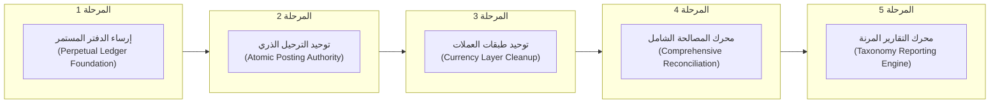
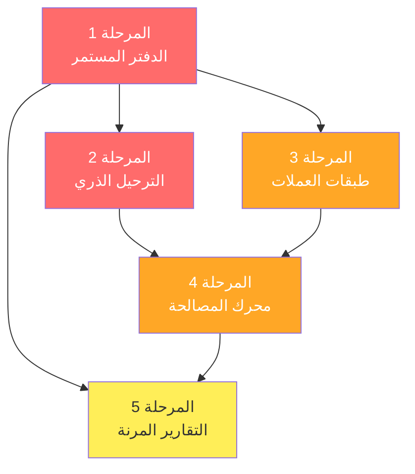

# الخطة التنفيذية الشاملة لمحرك المحاسبة المالية

## Comprehensive Execution Plan — `accounting_engine`

**تاريخ الإصدار:** نوفمبر 2026
**المرجع الأساسي:** [التحليل المعماري للقرارات الخمسة](../key_architectural_decisions_analysis.md)
**الإصدار المستهدف:** `accounting_engine v2.0 — Production-Ready`

---

## سجل المعايير والمصادر الرسمية المعتمدة في هذه الخطة

| الرمز | المعيار / المصدر الرسمي | الجهة المصدرة | الصلة بالخطة |
| :--- | :--- | :--- | :--- |
| **IAS 1** | عرض القوائم المالية (Presentation of Financial Statements) | IASB | القرار 5: هيكل التقارير المرنة |
| **IAS 7** | قائمة التدفقات النقدية (Statement of Cash Flows) | IASB | المرحلة 5: ترجمة التدفقات النقدية |
| **IAS 8** | السياسات المحاسبية والتقديرات والأخطاء | IASB | المرحلة 1: قيود التصحيح والافتتاح |
| **IAS 16** | الممتلكات والمعدات (Property, Plant & Equipment) | IASB | المرحلة 2: ذرية ترحيل الأصول |
| **IAS 21** | آثار التغيرات في أسعار صرف العملات الأجنبية | IASB | المرحلة 3: توحيد العملات |
| **IAS 36** | انخفاض قيمة الأصول (Impairment of Assets) | IASB | المرحلة 2: التدني والشطب |
| **IFRS 9** | الأدوات المالية (Financial Instruments — ECL) | IASB | المرحلة 4: مصالحة الذمم |
| **IFRS 10** | القوائم المالية الموحدة | IASB | المرحلة 5: التقارير الموحدة |
| **IFRS 15** | الإيراد من العقود مع العملاء | IASB | المرحلة 5: إثبات الإيرادات |
| **ASC 830** | ترجمة العملات الأجنبية (US GAAP) | FASB | المرحلة 3: التوافق مع GAAP |
| **ISO 4217** | رموز العملات الدولية | ISO | المرحلة 3: سجل العملات |
| **COSO** | إطار الرقابة الداخلية المتكامل | COSO / Treadway | المرحلة 2 و 4: حوكمة الترحيل والمصالحة |
| **SOC-1 / ISAE 3402** | معايير تقارير الرقابة على الخدمات | AICPA / IAASB | المرحلة 4: شهادة المصالحة |
| **XBRL / iXBRL** | لغة التقارير المالية القابلة للتوسيع | XBRL International | المرحلة 5: بنية التصنيف المالي |
| **TigerBeetle** | أنماط محركات الأستاذ العام عالية الاعتمادية | TigerBeetle Inc. | المرحلة 1: جدول الأرصدة المستمرة |
| **Martin Fowler** | أنماط التحليل المحاسبي (Analysis Patterns — Accounting) | Martin Fowler | المرحلة 1 و 2: الدفتر المستمر والذرية |

---

## الرؤية العامة للخطة

---

## فهرس المراحل التنفيذية

| المرحلة | العنوان | القرار المعماري | الأولوية | الملف |
| :---: | :--- | :---: | :---: | :--- |
| **1** | إرساء قواعد الدفتر المستمر وجدول الأرصدة اللحظية | القرار 1 | 🔴 حرجة | [phase_01_perpetual_ledger.md](./phase_01_perpetual_ledger.md) |
| **2** | توحيد سلطة الترحيل الذري وواجهة الملحقات | القرار 3 | 🔴 حرجة | [phase_02_atomic_posting_authority.md](./phase_02_atomic_posting_authority.md) |
| **3** | توحيد طبقات العملات الثلاث ونموذج سطر القيد | القرار 2 | 🟠 عالية | [phase_03_currency_layers.md](./phase_03_currency_layers.md) |
| **4** | بناء محرك المصالحة الشامل والجدولة الآلية | القرار 4 | 🟠 عالية | [phase_04_reconciliation_engine.md](./phase_04_reconciliation_engine.md) |
| **5** | بناء محرك شجرة التصنيف المالي للتقارير المرنة | القرار 5 | 🟡 استراتيجية | [phase_05_taxonomy_reporting.md](./phase_05_taxonomy_reporting.md) |

---

## مبادئ التنفيذ الإلزامية عبر كافة المراحل

> [!IMPORTANT]
> **المبادئ التالية غير قابلة للتنازل ويجب الالتزام بها في كل مرحلة:**

1. **الحفاظ على التوافق العكسي (Backward Compatibility):**
   كل تعديل يجب أن يمر عبر مرحلة هجرة بيانات (Migration) تحافظ على سلامة القيود المرحلة سابقاً. لا يُسمح بحذف أعمدة أو تغيير أنواع بيانات دون Migration ثنائي الاتجاه (`up.sql` و `down.sql`).

2. **الاختبار قبل الترحيل (Test-Before-Migrate):**
   كل مرحلة تتطلب كتابة الاختبارات (Unit + Integration) **قبل** تعديل الكود الإنتاجي. يُستخدم نمط TDD: اكتب اختباراً يفشل → عدّل الكود ليمر → أعد التشغيل.

3. **الذرية المحاسبية (Accounting Atomicity):**
   أي عملية تمس الأستاذ العام (account_moves / account_move_lines / account_balances) يجب أن تكون ضمن معاملة قاعدة بيانات واحدة (`BEGIN ... COMMIT`) بمستوى عزل `SERIALIZABLE` أو `REPEATABLE READ`.

4. **عدم الإزالة الفورية (Deprecation-First):**
   الحقول والدوال القديمة تُعلّم كـ `// Deprecated:` مع ترك فترة زمنية قبل إزالتها نهائياً في الإصدار اللاحق.

5. **التوثيق الإلزامي (ADR — Architecture Decision Record):**
   كل تغيير معماري يُوثّق في ملف ADR مستقل يتضمن: السياق، القرار، البدائل المرفوضة، النتائج المتوقعة.

---

## مخطط التبعيات بين المراحل

> [!NOTE]
>
> - **المرحلة 1** هي الأساس المطلق ولا يمكن بدء أي مرحلة أخرى بدونها.
> - **المرحلتان 2 و 3** يمكن تنفيذهما بالتوازي بعد إكمال المرحلة 1.
> - **المرحلة 4** تعتمد على اكتمال المرحلتين 2 و 3.
> - **المرحلة 5** تعتمد على اكتمال المراحل 1 و 4.

---

## الملفات المتأثرة عبر كافة المراحل (Impact Map)

| الملف المصدري | المرحلة 1 | المرحلة 2 | المرحلة 3 | المرحلة 4 | المرحلة 5 |
| :--- | :---: | :---: | :---: | :---: | :---: |
| `internal/posting/entry.go` | ✏️ | — | ✏️ | — | — |
| `internal/posting/engine.go` | ✏️ | ✏️ | ✏️ | — | — |
| `internal/posting/repository.go` | ✏️ | ✏️ | — | — | — |
| `internal/reporting/trial_balance.go` | ✏️ | — | — | — | ✏️ |
| `internal/reporting/closing_engine.go` | ✏️ | — | — | — | — |
| `internal/reporting/balance_sheet.go` | — | — | — | — | ✏️ |
| `internal/reporting/income_statement.go` | — | — | — | — | ✏️ |
| `internal/reporting/currency_translation.go` | — | — | ✏️ | — | ✏️ |
| `internal/subledgers/fixed_assets.go` | — | ✏️ | — | ✏️ | — |
| `internal/subledgers/writeoff.go` | — | ✏️ | — | ✏️ | — |
| `internal/subledgers/control_accounts.go` | — | ✏️ | — | — | — |
| `internal/subledgers/gl_reconciliation.go` | — | — | — | ✏️ | — |
| `internal/subledgers/service.go` | — | ✏️ | — | — | — |
| `internal/valuation/revaluation.go` | — | — | ✏️ | — | — |
| `storage/postgres/schema.sql` | ✏️ | ✏️ | ✏️ | ✏️ | ✏️ |
| `storage/postgres/driver.go` | ✏️ | ✏️ | ✏️ | ✏️ | — |
| `storage/memory/driver.go` | ✏️ | ✏️ | ✏️ | ✏️ | — |
| `engine.go` | — | ✏️ | — | ✏️ | ✏️ |

---

## معايير القبول النهائية لكل مرحلة (Definition of Done)

كل مرحلة تُعتبر مكتملة فقط عند تحقيق:

- [ ] جميع اختبارات الوحدة (Unit Tests) تمر بنجاح.
- [ ] جميع اختبارات التكامل (Integration Tests) تمر مع PostgreSQL.
- [ ] لا يوجد تراجع في الاختبارات الموجودة سابقاً (Zero Regression).
- [ ] تم إنشاء Migration ثنائي الاتجاه (`up.sql` / `down.sql`).
- [ ] تم تحديث الوثائق المرجعية (`docs/`).
- [ ] تم إنشاء ADR يوثق القرارات المعمارية المتخذة.
- [ ] `go vet ./...` و `golangci-lint run` بدون تحذيرات.
- [ ] اختبار أداء (Benchmark) يثبت عدم تدهور الأداء.
