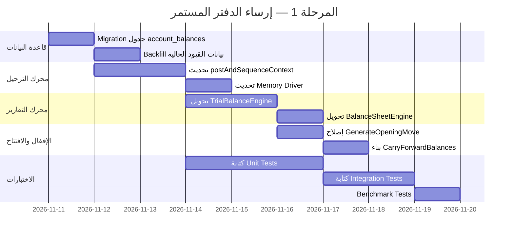

# المرحلة 1: إرساء قواعد الدفتر المستمر وجدول الأرصدة اللحظية

## Phase 1: Perpetual Ledger Foundation & Materialized Account Balances

**القرار المعماري:** القرار 1 — هل المحرك Perpetual Ledger أم Periodic Ledger؟
**الأولوية:** 🔴 حرجة (Critical — Blocking)
**التبعيات:** لا شيء (المرحلة الأساسية)
**المراجع المعيارية:**

| المعيار | الصلة |
| :--- | :--- |
| **IAS 8** — السياسات المحاسبية والتقديرات والأخطاء | حصر القيد الافتتاحي في تصحيح الأخطاء وبداية التشغيل |
| **IAS 1.38** — مبدأ استمرارية العرض والمقارنة | ضمان عدم مضاعفة الأرصدة عند التدوير السنوي |
| **TigerBeetle Design** — Materialized Balance Approach | الأداء الفوري $O(1)$ لقراءة الأرصدة |
| **Martin Fowler — Analysis Patterns (Accounting)** | نمط الرصيد المستمر مقابل التجميع الدوري |
| **COSO IC-IF 2013 — Principle 10** | اختيار وتطوير أنشطة الرقابة التي تسهم في تقليل المخاطر |

---

## 1. الأهداف (Objectives)

1. إنشاء جدول `account_balances` في PostgreSQL يحتفظ بأرصدة لحظية مستمرة لكل حساب في كل فترة مالية.
2. تحديث جدول الأرصدة **ذرياً** مع كل عملية ترحيل (في نفس الـ `Transaction`).
3. تحويل محركات التقارير (`TrialBalanceEngine`, `BalanceSheetEngine`, `IncomeStatementEngine`) لقراءة الأرصدة من `account_balances` بدلاً من تجميع كل القيود التاريخية.
4. إصلاح معضلة القيد الافتتاحي (`GenerateOpeningMove`) لمنع مضاعفة أرصدة الميزانية العمومية.
5. ضبط آلية الإقفال السنوي (`GenerateClosingMove`) لتحديث أرصدة بداية الفترة اللاحقة في `account_balances` دون توليد قيد افتتاحي مكرر.

---

## 2. المعالجة التقنية المفصلة (Technical Implementation)

### 2.1 هجرة قاعدة البيانات — Migration `202611100009`

**ملف:** `storage/postgres/migrations/202611100009_perpetual_account_balances.sql`

```sql
-- المرحلة 1: جدول الأرصدة المستمرة اللحظية
-- المرجع: TigerBeetle Materialized Balance + IAS 8 Cutover Semantics

CREATE TABLE IF NOT EXISTS account_balances (
    company_id       UUID NOT NULL REFERENCES companies(id) ON DELETE RESTRICT,
    account_id       UUID NOT NULL,
    fiscal_period_id UUID NOT NULL,
    currency_id      VARCHAR(3) NOT NULL REFERENCES currencies(code) ON DELETE RESTRICT,

    -- أرصدة بداية الفترة (Beginning Balances)
    beginning_debit  NUMERIC(28,4) NOT NULL DEFAULT 0,
    beginning_credit NUMERIC(28,4) NOT NULL DEFAULT 0,

    -- حركات الفترة (Period Activity)
    period_debit     NUMERIC(28,4) NOT NULL DEFAULT 0,
    period_credit    NUMERIC(28,4) NOT NULL DEFAULT 0,

    -- أرصدة نهاية الفترة (Ending Balances) — Generated Always
    ending_debit     NUMERIC(28,4) NOT NULL
        GENERATED ALWAYS AS (beginning_debit + period_debit) STORED,
    ending_credit    NUMERIC(28,4) NOT NULL
        GENERATED ALWAYS AS (beginning_credit + period_credit) STORED,

    -- التزامن والتدقيق
    version          BIGINT NOT NULL DEFAULT 1,
    updated_at       TIMESTAMPTZ NOT NULL DEFAULT NOW(),

    PRIMARY KEY (company_id, account_id, fiscal_period_id, currency_id),
    FOREIGN KEY (company_id, account_id)
        REFERENCES accounts(company_id, id) ON DELETE RESTRICT,
    FOREIGN KEY (company_id, fiscal_period_id)
        REFERENCES fiscal_periods(company_id, id) ON DELETE RESTRICT,

    -- قيود النزاهة الحسابية
    CONSTRAINT chk_beginning_debit_positive  CHECK (beginning_debit  >= 0),
    CONSTRAINT chk_beginning_credit_positive CHECK (beginning_credit >= 0),
    CONSTRAINT chk_period_debit_positive     CHECK (period_debit     >= 0),
    CONSTRAINT chk_period_credit_positive    CHECK (period_credit    >= 0)
);

-- فهرس للبحث السريع عن أرصدة حساب معين
CREATE INDEX IF NOT EXISTS idx_account_balances_account
    ON account_balances(company_id, account_id, fiscal_period_id);

-- فهرس لتجميع أرصدة فترة كاملة (لميزان المراجعة)
CREATE INDEX IF NOT EXISTS idx_account_balances_period
    ON account_balances(company_id, fiscal_period_id);

-- دالة التحديث الذري عند ترحيل قيد
CREATE OR REPLACE FUNCTION update_account_balance_on_posting()
RETURNS trigger AS $$
BEGIN
    -- يُستدعى بعد تحديث حالة القيد من draft إلى posted
    IF NEW.status = 'posted' AND OLD.status = 'draft' THEN
        INSERT INTO account_balances (
            company_id, account_id, fiscal_period_id, currency_id,
            period_debit, period_credit
        )
        SELECT
            lines.company_id,
            lines.account_id,
            NEW.period_id,
            lines.currency_id,
            SUM(lines.debit),
            SUM(lines.credit)
        FROM account_move_lines lines
        WHERE lines.move_id = NEW.id
        GROUP BY lines.company_id, lines.account_id, lines.currency_id
        ON CONFLICT (company_id, account_id, fiscal_period_id, currency_id)
        DO UPDATE SET
            period_debit  = account_balances.period_debit  + EXCLUDED.period_debit,
            period_credit = account_balances.period_credit + EXCLUDED.period_credit,
            version       = account_balances.version + 1,
            updated_at    = NOW();
    END IF;
    RETURN NEW;
END;
$$ LANGUAGE plpgsql;

DROP TRIGGER IF EXISTS trg_update_balances_on_posting ON account_moves;
CREATE TRIGGER trg_update_balances_on_posting
    AFTER UPDATE ON account_moves
    FOR EACH ROW
    WHEN (OLD.status = 'draft' AND NEW.status = 'posted')
    EXECUTE FUNCTION update_account_balance_on_posting();
```

**ملف التراجع:** `storage/postgres/migrations/202611100009_perpetual_account_balances.down.sql`

```sql
DROP TRIGGER IF EXISTS trg_update_balances_on_posting ON account_moves;
DROP FUNCTION IF EXISTS update_account_balance_on_posting();
DROP TABLE IF EXISTS account_balances;
```

---

### 2.2 تعديل محرك الترحيل (`internal/posting/engine.go`)

#### المهام البرمجية

| # | المهمة | الملف | التأثير |
| :---: | :--- | :--- | :--- |
| 1.1 | إضافة تحديث `account_balances` ضمن `postAndSequenceContext()` | `storage/postgres/driver.go` | الترحيل الذري |
| 1.2 | إضافة نفس المنطق في `storage/memory/driver.go` | `storage/memory/driver.go` | اختبارات الوحدة |
| 1.3 | تعريف واجهة `BalanceRepository` في `internal/posting/repository.go` | `internal/posting/repository.go` | عقد تجريدي |

#### العقد البرمجي الجديد

```go
// internal/posting/repository.go — إضافة

// BalanceUpdateRepository يدعم التحديث الذري لجدول الأرصدة المستمرة
// المرجع: TigerBeetle Materialized Balance Pattern
type BalanceUpdateRepository interface {
    UpdateAccountBalancesOnPosting(ctx context.Context, entry JournalEntry) error
}
```

---

### 2.3 تعديل محرك التقارير (`internal/reporting/`)

#### تحويل `TrialBalanceEngine` إلى القراءة من `account_balances`

**الملف:** `internal/reporting/trial_balance.go`

**التعديل المطلوب:**

1. استبدال استدعاء `listPostedEntries(e.repository, time.Time{}, endDate)` (السطر 99) باستعلام مباشر على `account_balances`.
2. إنشاء دالة مساعدة:

```go
// readPeriodBalances يقرأ أرصدة الحسابات من جدول الأرصدة المستمرة
// أداء O(1) مقابل O(N) في النمط القديم
// المرجع: IAS 1.38 — مبدأ استمرارية العرض
func readPeriodBalances(
    repository Repository,
    companyID uuid.UUID,
    periodID uuid.UUID,
    currency string,
) (map[uuid.UUID]AccountPeriodBalance, error) {
    // قراءة مباشرة من account_balances
    // بدلاً من تجميع كل القيود التاريخية
}

type AccountPeriodBalance struct {
    AccountID      uuid.UUID
    BeginningDebit decimal.Decimal
    BeginningCredit decimal.Decimal
    PeriodDebit    decimal.Decimal
    PeriodCredit   decimal.Decimal
    EndingDebit    decimal.Decimal
    EndingCredit   decimal.Decimal
}
```

1. الاحتفاظ بالدالة القديمة مع التعليم كـ `// Deprecated:` حتى المرحلة التالية.

---

### 2.4 إصلاح معضلة القيد الافتتاحي

**الملف:** `internal/reporting/closing_engine.go` — دالة `GenerateOpeningMove` (السطر 73)

#### القواعد الإلزامية (وفق IAS 8 و IAS 1)

| الحالة | السلوك المطلوب |
| :--- | :--- |
| **أول سنة مالية للمنشأة على النظام** | يُسمح بـ `EntryClassOpening` لتسجيل أرصدة القطع الافتتاحية (Cutover Balances) من النظام القديم |
| **سنة مالية لاحقة (سنة 2 فأكثر)** | يُمنع `EntryClassOpening` نهائياً؛ الأرصدة تدور تلقائياً عبر `account_balances.beginning_balance` |
| **إقفال سنوي** | يُولّد `EntryClassClosing` لتصفير حسابات P&L فقط؛ ثم يُحدث `account_balances` لنقل أرصدة الميزانية إلى الفترة الأولى من السنة الجديدة |

```go
// GenerateOpeningMove — تعديل مقترح
func (e *ClosingEngine) GenerateOpeningMove(year masterdata.FiscalYear, ...) (posting.JournalEntry, error) {
    // فحص: هل هذه أول سنة مالية للمنشأة على النظام؟
    isFirstYear, err := e.repository.IsFirstFiscalYear(ctx, year.CompanyID, year.ID)
    if err != nil {
        return posting.JournalEntry{}, err
    }
    if !isFirstYear {
        // في الدفتر المستمر، الأرصدة تدور تلقائياً
        // لا حاجة لقيد افتتاحي يومية يضاعف الأرصدة
        return posting.JournalEntry{}, ErrOpeningMoveNotRequired
    }
    // ... (المنطق الحالي لأول سنة فقط — Cutover)
}
```

---

### 2.5 آلية التدوير السنوي الآلي (Period Rollover)

عند إقفال السنة المالية، يجب تحديث `beginning_debit` و `beginning_credit` للفترة الأولى من السنة الجديدة:

```go
// CarryForwardBalances ينقل أرصدة نهاية السنة إلى بداية السنة التالية
// للحسابات الدائمة (أصول، التزامات، حقوق ملكية) فقط
// المرجع: IAS 1.38, Martin Fowler — Perpetual Balance Carry-Forward
func (e *ClosingEngine) CarryForwardBalances(
    ctx context.Context,
    closedYear masterdata.FiscalYear,
    newYearFirstPeriodID uuid.UUID,
) error {
    // 1. قراءة أرصدة نهاية آخر فترة في السنة المغلقة
    // 2. لكل حساب دائم (Asset, Liability, Equity):
    //    INSERT INTO account_balances (beginning_debit, beginning_credit)
    //    VALUES (ending_debit, ending_credit) للفترة الأولى الجديدة
    // 3. حسابات P&L تبدأ من صفر (بعد قيد الإقفال)
}
```

---

## 3. هجرة البيانات الموجودة (Data Backfill)

> [!WARNING]
> **عند تشغيل هذه الخطوة لأول مرة على بيئة تحتوي على قيود مرحلة سابقاً:**

يجب تنفيذ عملية ملء أولي (Backfill) لجدول `account_balances` من القيود المرحلة الحالية:

```sql
-- Backfill: ملء جدول الأرصدة من القيود المرحلة الحالية
INSERT INTO account_balances (
    company_id, account_id, fiscal_period_id, currency_id,
    period_debit, period_credit
)
SELECT
    lines.company_id,
    lines.account_id,
    moves.period_id,
    lines.currency_id,
    SUM(lines.debit),
    SUM(lines.credit)
FROM account_move_lines lines
JOIN account_moves moves ON moves.id = lines.move_id
WHERE moves.status = 'posted'
  AND moves.period_id IS NOT NULL
GROUP BY lines.company_id, lines.account_id, moves.period_id, lines.currency_id
ON CONFLICT (company_id, account_id, fiscal_period_id, currency_id)
DO UPDATE SET
    period_debit  = EXCLUDED.period_debit,
    period_credit = EXCLUDED.period_credit,
    version       = account_balances.version + 1,
    updated_at    = NOW();
```

---

## 4. خطة الاختبارات (Test Plan)

| # | سيناريو الاختبار | النوع | المعيار المرجعي | معيار القبول |
| :---: | :--- | :--- | :--- | :--- |
| T1.1 | ترحيل قيد واحد يُحدث `account_balances` ذرياً | Unit | TigerBeetle | `ending = beginning + period` |
| T1.2 | ترحيل 1000 قيد متزامن ثم التحقق من تطابق الأرصدة | Integration | COSO | $\sum \text{Debit} = \sum \text{Credit}$ |
| T1.3 | فشل الترحيل في منتصف المعاملة لا يُحدث `account_balances` | Integration | ACID | الرصيد لا يتغير |
| T1.4 | ميزان المراجعة من `account_balances` يطابق التجميع اليدوي للقيود | Integration | IAS 1 | تطابق تام |
| T1.5 | `GenerateOpeningMove` في السنة الثانية يُرجع `ErrOpeningMoveNotRequired` | Unit | IAS 8 | خطأ متوقع |
| T1.6 | `CarryForwardBalances` ينقل أرصدة B/S فقط ويصفّر P&L | Unit | IAS 1.38 | أرصدة P&L = 0 |
| T1.7 | ترحيل عكس قيد يُنقص الأرصدة في `account_balances` | Unit | IAS 8 | أرصدة تنخفض |
| T1.8 | أداء ميزان المراجعة من `account_balances` أسرع 10x من التجميع | Benchmark | TigerBeetle | $< 10\text{ms}$ لـ 10K حساب |

---

## 5. تسلسل المهام والجدول الزمني



---

## 6. معايير الاكتمال (Definition of Done)

- [x] جدول `account_balances` مُنشأ ومفهرس في PostgreSQL.
- [x] كل عملية ترحيل تُحدّث `account_balances` ذرياً في نفس المعاملة.
- [x] `TrialBalanceEngine` يقرأ من `account_balances` بدلاً من تجميع القيود عندما يدعم النطاق ذلك.
- [x] `GenerateOpeningMove` مقيّد بأول سنة مالية فقط (Cutover).
- [x] `CarryForwardBalances` ينقل أرصدة الميزانية العمومية إلى أول فترة في السنة التالية.
- [ ] جميع معايير الاختبار T1.1 — T1.8 مستوفاة (T1.1 — T1.7 مُغطاة؛ T1.8 لم يحقق عتبة الأداء).
- [ ] Benchmark يثبت أداءً أقل من 10ms وتحسناً ≥ 10x. قياس 10K حساب في الذاكرة (3 تكرارات): المسار المادي 37.5ms مقابل 37.4ms للتجميع التاريخي؛ يلزم تحسين إضافي.
- [x] Migration ثنائي الاتجاه (`up.sql` / `down.sql`) مكتمل.
