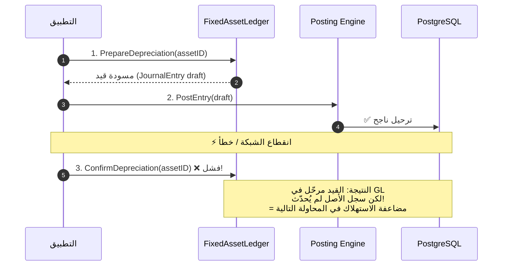
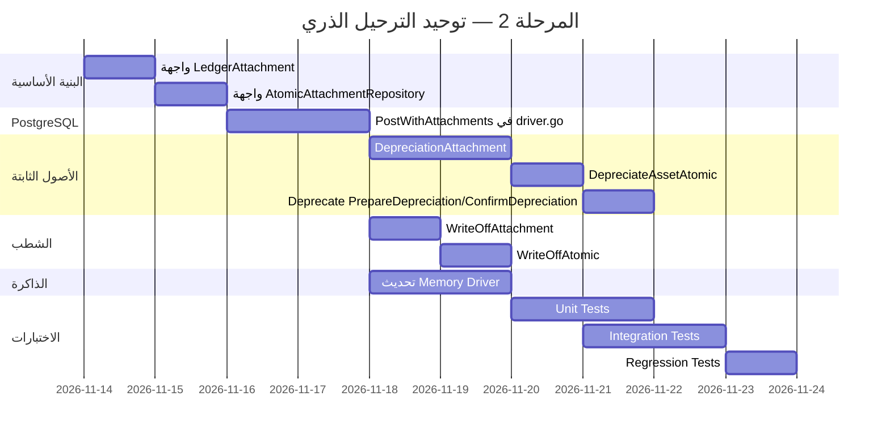

# المرحلة 2: توحيد سلطة الترحيل الذري وواجهة الملحقات
## Phase 2: Atomic Posting Authority & Ledger Attachment SPI

**القرار المعماري:** القرار 3 — من يملك سلطة الترحيل المحاسبي؟
**الأولوية:** 🔴 حرجة (Critical)
**التبعيات:** المرحلة 1 (جدول `account_balances` الذري)
**المراجع المعيارية:**

| المعيار | الصلة |
| :--- | :--- |
| **IAS 16.43–62** | الاستهلاك الدوري والاستبعاد والتخريد يجب أن يُثبت ذرياً مع القيد |
| **IAS 36.59–64** | إثبات التدني وعكسه يجب أن يُحدث الأصل والقيد في آن واحد |
| **IFRS 9.5.4** | شطب الذمم المدينة يجب أن يكون ذرياً مع حساب المراقبة |
| **COSO IC-IF Principle 10** | أنشطة الرقابة تمنع التفكك بين الأنظمة الفرعية |
| **Martin Fowler — Analysis Patterns** | نمط الكاتب الوحيد (Single Writer) لسلامة الأستاذ العام |
| **SOC-1 Type II** | ضمان عدم وجود مسارات ترحيل موازية غير خاضعة للرقابة |

---

## 1. الأهداف (Objectives)

1. تكريس مبدأ **الكاتب الوحيد (Single Writer Principle)**: لا يوجد أي مسار في النظام يكتب في `account_moves` أو `account_move_lines` سوى `posting.Engine`.
2. بناء واجهة برمجية عامة `LedgerAttachment` تسمح لأي دفتر مساعد بتقديم عملية تشغيلية يتم تنفيذها **ذرياً** مع ترحيل القيد.
3. إزالة ثغرة التفكك (Split-Brain) في:
   - الأصول الثابتة: `PrepareDepreciation` → ترحيل → `ConfirmDepreciation` (مسار من مرحلتين).
   - الشطب: `PrepareWriteOff` → ترحيل → `ConfirmWriteOff` (مسار من مرحلتين).
4. توحيد ترحيل العمليات البنكية في ذات المعاملة الذرية.

---

## 2. تحليل الثغرة الحالية (Current Split-Brain Risk)



---

## 3. المعالجة التقنية المفصلة (Technical Implementation)

### 3.1 تعريف واجهة الملحقات الذرية (`LedgerAttachment SPI`)

**ملف جديد:** `internal/posting/attachment.go`

```go
package posting

import (
    "context"
)

// LedgerAttachment هو عقد واجهة يسمح لأي دفتر مساعد بتسجيل
// عملية تشغيلية يُنفذها محرك الترحيل ذرياً مع القيد.
//
// المرجع: COSO IC-IF Principle 10 — أنشطة الرقابة الذرية
// المرجع: Martin Fowler — Single Writer Pattern
type LedgerAttachment interface {
    // AttachmentKind يُرجع نوع الملحق (e.g., "fixed_asset_depreciation",
    // "receivable_writeoff", "bank_fee")
    AttachmentKind() string

    // ValidateAttachment يتحقق من صحة البيانات التشغيلية
    // قبل فتح معاملة قاعدة البيانات
    ValidateAttachment(ctx context.Context, entry JournalEntry) error

    // ExecuteAtomicMutation ينفذ التحديث التشغيلي ضمن المعاملة الذرية
    // للترحيل. يجب أن يستخدم الـ tx المقدم وليس اتصالاً مستقلاً.
    // المرجع: IAS 16 — تحديث مجمع الاستهلاك ذرياً مع القيد
    ExecuteAtomicMutation(ctx context.Context, tx AtomicTransaction, entry JournalEntry) error
}

// AtomicTransaction يمثل معاملة قاعدة بيانات مفتوحة
// يستخدمها الملحق لتنفيذ التحديثات ضمن نفس المعاملة
type AtomicTransaction interface {
    Exec(ctx context.Context, sql string, args ...any) error
    QueryRow(ctx context.Context, sql string, args ...any) Row
}

// Row واجهة مبسطة لقراءة صف واحد
type Row interface {
    Scan(dest ...any) error
}
```

---

### 3.2 توسيع `posting.Engine` لدعم الملحقات

**الملف:** `internal/posting/engine.go`

```go
// PostEntryWithAttachment يرحل القيد مع ملحق تشغيلي واحد أو أكثر
// في معاملة ذرية واحدة.
// المرجع: COSO IC-IF — عدم السماح بتفكك حالة الدفاتر المساعدة عن GL
func (e *Engine) PostEntryWithAttachment(
    ctx context.Context,
    entry *JournalEntry,
    posterID string,
    attachments ...LedgerAttachment,
) error {
    // 1. التحقق الأساسي (التوازن، الفترة، الصلاحيات)
    if err := e.prepareForPosting(ctx, entry, posterID); err != nil {
        return err
    }

    // 2. التحقق من صحة جميع الملحقات
    for _, att := range attachments {
        if err := att.ValidateAttachment(ctx, *entry); err != nil {
            return fmt.Errorf("attachment %s validation: %w", att.AttachmentKind(), err)
        }
    }

    // 3. فتح معاملة ذرية وتنفيذ كل شيء
    e.mu.Lock()
    defer e.mu.Unlock()

    repo, ok := e.repo.(AtomicAttachmentRepository)
    if !ok {
        return ErrAtomicPostingOpenLineRequired
    }

    return repo.PostWithAttachments(ctx, entry, attachments)
}
```

---

### 3.3 توسيع واجهة المستودع

**الملف:** `internal/posting/repository.go` — إضافة:

```go
// AtomicAttachmentRepository يدعم ترحيل قيد مع ملحقات تشغيلية
// في معاملة ذرية واحدة
type AtomicAttachmentRepository interface {
    PostWithAttachments(
        ctx context.Context,
        entry *JournalEntry,
        attachments []LedgerAttachment,
    ) error
}
```

---

### 3.4 تطبيق المستودع في PostgreSQL

**الملف:** `storage/postgres/driver.go` — دالة جديدة:

```go
func (d *Driver) PostWithAttachments(
    ctx context.Context,
    entry *posting.JournalEntry,
    attachments []posting.LedgerAttachment,
) error {
    tx, err := d.beginCompanyTx(ctx, entry.CompanyID)
    if err != nil {
        return err
    }
    defer tx.Rollback(context.WithoutCancel(ctx))

    // 1. ترحيل القيد وتسلسله (النمط الحالي)
    posted, err := d.postEntryInTx(ctx, tx, *entry)
    if err != nil {
        return err
    }
    *entry = posted

    // 2. تحديث account_balances ذرياً
    if err := d.updateBalancesInTx(ctx, tx, posted); err != nil {
        return err
    }

    // 3. تنفيذ جميع الملحقات التشغيلية في نفس المعاملة
    txAdapter := &pgxTxAdapter{tx: tx}
    for _, att := range attachments {
        if err := att.ExecuteAtomicMutation(ctx, txAdapter, posted); err != nil {
            return fmt.Errorf("attachment %s: %w", att.AttachmentKind(), err)
        }
    }

    return tx.Commit(ctx)
}
```

---

### 3.5 تحويل الأصول الثابتة إلى الملحقات الذرية

**الملف:** `internal/subledgers/fixed_assets.go`

#### ملحق الاستهلاك الذري:

```go
// DepreciationAttachment ينفذ تحديث سجل الأصل الثابت ذرياً
// مع ترحيل قيد الاستهلاك. يحل محل نمط PrepareDepreciation + ConfirmDepreciation
// المرجع: IAS 16.43 — الاستهلاك يجب أن يُثبت بالتزامن مع القيد
type DepreciationAttachment struct {
    AssetID     uuid.UUID
    CompanyID   uuid.UUID
    Amount      financialtypes.Money
    AsOf        time.Time
    UpdatedAsset FixedAsset // الحالة الجديدة للأصل بعد الاستهلاك
}

func (a *DepreciationAttachment) AttachmentKind() string {
    return "fixed_asset_depreciation"
}

func (a *DepreciationAttachment) ValidateAttachment(ctx context.Context, entry posting.JournalEntry) error {
    if a.AssetID == uuid.Nil || a.CompanyID == uuid.Nil {
        return ErrInvalidAsset
    }
    if a.CompanyID != entry.CompanyID {
        return ErrCompanyMismatch
    }
    // التحقق من تطابق مبلغ الاستهلاك مع أسطر القيد
    return nil
}

func (a *DepreciationAttachment) ExecuteAtomicMutation(
    ctx context.Context,
    tx posting.AtomicTransaction,
    entry posting.JournalEntry,
) error {
    // تحديث سجل الأصل في نفس معاملة الترحيل
    data, _ := json.Marshal(a.UpdatedAsset)
    return tx.Exec(ctx,
        `UPDATE fixed_assets SET asset_data = $1 WHERE company_id = $2 AND id = $3`,
        data, a.CompanyID, a.AssetID,
    )
}
```

#### دالة الاستهلاك الجديدة (تحل محل PrepareDepreciation + ConfirmDepreciation):

```go
// DepreciateAssetAtomic يولد قيد الاستهلاك ويرفقه بملحق ذري
// لتحديث سجل الأصل — في معاملة واحدة عبر PostEntryWithAttachment.
// المرجع: IAS 16.43–62
func (l *FixedAssetLedger) DepreciateAssetAtomic(
    ctx context.Context,
    engine *posting.Engine,
    assetID, journalID uuid.UUID,
    asOf time.Time,
    posterID string,
) (posting.JournalEntry, error) {
    // 1. قراءة الأصل وحساب الاستهلاك
    asset, err := l.repo.GetFixedAsset(ctx, l.companyID, assetID)
    // ... (المنطق الحالي لـ depreciationUpdate)

    // 2. بناء مسودة القيد
    entry := posting.JournalEntry{ /* ... */ }
    if err := engine.CreateDraftContext(ctx, entry); err != nil {
        return posting.JournalEntry{}, err
    }

    // 3. بناء الملحق الذري
    attachment := &DepreciationAttachment{
        AssetID: assetID, CompanyID: l.companyID,
        Amount: expense, AsOf: asOf, UpdatedAsset: updated,
    }

    // 4. ترحيل ذري موحد
    if err := engine.PostEntryWithAttachment(ctx, &entry, posterID, attachment); err != nil {
        return posting.JournalEntry{}, err
    }
    return entry, nil
}
```

---

### 3.6 تحويل الشطب إلى ملحق ذري

**الملف:** `internal/subledgers/writeoff.go`

```go
// WriteOffAttachment ينفذ تحديث سطر الذمة المفتوح ذرياً
// مع ترحيل قيد الشطب.
// المرجع: IFRS 9.5.4 — شطب الذمم يجب أن يكون ذرياً
type WriteOffAttachment struct {
    OpenLineID    uuid.UUID
    CompanyID     uuid.UUID
    WriteOffAmount financialtypes.Money
}

func (a *WriteOffAttachment) AttachmentKind() string {
    return "receivable_writeoff"
}

func (a *WriteOffAttachment) ValidateAttachment(ctx context.Context, entry posting.JournalEntry) error {
    // التحقق من أن السطر المفتوح ينتمي لنفس الشركة والقيد
    return nil
}

func (a *WriteOffAttachment) ExecuteAtomicMutation(
    ctx context.Context,
    tx posting.AtomicTransaction,
    entry posting.JournalEntry,
) error {
    // تحديث المبلغ المتبقي وإغلاق السطر إذا لزم
    return tx.Exec(ctx,
        `UPDATE subledger_open_lines SET line_data = ... WHERE id = $1 AND company_id = $2`,
        a.OpenLineID, a.CompanyID,
    )
}
```

---

### 3.7 الحفاظ على التوافق العكسي

| الدالة القديمة | الإجراء | الملاحظة |
| :--- | :--- | :--- |
| `PrepareDepreciation` | تعليم كـ `// Deprecated` | تبقى لفترة انتقالية |
| `ConfirmDepreciation` | تعليم كـ `// Deprecated` | تُستبدل بـ `DepreciateAssetAtomic` |
| `PrepareWriteOff` | تعليم كـ `// Deprecated` | تبقى لفترة انتقالية |
| `PostEntryWithOpenLine` | تحويل داخلي ليستخدم `PostWithAttachments` | توحيد المسار |

---

## 4. خطة الاختبارات (Test Plan)

| # | سيناريو الاختبار | النوع | المعيار المرجعي | معيار القبول |
| :---: | :--- | :--- | :--- | :--- |
| T2.1 | استهلاك أصل ذرياً يُحدث القيد والأصل في معاملة واحدة | Integration | IAS 16 | حالة الأصل والقيد متسقة |
| T2.2 | فشل الترحيل يترك الأصل والقيد دون تغيير (Rollback) | Integration | COSO | لا تغيير على أي جدول |
| T2.3 | شطب ذمة ذرياً يُحدث القيد والسطر المفتوح | Integration | IFRS 9 | المبلغ المتبقي صحيح |
| T2.4 | لا يوجد مسار يكتب في `account_moves` خارج `posting.Engine` | Unit | SOC-1 | فحص معماري |
| T2.5 | `PostEntryWithAttachment` مع ملحقين يُنفذ الجميع ذرياً | Integration | COSO | إما الكل أو لا شيء |
| T2.6 | فشل أي ملحق يُلغي الكل (Partial Failure Rollback) | Integration | ACID | لا آثار جزئية |
| T2.7 | `OpenLineAttachment` القديم يعمل عبر المسار الجديد | Regression | — | التوافق العكسي |
| T2.8 | استهلاك متزامن لأصلين مختلفين دون تقاطع (Concurrent) | Integration | COSO | لا deadlocks |

---

## 5. تسلسل المهام والجدول الزمني



---

## 6. معايير الاكتمال (Definition of Done)

- [x] واجهة `LedgerAttachment` مُعرّفة ومُوثّقة.
- [x] `PostWithAttachments` يعمل في PostgreSQL مع الذرية الكاملة.
- [x] `DepreciateAssetAtomic` يحل محل مسار `Prepare + Confirm`.
- [x] `WriteOffAtomic` يحل محل مسار `Prepare + Confirm`.
- [x] الدوال القديمة معلّمة كـ `Deprecated`.
- [x] جميع اختبارات المرحلة (T2.1 — T2.8) تمر بنجاح.
- [ ] لا يوجد regression في الاختبارات الحالية.
- [x] `PostEntryWithOpenLine` يعمل عبر المسار الموحد الجديد.

## 7. حالة التنفيذ (Execution Status)

**حالة المرحلة:** اكتمل التنفيذ والتحقق من اختبارات المرحلة في 2026-11-10.

| الاختبار | الحالة | التحقق |
| :--- | :---: | :--- |
| T2.1 — الاستهلاك الذري | ✅ | ذاكرة وPostgreSQL |
| T2.2 — التراجع عند فشل الترحيل | ✅ | تحقق من بقاء الأصل والقيد والأرصدة دون تغيير |
| T2.3 — الشطب الذري | ✅ | ذاكرة وPostgreSQL |
| T2.4 — سلطة الكاتب الواحد | ✅ | فحص معماري لمصادر Go الإنتاجية |
| T2.5 — تنفيذ عدة ملحقات | ✅ | تحقق من اعتماد الملحقات معاً في PostgreSQL |
| T2.6 — التراجع عند فشل ملحق لاحق | ✅ | تحقق من عدم اعتماد التغييرات المرحلية |
| T2.7 — توافق `PostEntryWithOpenLine` | ✅ | المسار الموحد، بما فيه واجهة التوافق |
| T2.8 — استهلاك أصلين بالتوازي | ✅ | ذاكرة وPostgreSQL |

**ملاحظة إغلاق:** نجح `go test -skip '^TestPostgresBatchPostingPerformance$' ./... -count=1`.
أما التشغيل الكامل فأخفق فقط في اختبار الأداء القائم `TestPostgresBatchPostingPerformance`:
بلغ المعدل 1,134.96 قيد/ثانية مقابل حد 2,000. الاختبار يقيس `PostBulk` ولا يستخدم مسار الملحقات
المضاف هنا؛ لذلك تُرك معيار عدم التراجع غير مؤكد ولم يُخفّض حد الأداء أو يُعدّل الاختبار.
اختبارات PostgreSQL شُغّلت على مخطط معزول لأن قاعدة الاختبارات الافتراضية تحتوي على بصمة مختلفة
للترحيل `202611100008`.
