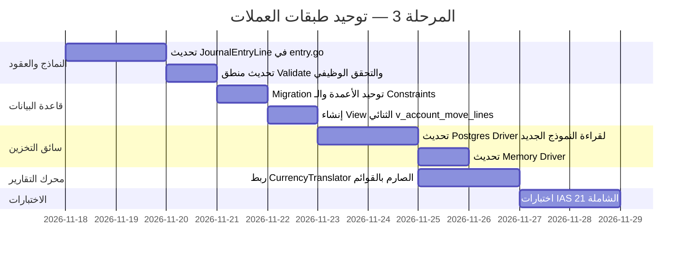

# المرحلة 3: توحيد طبقات العملات الثلاث ونموذج سطر القيد
## Phase 3: Three-Tier Currency Architecture & Journal Entry Line Modernization

**القرار المعماري:** القرار 2 — ما هو عمق تعدد العملات المعتمد؟  
**الأولوية:** 🟠 عالية (High Priority)  
**التبعيات:** المرحلة 1 (الدفتر المستمر وقيد الأرصدة)  
**المراجع المعيارية:**

| المعيار | الصلة |
| :--- | :--- |
| **IAS 21** — آثار التغيرات في أسعار صرف العملات الأجنبية | الفصل الصارم بين العملة الوظيفية، عملة المعاملة، وعملة العرض |
| **ASC 830 (FASB)** — Foreign Currency Matters | تحديد العملة الوظيفية للمنشأة وقواعد الترجمة المالية |
| **ISO 4217** | الترميز المعياري للعملات والوحدات الكسرية (Minor Units) |
| **IAS 21.28–32** | الاعتراف بفروق العملة (Realized & Unrealized FX Gains/Losses) في P&L |
| **IAS 21.39** | ترحيل فروق ترجمة القوائم المالية إلى احتياطي ترجمة العملات الأجنبية (FCTR) في OCI |

---

## 1. الأهداف (Objectives)

1. **إعادة هيكلة نموذج سطر القيد (`JournalEntryLine`)**:
   - إزالة التشويش والازدواجية الناتجة عن تضارب 5 حقول للمبالغ والعملات (`Debit`, `Credit`, `AmountCurrency`, `ForeignAmount`, `Currency`).
   - اعتماد نموذج ثنائي الطبقات حصراً في سطر القيد: (طبقة المعاملة + طبقة العملة الوظيفية).
2. **تكريس الفصل الثلاثي المعياري (Three-Tier Currency Separation)**:
   - **الطبقة 1: عملة المعاملة (`Transaction Currency`)**: تسجل في سطر القيد كما وردت في الفاتورة أو المستند دون إلزامية توازن القيد بها عند تباين عملات الأطراف.
   - **الطبقة 2: العملة الوظيفية (`Functional Currency`)**: عملة المنشأة القانونية، وبها يتحقق التوازن الحسابي الصارم إجبارياً ($\sum \text{FunctionalDebit} = \sum \text{FunctionalCredit}$).
   - **الطبقة 3: عملة العرض (`Presentation Currency`)**: طبقة ديناميكية تماماً لا تُحفظ في قيود اليومية، بل تُولد آنياً في محرك التقارير (`reporting`) والتوحيد (`consolidation`) عبر `CurrencyTranslator`.
3. **تنظيف مخطط قاعدة البيانات (`PostgreSQL Schema`)**:
   - توحيد أعمدة `account_move_lines` لمنع تخزين قيم متناقضة.
   - إنشاء هجرة تدريجية تحافظ على التوافق مع القيود السابقة (Backward Compatibility).

---

## 2. تحليل الفجوة الحالية في سطر القيد

### 2.1 الوضع الراهن في `internal/posting/entry.go`
```go
type JournalEntryLine struct {
    Debit               financialtypes.Money // وظيفية أم معاملة؟ غير واضح
    Credit              financialtypes.Money // وظيفية أم معاملة؟ غير واضح
    TransactionAmount   financialtypes.Money // عملة المعاملة
    TransactionCurrency string
    ExchangeRate        decimal.Decimal      // سعر الصرف
    FunctionalDebit     financialtypes.Money // العملة الوظيفية
    FunctionalCredit    financialtypes.Money
    AmountCurrency      financialtypes.Money // حقل موروث مكرر (Odoo-style legacy)
    Currency            string               // رمز عملة حر وغير محدد
    ForeignAmount       decimal.Decimal      // حقل مكرر
}
```

### 2.2 مخاطر الوضع الراهن
- عند التحقق من التوازن في `Validate()`، يضطر المحرك للبحث التخميني: هل القيد معبأ بحقول `FunctionalDebit` أم `Debit` أم `AmountCurrency`؟
- في قاعدة بيانات PostgreSQL (`account_move_lines`)، توجد أعمدة:
  - `debit numeric(28,4)`
  - `credit numeric(28,4)`
  - `amount_currency numeric(28,4)`
  - `currency_id varchar(3)`
  - `transaction_amount_minor bigint`
  - `transaction_currency varchar(3)`
  - `functional_debit_minor bigint`
  - `functional_credit_minor bigint`
  مما يسمح بنشوء حالات تناقض بين المبالغ الكسرية (`minor`) والمبالغ العشرية (`numeric`).

---

## 3. المعالجة التقنية المفصلة (Technical Implementation)

### 3.1 إعادة هيكلة `JournalEntryLine` في Go

**الملف:** `internal/posting/entry.go`

```go
package posting

import (
    "errors"
    "time"

    financialtypes "accounting_engine/internal/types"
    "github.com/google/uuid"
    "github.com/shopspring/decimal"
)

var (
    ErrMissingTransactionCurrency = errors.New("transaction currency is required")
    ErrMissingFunctionalCurrency  = errors.New("functional currency is required")
    ErrInvalidExchangeRate        = errors.New("exchange rate must be strictly positive")
    ErrFunctionalBalanceMismatch  = errors.New("functional debit and credit totals must balance")
)

// JournalEntryLine يمثل سطر القيد المحاسبي المحرّر والمطابق لمعيار IAS 21
// المرجع: IAS 21.21–23 — القياس الأولي بعملة المعاملة والتحويل للعملة الوظيفية
type JournalEntryLine struct {
    ID               uuid.UUID
    CompanyID        uuid.UUID
    AccountID        uuid.UUID

    // ==========================================
    // الطبقة 1: عملة المعاملة (Transaction Layer)
    // ==========================================
    TransactionCurrency string          // رمز العملة الدولي ISO 4217 (e.g., "EUR", "USD")
    TransactionAmount   decimal.Decimal // المبلغ الأصلي (موجب للمدين، سالب للدائن)

    // ==========================================
    // الطبقة 2: العملة الوظيفية (Functional Layer)
    // ==========================================
    ExchangeRate     decimal.Decimal      // سعر الصرف المعتمد (Transaction -> Functional)
    FunctionalDebit  financialtypes.Money // المبلغ المدين بالعملة الوظيفية للمنشأة
    FunctionalCredit financialtypes.Money // المبلغ الدائن بالعملة الوظيفية للمنشأة

    // ==========================================
    // الأبعاد التحليلية والمرجعية (Dimensions & Matching)
    // ==========================================
    PartnerID        *uuid.UUID
    CostCenterID     *uuid.UUID
    ProjectID        *uuid.UUID
    SegmentID        *uuid.UUID
    BusinessUnitID   *uuid.UUID
    MatchingNumber   string
    ReconciledAmount decimal.Decimal

    // ==========================================
    // الحقول الموروثة (Deprecated for Backward Compatibility)
    // ==========================================
    // Deprecated: استخدم FunctionalDebit و FunctionalCredit
    Debit financialtypes.Money
    // Deprecated: استخدم FunctionalDebit و FunctionalCredit
    Credit financialtypes.Money
    // Deprecated: استخدم TransactionAmount و TransactionCurrency
    AmountCurrency financialtypes.Money
}
```

---

### 3.2 قواعد التحقق والتوازن الصارم (`Validate`)

**الملف:** `internal/posting/entry.go`

```go
func (e JournalEntry) Validate() error {
    if len(e.Lines) < 2 {
        return ErrMinimumLines
    }

    var totalFunctionalDebit decimal.Decimal
    var totalFunctionalCredit decimal.Decimal
    var functionalCurrency string

    for i, line := range e.Lines {
        // 1. تسوية الحقول الموروثة إن وجدت لضمان التوافق العكسي
        resolvedLine, err := normalizeLineCurrencies(line)
        if err != nil {
            return fmt.Errorf("line %d: %w", i, err)
        }

        // 2. التحقق من وجود عملة المعاملة والمبلغ
        if resolvedLine.TransactionCurrency == "" {
            return ErrMissingTransactionCurrency
        }
        if resolvedLine.TransactionAmount.IsZero() {
            return ErrInvalidEntry
        }

        // 3. التحقق من سعر الصرف
        if !resolvedLine.ExchangeRate.IsPositive() {
            return ErrInvalidExchangeRate
        }

        // 4. التحقق من العملة الوظيفية
        lineCurr := resolvedLine.FunctionalDebit.Currency()
        if lineCurr == "" {
            lineCurr = resolvedLine.FunctionalCredit.Currency()
        }
        if lineCurr == "" {
            return ErrMissingFunctionalCurrency
        }
        if functionalCurrency == "" {
            functionalCurrency = lineCurr
        } else if functionalCurrency != lineCurr {
            return financialtypes.ErrCurrencyMismatch
        }

        // 5. التحقق من جانب واحد فقط (مدين أو دائن)
        hasDebit := !resolvedLine.FunctionalDebit.Amount().IsZero()
        hasCredit := !resolvedLine.FunctionalCredit.Amount().IsZero()
        if (hasDebit && hasCredit) || (!hasDebit && !hasCredit) {
            return ErrLineMustHaveOneSide
        }

        totalFunctionalDebit = totalFunctionalDebit.Add(resolvedLine.FunctionalDebit.Amount())
        totalFunctionalCredit = totalFunctionalCredit.Add(resolvedLine.FunctionalCredit.Amount())
    }

    // 6. التحقق المحاسبي الإلزامي: توازن العملة الوظيفية
    // المرجع: IAS 21 — توازن دفاتر الأستاذ العام بالعملة الوظيفية للمنشأة
    if !totalFunctionalDebit.Equal(totalFunctionalCredit) {
        return ErrFunctionalBalanceMismatch
    }

    return nil
}
```

---

### 3.3 هجرة قاعدة البيانات — Migration `202611100010`

**ملف:** `storage/postgres/migrations/202611100010_currency_layers_unification.sql`

```sql
-- المرحلة 3: توحيد طبقات العملات في جدول account_move_lines
-- المرجع: IAS 21 و ASC 830

-- 1. التأكد من تعبئة الأعمدة الوظيفية من الأعمدة القديمة للبيانات السابقة
UPDATE account_move_lines
SET
    transaction_currency = COALESCE(NULLIF(transaction_currency, ''), currency_id, 'SAR'),
    transaction_amount_minor = CASE 
        WHEN transaction_amount_minor <> 0 THEN transaction_amount_minor
        WHEN debit > 0 THEN (debit * 100)::bigint
        ELSE -(credit * 100)::bigint
    END,
    functional_debit_minor = CASE 
        WHEN functional_debit_minor <> 0 THEN functional_debit_minor
        ELSE (debit * 100)::bigint
    END,
    functional_credit_minor = CASE 
        WHEN functional_credit_minor <> 0 THEN functional_credit_minor
        ELSE (credit * 100)::bigint
    END
WHERE functional_debit_minor = 0 AND functional_credit_minor = 0;

-- 2. إضافة قيد التحقق الصارم على أسطر القيد
ALTER TABLE account_move_lines
    DROP CONSTRAINT IF EXISTS chk_currency_layers_consistency;

ALTER TABLE account_move_lines
    ADD CONSTRAINT chk_currency_layers_consistency
    CHECK (
        exchange_rate > 0 AND
        transaction_currency IS NOT NULL AND
        (
            (functional_debit_minor > 0 AND functional_credit_minor = 0) OR
            (functional_credit_minor > 0 AND functional_debit_minor = 0)
        )
    );

-- 3. إنشاء View للتقارير والاستعلامات يسهل القراءة بالقيم العشرية
CREATE OR REPLACE VIEW v_account_move_lines_dual_currency AS
SELECT
    aml.move_id,
    aml.line_id,
    aml.company_id,
    aml.account_id,
    aml.partner_id,
    -- طبقة المعاملة
    aml.transaction_currency,
    (aml.transaction_amount_minor::numeric / (10 ^ c_tx.minor_units)) AS transaction_amount,
    aml.exchange_rate,
    -- طبقة العملة الوظيفية
    comp.functional_currency,
    (aml.functional_debit_minor::numeric / (10 ^ c_fn.minor_units)) AS functional_debit,
    (aml.functional_credit_minor::numeric / (10 ^ c_fn.minor_units)) AS functional_credit
FROM account_move_lines aml
JOIN companies comp ON comp.id = aml.company_id
JOIN currencies c_tx ON c_tx.code = aml.transaction_currency
JOIN currencies c_fn ON c_fn.code = comp.functional_currency;
```

**ملف التراجع:** `storage/postgres/migrations/202611100010_currency_layers_unification.down.sql`

```sql
DROP VIEW IF EXISTS v_account_move_lines_dual_currency;
ALTER TABLE account_move_lines DROP CONSTRAINT IF EXISTS chk_currency_layers_consistency;
```

---

### 3.4 حسم طبقة عملة العرض (`Presentation Currency Layer`)

> [!IMPORTANT]
> **قاعدة معمارية قاطعة:**  
> عملة العرض (`Presentation Currency`) **لا تُخزن أبداً** في أسطر القيود المحاسبية (`account_move_lines`)، لأن أسعار الصرف متغيرة، والترجمة تخضع لمتطلبات تاريخية ومتوسطة وإقفال بحسب طبيعة الحساب وفق **IAS 21**.

المعالجة المعتمدة:
1. يتم استخراج ميزان المراجعة والقوائم المالية أولاً **بالعملة الوظيفية**.
2. إذا طُلب التقرير بعملة عرض مختلفة عن العملة الوظيفية، يتم تمرير النتائج فوراً إلى `CurrencyTranslator` في `internal/reporting/currency_translation.go`:
   - الأصول والالتزامات: تُترجم بسعر الإقفال التاريخي لتاريخ القائمة (`ClosingRate`).
   - حقوق الملكية ورأس المال: تُترجم بالأسعار التاريخية لنشوء البنود (`HistoricalRate`).
   - الإيرادات والمصروفات: تُترجم بمتوسط أسعار الفترة (`AverageRate`).
   - الفارق المحاسبي الناتج يرحل تلقائياً إلى بند **احتياطي ترجمة العملات الأجنبية (FCTR)** في حقوق الملكية وقائمة الدخل الشامل (OCI).

---

## 4. خطة الاختبارات (Test Plan)

| # | سيناريو الاختبار | النوع | المعيار المرجعي | معيار القبول |
| :---: | :--- | :--- | :--- | :--- |
| T3.1 | قيد متعدد العملات (فاتورة بالـ EUR وذمة بالـ SAR) يتوازن وظيفياً | Unit | IAS 21 | يقبل الترحيل بنجاح |
| T3.2 | قيد غير متوازن وظيفياً رغم توازن عملة المعاملة | Unit | IAS 21 | يرفض مع `ErrFunctionalBalanceMismatch` |
| T3.3 | قيد بسعر صرف سالب أو صفر | Unit | ISO 4217 | يرفض مع `ErrInvalidExchangeRate` |
| T3.4 | ترجمة ميزانية عمومية لعملة عرض مختلفة تحسب FCTR بدقة | Integration | IAS 21.39 | $\Delta \text{Assets} - \Delta \text{Liab} = \text{FCTR}$ |
| T3.5 | التحقق من التوافق العكسي مع القيود القديمة ذات الحقول الموروثة | Regression | — | جميع القيود القديمة تقرأ بدون أخطاء |
| T3.6 | اختبار إعادة تقييم البنود النقدية بالعملة الأجنبية لنهاية الفترة | Integration | IAS 21.28 | توليد قيد فروق عملة محققة/غير محققة |

---

## 5. تسلسل المهام والجدول الزمني



---

## 6. معايير الاكتمال (Definition of Done)

- [ ] نموذج `JournalEntryLine` يعتمد صراحة على طبقة المعاملة وطبقة العملة الوظيفية.
- [ ] الحقول القديمة المكررة تم تعليمها كـ `Deprecated` مع وجود محول تسوية تلقائي.
- [ ] التحقق من التوازن يُلزم تطابق المدين والدائن بالعملة الوظيفية حصراً.
- [ ] مخطط PostgreSQL يطبق قيد النزاهة `chk_currency_layers_consistency`.
- [ ] عملة العرض مطبقة كـ Dynamic Projection فقط عبر `CurrencyTranslator`.
- [ ] جميع اختبارات T3.1 — T3.6 تمر بنجاح دون أي تراجع.

