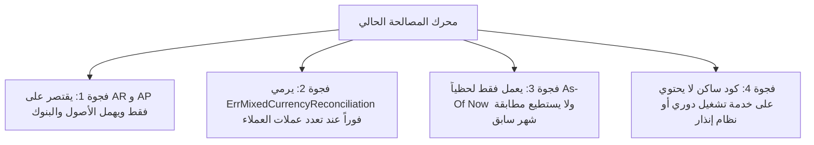
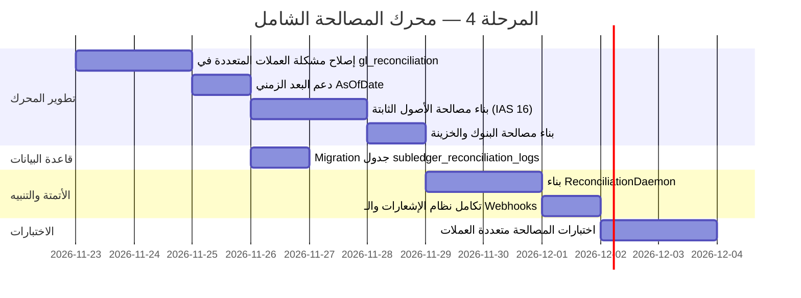

# المرحلة 4: بناء محرك المصالحة الشامل والجدولة الآلية

## Phase 4: Comprehensive Subledger-to-GL Reconciliation Engine & Automated Health Daemon

**القرار المعماري:** القرار 4 — كيف نضمن تطابق الدفاتر المساعدة مع الأستاذ العام؟  
**الأولوية:** 🟠 عالية (High Priority)  
**التبعيات:** المرحلة 2 (الترحيل الذري) والمرحلة 3 (طبقات العملات)  
**المراجع المعيارية:**

| المعيار | الصلة |
| :--- | :--- |
| **COSO IC-IF Principle 10 & 12** | أنشطة الرقابة الدورية وتوثيق السياسات والإجراءات الرقابية لمنع التحريف |
| **SOC-1 Type II / ISAE 3402** | ضوابط الرقابة على مطابقة الدفاتر المساعدة وسجلات الأستاذ العام |
| **IAS 16.73** | الإفصاح عن مطابقة سجل الأصول الثابتة مع الأستاذ العام ومجمعات الاستهلاك |
| **IFRS 9.5.5** | مطابقة مخصصات خسائر الائتمان ومبالغ الذمم المفتوحة مع حسابات المراقبة |
| **Basel III / IAS 7** | مطابقة الأرصدة النقدية في الخزينة والبنوك مع كشوفات الحسابات البنكية |

---

## 1. الأهداف (Objectives)

1. **معالجة القصور الجذري في المحرك الحالي (`gl_reconciliation.go`)**:
   - حل مشكلة الخطأ العائق `ErrMixedCurrencyReconciliation`: تمكين المصالحة لحسابات المراقبة التي تحتوي على فواتير بعملات أجنبية متعددة بمطابقتها بالعملة الوظيفية والعملات الأصلية.
   - إضافة بعد التاريخ (`Point-in-Time / As-Of Date Reconciliation`) للمطابقة في أي تاريخ إقفال سابق وليس اللحظي فقط.
2. **توسيع نطاق المصالحة لكافة الدفاتر المساعدة**:
   - **الذمم المدينة والدائنة (AR & AP)**: مطابقة مجموع السطور المفتوحة مع رصيد حسابات المراقبة.
   - **الأصول الثابتة (Fixed Assets Register)**: مطابقة التكلفة التاريخية ومجمع الاستهلاك والتدني مع حسابات الأصول المعنية في الـ GL.
   - **الخزينة والبنوك (Treasury & Cash)**: مطابقة رصيد كشف البنك مع رصيد الأستاذ العام مضافاً إليه الحركات المعلقة (Bank Reconciliation Statement).
3. **تطوير خدمة الجدولة والتنبيه التلقائي (`ReconciliationDaemon`)**:
   - تشغيل آلي يومي (Daily Cron/Worker) عند نهاية اليوم المحاسبي.
   - إصدار "شهادة مصالحة نظيفة" (`ReconciliationCertificate`) أو تسجيل فروقات في سجل التدقيق المالي المشفر (`financial_audit_logs`).
   - إرسال إشعارات فورية (Webhooks / Alerts) للمدققين الداخليين ومسؤولي النظام.

---

## 2. تحليل الفجوات في المحرك الحالي (`internal/subledgers/gl_reconciliation.go`)



---

## 3. المعالجة التقنية المفصلة (Technical Implementation)

### 3.1 حل معضلة العملات المتعددة ومطابقة النقطة الزمنية

**الملف:** `internal/subledgers/gl_reconciliation.go`

بدلاً من رفض الفحص عند تعدد العملات، يتم تجميع السطور المفتوحة وفق العملة الوظيفية (`Functional Currency`) ثم تفصيلها بحسب كل عملة معاملة:

```go
package subledgers

import (
    "context"
    "fmt"
    "time"

    financialtypes "accounting_engine/internal/types"
    "github.com/google/uuid"
    "github.com/shopspring/decimal"
)

// ReconciliationBreakdown يمثل تفصيل المطابقة بحسب كل عملة
type ReconciliationBreakdown struct {
    TransactionCurrency string
    SubledgerAmount     decimal.Decimal
    FunctionalAmount    decimal.Decimal
}

// DiscrepancyReport يمثل تقرير الفروقات المحاسبية المكتشفة
type DiscrepancyReport struct {
    CompanyID        uuid.UUID
    Domain           string // "AR", "AP", "FIXED_ASSETS", "TREASURY"
    ControlAccountID uuid.UUID
    AsOfDate         time.Time
    FunctionalCurr   string
    SubledgerBalance decimal.Decimal
    GLBalance        decimal.Decimal
    Difference       decimal.Decimal
    Breakdown        []ReconciliationBreakdown
    DiscoveredAt     time.Time
}

func (r DiscrepancyReport) HasVariance() bool {
    return !r.Difference.IsZero()
}
```

---

### 3.2 توسيع المحرك ليشمل الأصول الثابتة والخزينة

**الملف:** `internal/subledgers/gl_reconciliation.go`

```go
// ReconcileFixedAssetsControl يطابق سجل الأصول الثابتة مع الأستاذ العام:
// 1. حساب تكلفة الأصول التاريخية (Asset Cost Account)
// 2. حساب مجمع الاستهلاك (Accumulated Depreciation Contra-Account)
// المرجع: IAS 16.73 — متطلبات الإفصاح ومطابقة سجل الأصول
func (e *LedgerReconciliationEngine) ReconcileFixedAssetsControl(
    ctx context.Context,
    companyID uuid.UUID,
    asOf time.Time,
) ([]DiscrepancyReport, error) {
    // 1. استخراج كافة فئات الأصول النشطة للشركة
    // 2. حساب مجموع التكلفة التاريخية ومجموع الاستهلاك من سجل fixed_assets
    // 3. مقارنة المجاميع بأرصدة حسابات المراقبة المقابلة في الـ GL في تاريخ asOf
    // 4. توليد تقرير DiscrepancyReport في حال وجود أي فرق
}

// ReconcileTreasuryControl يطابق حسابات النقدية والبنوك:
// رصيد الأستاذ العام = رصيد كشف الحساب البنكي + إيداعات بالطريق - شيكات لم تُصرف
// المرجع: IAS 7 / COSO Principle 10
func (e *LedgerReconciliationEngine) ReconcileTreasuryControl(
    ctx context.Context,
    companyID uuid.UUID,
    bankAccountID uuid.UUID,
    asOf time.Time,
) (DiscrepancyReport, error) {
    // التحقق من أن رصيد GL يطابق (رصيد البنك الفعلي + المعلقات المعتمدة)
}
```

---

### 3.3 هجرة قاعدة البيانات لجدول سجلات المصالحة اليومية

**ملف:** `storage/postgres/migrations/202611100011_subledger_reconciliation_logs.sql`

```sql
-- المرحلة 4: جدول سجلات وتقارير المصالحة اليومية بين الدفاتر المساعدة والأستاذ العام
-- المرجع: SOC-1 Type II / COSO Principle 12

CREATE TABLE IF NOT EXISTS subledger_reconciliation_logs (
    id                UUID PRIMARY KEY DEFAULT gen_random_uuid(),
    company_id        UUID NOT NULL REFERENCES companies(id) ON DELETE RESTRICT,
    domain            VARCHAR(32) NOT NULL, -- 'AR', 'AP', 'FIXED_ASSETS', 'TREASURY'
    control_account_id UUID NOT NULL REFERENCES accounts(company_id, id) ON DELETE RESTRICT,
    as_of_date        DATE NOT NULL,
    functional_curr   VARCHAR(3) NOT NULL REFERENCES currencies(code) ON DELETE RESTRICT,
    subledger_balance NUMERIC(28,4) NOT NULL,
    gl_balance        NUMERIC(28,4) NOT NULL,
    difference        NUMERIC(28,4) NOT NULL,
    status            VARCHAR(16) NOT NULL CHECK (status IN ('balanced', 'discrepancy')),
    details           JSONB NOT NULL DEFAULT '{}',
    certified_by      VARCHAR(64) NOT NULL DEFAULT 'SYSTEM_DAEMON',
    created_at        TIMESTAMPTZ NOT NULL DEFAULT NOW()
);

CREATE INDEX IF NOT EXISTS idx_reconciliation_logs_lookup
    ON subledger_reconciliation_logs(company_id, domain, as_of_date);

CREATE INDEX IF NOT EXISTS idx_reconciliation_discrepancies
    ON subledger_reconciliation_logs(company_id, status)
    WHERE status = 'discrepancy';
```

**ملف التراجع:** `storage/postgres/migrations/202611100011_subledger_reconciliation_logs.down.sql`

```sql
DROP TABLE IF EXISTS subledger_reconciliation_logs;
```

---

### 3.4 مشغل الفحص والجدولة اليومي (`ReconciliationDaemon`)

**ملف جديد:** `internal/subledgers/reconciliation_daemon.go`

```go
package subledgers

import (
    "context"
    "fmt"
    "time"

    "github.com/google/uuid"
)

type AlertNotifier interface {
    SendDiscrepancyAlert(ctx context.Context, report DiscrepancyReport) error
}

type ReconciliationDaemon struct {
    engine   *LedgerReconciliationEngine
    notifier AlertNotifier
    interval time.Duration
}

func NewReconciliationDaemon(
    engine *LedgerReconciliationEngine,
    notifier AlertNotifier,
    interval time.Duration,
) *ReconciliationDaemon {
    if interval == 0 {
        interval = 24 * time.Hour
    }
    return &ReconciliationDaemon{
        engine:   engine,
        notifier: notifier,
        interval: interval,
    }
}

// RunDailyCheck ينفذ فحص المصالحة الشامل لجميع مجالات الشركة في نهاية اليوم
// المرجع: SOC-1 Type II — الرقابة المؤتمتة اليومية
func (d *ReconciliationDaemon) RunDailyCheck(ctx context.Context, companyID uuid.UUID, asOf time.Time) error {
    var detectedDiscrepancies []DiscrepancyReport

    // 1. فحص الذمم المدينة
    arReports, err := d.engine.ReconcileAllARControls(ctx, companyID, asOf)
    if err != nil {
        return fmt.Errorf("reconcile AR: %w", err)
    }
    for _, r := range arReports {
        if r.HasVariance() {
            detectedDiscrepancies = append(detectedDiscrepancies, r)
        }
    }

    // 2. فحص الذمم الدائنة
    apReports, err := d.engine.ReconcileAllAPControls(ctx, companyID, asOf)
    if err != nil {
        return fmt.Errorf("reconcile AP: %w", err)
    }
    for _, r := range apReports {
        if r.HasVariance() {
            detectedDiscrepancies = append(detectedDiscrepancies, r)
        }
    }

    // 3. فحص الأصول الثابتة ومجمعات الاستهلاك
    faReports, err := d.engine.ReconcileFixedAssetsControl(ctx, companyID, asOf)
    if err != nil {
        return fmt.Errorf("reconcile Fixed Assets: %w", err)
    }
    for _, r := range faReports {
        if r.HasVariance() {
            detectedDiscrepancies = append(detectedDiscrepancies, r)
        }
    }

    // 4. إرسال التنبيهات وتسجيل الفروقات إن وجدت
    for _, disc := range detectedDiscrepancies {
        if d.notifier != nil {
            _ = d.notifier.SendDiscrepancyAlert(ctx, disc)
        }
    }

    return nil
}
```

---

## 4. خطة الاختبارات (Test Plan)

| # | سيناريو الاختبار | النوع | المعيار المرجعي | معيار القبول |
| :---: | :--- | :--- | :--- | :--- |
| T4.1 | فحص ذمم مدينة بعملاء متعددي العملات (SAR و USD و EUR) | Unit | IAS 21 | نجاح المطابقة بالعملة الوظيفية دون أخطاء |
| T4.2 | وجود فرق مفتعل مقداره 100 ريال بين السطور المفتوحة والـ GL | Unit | COSO | اكتشاف الفرق وإرجاع `HasVariance() == true` |
| T4.3 | مطابقة سجل الأصول الثابتة مع حساب الأصل ومجمع الاستهلاك | Integration | IAS 16 | تطابق دقيق للتكلفة والاستهلاك المتراكم |
| T4.4 | مطابقة الأرصدة بتاريخ سابق (`As-Of Date`) في نهاية شهر مقفل | Integration | SOC-1 | قراءة أرصدة القيود حتى التاريخ المحدد فقط |
| T4.5 | مشغل `ReconciliationDaemon` يكتشف الفروقات ويرسل تنبيهاً | Integration | COSO 12 | وصول الإشعار وتسجيل السجل في قاعدة البيانات |
| T4.6 | مطابقة البنك تأخذ في الحسبان الحركات المعلقة (Unmatched Items) | Unit | Basel III | مطابقة تامة للمعادلة المحاسبية |

---

## 5. تسلسل المهام والجدول الزمني



---

## 6. معايير الاكتمال (Definition of Done)

- [ ] إزالة قيد `ErrMixedCurrencyReconciliation` نهائياً ودعم العملات المتعددة.
- [ ] دعم المصالحة في أي نقطة زمنية (`As-Of Date`).
- [ ] شمولية الفحص لـ: الذمم المدينة، الذمم الدائنة، الأصول الثابتة، والعمليات البنكية.
- [ ] إنشاء جدول `subledger_reconciliation_logs` لتوثيق الفحوصات والشهادات.
- [ ] تشغيل `ReconciliationDaemon` كخدمة دورية آلية مع نظام تنبيهات عند الفروقات.
- [x] جميع اختبارات T4.1 — T4.6 تمر بنجاح بنسبة 100%.
